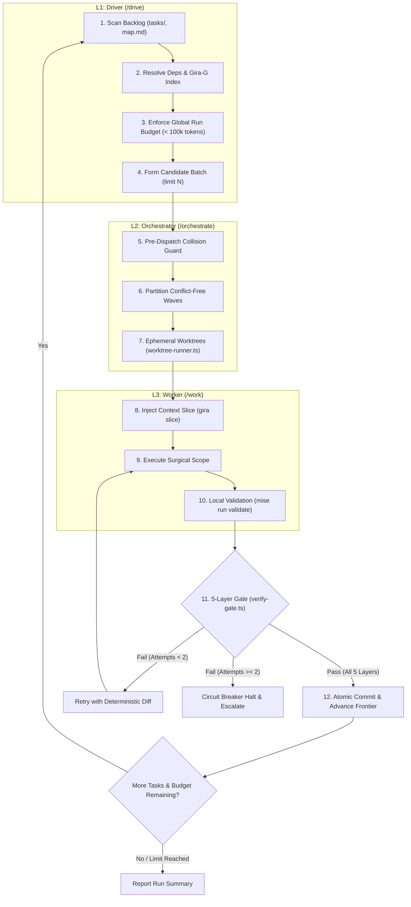

# /drive — Continuous Autonomous Backlog Driver

Autonomous backlog execution driver for G-Ingá. Governs multi-task continuous delivery by scanning pending task backlogs, extracting minimal architectural context slices via Gira-G (`gira`), delegating wave batching to `/orchestrate`, and driving micro-execution via `/work` with strict token frugality and anti-thrashing circuit breakers.

## Non-Negotiable Invariants

1. **Tokens Per Verified Task:** Context extraction must be strictly minimal. Never dump full repository context. Query Gira-G architectural indexing (`docs/architecture/macro-map.json`) via `gira locate`, `gira slice`, and `gira impact` to furnish workers with bounded slices.
2. **Strict Token Budgets:** Enforce global run ceiling (< 100,000 tokens across an entire `/drive` session) and ticket ceilings (< 25,000 tokens per standard ticket).
3. **Layered Separation of Concerns:**
   - **L1 Driver (`/drive`):** Backlog discovery, dependency ordering, global budget tracking, and batch circuit breakers.
   - **L2 Orchestrator (`/orchestrate`):** OODA batch management, collision detection (`verify-gate.ts`), wave partitioning (`orchestrate-runner.ts`), ephemeral worktrees (`worktree-runner.ts`), and 5-layer verification gates.
   - **L3 Worker (`/work`):** Scoped surgical task execution within isolated ephemeral worktrees using Gira-G contextual slices.
4. **Anti-Thrashing Circuit Breaker (ADR 0002 §5, Trigger E3):** Halt immediately if any task fails verification gate twice consecutively without new evidence. Escalate to the repository owner.
5. **Deterministic Verification Vocabulary:** Every check in all task records and gates must strictly use `pass`, `fail`, `blocked`, or `not run`.
6. **No Direct Unverified Commits:** Commits are sealed atomically only after all 5 layers of the Autonomous Verification Gate pass with 100% compliance.

## 3-Layer Autonomous Execution Architecture



## Parameters and Modes

The `/drive` driver accepts configuration flags to control execution scope and resource limits:

- `--limit <N>`: Maximum number of tasks to process in a single continuous drive session (default: `3`).
- `--dry-run`: Scan backlog, resolve dependencies, query Gira-G slices, and output execution plan without executing workers or modifying files.
- `--tag <tag>`: Filter candidate tasks by tag or parent spec (e.g., `--tag standard`, `--tag v1`).
- `--max-tokens <tokens>`: Maximum token budget for the continuous run (default: `100000`).

## Execution Protocol

### Step 1: Backlog Discovery & Dependency Ordering (L1)

- Inspect `git status`, HEAD SHA, and branch.
- Scan active and open tasks in `tasks/*.md` (and `map.md` if present).
- Filter tasks by eligibility:
  - Schema is valid (`schema: task/1`).
  - Status is `active` or `draft` (or unblocked pending implementation).
  - Dependencies listed in `depends_on` are fully `verified` or `accepted`.
- Sort candidates topologically by dependency depth and limit candidates to `--limit <N>`.

### Step 2: Gira-G Architectural Context Extraction (L1 / L3)

To ensure zero token waste and maximize tokens per verified task, query the Gira-G architectural index (`docs/architecture/macro-map.json`):

- **Locate Target Nodes:**

  ```bash
  gira locate "<component-or-task>" --index docs/architecture/macro-map.json
  ```

- **Extract Bounded Context Slices:**

  ```bash
  gira slice "<node-id>" --tier summary --index docs/architecture/macro-map.json
  ```

- **Compute Impact Scope:**

  ```bash
  gira impact "<node-id>" --index docs/architecture/macro-map.json
  ```

Inject only the minimal contextual slice and bounded contract boundaries into the worker execution prompts.

### Step 3: Concurrency Wave Partitioning & Orchestration (L2)

Hand off candidate tasks to `/orchestrate` via the auto-runner harness:

- **Pre-Dispatch Collision Check:** Run `tools/gate/verify-gate.ts --pre-dispatch` across declared file scopes.
- **Wave Partitioning:** Automatically partition colliding tasks into sequential waves using `orchestrate-runner.ts` (`partitionWaves`).
- **Worktree Isolation:** Launch concurrent workers in isolated ephemeral Git worktrees (`tools/gate/worktree-runner.ts`) to eliminate index locking.

### Step 4: Scoped Worker Execution (L3)

Each worker subagent executes `/work` within its designated worktree:

- Follow ceremony tier procedures (typically `standard`).
- Confine edits strictly to declared `In scope` files.
- Validate locally: `mise run validate` and `mise run test`.
- Report completion with `status: ready_for_gate`.

### Step 5: Verification Gate & Circuit Breaker (L2)

Evaluate completed worker deliverables through the 5-layer Autonomous Verification Gate:

- **Layer 1:** Scope and diff verification (`git diff --name-only`).
- **Layer 2:** Deterministic exit codes (`mise run validate` == 0).
- **Layer 3:** Task ancestry and Git lineage check (`git merge-base --is-ancestor`).
- **Layer 4:** Quantitative thresholds (0 lint errors, 100% schema match).
- **Layer 5:** Anti-thrashing circuit breaker:
  - If a task fails verification twice without new evidence, trigger immediate **Circuit Breaker Halt** (ADR 0002 §5, Trigger E3).
  - Halt entire drive execution, mark the failing task `blocked`, and escalate to the repository owner.

### Step 6: Atomic Seal & Continuous Handoff

- Update task records with verification results.
- Seal atomic commit per resolved ticket wave.
- Decrement token budget by recorded consumption.
- If remaining budget > 0 and eligible tasks remain under `--limit`, repeat from Step 1.
- Otherwise, exit cleanly and output the final `/drive` session ledger.

## References

- Ceremony Tiers & Routing: [ADR 0002](../../../docs/decisions/0002-ceremony-tiers-and-routing.md)
- Artifact Schema Contracts: [docs/artifact-contracts.md](../../../docs/artifact-contracts.md)
- OODA Orchestration Harness: [.agents/skills/orchestrate/SKILL.md](../orchestrate/SKILL.md)
- Autonomous Verification Gate: [.agents/skills/orchestrate/gate.md](../orchestrate/gate.md)
- Auto-Wave Runner: [tools/gate/orchestrate-runner.ts](../../../tools/gate/orchestrate-runner.ts)
- Ephemeral Worktrees: [tools/gate/worktree-runner.ts](../../../tools/gate/worktree-runner.ts)
- Token Budget Guardrail: [tools/eval/token_budget_guard.ts](../../../tools/eval/token_budget_guard.ts)
- Gira-G Macro Architecture Map: [docs/architecture/macro-map.json](../../../docs/architecture/macro-map.json)
