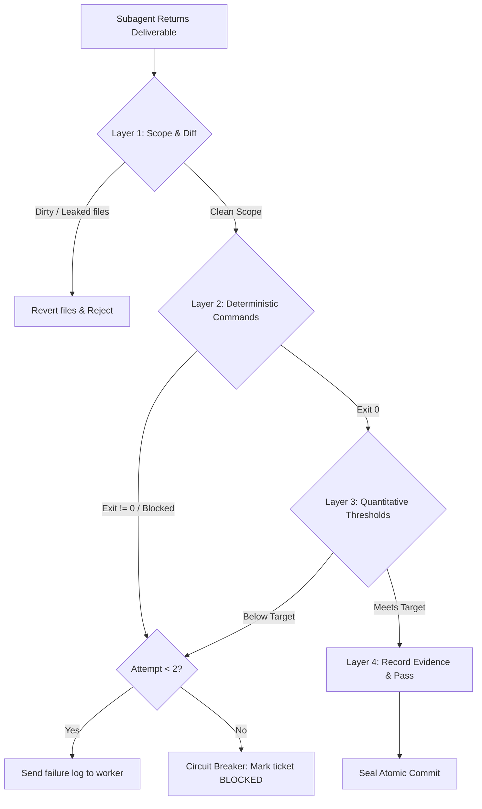

# Autonomous Verification Gate (Go/No-Go Specification)

The Autonomous Verification Gate is the deterministic barrier between subagent code generation and repository persistence. In G-Ingá, self-attestation is rejected: no commit or state advancement occurs without passing all applicable gate layers.

---

## 1. The 4 Verification Layers



---

## 2. Layer 1: Scope & Diff Gate (Structural Integrity)

Before executing test suites or reading reports, the orchestrator inspects the physical Git changes.

### Commands

```bash
git status --porcelain
git diff --name-only HEAD
```

### Invariants & Evaluation

1. **Scope Boundary:** Every modified, added, or deleted path MUST match the declared `In scope:` patterns of the dispatched ticket.
2. **Untracked Leakage:** No untracked scratch files, dumps, `.DS_Store`, or node artifacts outside `.gitignore`.
3. **Secret Scan:** No staged or unstaged diff contains patterns matching API keys, `.env` files, or access tokens.

### Rollback Procedure on Violation

If a subagent touches files outside its authorized boundary:

```bash
git checkout HEAD -- <unauthorized-file>
git clean -fd <unauthorized-directory>
```

The ticket evaluation for Layer 1 is immediately marked `fail` with the message:
`Gate 1 violation: Touched out-of-scope files: [<file1>, <file2>]`.

---

## 3. Layer 2: Deterministic Command & Exit Code Gate

Layer 2 executes canonical repo verification suites. Subagents must never be asked *"did tests pass?"*; the orchestrator runs the checks directly.

### Strict 4-Value Vocabulary

Every check reports exactly one of four values:

- `pass`: Command exited with status `0` and verified the target behavior.
- `fail`: Command exited with status `1` (or non-zero test failure).
- `blocked`: Command exited with status `2` (environment, missing toolchain, network failure, shallow clone).
- `not run`: Check was not executed in this pass.

### Mandatory Checks Invariant

Exit code 0 is strictly forbidden if any mandatory check (e.g. `mise run validate`, baseline test suite, or required type check) was skipped, unrun, or blocked.

### Standard Commands

```bash
# Repository validation (linters, links, mermaid, schemas)
mise run validate

# Repository test suite
mise run test
```

### Exit Code Mapping Table

| Exit Code | Gate Status | Action |
|---|---|---|
| `0` | `pass` | Proceed to Layer 3. |
| `1` | `fail` | Increment failure counter. If counter < 2, feed stderr/stdout to worker for retry. |
| `2` | `blocked` | Environment block. Halt ticket execution; escalate to human owner. |
| `127` | `blocked` | Missing binary / command toolchain. Escalate to human owner. |

---

## 4. Layer 3: Quantitative Metric & Threshold Gate

For tickets specifying numerical acceptance thresholds (e.g., benchmark latency, test coverage delta, token budgets, or schema adherence):

| Metric Category | Target Threshold | Evaluation Command / Check |
|---|---|---|
| **Linter / Schema Issues** | `0` issues | `mise run validate` exits `0` with 0 warnings |
| **Test Regressions** | `0` regressions | `mise run test` reports 0 failed tests |
| **Token Economy** | Main context $< 25\text{k}$ tokens | Main transcript inspection |
| **Subagent Execution Attempts** | $\le 2$ attempts | Circuit breaker counter |

If any threshold is not satisfied, the gate evaluates to `fail`.

---

## 5. Layer 4: Anti-Thrashing Circuit Breaker (ADR 0002 §5, Trigger E3)

To prevent infinite loops and runaway token expenditure:

- Maintain an attempt counter per ticket: `attempts: N`.
- **First Failure ($N = 1$):**
  - Extract the exact compiler, linter, or test failure output.
  - Send corrective instructions to the subagent with the factual failure report.
- **Second Failure ($N = 2$):**
  - **Circuit Breaker Trips:** Immediately halt subagent execution.
  - Revert dirty changes: `git checkout HEAD . && git clean -fd`.
  - Mark ticket status as `blocked` in the roadmap (`map.md`).
  - Escalate to the repository owner with:
    - Root cause failure log.
    - Attempt history ($N = 2$).
    - Recommended human action or architectural disambiguation.
  - Advance the orchestrator to other independent unblocked tickets on the frontier.
