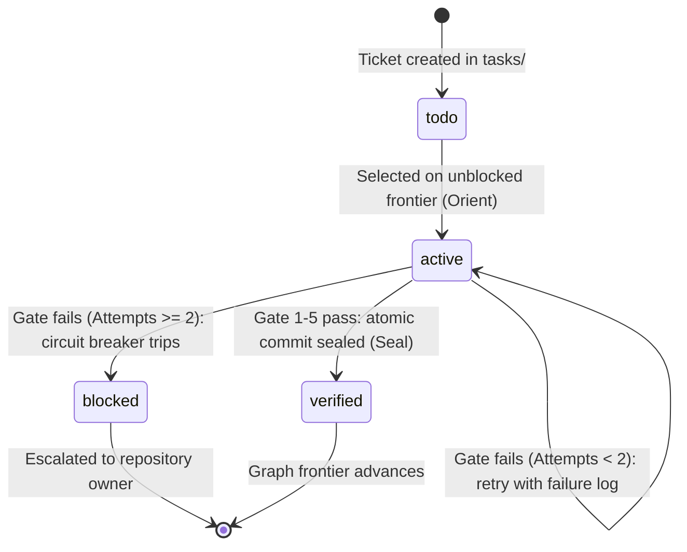

# OODA Orchestration Cycle Reference

This document formalizes the state machine, graph transitions, and operational loop of the `/orchestrate` harness.

---

## 1. Ticket Lifecycle State Machine

A ticket moves through deterministic states across the OODA loop:



### State Definitions

| State | Definition | Permitted Next States |
|---|---|---|
| `todo` | Recorded in `tasks/`; not started; dependencies may or may not be met. | `active` |
| `active` | Work in progress: selected on the frontier, dispatched to a worker, or under gate verification. | `verified`, `blocked`, `active` (retry) |
| `verified` | All 5 gate layers passed (`exit 0`), commit sealed, ticket closed. | Final state |
| `blocked` | Circuit breaker tripped after 2 failures, or environmental block (`exit 2`). | Human intervention (owner) |

---

## 2. The 6 Phases of the Loop

### Phase 1: OBSERVE

- Read the repository status (`git status --porcelain`, current branch, HEAD).
- Read the task backlog (`tasks/`).
- Parse dependencies: identify tickets whose prerequisites are completely in state `verified`.

### Phase 2: ORIENT

- Prioritize unblocked tickets (e.g. foundational ADRs/schemas before implementation, core libraries before CLI wrappers).
- Transition selected ticket to `active`.
- Extract constraints and define the **Verification Contract** (allowed paths, required commands, metrics).

### Phase 3: DECIDE

- Determine concurrent batch size $N$ ($\le 4$).
- Partition workload so that no two concurrent subagents have overlapping files in their `In scope:` paths.
- Prepare the structured prompts using `subagent-prompt.md`.

### Phase 4: ACT

- Invoke subagents concurrently via `invoke_subagent`.
- Set `Workspace: "inherit"` (shared working tree) only when the pre-dispatch collision check passes; otherwise isolate workers (`Workspace: "share"` when isolated worktrees are supported, or `tools/gate/worktree-runner.ts`) and merge worktree results back into the orchestrator branch before Gate Layer 1.
- Cease tool execution to let subagents run asynchronously until system wakeup.

### Phase 5: GATE

- Intercept subagent completion.
- Run Layer 1 (Scope & Diff Gate): verify zero out-of-scope edits.
- Run Layer 2 (Deterministic Command Gate): execute test suites; map exit codes strictly (`pass`, `fail`, `blocked`).
- Run Layer 3 (Task Ancestry & Lineage Gate): verify task record ancestry via `git merge-base --is-ancestor`.
- Run Layer 4 (Quantitative Metric Gate): verify zero regressions, linter errors, or latency thresholds.
- Run Layer 5 (Circuit Breaker): if failures $\ge 2$, escalate and mark `blocked`.

### Phase 6: SEAL & ADVANCE

- Mark ticket `verified` in `tasks/`.
- Commit changes atomically:

```bash
git add <scope-files>
git commit -m "<type>(<scope>): <summary> [resolves #ID]"
```

- Re-evaluate the dependency graph to uncover newly unblocked tickets.
- Repeat until the entire graph is `verified` or `blocked`.
