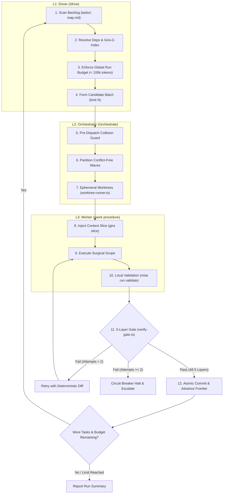

# /drive — Continuous Autonomous Backlog Driver

Autonomous backlog execution driver for G-Ingá. Governs multi-task continuous delivery by scanning pending task backlogs, extracting minimal architectural context slices via Gira-G (`gira`), delegating wave batching to `/orchestrate`, and driving micro-execution through workers that follow the `/work` procedure with strict token frugality and anti-thrashing circuit breakers.

## Non-Negotiable Invariants

1. **Tokens Per Verified Task:** Context extraction must be strictly minimal. Never dump full repository context. Query Gira-G architectural indexing (`docs/architecture/macro-map.json`) via `gira locate`, `gira slice`, and `gira impact` to furnish workers with bounded slices.
2. **Strict Token Budgets:** Enforce global run ceiling (< 100,000 tokens across an entire `/drive` session) and ticket ceilings (< 25,000 tokens per standard ticket).
3. **Layered Separation of Concerns:**
   - **L1 Driver (`/drive`):** Backlog discovery, dependency ordering, global budget tracking, and batch circuit breakers.
   - **L2 Orchestrator (`/orchestrate`):** OODA batch management, collision detection (`verify-gate.ts`), wave partitioning (`orchestrate-runner.ts`), ephemeral worktrees (`worktree-runner.ts`), and 5-layer verification gates.
   - **L3 Worker (`/work` procedure):** Scoped surgical task execution within isolated ephemeral worktrees using Gira-G contextual slices.
4. **Anti-Thrashing Circuit Breaker (ADR 0002 §5, Trigger E3):** Halt immediately if any task fails verification gate twice consecutively without new evidence. Escalate to the repository owner.
5. **Deterministic Verification Vocabulary:** Every check in all task records and gates must strictly use `pass`, `fail`, `blocked`, or `not run`.
6. **No Direct Unverified Commits:** Commits are sealed atomically only after all 5 layers of the Autonomous Verification Gate pass with 100% compliance.

## 3-Layer Autonomous Execution Architecture



## Parameters and Modes

The `/drive` driver accepts configuration flags to control execution scope and resource limits:

- `--limit <N>`: Maximum number of tasks to process in a single continuous drive session (default: `3`).
- `--dry-run`: Scan backlog, resolve dependencies, query Gira-G slices, and output execution plan without executing workers or modifying files.
- `--tag <tag>`: Filter candidate tasks by tag or parent spec (e.g., `--tag standard`, `--tag v1`).
- `--max-tokens <tokens>`: Maximum token budget for the continuous run (default: `100000`).

## Execution Protocol

### Step 1: Backlog Discovery & Dependency Ordering (L1)

- Inspect `git status`, HEAD SHA, and branch.
- **Reconcile the parent checkpoint first.** If the parent record has a `## Checkpoint`, compare it with Git using "Reconcile on start" in [resume.md](../work/resume.md). On any mismatch of branch, HEAD, worktree or child statuses, report the difference and stop: dispatch no child until it is reconciled. Record the reconciliation as `pass`, or as `blocked` with the mismatch.
- Scan active and open tasks in `tasks/*.md` (and `map.md` if present).
- Filter tasks by eligibility:
  - Schema is valid (`schema: task/1`).
  - Status is `todo` or `active`, or `blocked` with its `## Blockers` entry resolved (contract §3.3: `blocked --> active` when the blocker is resolved). Never `completed`, `verified`, `accepted`, `partial` or `cancelled`.
  - Dependencies listed in `depends_on` are fully `verified` or `accepted`.
- Sort candidates topologically by dependency depth and limit candidates to `--limit <N>`.

### Step 2: Gira-G Architectural Context Extraction (L1 / L3)

To ensure zero token waste and maximize tokens per verified task, query the Gira-G architectural index (`docs/architecture/macro-map.json`).

**Availability check:** run `command -v gira`. The `gira` CLI is not part of this repository and may be absent (for example in cloud sessions). If it is unavailable, apply the fallback below instead of the commands that follow.

**Staleness check (only when `gira` is available):** the map is indexed at the SHA anchor in `gira.yaml` (`repositories[].sha`). Before the queries below, run from the repository root:

```bash
anchor=$(sed -n 's/^ *sha: *"\([0-9a-f]\{40\}\)".*/\1/p' gira.yaml | head -n 1)
git cat-file -e "${anchor}^{commit}" && git rev-list --count "${anchor}..HEAD" -- .claude/skills .agents/skills tools docs/decisions
```

- The map is **stale** when the count is greater than 0: the anchor isn't `HEAD` and at least one commit since the anchor touches `.claude/skills/`, `.agents/skills/`, `tools/` or `docs/decisions/`. A count of 0, which includes an anchor equal to `HEAD`, means the map is current.
- A stale map may still be read. Report it as `gira map: stale (anchor <short-sha>, <count> commits)` in the session ledger and in every worker prompt that carries a slice from it.
- If `anchor` is empty or `git cat-file` fails (for example in a shallow clone), record the staleness check as `not run` with that reason and report the map's freshness as unknown.
- When the fallback below applies, no map is read and this check isn't run.
- Regenerate the map only where `gira` is on `PATH` (today the owner's machine), with `gira index`, never by editing the anchor alone. Commit `gira.yaml` and `docs/architecture/macro-map.json` together in the same commit.
- This check stays a `/drive` instruction: it is not a validator layer, and nothing under `tools/` parses `gira.yaml` (ADR 0007 item 3). Gira-G output, stale or current, is context for workers and never evidence for a gate.

- **Locate Target Nodes:**

  ```bash
  gira locate "<component-or-task>" --index docs/architecture/macro-map.json
  ```

- **Extract Bounded Context Slices:**

  ```bash
  gira slice "<node-id>" --tier summary --index docs/architecture/macro-map.json
  ```

- **Compute Impact Scope:**

  ```bash
  gira impact "<node-id>" --index docs/architecture/macro-map.json
  ```

Inject only the minimal contextual slice and bounded contract boundaries into the worker execution prompts.

**Fallback when `gira` is unavailable:** record the Gira-G context step as `not run` with the note `gira not installed`. It is `not run`, not `blocked`, because the step only enriches context and no gate depends on it. Derive the context slice deterministically from the task record instead: the files listed under `In scope:` in its `## Objective`, plus the contract sections its acceptance criteria cite. Do not substitute another tool.

### Step 3: Concurrency Wave Partitioning & Orchestration (L2)

Hand off candidate tasks to `/orchestrate` via the auto-runner harness:

- **Pre-Dispatch Collision Check:** Run `tools/gate/verify-gate.ts --pre-dispatch` across declared file scopes.
- **Wave Partitioning:** Automatically partition colliding tasks into sequential waves using `orchestrate-runner.ts` (`partitionWaves`).
- **Worktree Isolation:** Launch concurrent workers in isolated ephemeral Git worktrees (`tools/gate/worktree-runner.ts`) to eliminate index locking.

### Step 4: Scoped Worker Execution (L3)

Each worker subagent follows the `/work` procedure within its designated worktree, dispatched on **Sonnet** (`model` set to `sonnet`, per the shared role-to-model table in `.claude/skills/work/references/model-policy.md`). Its dispatch prompt tells it to read and follow `.claude/skills/work/references/procedure.md` (ADR 0010); it never invokes the `work` skill, which is user-invoked:

- Follow ceremony tier procedures (typically `standard`).
- Confine edits strictly to declared `In scope` files.
- Validate locally: `mise run validate` and `mise run test`.
- Leave the task record at `completed` (or `verified` only when the §3.4 rule holds at `verified_at`) and report the deliverable to the orchestrator for the gate.

### Step 5: Verification Gate & Circuit Breaker (L2)

Evaluate completed worker deliverables through the 5-layer Autonomous Verification Gate:

- **Layer 1:** Scope and diff verification (`git diff --name-only`).
- **Layer 2:** Deterministic exit codes (`mise run validate` == 0).
- **Layer 3:** Task ancestry and Git lineage check (`git merge-base --is-ancestor`).
- **Layer 4:** Quantitative thresholds (0 lint errors, 100% schema match).
- **Layer 5:** Anti-thrashing circuit breaker:
  - If a Sonnet worker fails verification once, retry on **Opus** (`model` set to `opus`, per `.claude/skills/work/references/model-policy.md`).
  - If the task then fails verification a second time without new evidence, trigger immediate **Circuit Breaker Halt** (ADR 0002 §5, Trigger E3).
  - Halt entire drive execution, mark the failing task `blocked`, and escalate to the repository owner.

### Step 6: Atomic Seal & Continuous Handoff

- Update task records with verification results. Each child's verification note records the model that ran it and its token totals in the ADR 0006 vocabulary — `tokens_input`, `tokens_output`, `cache_read_tokens`, `cache_write_tokens`, `total_tokens`, `cache_read_ratio` — with no prompt content (per `.claude/skills/work/references/model-policy.md`).
- Seal atomic commit per resolved ticket wave.
- After each verified child, replace the parent's `## Checkpoint` with the done, active and blocked children, the branch and HEAD, and the copy-pasteable resume prompt, using the template in [resume.md](../work/resume.md). The next child to run is the first eligible child after the last one in `done`.
- Decrement token budget by recorded consumption.
- If remaining budget > 0 and eligible tasks remain under `--limit`, repeat from Step 1.
- Otherwise, run the handoff report and merge rule in "Session Close and Merge" ([procedure.md](../work/references/procedure.md)), then exit cleanly and output the final `/drive` session ledger with that report.

## References

- Ceremony Tiers & Routing: [ADR 0002](../../../docs/decisions/0002-ceremony-tiers-and-routing.md)
- Subagent Model Policy: [.claude/skills/work/references/model-policy.md](../work/references/model-policy.md)
- Artifact Schema Contracts: [docs/artifact-contracts.md](../../../docs/artifact-contracts.md)
- OODA Orchestration Harness: [.claude/skills/orchestrate/SKILL.md](../orchestrate/SKILL.md)
- Autonomous Verification Gate: [.claude/skills/orchestrate/gate.md](../orchestrate/gate.md)
- Auto-Wave Runner: [tools/gate/orchestrate-runner.ts](../../../tools/gate/orchestrate-runner.ts)
- Ephemeral Worktrees: [tools/gate/worktree-runner.ts](../../../tools/gate/worktree-runner.ts)
- Token Budget Guardrail: [tools/eval/token_budget_guard.ts](../../../tools/eval/token_budget_guard.ts)
- Gira-G Macro Architecture Map: [docs/architecture/macro-map.json](../../../docs/architecture/macro-map.json)
- Harness Extensions Beyond V1 (Gira-G optional, staleness): [ADR 0007](../../../docs/decisions/0007-harness-extensions-beyond-v1.md)
