# Handoff Harness Proposal (Epic > Feature > Task via CLI)

Date: 2026-10-13. Status: proposal, no implementation.
Depends on: `docs/research/2026-10-13-multi-host-orchestration-analysis.md`.
Conforms to: `docs/artifact-contracts.md`, ADR 0002, ADR 0006, ADR 0007.

## 1. Goal

Manage work as Epic > Feature > Task through a thin shell CLI (`ginga`) that emits minimal context packets. Human is the manual air-gap bridge for Antigravity. Automation is allowed for `claude -p` and `opencode run`. No `agy` auto-spawn.

Mapping without breaking `schema: task/1`:

- Epic = heavy parent (spec + SC rows).
- Feature = standard child, or new heavy if it needs its own spec.
- Task = atomic standard child (one worktree, one PR).
- `epic:` key, if added, is optional metadata (no major bump). A real `schema: epic/1` requires a major migration per contract section 8.

### 1.1 Hierarchy

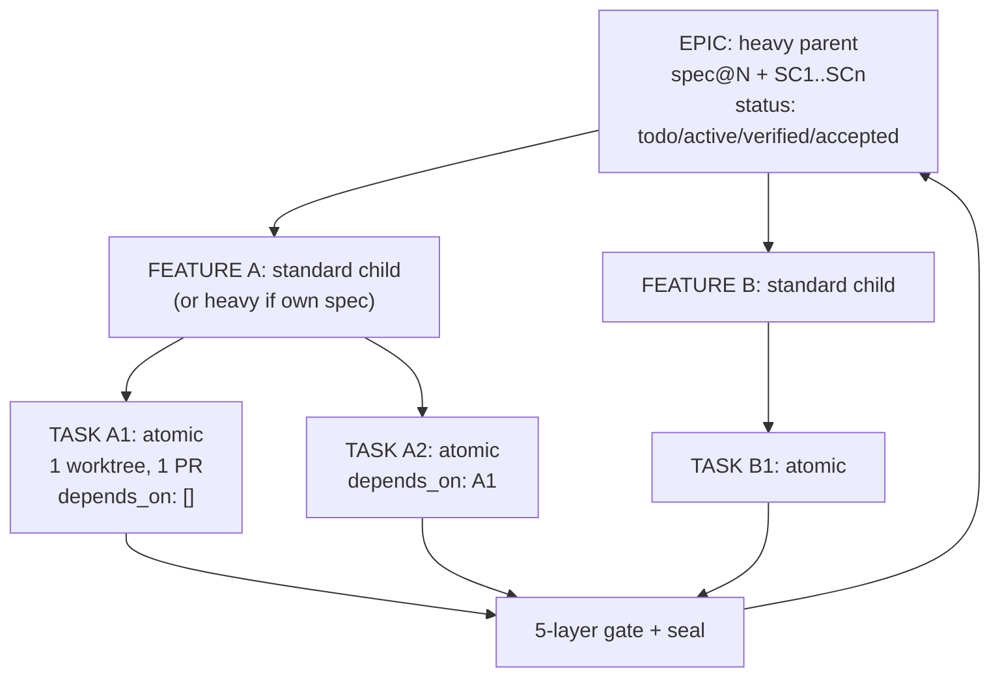

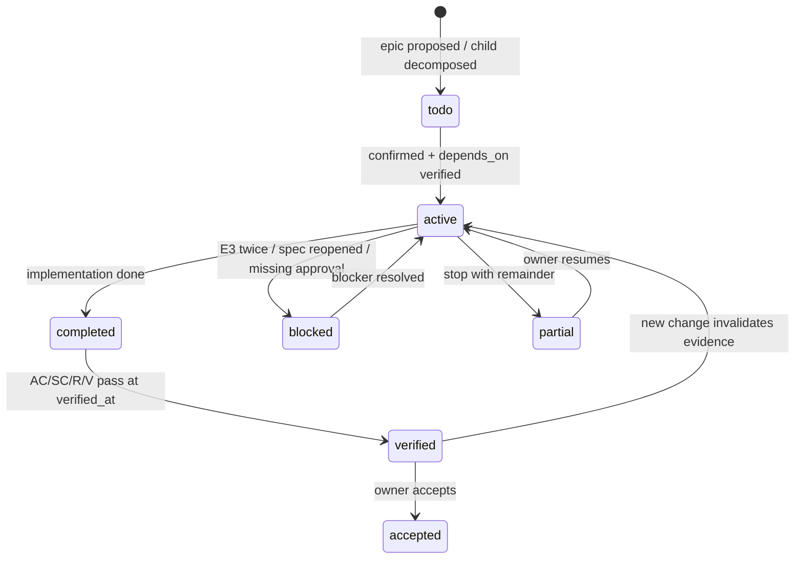

## 2. End-to-end flow

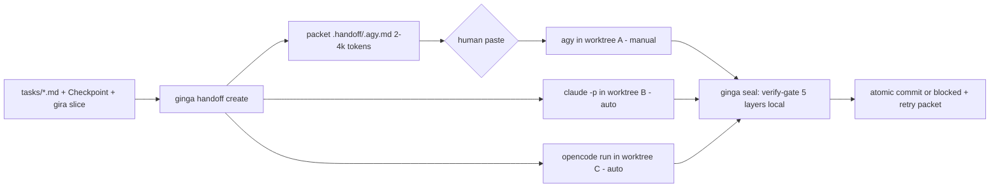

### 2.1 Packet lifecycle

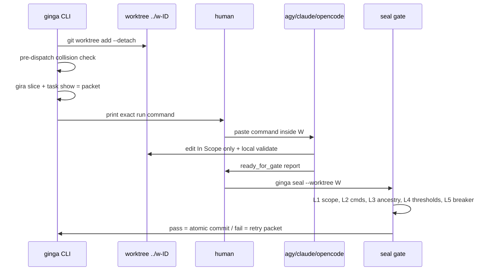

## 3. CLI surface

```text
ginga epic create/show <id>
ginga feature list --epic <id> --json
ginga task show <id> --json        # frontmatter + Objective + ACs + Checkpoint only
ginga task claim <id>              # todo->active with depends_on guard
ginga slice <node> --tier summary  # gira slice wrapper, deterministic fallback if gira absent
ginga handoff create <task-id> --host agy|claude|opencode --model <id>
ginga handoff seal <task-id> --worktree <path>
ginga budget                       # input/output/cache totals, cost, attempts, gate results
```

`create` provisions `git worktree add --detach ../w-<id>`, runs `verify-gate.ts --pre-dispatch` across declared scopes, partitions colliding workers via `partitionWaves`, and writes the packet. `seal` runs the 5-layer gate locally (scope/diff, exit codes, ancestry `git merge-base --is-ancestor`, thresholds, E3 breaker) and only then commits atomically.

### 3.1 Worktree isolation

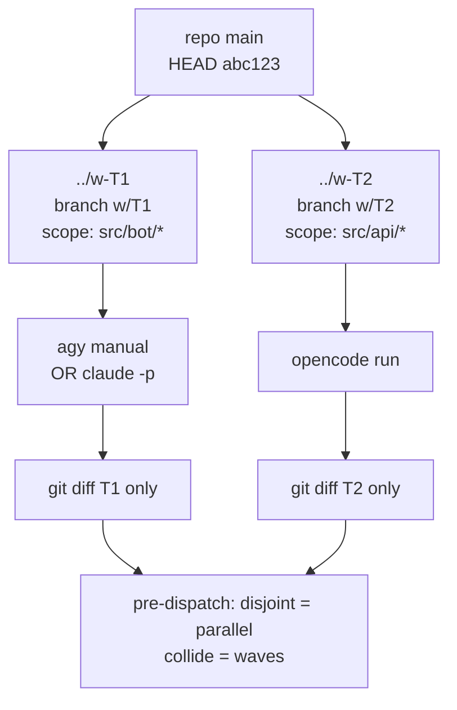

No shared `.git/index.lock` contention. Dirty tree in one worktree never blocks another. Setup SLA <500ms per worker.

### 3.2 Router

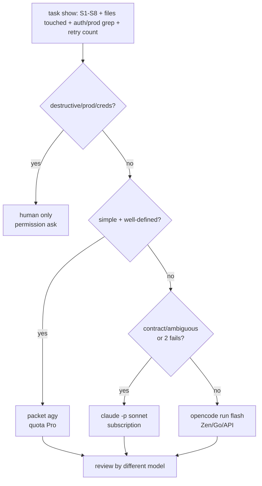

Deterministic inputs, not vibes: file count from `glob`, `auth|payment|prod` from `grep`, failure count from gate log, diff size from `git diff --stat`.

## 4. Packet format (`.handoff/<id>.agy.md`)

Reuse `.agents/skills/orchestrate/subagent-prompt.md` sections:

1. `# TASK: <id> — <title>` + expected branch/HEAD/worktree.
2. `## Mission` (1-3 sentences from task Objective).
3. `## In Scope` (allowed paths only; Gate 1 rolls back the rest).
4. `## Out of scope + forbidden` (`.env`, credentials, `push --force`, `deploy`, `rm -rf`, prod DB writes).
5. `## Slice` (bounded `gira slice` summary + cited contracts; never full repo).
6. `## Acceptance + commands` (`mise run validate`, `mise run test`, zero-regression thresholds).
7. `## Current Checkpoint` (done/next/open/revalidate; enables fresh-window resume without transcript).
8. `## Required return`:

```text
status: ready_for_gate
ticket: #<id>
summary: <1-2 sentences>
modified_files:
  - <path>
checks_run:
  - <check>: pass/fail/blocked
```

No secrets, no full transcripts, no `map.md` dump.

### 4.1 Token rationale

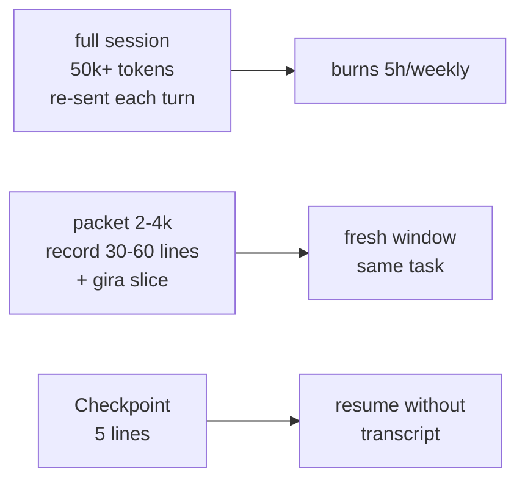

## 5. Exact AGY invocation (printed by `create`)

`create` prints a copy-paste block. By reference (no shell-quoting blowup):

```text
handoff: .handoff/2026-10-12-bot-02.agy.md (3.1k tokens)
worktree: ../w-bot-02 (clean, branch w/bot-02)

--- paste inside ../w-bot-02 ---
cd ../w-bot-02
agy --model gemini-3.8-flash-medium --effort medium -p "Leia ../G-Inga/.handoff/2026-10-12-bot-02.agy.md e execute a TASK. Restrinja-se ao In Scope."
--- end ---

return:
  ginga seal 2026-10-12-bot-02 --worktree ../w-bot-02
```

Variants: TUI `agy --model ...` without `-p` for hard debug; `--mode plan` for Epic/Feature planning; `--output-format json` on a second run to import `tokens_input/output` totals into `ginga budget` without storing prompts.

### 5.1 Fresh-window resume

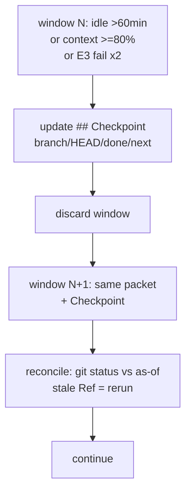

## 6. Host policy

- Allowed auto: `ginga -> claude -p` (same-vendor scripting, burns Pro window faster), `ginga -> opencode run -m <provider/model>` (Zen/Go/API key/OpenRouter/local).
- Manual only: `agy -p` / AGY app by human reading the packet. No OpenCode-to-`agy` bash tool, no `ginga --host agy` spawn, no account rotation.
- Orchestrated Gemini = `google/*` via `GEMINI_API_KEY` inside OpenCode, not consumer login.

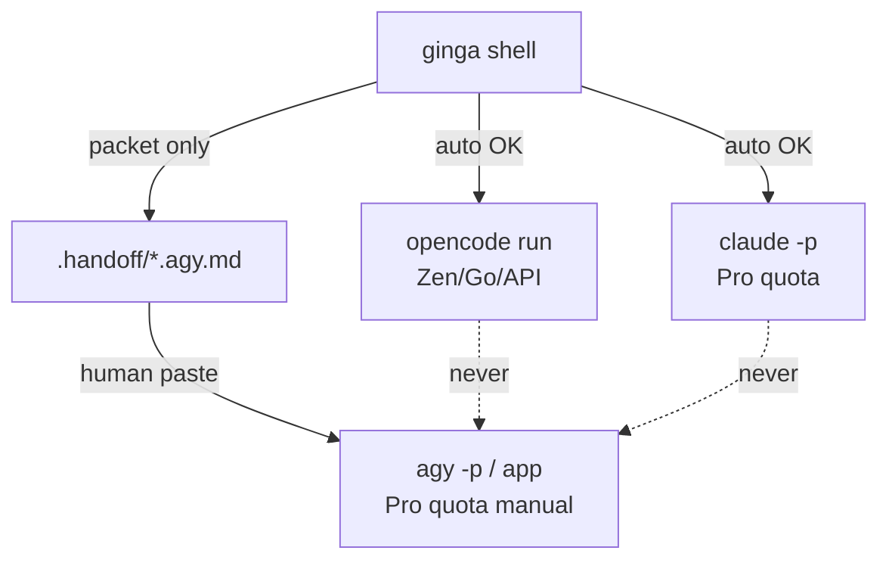

## 6.1 Roles: agent vs ginga vs gate (how we use it)

Ginga is not the gate. Three layers with strict separation:

- **Agent (e.g. Claude Opus 5.5 as main orchestrator):** reasons, runs OODA, decides batches, dispatches subagents, calls ginga/gate via `Bash`. Keeps root context <25k. Never trusts worker self-attestation.
- **Ginga CLI (proposed thin shell, no LLM):** executes deterministically — worktree provision, `task show/claim`, `gira slice`, `handoff create/seal`, `budget`. Calls the gate, never replaces it.
- **Gate (`tools/gate/verify-gate.ts`):** deterministic judge, 5 layers, exit `0=pass, 1=fail, 2=blocked`. No commit or frontier advance without `pass`.

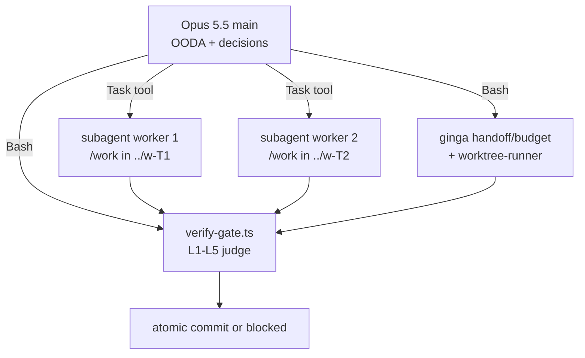

### 6.2 Example session (Opus 5.5 main)

**Step 1 — OBSERVE:** `git status --porcelain; git log -n 1 --oneline`; read `tasks/<id>.md` Objective + ACs + Checkpoint.

**Step 2 — DECIDE (collision first):**

```bash
bun tools/gate/verify-gate.ts --pre-dispatch --declared-scopes '{"w-bot02":["src/bot/"],"w-api03":["src/api/"]}'
bun tools/gate/orchestrate-runner.ts --batch batch.json --dry-run
```

**Step 3 — ACT:** two `Task(general)` dispatches in one turn with `subagent-prompt.md` format (Mission + In Scope + contract + slice + `ready_for_gate` return). For AGY, main runs `ginga handoff create <id> --host agy` and prints the paste block instead of spawning.

**Step 4 — GATE (judge, run by main, not workers):**

```bash
bun tools/gate/verify-gate.ts --scope "src/bot/" --cmd "mise run test" --attempt 1
git diff --name-only HEAD
git merge-base --is-ancestor <B1> <verified_at>
```

**Step 5 — SEAL:** `ginga seal <id> --worktree ../w-<id>` commits only on L1-L5 `pass`; fail once = retry with log, twice = `blocked` + owner escalate (E3).

Permissions: allow `Bash(ginga *, verify-gate *, worktree *)`, ask on `rm/push/deploy/creds`; `PostToolUse` hook re-runs gate after `Edit`. AGY output returns via human paste + `budget import` of `--output-format json` totals only (no prompts, ADR 0006).

## 7. Verification gate and observability

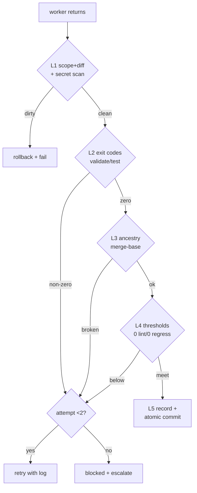

- JSONL per call: `project_id, task_id, coordinator, executor, provider, model, in/out/cache_tokens, cost, attempts, errors, latency, tool_calls, test_result, human_intervention, fallback_reason, cost_per_approved_task`.
- Reuse `tools/gate/verify-gate.ts`, `tools/eval/token_budget_guard.ts` (<25k standard, <100k drive run, warn at 80%), `opencode stats`, Claude `/usage` + OTel, Zen `monthly limit`, `AI Credit Overages: Never`.
- Kill on 3 retries, no green diff in 15 min, or cost >2x estimate. `permission.bash` denies `rm *`, `push`, `deploy`, credential paths. Secret scan in Gate 1.

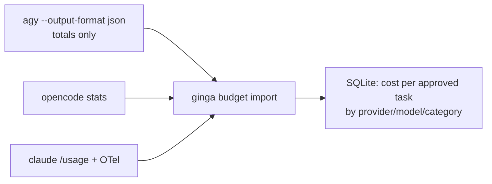

## 8. Delivery phases

- P1: `task show/slice/budget` read-only + packet generator spike (1 task, 1 host).
- P2: `seal` with 5-layer gate reuse.
- P3: simple router (`task show` signals S1-S8 + retry count determine `agy|claude|opencode`).
- P4: two parallel worktrees, disjoint scopes only, throughput vs cost measured.
- P5: budget caps, fallback order, dashboard answering cost-per-approved-task.
- P6: expand only on measured gain.

Acceptance for P1: one real standard task delivered via packet + `seal` with all gate layers `pass`, worktree clean, no secret in packet or log.

## 9. Token economy vs quality (no quality loss)

Rule: cheap default, expensive only on measured signal, quality proven by gate — never by self-attestation.

### 9.1 Cost per approved task (hypotheses to calibrate, USD→BRL R$5.40, no tax)

Consumption hypotheses (H1-H3, to replace with experiment §9.3): simple 50k in + 15k out, intermediate 200k in + 60k out, complex 800k in + 250k out.

| Category | Cheap route | Escalate to expensive when | Quality guard |
|---|---|---|---|
| Planning/architecture | OpenCode GLM/Qwen Flash packet | >3 services or auth/payment involved | owner approves plan; ADR required if architectural |
| Exploration | Haiku/Flash read-only explore | >50 files or >100k context | read-only; no edits allowed |
| Well-defined implementation | AGY Flash packet (Pro quota) | 2 gate fails | Gate 1-5 `pass`; review by different model |
| API integration | Zen Qwen/DeepSeek Flash | ambiguous schema or 401/429 twice | contract test `pass`; creds never in packet |
| Tests | cheapest Flash / local Qwen 30B | coverage does not move | coverage delta + 0 regressions |
| Bug fix | Sonnet subscription | stacktrace >100 lines or race suspected | repro fails first, passes after |
| Refactor | Sonnet + lint hooks | diff >500 lines | full suite + diff read V1 |
| Security review | different model than author | secret/PII found | human mandatory; blocked on fail |
| Hard debug | Opus/thinking subscription | no hypothesis in 2 turns | hypothesis logged per attempt |
| Final validation | Sonnet + `validate+test` | any red | human merge; no auto `push/deploy` |

Illustrative math (from §9 hypotheses, not a promise): simple via DeepSeek Flash off-peak ≈ R$0.09 vs Sonnet API ≈ R$1.35; intermediate ≈ R$0.32 vs R$5.40; complex ≈ R$1.32 vs R$21.60. Subscription quotas (Pro 5h/weekly, AGY 5h/weekly) are not convertible to tokens — they are time windows, tracked separately in `ginga budget` as window-burn, not MTok.

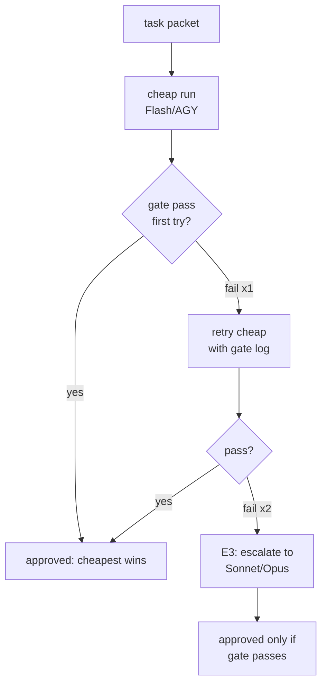

### 9.2 Quality non-negotiables

- Gate 5 layers local on every seal; `pass/fail/blocked/not run` vocabulary only; exit 0 forbidden with skipped mandatory checks.
- `verified_at` + `B1` ancestry via `git merge-base --is-ancestor`; stale `Ref` = rerun.
- Secrets: pattern scan in L1, `env:{VAR}` only, JSONL stores totals, never prompts.
- Destructive/prod/creds/permission changes: `permission: ask` + explicit owner approval, never auto-delegated.

### 9.3 One-week calibration experiment (5 real tasks x 3 runs)

Pick 5 real standard tasks (1 simple endpoint, 1 integration, 1 bot + persistence + tests, 1 bug fix, 1 refactor). For each, run 3 routes with the same packet: (A) AGY Flash manual, (B) OpenCode cheap Flash via API, (C) Claude Sonnet subscription. One worktree per run, `seal` after each.

Record per run: `in/out/cache_tokens` (where exposed), wall time, gate result, attempts, human interventions, rework lines, final `pass/fail`, window-burn (Pro/AGY 5h bar before/after).

| task_id | route | tokens in/out | time | attempts | interventions | gate | rework | approved |
|---|---|---|---|---|---|---|---|---|
| ... | A/B/C | ... | ... | 1-3 | 0-N | pass/fail | +lines | yes/no |

Decision rules after 15 runs:

- If cheap (A/B) first-try `pass` >= 4/5 with <= 1 intervention each: cheap becomes default for that category; expensive only on 2nd fail.
- If cheap `pass` <= 2/5 or rework >2x vs Sonnet: category stays on Sonnet; cheap only for exploration/draft.
- If parallel 2-worktree throughput <1.6x or cost >1.4x single: keep sequential until P5 proves otherwise.
- Promote measured rows to replace H1-H3 hypotheses in §9.1; keep subscription windows as separate burn metric, never as token equivalent.

## 10. Why this saves tokens (mechanisms, not promises)

Savings come from sending less context per decision and from stopping bad runs early — not from a cheaper model alone.

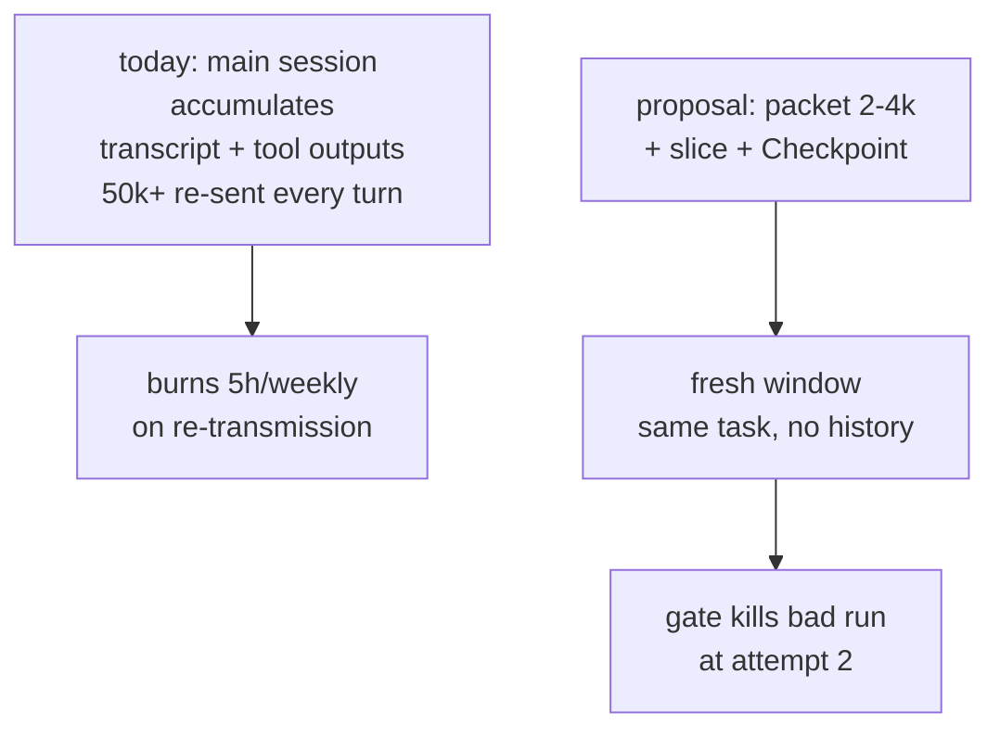

1. **No re-send:** long sessions re-transmit history on every request (cache-read still burns quota). Packet + `task show --json` + bounded `gira slice` deliver 30-60 lines + slice instead of the repo. Fresh AGY/Claude window reads the packet, not the transcript.
2. **Isolation:** exploration and tool noise stay inside ephemeral subagents/worktrees. Root (Opus 5.5 main) stays <25k by design (`/orchestrate` invariant 3). Only `ready_for_gate` summaries return.
3. **Early stop:** E3 breaker (2 fails without new evidence) + `token_budget_guard` (warn 80%, hard ceiling per tier) + kill on 15 min without green diff prevent the classic loop where a weak model burns 3x the tokens of one Sonnet run.
4. **Right model first time:** router sends read-only explore to Haiku/Flash, well-defined build to cheap Flash/AGY packet, and reserves Sonnet/Opus 5.5 for ambiguous contracts and hard debug. Fewer retries = fewer tokens.
5. **Resume without replay:** `## Checkpoint` (branch/HEAD/done/next) lets any new window reconcile with `git status` + `merge-base` instead of replaying the conversation. Idle >60 min or context >=80% means discard + resume, not continue.

What is not claimed: absolute MTok per window for Pro/AGY (unpublished), nor that parallel workers save tokens (they cost ~linearly more; they save wall time when scopes are disjoint). §9.3 measures all of the above.

### 10.1 Can Opus 5.5 itself call `agy -p`?

No. Claude Code (even with Opus 5.5 as main) is third-party software relative to Google. Having the agent run `agy -p` via its `Bash` tool to spend the consumer AI Pro quota is both FAQ violations at once: third-party access with an Antigravity login, and wrapping `agy` inside a third-party coding agent. Account suspension risk applies the same as OpenCode spawning it. The compliant path stays: Opus 5.5 main prints or writes the packet, human pastes it into `agy`, human returns the diff for `seal`.

## 11. Autoresearch-adapted overnight loop (auto legs only)

Adapted from [karpathy/autoresearch](https://github.com/karpathy/autoresearch) (`program.md`: one editable file, fixed evaluation, fixed time budget, scalar metric, `keep/discard/crash` ledger, baseline first, simplicity criterion, human-owned org code). The `agy` leg is excluded by design (ToS air-gap, §10.1) — this loop runs only where spawning is legal (`claude -p`, `opencode run`).

| Autoresearch | G-Ingá analog | Rule |
|---|---|---|
| `train.py` editable / `prepare.py` read-only | In Scope vs gate/skills/contracts | Worker never modifies gate, skills, or contracts |
| Fixed 5-minute budget → comparable runs | Token ceiling per tier | Add wall-clock cap per attempt; both bind |
| Scalar metric `val_bpb` | Cost-per-approved-task + gate pass | Both recorded per attempt, never blended |
| `results.tsv` ledger | Run ledger in `ginga budget` | Schema below; append-only |
| Baseline first | B rows | Every attempt records its pre-attempt HEAD |
| Simplicity criterion | L4 extension | Diff-size budget per tier; disproportionate complexity = discard |
| Human owns `program.md` | Owner owns packets/skills | Packets iterate via `learnings.md`, never by workers |
| `> run.log`, grep metrics | `ready_for_gate` | Grep, don't paste: logs stay in the worktree, cited by path |
| Branch per run, advance-or-reset | Retry packets | One attempt-branch per try; pass advances, fail resets `--hard` |

### 11.1 Run ledger schema

One row per attempt, appended by `seal` (pipe-separated):

```text
attempt | commit | cost_usd | gate | status | description
```

- `attempt`: `<task-id>#<n>`.
- `commit`: short SHA of the attempt-branch head.
- `cost_usd`: metered API/Zen spend, `0` for subscription-window legs (window-burn tracked separately, never converted).
- `gate`: `pass` / `fail` / `blocked`.
- `status`: `keep` (advanced), `discard` (reset), `crash` (tooling/env failure).
- `description`: one line — what this attempt tried.

### 11.2 Loop with machine-checkable stop conditions

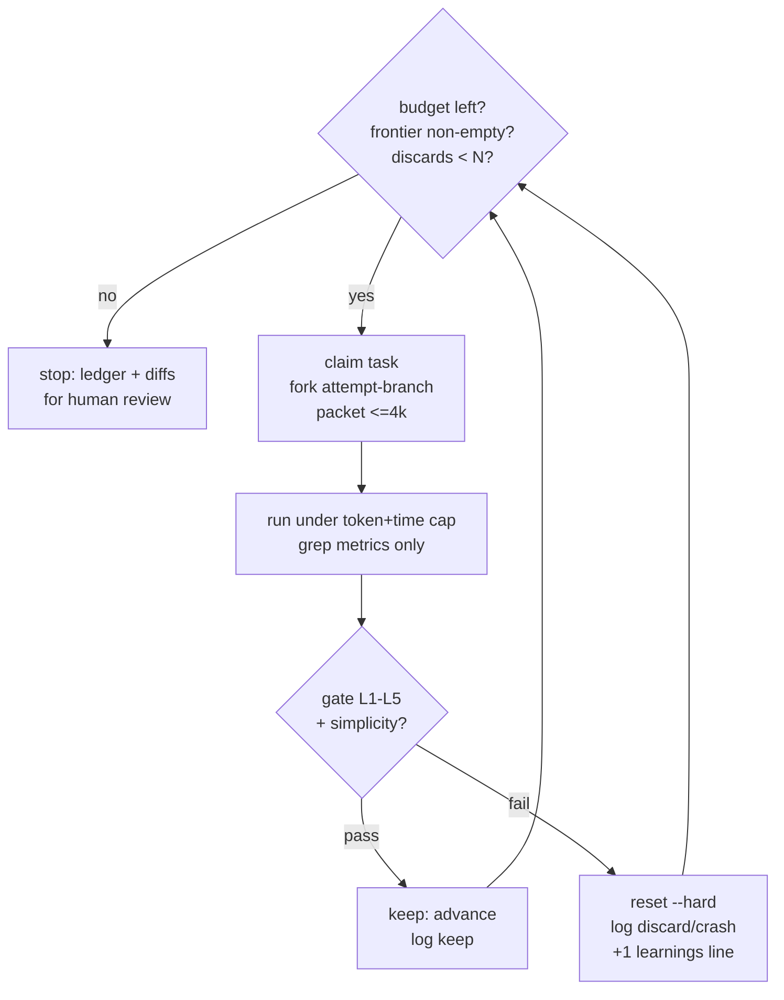

Defaults: `N = 3` consecutive discards per task before `blocked`; attempt wall-clock cap 15 minutes; packet ceiling 4k tokens. Consecutive `crash` rows (tooling, not model) halt the loop immediately for human inspection instead of burning budget.

### 11.3 Simplicity criterion for seal

When the gate passes, seal additionally checks lines added vs acceptance criteria covered. A `pass` that doubles the diff for a marginal gain is `discard` with the note `complexity-disproportionate`; a `pass` that deletes code for equal behavior is always `keep`. Thresholds per tier are calibrated by the §9.3 experiment, starting suggestion: standard tasks stay under 300 added lines excluding tests.

## 12. SPIKE: OmniRoute as cheap transport (time-boxed, non-binding)

Status: spike proposal. Nothing here commits the harness to OmniRoute. The spike answers one question — "does a gateway cheap-leg beat direct cheap-legs on cost-per-approved-task?" — then we adopt, adapt, or abandon. Expiry: 2 weeks from kickoff; no extension without a new decision.

### 12.1 Scope (narrow on purpose)

- Install gateway pinned to one release (LTS rail when available); local-only, `REQUIRE_API_KEY=true`, key via `{env:OMNIROUTE_API_KEY}`.
- Wire OpenCode via the live-catalog plugin (`@omniroute/opencode-plugin`, v1 or v2 matching the local OpenCode version); no static model blocks.
- Configure exactly 3 combos: `cheap` (GLM-Flash + Zen free rotativos), `judge` (groq per-model caps), `strong` (Zen Sonnet / direct API as paid control). Compression: `coding-safe` on implementers, `aggressive` only on read-only exploration dumps.
- Hard bans in every combo: `agy`, `kiro`, `opencode-free` routes (ToS), plus default-deny on free/keyless routes for proprietary code (privacy). STRICT mode: only routes with documented hard-stop.

### 12.2 Success criteria (measured, not claimed)

Run the §9.3 protocol with routes D (gateway cheap) and E (gateway cheap + compression) on the same 5 real tasks:

- Adopt `cheap` as default iff first-try-pass ≥ 4/5 AND cost-per-approved-task < direct cheap-leg AND gate-fail rate does not rise vs control.
- Adapt (different combo members, presets, or caps) iff within 20% on cost with equal quality — one more week, then re-judge.
- Abandon iff first-try-pass ≤ 2/5, rework > 2x vs control, any ToS/privacy incident, or gateway downtime breaks 2 sessions. Removal is one config change (combos out, direct routes stay).

### 12.3 What gets recorded

Ledger rows gain `transport:` (`direct` / `gateway`) and `compression_plan:` (preset + echoed header). The decision (adopt/adapt/abandon) is recorded with the numbers, and the gateway stays a replaceable transport behind the provider interface — never a dependency of tasks, gate, or seal.
