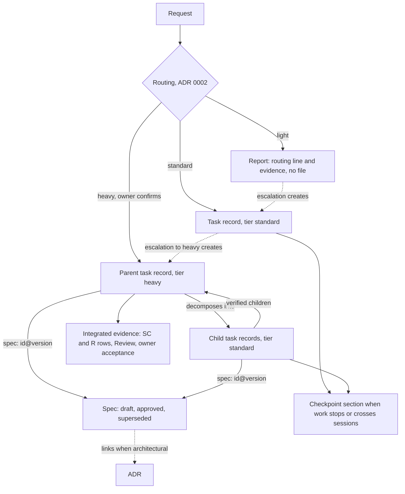
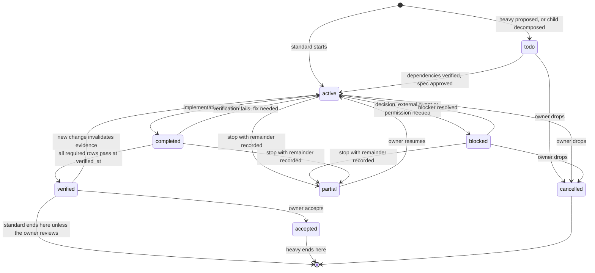

# Artifact contracts

**Status:** proposed (decision D3, [ADR 0003](decisions/0003-minimum-artifact-schemas.md)). Nothing here is implemented. No validator exists yet, so every "deterministic check" below is a specification for M1, not an enforced rule.

This document is the field-level contract. The rationale and the alternatives are in ADR 0003. The tiers and routing rules come from [ADR 0002](decisions/0002-ceremony-tiers-and-routing.md) (`accepted`) and aren't restated here.

## 1. What each tier persists

| | `light` | `standard` | `heavy` |
|---|---|---|---|
| Routing record | routing line in the report | `## Routing and approvals` in the task record | `## Routing and approvals` in the parent task record |
| Task record | none | one file | one parent file (`tier: heavy`) plus one file per decomposed task (each `tier: standard`) |
| Spec | none | none | one file, approved before any child task starts |
| Checkpoint | none | `## Checkpoint` section, only when the work stops or crosses sessions | same, in each task that stops or crosses sessions |
| Evidence | in the report | `## Verification` table in the task record | each child's table, plus the parent's integrated table and `## Review` |
| ADR | none | none | when architectural, in `docs/decisions/`, linked from the spec |

A typical `standard` record is 30–60 lines. It's written once, updated in place, and re-read only on resume or review.



## 2. Shared conventions

### 2.1 Files and identifiers

- Task records live in `tasks/<id>.md` and specs in `specs/<id>.md` ([SDLC brief](briefs/sdlc-harness-brief.md) §11). Where they live in a target repository is D5's call.
- The id is the file name without `.md`: `<YYYY-MM-DD>-<slug>`, for example `2026-10-12-pagination-off-by-one`. A date plus a slug doesn't collide across branches the way a sequence number would.
- A decomposed task's id is `<parent-id>-<NN>-<slug>`, with `NN` in dependency order.
- The title is the file's H1. There is no `id` or `title` key in the frontmatter, so they can't drift from the file name and heading.

### 2.2 Frontmatter and sections

Each file is Markdown with a short YAML frontmatter block. The frontmatter holds only what a script must read: the schema version, the tier, the state and the references to other files. Everything else is a `##` section with a fixed name.

Commit SHAs in the frontmatter are always quoted. YAML reads an unquoted all-digit SHA such as `0123456` as a number (checked with PyYAML: it becomes `42798`).

A conditional section that doesn't apply is either left out or written as `skip: <reason>` when the omission should stay visible (ADR 0002 §6). Unknown keys and sections are allowed and preserved.

### 2.3 Routing and approvals log

One append-only list, shared by every tier. In `light` it's the first lines of the report. In `standard` and `heavy` it's the `## Routing and approvals` section. Each entry is one bullet that starts with a keyword:

| Keyword | Format | When |
|---|---|---|
| `tier:` | `tier: <tier> (<deciding signals>)` | first entry, exactly once |
| `escalated:` | `escalated: <from> → <to> because <E1–E5>: <evidence>` | ADR 0002 §5 |
| `downgraded:` | `downgraded: <from> → <to> because <reason>` | `standard → light` once before edits; from `heavy` only with an `approved:` entry |
| `override:` | `override: owner ordered <tier>; risk: <one line>` | owner orders a lower tier |
| `confirmed:` | `confirmed: heavy by owner (<date>, <ref>)` | entering `heavy` |
| `approved:` | `approved: <subject> by owner (<date>, <ref>)` | spec version, ADR, exception, `heavy` downgrade, protected action |
| `decided:` | `decided: <question> → <answer> by owner (<date>, <ref>)` | a preference call during the work |
| `divergence:` | `divergence: <spec section>: <finding>` | E5 |
| `accepted:` | `accepted: by owner (<date>, <ref>)` | final acceptance |

`<ref>` is the owner's own words quoted, or a link to the commit or comment where the owner approved. The agent writes the entry, but only after the owner's explicit message. The file can't prove who approved: that's a trust boundary, not a check (see §7).

`→` and `->` are both accepted. The current tier is the target of the last `tier:`, `escalated:`, `downgraded:` or `override:` entry.

### 2.4 Results and provenance

- Check results use the brief's vocabulary only: `pass`, `fail`, `blocked`, `not run`. A row nobody has run yet is `not run`.
- A result is valid for the commit it ran on, never for "the code" in general.
- An acceptance criterion the agent derived without a source in the request or the spec is tagged `[inferred]`. This applies [ADR 0001](decisions/0001-product-boundary.md) §3 (provenance) to the one place where an inference could silently become a requirement.

## 3. Task record (`schema: task/1`)

Used by `standard` tasks, by the `heavy` parent and by the `heavy` children.

### 3.1 Frontmatter

| Key | Required | Values | Notes |
|---|---|---|---|
| `schema` | always | `task/1` | contract version (§8) |
| `tier` | always | `standard`, `heavy` | `light` never has a file. Must equal the current tier in the log |
| `status` | always | see §3.3 | |
| `parent` | decomposed tasks | parent task id | |
| `spec` | `heavy` parent and its children | `<spec-id>@<version>` | the spec version this task implements |
| `depends_on` | when non-empty | list of task ids | tasks that must be `verified` first |
| `verified_at` | `verified`, `accepted` | commit SHA, quoted | the commit every required row ran on. `B` rows ran earlier, by definition |

### 3.2 Sections

| Section | Required when | Content |
|---|---|---|
| `## Routing and approvals` | always | the log (§2.3) |
| `## Objective` | always | the outcome in one to three sentences, then `In scope:` and `Out of scope:` bullets |
| `## Acceptance criteria` | always | numbered `AC1`, `AC2`, … Each is checkable. Children may cite spec criteria (`AC1 = SC2`) instead of copying them |
| `## Verification` | always | table `ID \| Check \| Result \| Ref` (§3.4) |
| `## Constraints and budget` | when something differs from the defaults (§3.5) | budget overrides, external dependencies, applicable limits |
| `## Plan` | S2 fails or step order matters (ADR 0002 §4); always for a `heavy` parent | ordered steps. A `heavy` parent lists its children here. Otherwise `skip: <reason>` or absent |
| `## Blockers` | `blocked`, `partial` | what blocks, what's needed, from whom. Options with trade-offs when it's a decision |
| `## Checkpoint` | the work stops or crosses sessions | §3.6 |
| `## Review` | `heavy` parent; `standard` after a review trigger (ADR 0002 §4) | each finding with its resolution: `fixed in <sha>`, `rejected: <reason>` or `open` |
| `## Outcome` | `verified`, `accepted`, `partial`, `cancelled` | what was delivered, what wasn't, follow-ups |

### 3.3 States

The brief requires `completed`, `verified` and `accepted` to be distinct, with partial and blocked outcomes.

| State | Meaning | Who sets it |
|---|---|---|
| `todo` | recorded, not started. Mostly decomposed `heavy` children | agent |
| `active` | work in progress | agent |
| `blocked` | can't continue without a decision, an external event or a permission | agent |
| `completed` | implementation finished. Verification isn't all `pass` yet, for example a check is `blocked` or `not run` | agent |
| `verified` | every required row is `pass` at `verified_at` | agent, guarded by checks |
| `accepted` | the owner accepted the result | owner (agent records the `accepted:` entry) |
| `partial` | stopped with some criteria verified and the rest recorded as not delivered | agent proposes, owner may resume |
| `cancelled` | dropped | owner |



Guards. "det" marks what a script can check; the rest is agent judgment:

- `todo → active`: every `depends_on` task is `verified` or `accepted` (det). For a task with `spec:`, the spec is `approved` at that version (det). A `heavy` parent has a `confirmed:` entry (det).
- `active → completed`: every `AC`, and for a `heavy` parent every spec `SC`, has at least one row in `## Verification` (det). The agent believes the implementation is done (judgment).
- `completed → verified`: every `AC`, `SC` and `V` row is `pass` and every required row ran on `verified_at` (det). An `R` row is `pass`, or a `fail` that cites a `B` row showing the same failure before the change (det for the citation, judgment for the attribution). For a `heavy` parent: every child is `verified` or `accepted`, no `## Review` finding is `open`, the spec is `approved` and unchanged (§4.3), and every `divergence:` entry has a later `approved:` entry resolving it (det).
- `verified → accepted`: an `accepted:` entry exists (det for presence; only the owner makes it true).
- `blocked` and `partial`: `## Blockers` is non-empty (det). `partial` also needs `## Outcome` naming the criteria not delivered (det for presence).
- The owner can cancel from any state that isn't terminal; the diagram shows only the common cases.
- A `heavy` parent is created as `todo` when the agent proposes `heavy`, and moves to `active` (questions, then the spec) once the owner confirms. Its children can't leave `todo` until the spec is `approved`.
- A child task never becomes `heavy`. If it finds a `heavy` trigger the spec didn't cover, that's a `divergence:` on the parent (E5).

### 3.4 Verification table

One table plans the checks before editing and records the results afterward, so criteria, checks and evidence live in one place.

| ID prefix | Row kind | Result needed for `verified` |
|---|---|---|
| `AC<n>` | an acceptance criterion and the check that exercises it. A bug's `AC` starts with a failing repro | `pass` |
| `SC<n>` | a spec criterion, end to end (parent only) | `pass` |
| `B<n>` | baseline, captured before editing (ADR 0002 §4) | any. It's a record of the starting state |
| `R<n>` | regression or integrated run | `pass`, or a `fail` attributed to a `B` row |
| `V<n>` | self-review, for example "diff read against AC1–AC3" | `pass` |

A `standard` task and a `heavy` parent have at least one `B` row and one `V` row (ADR 0002 §4). When no relevant check exists (S6 fails), the `B` row says so and is `not run`.

A flaky check is a `fail` with a note (`flaky: <evidence>`). It never counts as `pass`.

`Ref` is the short commit SHA the row ran on, plus a log path when a log was kept. Logs aren't stored by default: the command and the commit make the row reproducible.

### 3.5 Budget defaults

ADR 0002 sets no numeric limits and D4 hasn't decided what can be measured, so every limit carries an enforcement label: `hard` (a platform mechanism enforces it) or `guideline` (the agent follows it, nothing enforces it).

| Limit | Default | Enforcement today |
|---|---|---|
| Verification attempts without new information | 2, then escalate (E3) | guideline |
| Subagents | 0 (brief §3: don't delegate by default) | guideline |
| Investigation for a routing signal | bounded, then record a blocker or question (ADR 0002 §2) | guideline |
| Tokens, time | none until D4 provides a signal | not set |
| Permissions and protected actions | Claude Code permission settings | hard (platform) |

A task records only what differs from these defaults, in `## Constraints and budget`. Expanding a `guideline` limit because progress justifies it is recorded there with the reason (brief §3). A `hard` limit is never exceeded. No tier and no budget relaxes approved acceptance criteria, security requirements or protected-action approval.

### 3.6 Checkpoint section

Concise operational state, not a transcript (brief §6). The latest checkpoint replaces the previous one; Git keeps the history.

```markdown
## Checkpoint

- as of: 2026-10-12, branch fix/pagination, head 4f2a9c1, worktree dirty (src/paging.ts)
- done: AC1 repro written and failing (see Verification)
- next: change the offset calculation in src/paging.ts, then rerun AC1 and R1
- open: hypothesis (inferred) that pageSize=0 is unreachable from the UI
- revalidate: B1 ran on 9d0e311; rerun it if main moved
```

On resume, before any edit: compare the current branch, head and worktree with `as of`. If they differ, reconcile first. Treat any row whose `Ref` isn't the current head as stale until rerun or explicitly judged unaffected.

## 4. Spec (`schema: spec/1`, `heavy` only)

### 4.1 Frontmatter

| Key | Required | Values | Notes |
|---|---|---|---|
| `schema` | always | `spec/1` | |
| `status` | always | `draft`, `approved`, `superseded` | the brief's three states |
| `version` | always | integer, starts at 1 | goes up by one each time an approved spec is reopened |
| `approved_version` | after the first approval | integer | the last version the owner approved |
| `approved_hash` | after the first approval | `sha256:<hex>` | hash of the body at that approval (§4.3) |
| `superseded_by` | `superseded` | spec id | |

The approval itself is an `approved: spec v<N>` entry in the parent task's log. It isn't in the spec, because the spec body is hashed and an entry there would change the hash it records.

### 4.2 Sections

| Section | Required | Content |
|---|---|---|
| `## Problem` | always | current behavior, who is affected, which `heavy` triggers apply |
| `## Expected behavior` | always | observable behavior after the change |
| `## Scope` | always | in scope, out of scope, non-goals |
| `## Acceptance criteria` | always | `SC1`, `SC2`, …, checkable end to end |
| `## Interfaces and dependencies` | always | contracts that change, their consumers, data and external systems. `none` needs a reason |
| `## Decisions` | always | alternatives considered and the choice, briefly. Link the ADR when architectural |
| `## Risks and constraints` | always | security, data, compatibility, performance. Protected actions the work will need |
| `## Verification` | always | integrated regression scope, end-to-end checks for the `SC` rows, the review's focus |
| `## Rollback` | when H2 holds or a protected action is planned; else `skip:` | how to undo, or why it can't be undone and what guards the step |
| `## Open questions` | always | empty, or each one marked `deferred: <why it's safe to proceed>` before approval |
| `## Revisions` | always | one line per version: what changed and why, with the `divergence:` it resolves |

Following the references (A2 in the [D3 evidence](research/d3-artifact-evidence.md)), a spec avoids file paths and code unless they're the contract itself.

### 4.3 Approval and versions

The approved text must not change without the owner seeing it (brief §3).

1. **Approve.** The owner approves version `N`. The agent sets `status: approved`, `approved_version: N` and `approved_hash`, and adds `approved: spec vN by owner (…)` to the parent log.
2. **Freeze.** While `status: approved`, the body must hash to `approved_hash` (det). Any edit fails the check, even a typo fix.
3. **Reopen.** To change an approved spec: set `status: draft`, set `version: N+1`, edit, and add a `## Revisions` line. Children that reference `@N` and depend on the changed part go to `blocked`. Children that don't depend on it may continue against `@N`.
4. **Reapprove.** The owner approves `N+1`. The agent records the new hash and moves children to `@N+1` after checking which of their rows the change makes stale.
5. **Exception instead of a change.** The owner can accept a divergence without changing the spec. That's an `approved: exception <what> by owner (…)` entry in the parent log, and the spec stays as it is.
6. **Supersede.** When the work is replaced wholesale, the old spec becomes `superseded` with `superseded_by`. It's never deleted.

The hash covers every byte after the closing `---` of the frontmatter, with LF line endings. Frontmatter edits, such as a schema migration (§8), don't change it. One definition, for illustration:

```sh
awk 'n >= 2 { print } /^---$/ { n++ }' specs/<id>.md | sha256sum
```

## 5. Heavy evidence

ADR 0002 requires an evidence record for `heavy`. Here it's the parent task record, not a separate file:

- The parent's `## Verification` has `B` rows (the relevant suite before any child started), `SC` rows (each spec criterion end to end on the integrated head) and `R` rows (the integrated regression run).
- The parent's `## Review` holds the fresh-context review against the spec, which flags only correctness or requirement gaps (ADR 0002 §4).
- Each child keeps its own `AC` evidence. The parent links children by id rather than copying their rows.
- Release, deploy, migration or publishing are protected actions. `accepted` doesn't authorize them. Each needs its own `approved:` entry, and `## Outcome` lists any that are still pending.

## 6. Light report

`light` persists nothing (ADR 0002 §4). The report is the record:

```text
tier: light (S1–S4, S6, S7 hold; S5 doesn't)
Changed: README.md, "recieve" → "receive" (1 line, prose only)
Checks:
- V1 diff read: 1 line changed, no other files: pass
- V2 markdown lint on README.md: not run (no linter configured)
```

If a `light` task escalates, the agent creates the task record at that moment. It copies the routing lines and any evidence still valid, then adds the `escalated:` entry.

A `light` task has no resume contract. It fits one session by definition (S8). If it's interrupted anyway, the next session reroutes from the request and the Git diff, which is cheap because the change is small.

## 7. Validation

Nothing below exists yet. M1 can implement the deterministic column as one small script.

| Check | Deterministic script | Agent judgment | Owner |
|---|---|---|---|
| Frontmatter parses, `schema` known, required keys present, enum values valid | ✓ | | |
| File name is a valid id, ids are unique, `parent`, `depends_on` and `spec` resolve, no dependency cycles | ✓ | | |
| Required sections present for the tier and status; `skip:` has a reason | ✓ | | |
| Log grammar; frontmatter `tier` equals the current tier; `heavy` has `confirmed:` before leaving `todo` | ✓ | | |
| `AC`/`SC` ids unique; every criterion has a verification row; `B` and `V` rows present; result values valid | ✓ | | |
| Status guards (§3.3) and `verified_at` matches every required row | ✓ | | |
| Approved spec body matches `approved_hash`; children reference an approved version | ✓ | | |
| Status transition legal against the previous commit's version of the file | ✓ (needs Git history) | | |
| Internal links resolve | ✓ | | |
| Obvious secrets in records (brief §6) | ✓ (pattern scan, incomplete) | | |
| Routing signals answered correctly | | ✓ | can override |
| Criteria are checkable and cover the objective | | ✓ | approves them in `heavy` |
| The check actually exercises its criterion | | ✓ | |
| Evidence still applies after later changes | | ✓ | |
| Implementation diverges from the spec | | ✓ (raises it) | decides |
| Review findings: real or noise | | ✓ | final call in `heavy` |
| `heavy` confirmation, spec approval, exceptions, acceptance, overrides, protected actions | | records them | ✓ |

The script can prove that an `approved:` line exists, not that the owner wrote it. That limit holds until approvals come from a channel the agent can't write, and no such channel is in scope.

## 8. Versioning and evolution

- `schema: task/1` and `schema: spec/1` carry a major version only.
- **No bump:** adding an optional key or section, or adding a log keyword. Readers ignore what they don't know and keep it.
- **Bump:** a new required key or section, a renamed or removed key, or a changed meaning or enum.
- The validator reads the current and previous major versions and writes only the current one.
- **Terminal records** (`verified`, `accepted`, `partial`, `cancelled`, `superseded`) are history. They're validated against the schema they declare and never migrated.
- **Open records** on an old schema are migrated only through an explicit, separate commit whose diff the owner can review. The agent never migrates in passing while doing other work. A frontmatter-only migration doesn't touch an approved spec's hash. A body migration does, so the owner has to reapprove the spec.
- **Unknown or missing `schema`:** the file is treated as unstructured prose and reported as `blocked` for validation. The agent doesn't guess the version.
- **Missing required value:** the validator fails. The agent doesn't invent values: a missing approval stays missing until the owner gives one, and a missing result is `not run`.
- **Invalid state**, for example `verified` with a `not run` row: the fix is to move the status back with a reason, never to edit the evidence.

## 9. Examples

### 9.1 `light`: fix a README typo (ADR 0002 R01)

See §6. No file is created.

### 9.2 `standard`: off-by-one pagination bug (ADR 0002 R04)

`tasks/2026-10-12-pagination-off-by-one.md`:

```markdown
---
schema: task/1
tier: standard
status: verified
verified_at: "7c1e0b2"
---

# Owners list skips one owner between pages

## Routing and approvals

- tier: standard (S2 fails: cause unknown; S1, S3–S7 hold)

## Objective

Page 2 of the owners list starts at the 12th owner instead of the 11th. Fix it so pages are contiguous.

In scope: the paging offset in the owners query.
Out of scope: page-size options, sorting.

## Acceptance criteria

1. AC1: with 25 owners and page size 10, pages 1–3 return owners 1–10, 11–20 and 21–25.
2. AC2: page 1 is unchanged.
3. AC3 [inferred]: a page past the end returns an empty list, not an error.

## Verification

| ID | Check | Result | Ref |
|---|---|---|---|
| B1 | owners module tests before the change | pass | 9d0e311 |
| AC1 | new test `paginates contiguously`, failing first | pass | 7c1e0b2 |
| AC2 | existing test `first page` | pass | 7c1e0b2 |
| AC3 | new test `page past end is empty` | pass | 7c1e0b2 |
| R1 | owners module tests | pass | 7c1e0b2 |
| V1 | diff read against AC1–AC3 | pass | 7c1e0b2 |

## Plan

1. Write the AC1 repro and confirm it fails.
2. Find where the offset is computed and fix it.
3. Add AC3, then run R1.

## Outcome

Offset used `page * size + 1`; now `(page - 1) * size`. No follow-ups.
```

### 9.3 `heavy`: rename a response field the client consumes (ADR 0002 R07)

Parent `tasks/2026-10-14-owner-phone-field.md`, while the second child is in progress:

```markdown
---
schema: task/1
tier: heavy
status: active
spec: 2026-10-14-owner-phone-field@1
---

# Rename Owner.telephone to phone across the REST API and the Angular client

## Routing and approvals

- tier: heavy (H3: changes a response field the Angular client consumes)
- confirmed: heavy by owner (2026-10-14, "pode seguir como heavy")
- approved: spec v1 by owner (2026-10-14, "spec aprovada")

## Objective

Owners expose `phone` instead of `telephone`, without breaking the client at any commit. See the spec.

In scope: the REST response and request bodies, the Angular client.
Out of scope: the database column name.

## Acceptance criteria

SC1–SC3 from the spec.

## Plan

1. 2026-10-14-owner-phone-field-01-expand: serve both fields (verified)
2. 2026-10-14-owner-phone-field-02-client: client uses `phone` (active, depends on 01)
3. 2026-10-14-owner-phone-field-03-contract: remove `telephone` (todo, depends on 02)

## Verification

| ID | Check | Result | Ref |
|---|---|---|---|
| B1 | REST and Angular test suites before 01 | pass | a11f0e4 |
| SC1 | end-to-end: create and edit an owner's phone from the UI | not run | |
| SC2 | API response has `phone` and no `telephone` | not run | |
| SC3 | API rejects a request body that uses `telephone` with a clear error | not run | |
| R1 | REST and Angular suites on the integrated head | not run | |
| V1 | integrated diff read against SC1–SC3 | not run | |

## Review

skip: runs after child 03 is verified

## Checkpoint

- as of: 2026-10-15, branch feat/owner-phone, head c93d2aa, worktree clean
- done: 01 verified (both fields served)
- next: finish 02, then 03, then SC1–SC3 and R1, then the review
- revalidate: B1 ran on a11f0e4; rerun before R1 if main moved
```

Spec `specs/2026-10-14-owner-phone-field.md`, abridged:

```markdown
---
schema: spec/1
status: approved
version: 1
approved_version: 1
approved_hash: sha256:<hash of the body at approval>
---

# Owner phone field

## Problem

The API calls the field `telephone`, the UI calls it `phone`. Renaming it changes a contract the Angular client consumes (H3).

## Expected behavior

Responses use `phone`. Requests that send `telephone` get a 400 with a message naming `phone`.

## Scope

In: owner endpoints, the Angular owner forms. Out: the database column; other entities.

## Acceptance criteria

- SC1: a user can create and edit an owner's phone from the UI.
- SC2: owner responses contain `phone` and not `telephone`.
- SC3: a request body with `telephone` returns 400 naming `phone`.

## Interfaces and dependencies

Owner JSON contract (consumer: Angular client in this system). No external consumers known (inferred; checked by searching both repositories).

## Decisions

Expand–contract: serve both fields, move the client, then remove `telephone`. Rejected: a single breaking commit, because the client would break between deploys.

## Risks and constraints

Unknown external consumers would break at the contract step. No data migration.

## Verification

Both suites at each child; end to end for SC1–SC3 on the integrated head; review focused on the contract step.

## Rollback

skip: no one-way door; reverting 03 restores `telephone`.

## Open questions

None.

## Revisions

- v1: initial.
```

Child `tasks/2026-10-14-owner-phone-field-02-client.md` has the same shape as §9.2, with `parent: 2026-10-14-owner-phone-field`, `spec: 2026-10-14-owner-phone-field@1`, `depends_on: [2026-10-14-owner-phone-field-01-expand]`, and criteria like `AC1 = SC1 (client side)`. Its routing log starts with `tier: standard (decomposed from heavy parent)`.

### 9.4 What they share

| Concept | `light` | `standard` | `heavy` |
|---|---|---|---|
| Routing log grammar | in the report | in the task record | in the parent; children say "decomposed from heavy parent" |
| Results vocabulary | ✓ | ✓ | ✓ |
| Criteria → check → result | rows `V`, optional `AC` in the report | `## Verification` | the same table at two levels |
| State machine | none | `active` → … → `verified` | children as `standard`; parent ends at `accepted` |
| Checkpoint | none | only when stopped or crossing sessions | per task, same format |
| Owner gates | permissions only | `decided:` when a call arises | `confirmed:`, `approved:` spec, `accepted:` |
