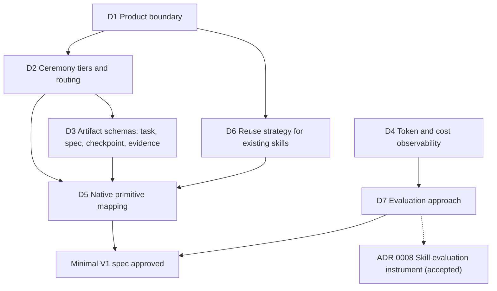

# Decision map

Open and settled decisions needed for a minimal V1. Status values are `proposed`, `accepted`, `rejected`, `superseded` and `open`. A decision becomes `accepted` only with the owner's explicit approval.

| ID | Decision | Status | Depends on | Record / next step |
|---|---|---|---|---|
| D1 | Product boundary: personal SDLC harness first, context map deferred | accepted | none | [ADR 0001](decisions/0001-product-boundary.md) |
| D2 | Ceremony tiers (`light` / `standard` / `heavy`): routing criteria and what each tier loads | accepted | D1 | [ADR 0002](decisions/0002-ceremony-tiers-and-routing.md), evidence in [research note](research/d2-routing-evidence.md). Follow-ups in the ADR are open but don't block |
| D3 | Minimal schemas and state transitions for task, spec, checkpoint and evidence | accepted | D2 | [ADR 0003](decisions/0003-minimum-artifact-schemas.md), field-level [artifact contracts](artifact-contracts.md), evidence in [research note](research/d3-artifact-evidence.md). Revised after review (parent lifecycle, spec versions, verification commits, downgrade, history checks), then accepted. Follow-ups in the ADR are open but don't block |
| D4 | Which token, context, tool and cost signals the owner's CLIs expose locally (Claude Code: `/usage`, OpenTelemetry, statusline; Antigravity CLI: `--output-format json` usage totals, `transcript_full.jsonl`) | accepted | none | [ADR 0006](decisions/0006-usage-observability.md), evidence in [research note](research/d4-observability-evidence.md) and AGY-S1 audits. Accepted by owner (2026-10-11): multi-host local telemetry (OTel for Claude Code, headless JSON for Antigravity) with 6-state taxonomy and strict privacy boundaries |
| D5 | Which parts are skills, hooks, scripts, subagents or `CLAUDE.md` | accepted | D2, D3, D6 | [ADR 0005](decisions/0005-native-primitive-mapping.md), evidence in [research note](research/d5-native-primitive-evidence.md). Aligned with accepted D6 (ADR 0004, linked from the D6 row). Accepted by owner (2026-10-11): one entry skill with a pointer, records at the target repo's root `tasks/` and `specs/`, pinned bundle distribution (FU1–FU4), validator inside bundle, no commit hook in V1 (H-1) with CI merge enforcement condition, and transitional coexistence with Pocock plugin (FU6). Minimal V1 spec authoring authorized. Revision accepted by owner (2026-10-13): personal plugin channel through this repository's marketplace (FU7); the pinned bundle stays the distribution for target repositories and CI |
| D6 | Reuse of Matt Pocock skills: depend on the installed plugin, vendor copies, or write our own | accepted | D1 | [ADR 0004](decisions/0004-reuse-strategy-for-existing-skills.md), evidence in [research note](research/d6-reuse-evidence.md). G-Ingá is the only harness at the end: it owns the contract path, may use native Claude Code mechanisms, adapts upstream techniques with provenance, and vendors nothing without a demonstrated need. The Pocock plugin stays only as the owner's existing flow during the transition, never as a dependency. Accepted as a strategic decision; the replacement criteria and open questions in the ADR stay provisional |
| D7 | Minimal V1 evaluation protocol and exploratory pilot: matched real tasks, friction log and session telemetry notes | accepted | D4 | [Evaluation protocol](research/d7-evaluation-protocol.md) accepted by owner (2026-10-11) for exploratory pilot on real tasks. Authorizes running the protocol to collect evidence; does not authorize V1 implementation. PetClinic optional. Extended by [ADR 0008](decisions/0008-skill-evaluation-instrument.md) (`accepted`, see [extensions](#extensions-of-settled-decisions)); D7 stays `accepted` |

## Extensions of settled decisions

A proposed record that extends a settled decision without reopening it. The settled decision keeps its status until the owner decides.

- **D5 → [ADR 0009](decisions/0009-enforcement-primitives.md) Enforcement primitives and the commit gate (`accepted` 2026-10-14):** which primitive carries which kind of rule; settles ADR 0005 H-1 with a mise-managed hk Git hook running the `pre-commit` mise task, the `g-inga:validate` bundle step, a `--no-verify` deny rule and a required CI check. Spec: [Harness Hardening](../specs/2026-10-14-harness-hardening.md).
- **D5 → [ADR 0010](decisions/0010-user-invoked-entry-skills.md) User-invoked entry skills (`accepted` 2026-10-14):** every G-Ingá skill is user-invoked, `/work` included; the `/work` procedure moves to `work/references/procedure.md`, which `/drive` and `/orchestrate` workers read; revises ADR 0005 item 1 and records the deviation from the V1 spec's model-invocable entry skill. Spec: [User-Invoked `/work`](../specs/2026-10-14-work-user-invoked.md).
- **D7 → [ADR 0008](decisions/0008-skill-evaluation-instrument.md) Skill evaluation instrument (`accepted` 2026-10-13):** `claude plugin eval` as the runner for the [Skill Health Evaluation](../specs/2026-10-13-skill-health-evaluation.md) epic, `skill-creator` as authoring aid and phase 2 candidate, `/skill-doctor` conditional. Complements the autoresearch program; the ledger stays the single system of record.
- **D7 → [ADR 0011](decisions/0011-skill-health-trigger-cases.md) Skill-health trigger cases under user-invoked skills (`accepted` 2026-10-15):** ADR 0010 retires SC1's "should-fire" trigger cases; the trigger suite keeps should-not-fire and near-miss as "no spurious invocation" checks, and behavioral conformance types the slash command. Spec text stays unchanged until it is next reopened.

## Not on the V1 path

| ID | Topic | Status | Record |
|---|---|---|---|
| B1 | Brand narrative and codename policy (codenames kept separate from milestones and SemVer) | proposed | [brand-and-roadmap.md](brand-and-roadmap.md). Doesn't block V1 |
| D8 | Harness extensions beyond V1: manifest scope for `.agents/skills/work/`, model-invocable `/orchestrate` and `/drive`, Gira-G as optional enrichment, V1 verification follow-ups | accepted | [ADR 0007](decisions/0007-harness-extensions-beyond-v1.md). Records deviations from the approved V1 spec without changing it. Accepted by owner (2026-10-13) in full, items 1–5: SC5 manifest scope as a recorded deviation, `/orchestrate` and `/drive` user-invocable outside the bundle, Gira-G optional with a `not run` fallback and a staleness rule kept in `/drive`, a follow-up task for spec Verification items 2 and 4, no spec v2 until another change needs reapproval |

## Deferred, not rejected

These stay deferred until a logged friction justifies them: plugin packaging as a product distribution channel and an installer (the owner's personal plugin channel exists since 2026-10-13, ADR 0005 FU7), stable/experimental channels, the multi-repo context map, PetClinic as a mandatory lab, global learning promotion and OKF adoption.
