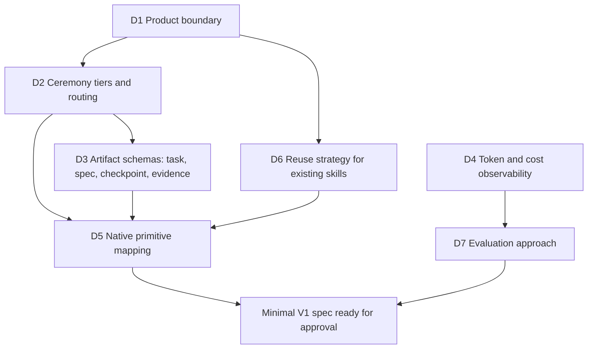

# Decision map

Open and settled decisions needed for a minimal V1. Status values are `proposed`, `accepted`, `rejected`, `superseded` and `open`. A decision becomes `accepted` only with the owner's explicit approval.

| ID | Decision | Status | Depends on | Record / next step |
|---|---|---|---|---|
| D1 | Product boundary: personal SDLC harness first, context map deferred | accepted | none | [ADR 0001](decisions/0001-product-boundary.md) |
| D2 | Ceremony tiers (`light` / `standard` / `heavy`): routing criteria and what each tier loads | accepted | D1 | [ADR 0002](decisions/0002-ceremony-tiers-and-routing.md), evidence in [research note](research/d2-routing-evidence.md). Follow-ups in the ADR are open but don't block |
| D3 | Minimal schemas and state transitions for task, spec, checkpoint and evidence | open | D2 | **Next.** Draft only what ADR 0002 requires: routing line, `standard` task record, `heavy` spec and evidence |
| D4 | Which token/cost signals Claude Code exposes locally (`/cost`, session transcripts, OpenTelemetry, statusline input) | open | none | Research against current official docs. Can run now, in parallel. |
| D5 | Which parts are skills, hooks, scripts, subagents or `CLAUDE.md` | open | D2, D3, D6 | Waits on D3 and D6. Smallest mechanism per need. Keep the fixed per-turn routing cost small (ADR 0002 §8) |
| D6 | Reuse of Matt Pocock skills: depend on the installed plugin, vendor copies, or write our own | open | D1 | Compare against token cost and the owner's customizations |
| D7 | Evaluation: friction log plus matched before/after comparisons; PetClinic optional | open | D4 | Define the smallest repeatable comparison |

## Not on the V1 path

| ID | Topic | Status | Record |
|---|---|---|---|
| B1 | Brand narrative and codename policy (codenames kept separate from milestones and SemVer) | proposed | [brand-and-roadmap.md](brand-and-roadmap.md). Doesn't block V1 |

## Deferred, not rejected

These stay deferred until a logged friction justifies them: plugin packaging and installer, stable/experimental channels, the multi-repo context map, PetClinic as a mandatory lab, global learning promotion and OKF adoption.
