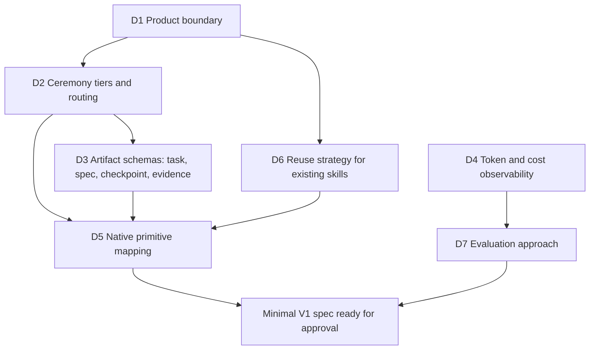

# Decision map

Open and settled decisions needed for a minimal V1. Status values are `proposed`, `accepted`, `rejected`, `superseded` and `open`. A decision becomes `accepted` only with the owner's explicit approval.

| ID | Decision | Status | Depends on | Record / next step |
|---|---|---|---|---|
| D1 | Product boundary: personal SDLC harness first, context map deferred | accepted | none | [ADR 0001](decisions/0001-product-boundary.md) |
| D2 | Ceremony tiers (`light` / `standard` / `heavy`): routing criteria and what each tier loads | accepted | D1 | [ADR 0002](decisions/0002-ceremony-tiers-and-routing.md), evidence in [research note](research/d2-routing-evidence.md). Follow-ups in the ADR are open but don't block |
| D3 | Minimal schemas and state transitions for task, spec, checkpoint and evidence | accepted | D2 | [ADR 0003](decisions/0003-minimum-artifact-schemas.md), field-level [artifact contracts](artifact-contracts.md), evidence in [research note](research/d3-artifact-evidence.md). Revised after review (parent lifecycle, spec versions, verification commits, downgrade, history checks), then accepted. Follow-ups in the ADR are open but don't block |
| D4 | Which token/cost signals Claude Code exposes locally (`/cost`, session transcripts, OpenTelemetry, statusline input) | open | none | Research against current official docs. Can run now, in parallel. Its answer sets the numeric budget limits that ADR 0003 leaves unset |
| D5 | Which parts are skills, hooks, scripts, subagents or `CLAUDE.md` | proposed | D2, D3, D6 | [ADR 0005](decisions/0005-native-primitive-mapping.md), evidence in [research note](research/d5-native-primitive-evidence.md). Aligned with accepted D6 (ADR 0004, linked from the D6 row). Proposes one entry skill with a pointer, records at the target repo's root `tasks/` and `specs/`, and a validator script. In V1 it runs only as a skill step and in target-repo CI where the owner enables it. No hook: the commit gate is an open follow-up (H-1). FU1–FU4 (distribution) are unresolved and block the minimal V1 spec. Recommended: a pinned bundle copied into each target repo, with the validator inside. Not accepted: waits for the owner |
| D6 | Reuse of Matt Pocock skills: depend on the installed plugin, vendor copies, or write our own | accepted | D1 | [ADR 0004](decisions/0004-reuse-strategy-for-existing-skills.md), evidence in [research note](research/d6-reuse-evidence.md). G-Ingá is the only harness at the end: it owns the contract path, may use native Claude Code mechanisms, adapts upstream techniques with provenance, and vendors nothing without a demonstrated need. The Pocock plugin stays only as the owner's existing flow during the transition, never as a dependency. Accepted as a strategic decision; the replacement criteria and open questions in the ADR stay provisional |
| D7 | Evaluation: friction log plus matched before/after comparisons; PetClinic optional | open | D4 | Define the smallest repeatable comparison |

## Not on the V1 path

| ID | Topic | Status | Record |
|---|---|---|---|
| B1 | Brand narrative and codename policy (codenames kept separate from milestones and SemVer) | proposed | [brand-and-roadmap.md](brand-and-roadmap.md). Doesn't block V1 |

## Deferred, not rejected

These stay deferred until a logged friction justifies them: plugin packaging and installer, stable/experimental channels, the multi-repo context map, PetClinic as a mandatory lab, global learning promotion and OKF adoption.
