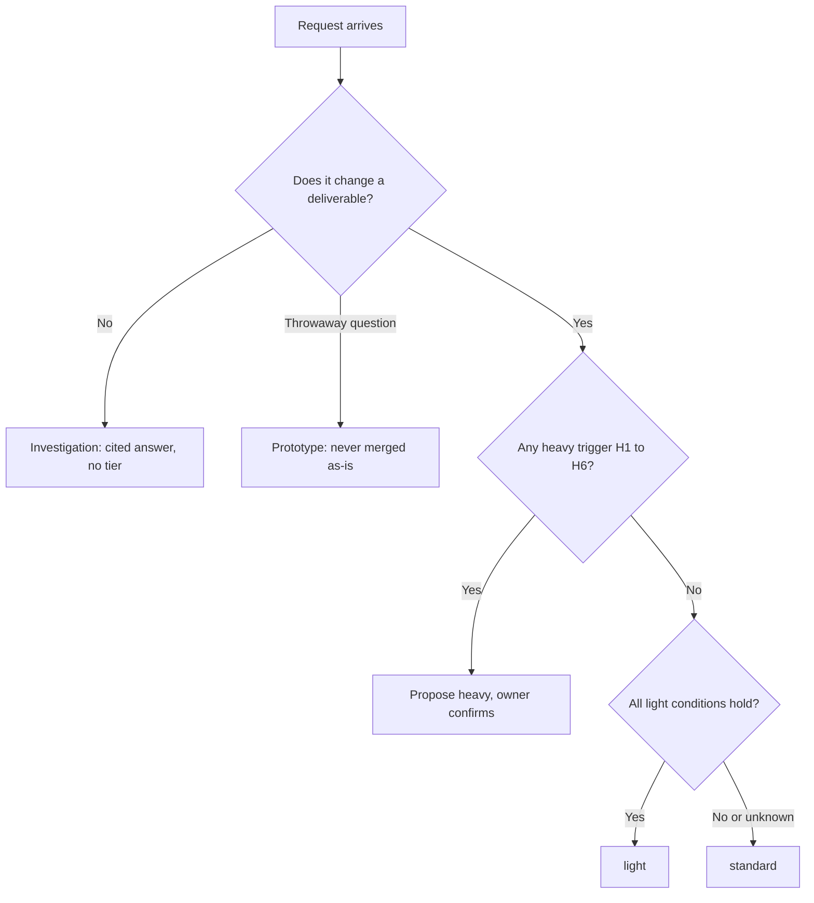
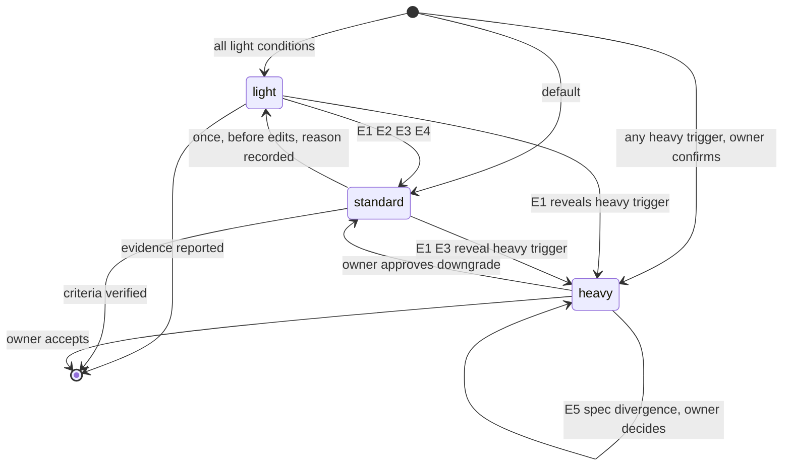

# 0002 — Ceremony tiers and routing

- **Status:** accepted (2026-10-10)
- **Date:** 2026-10-10
- **Deciders:** project owner (approved 2026-10-10, as written). The owner hasn't done the table-top labelling of R01–R17 yet; it stays a calibration input (§7).
- **Evidence:** [D2 routing evidence](../research/d2-routing-evidence.md). Codes like `C1`, `P3` and `X4` below refer to that note.

## Context

[Principles](../principles.md) §1 proposes three tiers (`light`, `standard`, `heavy`) but leaves open how a task gets routed and what each tier requires. D3 (schemas) and D5 (native primitive mapping) depend on this answer.

What the evidence shows:

- None of the references defines tiers or a risk score. Claude Code routes on approach clarity (C1), Pocock on scale and uncertainty (P1), Osmani on phase plus per-skill exclusions (O1), pstack on task type (X1). Where they mention risk, they mean reversibility and boundary crossing (C5, P3, O2, X4).
- All four keep a verification floor for small work too (C2, P2, O4, X5).
- Claude Code already enforces action-level risk through permission modes and the auto-mode classifier (C5).

Known gaps:

- The owner's existing work workflow (how it decides between "just do it" and "plan first") isn't written down in this repository, so this proposal doesn't reflect it yet.
- The [friction log](../friction-log.md) is empty. Every threshold below is a hypothesis until real tasks are logged.

## Problem

Choose criteria that (a) a person and an agent apply the same way to the same task, (b) keep cheap work cheap, (c) never let consequential work skip verification or human gates, and (d) can be tested with reproducible scenarios.

## Are three tiers the right shape?

**Inference:** three tiers are justified only if each boundary marks a discrete change in what the work demands from the human and from persisted state:

| Tier | Human involvement | Persisted artifacts |
|---|---|---|
| `light` | none (platform permissions only) | none; evidence goes in the report |
| `standard` | only on exception (decision needed, divergence found) | a task record |
| `heavy` | gated (tier confirmation, spec approval, final acceptance) | spec, tasks, checkpoints, ADR when architectural |

Size and task type don't set the tier. A 120-file mechanical rename isn't `heavy`, and a one-line database drop isn't `light`. Task type only picks the verification technique inside a tier: for example, a bug always starts with a reproduction.

We considered subcategories and rejected them for now (see Alternatives). Two kinds of work sit **outside** the tiers because they don't change the deliverable:

- **Investigation:** read-only questions. Output is a cited answer. If it leads to a change, route that change.
- **Prototype / spike:** throwaway code that settles a question (P1, X3). It's never merged as-is. Anything kept from it gets routed as a new change.

## Proposal

### 1. Routing signals

Each signal is a yes/no question someone can answer from the request and the repository. The user-facing concepts map like this: uncertainty → S1, S2. Dependencies and impact → S3. Reversibility → S4. Risk → S4, S5, S7. Baseline quality → S6. Cost of an error → S7. Scale → S8.

| ID | Signal | Question |
|---|---|---|
| S1 | Intent clarity | Can the expected outcome be stated as checkable acceptance criteria without a human product or preference call? |
| S2 | Approach clarity | Can the diff be described in one sentence (C1), following a pattern that already exists here? |
| S3 | Footprint and dependencies | Does it stay inside one module, without adding or changing a contract other code or people consume (public API, schema, persisted format, CLI flags, shared config)? |
| S4 | Reversibility | Is it a two-way door (P3): reverting the change fully restores the previous state, with no external effects? |
| S5 | Sensitive behavior | Does it change behavior in security, auth, permissions, secrets, privacy, money, or the harness's own policies? |
| S6 | Baseline quality | Does a relevant check exist and pass before the change? |
| S7 | Error detectability | Would a mistake be caught quickly by an existing check, rather than surfacing later or for someone else? |
| S8 | Scale | Does it fit in one session without decomposition (P1, O3)? |

### 2. Routing rule

The rule is categorical. It has no weights and no score.

- **`heavy`** if **any** of these holds:
  - **H1:** S1 fails, and the gap is a product or preference call that investigation or a prototype can't settle (X3).
  - **H2:** S4 fails: a one-way door (data migration or deletion, published artifact, external message).
  - **H3:** S3 fails because a contract that's already consumed changes, the architecture changes, or the change spans two or more independent subsystems (O3). Adding a new contract alone isn't H3.
  - **H4:** S5 holds: sensitive behavior changes.
  - **H5:** S8 fails: it needs more than one session.
  - **H6:** S6 fails **and** S7 fails: weak baseline and a mistake that wouldn't be caught.
- **`light`** if **all** of these hold: S1, S2, S3, S4, S6 (or the change is non-behavioral, such as prose or formatting), and S7, and S5 doesn't hold.
- **`standard`** otherwise. When a signal can't be answered cheaply, route `standard` and investigate within a bounded budget. Don't jump to `heavy` by default.

Every task, in every tier, starts its report with a routing line: tier plus the signals that decided it, for example `tier: standard (S2 fails: approach unclear)`. It costs one line. It makes misroutes visible and gives scenario tests something to assert.

### 3. Autonomy: when the agent decides and when it asks

| Situation | Agent | Owner |
|---|---|---|
| Choose `light` or `standard` | decides, records the reason | can override |
| Escalate to a higher tier | always allowed. Escalation to `heavy` stops work and asks | confirms `heavy` |
| Enter `heavy` | proposes, with the triggering signals and its first questions | confirms. This can be the same reply as the first question round |
| Downgrade `standard` → `light` | allowed once, before edits start, with the reason recorded. Never after a failed verification | |
| Downgrade from `heavy` | proposes with evidence | decides |
| Owner orders a lower tier | complies, records the override, states the risk once | owns the call |
| Signal unclear | if it's a fact, investigates (bounded). If it's a preference, that's H1, so ask | answers preference calls |

Some things don't relax at any tier or under any override. Approved acceptance criteria and critical security requirements stay mandatory. Protected actions (push, deploy, destructive operations) still need approval through Claude Code permissions and the brief's autonomy rules (C5). The tier never grants permissions.

### 4. What each tier requires

| | `light` | `standard` | `heavy` |
|---|---|---|---|
| Steps | inspect → change → check → report | inspect → task record → plan only if S2 fails or step order matters → implement in verifiable increments → verify → self-review → report | inspect → question rounds (P4) → draft spec → **owner approves spec** → split into `standard`-sized tasks → run each as `standard` → integrated verification → independent review → **owner accepts** |
| Persisted artifacts | none | task record (fields are D3's call) | spec, task records, checkpoint when work crosses sessions, ADR when architectural, evidence record |
| Baseline | if the check fails, check the baseline to attribute the failure | capture affected checks before editing | capture the relevant suite before editing, and record it |
| Verification | the most relevant cheap check, plus reading the diff | each acceptance criterion exercised by a check. Bugs get a failing repro first | everything `standard` requires for each task, plus an integrated regression run and end-to-end spec criteria |
| Review | self diff read | self-review against acceptance criteria. Fresh-context review only after a trigger (unfamiliar code, two failed attempts) | fresh-context adversarial review against the spec. It flags only correctness or requirement gaps (C3) |
| Human gates | none beyond permissions | only when a decision or divergence arises | tier confirmation, spec approval, final acceptance, plus ADR acceptance when there is one |
| Effort (hypothesis) | session default | session default | `high` for questioning, spec and review. Default effort for the decomposed tasks. Set it per phase or session, not mid-turn (C7) |
| Report | routing line, evidence (`pass` / `fail` / `blocked` / `not run`) | same, plus acceptance criteria mapped to evidence | same, plus review findings and how they were resolved |

`heavy` doesn't mean maximum effort everywhere. Its extra cost goes into alignment and independent review, and the implementation itself runs as ordinary `standard` tasks.

### 5. Changing tier mid-task

Escalation triggers:

- **E1:** new evidence breaks a `light` condition or reveals a `heavy` trigger (for example, the string you edited is parsed by an external client).
- **E2:** the diff outgrows its one-sentence description or reaches another module.
- **E3:** verification fails twice without new information. This combines the brief's recovery loop with the docs' advice to start over after two failed corrections.
- **E4:** an affected check fails in the baseline and the failure can't be attributed.
- **E5:** the implementation diverges from an approved spec. Stop, then follow the brief's divergence rule.

On escalation: stop editing. Add `escalated X → Y because …` to the routing line. Keep evidence that's still valid. Complete the new tier's missing entry steps. Revert edits that went off-path. Moving to `heavy` always pauses for the owner.

### 6. Guarding against too much and too little ceremony

Against bureaucracy:

- `light` is a closed all-of checklist and `heavy` a closed any-of list. Everything else is `standard`, which is the default when in doubt, not `heavy`.
- No template sections get filled for their own sake. A skipped step stays visible as `skip: <reason>` (pstack's convention, X1).
- `heavy` splits into `standard` tasks, so ceremony doesn't compound through implementation.

Against under-verification:

- The verification floor and the routing line apply in every tier.
- `heavy` triggers can only be lowered by an explicit owner override, and the override is recorded.
- Rationalization rows ("it's just a one-liner") get added only after they're observed (principle §4).

Feedback loop: log misroutes in the friction log. **Under-routing** is rework or a defect traced to a missed signal. **Over-routing** is an artifact nobody read afterward, or the owner saying "too much ceremony". Tune the signal definitions from those entries, not from intuition.

### 7. Testing the routing

Two layers, and neither is implemented in M0.

1. **Table-top (now):** the owner labels the scenarios below without looking at the expected column. Each disagreement is a criterion that needs rewording before acceptance.
2. **Behavioral (M1 or later, after D5 and D7):** run each scenario through the real router headlessly, with graders on the routing line. The installed CLI's `claude plugin eval` is one candidate (C9). Routing is stochastic (O5), so run each scenario several times, pin the model and CLI version, and report rates, not single outcomes.

Proposed acceptance for later: zero under-routing on scenarios with H2 or H4 triggers. Other mismatches get measured, not given a target, until there's a baseline.

| ID | Scenario | Expected | Deciding signals | Brief §8 |
|---|---|---|---|---|
| R01 | Fix a typo in the README | light | all light conditions | |
| R02 | Change one color constant, with a screenshot check available | light | all light conditions | 8 |
| R03 | Add a log line inside one function | light | all light conditions | |
| R04 | Off-by-one pagination bug with a clear repro, cause not yet known | standard | S2 fails | 2 |
| R05 | New endpoint following an existing pattern, criteria given | standard | S3 fails (adds a public contract), but no consumed contract changes, so not H3 | 1, 8 |
| R06 | Rename an internal function across 120 files with a codemod | standard | S3 fails (not one module), no contract | |
| R07 | Rename a REST response field the Angular client consumes | heavy | H3 | 11 |
| R08 | Migration that drops a column | heavy | H2 | |
| R09 | "Make the app multi-tenant" | heavy | H1, H5 | 3, 10 |
| R10 | Change auth token expiry | heavy | H4 | |
| R11 | "How does caching work here?" | investigation | no change | |
| R12 | Typo fix in an error message that an external client parses | light → heavy | E1 reveals H3 | |
| R13 | "Quick, just drop the legacy table, no plan" | heavy, override recorded, destructive step still needs approval | H2 | 5 |
| R14 | `standard` fix fails twice without new information | standard → re-plan, or heavy if the cause is architectural | E3 | |
| R15 | Suspected API change turns out to be internal only | standard holds (no downgrade below standard without the light checklist) | S3 re-evaluated | |
| R16 | Module tests already red before a small change | standard, failure attributed to baseline | S6 fails | 7 |
| R17 | Change G-Ingá's own routing rules | heavy | H4 (harness policy) | 12 |

### 8. Expected cost, and what to measure first

There's no evidence for numeric limits yet, so this section gives the cost structure, not targets.

| Cost component | Where it comes from | Tier |
|---|---|---|
| Fixed routing cost | router text paid every turn if it's in CLAUDE.md. If it's a skill, only the description each turn plus the body once invoked (C6, C8). Where it lives is D5's call | all |
| Routing line and report | a few output tokens | all |
| Task record | writing and re-reading it. Resuming is cheaper | standard, heavy |
| Baseline run | one extra run of the affected checks | standard, heavy |
| Question rounds and spec | conversation turns and owner time | heavy |
| Independent review | a separate subagent context, billed separately (C8) | heavy, and standard only after a trigger |
| Effort changes | possible prompt-cache rebuild when changed mid-session (C7) | heavy |

Hypotheses to test: `light` adds almost nothing over plain Claude Code. `standard` pays for itself through less rework. `heavy` costs the most per task but less per *verified* task on ambiguous work.

Measure per task before fixing any limit (D4 decides how to capture these): initial and final tier, escalations and their triggers, tokens (input, output, cache read and write, from `/usage` or transcripts), wall time, number of check runs, human interventions, first-pass verification result, rework within the following tasks, escaped defects, and artifacts produced versus artifacts read later. Start from real test-drive tasks. D7 sets the comparison protocol and sample size.

## Alternatives considered

| Option | Pros | Cons | Verdict |
|---|---|---|---|
| A. No explicit tiers: native Claude Code (plan mode when the owner chooses, auto-mode classifier) plus the verification floor | zero added cost, nothing to maintain | routing goes unrecorded, so misroutes can't be measured. Depends on the owner remembering plan mode. Our review gates aren't encoded | fallback if B's overhead shows up in measurements |
| **B. Three tiers, closed trigger lists, escalation rules, two exceptions (this proposal)** | explainable, testable per signal, cheap default, keeps human gates distinct | boundary cases need wording work. Signals are untested on real tasks | **recommended** |
| C. Two tiers (direct vs planned) plus review as an add-on | fewer boundaries | merges "needs a plan" with "needs an owner-approved spec", losing the human-gate distinction | revisit if the standard/heavy boundary is rarely used |
| D. Numeric weighted score | looks precise | the brief §9 advises against it. The inputs are subjective. No evidence that it helps | rejected for now |
| E. Task-type playbooks as the primary axis (pstack) | rich per-type procedure | type doesn't determine stakes. Twenty-plus playbooks conflict with token economy and growing from friction | adopt only "type picks the verification technique" |
| F. More tiers (`trivial` below, `critical` above) | finer control | more boundaries mean more misroutes. `critical` is covered by `heavy` plus platform permissions. No friction asks for it | rejected for now |

## Consequences

- D3 defines minimal fields only for what this ADR requires: the routing line, the `standard` task record, and the `heavy` spec and evidence.
- D5 has to keep the fixed routing cost small and use deterministic mechanisms only for floors that can be checked.
- The R01–R17 scenarios become the first entries of the D7 regression set.

## Follow-ups (open, not blocking)

The rules above apply as written, including H6, until a follow-up changes them through a new or superseding record.

1. Do these signals match how your work workflow decides between "just do it" and "plan first"? Where does it differ?
2. Should an urgent fix (hotfix) get an expedited `heavy` path, or wait until a friction asks for one?
3. Is H6 (weak baseline and a mistake that wouldn't be caught) a `heavy` trigger or just a `standard` obligation to add a check first?
