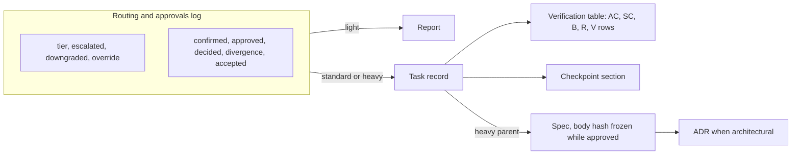

# 0003 — Minimum artifact schemas

- **Status:** proposed (2026-10-10). Awaiting the owner's approval.
- **Date:** 2026-10-10
- **Deciders:** project owner
- **Depends on:** [ADR 0001](0001-product-boundary.md) and [ADR 0002](0002-ceremony-tiers-and-routing.md), both `accepted`.
- **Contract:** [artifact contracts](../artifact-contracts.md) has the field-level detail, the state machine and the examples. This record holds the decisions and the rationale.
- **Evidence:** [D3 evidence](../research/d3-artifact-evidence.md) (codes `A1`–`A8`) and [D2 evidence](../research/d2-routing-evidence.md).

## Context

ADR 0002 fixes what each tier persists and leaves the fields to D3:

- `light`: nothing persisted. The routing line and the evidence go in the report.
- `standard`: a task record.
- `heavy`: a spec, task records, a checkpoint when work crosses sessions, an ADR when architectural, and an evidence record.

The [SDLC brief](../briefs/sdlc-harness-brief.md) adds hard requirements:

- Structured Markdown is the initial source of truth.
- Spec states are `draft`, `approved` and `superseded`. Replacing an approved spec requires human approval.
- Task states distinguish `completed`, `verified` and `accepted`, and support partial and blocked outcomes.
- A checkpoint is concise state, revalidated on resume.
- A prompt-only budget is a guideline, not enforcement.

Neither reference pack versions its artifacts, separates verified from accepted, or protects an approved spec from edits (A1, A3, A6, A7). D3 has to define those parts itself.

The [friction log](../friction-log.md) is still empty. Every choice below is sized to what ADR 0002 requires, not to an observed friction.

## Problem

Define the least persisted information that lets a task be executed, resumed and verified safely in each tier. It has to:

- keep `light` free of files;
- keep `standard` short;
- make an approved `heavy` spec tamper-evident;
- be validated mostly by a small deterministic script;
- evolve without silently rewriting user-owned or approved files.

## Decision (proposed)

1. **Three artifact kinds, not five.** Task record, spec and ADR are files. The routing record, the checkpoint and the evidence record are sections of the task record. ADRs keep this repository's existing format.
2. **One routing and approvals log for every tier** ([contract](../artifact-contracts.md) §2.3). It's one keyword-prefixed bullet per event: tier, escalation, downgrade, override, `heavy` confirmation, approval, owner decision, divergence and acceptance. In `light` it's the first lines of the report. In `standard` and `heavy` it's the task record's `## Routing and approvals` section. Budget and constraints live in their own section and aren't repeated in the log.
3. **The task record serves `standard`, the `heavy` parent and the `heavy` children.** It has seven frontmatter keys at most and four always-required sections: routing log, objective with scope, acceptance criteria, verification. Plan, blockers, checkpoint, review, outcome and budget overrides appear only when their condition holds ([contract](../artifact-contracts.md) §3.2).
4. **Eight task states.** They are `todo`, `active`, `blocked`, `completed`, `verified`, `accepted`, `partial` and `cancelled`, with guarded transitions.
   - `completed` means implemented but not fully verified.
   - `verified` means every required row is `pass` on one recorded commit (`verified_at`).
   - `accepted` needs the owner.
   - `standard` work ends at `verified`, and the `heavy` parent ends at `accepted` (ADR 0002 §5).
5. **One verification table plans the checks and records the evidence.** It has rows for criteria (`AC`, `SC`), baseline (`B`), regression (`R`) and self-review (`V`), each with a result and the commit it ran on. A failing `R` row counts only when a `B` row shows the same failure before the change.
6. **The `heavy` evidence record is the parent task record:** integrated `SC`, `R` and `B` rows plus a `## Review` section. Children keep their own rows and aren't copied. `accepted` never authorizes release, deploy or migration; each needs its own `approved:` entry.
7. **The spec is separate from execution state and frozen by a body hash.**
   - While `approved`, the body must hash to `approved_hash`.
   - Changing an approved spec means reopening it (`draft`, `version + 1`, a `## Revisions` line) and getting it reapproved.
   - Children on the old version that depend on the change go to `blocked`.
   - An owner-approved exception is the alternative to changing the spec.
   - Approvals are logged in the parent task, not in the spec, so the hash stays stable.
8. **Serialization:** Markdown with a small YAML frontmatter (only keys a script reads), plus fixed `##` sections. There is no separate JSON Schema, database or runtime. The contract document is the schema. An M1 script will implement the deterministic checks ([contract](../artifact-contracts.md) §7).
9. **Evolution:**
   - `schema: task/1` and `spec/1` carry a major version only.
   - Additive optional changes need no bump. Readers tolerate unknown keys and sections.
   - Terminal records are never migrated.
   - Open records migrate only in an explicit, reviewable commit.
   - A body migration of an approved spec requires reapproval.
   - Missing values are never invented. An invalid state is fixed by moving the status back, never by editing evidence.
10. **Budgets carry an enforcement label** (`hard` or `guideline`). Today only platform permissions are `hard`. Numeric token and time limits wait for D4.

## Alternatives considered

### A. Where the routing decision lives

| Option | Pros | Cons | Verdict |
|---|---|---|---|
| **A1. A section of the task record; the report for `light`** | One file to read on resume. No duplication. `light` stays file-free | Routing data across tasks has to be collected from many files | **recommended** |
| A2. A separate append-only routing log per repository | Easy to aggregate for D4 and D7 | Duplicates the task record. Merge conflicts. `light` would need a write | rejected |
| A3. Report and commit messages only | No files | Lost for a `standard` resume, and the gates can't be checked | `light` only |

### B. Standard task record

| Option | Pros | Cons | Verdict |
|---|---|---|---|
| **B1. One Markdown file per task, with fixed and conditional sections** | Matches both references (A3, A7). Self-contained resume. Checkable | Another file per task | **recommended** |
| B2. One shared `tasks/todo.md` checklist (A7) | Fewest files | No per-task state, evidence or checkpoint. Merge conflicts | rejected |
| B3. A directory per task (task, checkpoint, evidence files) | Separation of concerns | About three times the files and reads per resume | rejected |
| B4. Pocock's local ticket as-is (A3) | Minimal | One status (`ready-for-agent`). No completed, verified or accepted. No evidence | rejected, but its shape is reused |
| B5. Separate criteria list and evidence list | Familiar | The same IDs appear twice and drift | rejected for the single verification table |

### C. Heavy spec, approval and versions

| Option | Pros | Cons | Verdict |
|---|---|---|---|
| **C1. Separate spec; body hash frozen while approved; reopen in place with a version bump** | Silent edits become a deterministic failure. One file. Git keeps the old text | Needs a hash script. Even a typo needs reapproval | **recommended** |
| C2. One `heavy` file holding spec and execution state | Fewer files | Every status update edits the approved file, so silent changes can't be told apart. Brief §6 says a spec mustn't become a diary | rejected |
| C3. A new immutable file per spec version | Trivially immutable | Files multiply and references break, while Git already keeps history | rejected |
| C4. Living spec, edited freely (A6) | Least friction | Breaks the brief's approval rule | rejected |
| C5. Record the approval commit SHA and diff against it | No hash | Needs full history (fails in shallow clones). A file can't contain its own commit SHA | rejected |
| C6. A separate evidence file for `heavy` | Literal reading of ADR 0002 §4 | Duplicates the parent's verification table | rejected for the parent record (decision 6) |

### D. Serialization and validation

| Option | Pros | Cons | Verdict |
|---|---|---|---|
| **D1. Markdown, small YAML frontmatter, fixed `##` sections** | Readable, diff-friendly, the same pattern as Claude Code skills (C6 in the D2 evidence). Standard YAML parsers | Two syntaxes. YAML type coercion (dates, `no`) needs care | **recommended** |
| D2. Markdown sections only, `Key: value` lines | One syntax | Ad hoc parsing, more brittle | rejected |
| D3. YAML or JSON files with JSON Schema | Strongest field validation | Prose in YAML is painful. Two representations drift. The brief asks for Markdown | rejected |
| D4. D1 plus a JSON Schema for the frontmatter | Standard tooling for about seven keys | The important checks span files (hash, parents, transitions), which JSON Schema can't express | deferred until a second consumer needs it |
| D5. External tracker (GitHub Issues) | Native UI | Not local or offline. Harder to check. The brief wants Git-versioned state | rejected for V1 |
| D6. Database or SQLite | Queries | Not human-readable. The brief rules it out without evidence | rejected |

### E. Evolution

| Option | Pros | Cons | Verdict |
|---|---|---|---|
| **E1. Major version, tolerant reader, no auto-migration, explicit migration commits** | Safe for user-owned and approved files. Old records stay valid | Two majors must be readable for a while | **recommended** |
| E2. Semantic version per schema | Finer signal | Overkill for a few personal files | rejected |
| E3. No version; fix files when rules change | Simplest | Silent rewrites. Old terminal records fail validation | rejected |
| E4. Automatic migration script | Convenient | Rewrites user and approved files without review (compare A8) | rejected |

## Consequences

- `light` stays free: no file, one routing line, the evidence in the report.
- A `standard` record is about 30–60 lines and is read only on resume or review.
- `heavy` adds one spec file and an extra parent record. The rest of the ceremony runs inside `standard` children, as ADR 0002 intends.
- Until M1 builds the validator, every "det" check is a checklist the agent follows, not an enforced control. Reports must say so.
- Approvals are recorded by the agent from the owner's explicit words. The validator can prove they exist, not who wrote them.
- D5 decides where `tasks/` and `specs/` live in a target repository. It also decides how the records relate to Claude Code's session task list, and whether the validator runs as a hook, a script or a skill step.
- D7 can use the routing log, `verified_at` and the state history as per-task data. `light` tasks leave no file, so their data must come from transcripts or the report (D4).

## Follow-ups (open, not blocking)

1. Should a `light` task leave a routing trailer in its commit message (for example `Tier: light (...)`), so D4 and D7 can count it at no file cost?
2. Should `standard` tasks have an optional owner `accepted` step when the owner reviews the diff, or is `verified` plus a merge enough?
3. If typo-level reapprovals of approved specs turn out to be frequent, should an "editorial" revision class exist? Add one only after a logged friction.
4. When the evaluation record is needed (D7), define it as a new contract here rather than overloading the task record.
