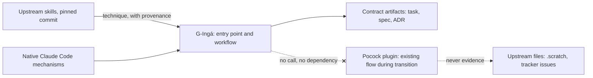

# 0004 — Reuse strategy for existing skills

- **Status:** accepted (2026-10-10)
- **Date:** 2026-10-10
- **Deciders:** project owner (approved 2026-10-10 as a strategic decision: "Aprovar como decisao estrategica"). The approval covers the Decision items 1–7. The replacement criteria in evidence §10 and the open questions below stay provisional and can change without amending this record
- **Depends on:** [ADR 0001](0001-product-boundary.md), `accepted`. Constrained by [ADR 0002](0002-ceremony-tiers-and-routing.md) and [ADR 0003](0003-minimum-artifact-schemas.md), both `accepted`; this record doesn't change either.
- **Evidence:** [D6 evidence](../research/d6-reuse-evidence.md). Codes like `S3`, `P18`, `C15` and `M4` below refer to that note.
- **Revision (2026-10-10, before acceptance):** after the owner described their setup and goal (S1–S3).
  - The end state is exclusive use of G-Ingá. The plugin is the existing flow during the transition, not a permanent complementary tool.
  - Native Claude Code mechanisms are explicitly allowed.
  - The cloud-availability evidence separates what the docs guarantee from what wasn't verified.
- **Revision (2026-10-10, final audit, before acceptance):** claims checked one by one and classified (evidence §9).
  - Scopes narrowed: the incompatibility holds for the skills read, a repository can carry plugin files by vendoring them, and `domain-modeling` offers ADRs rather than writing them unasked.
  - The transition table now says no role is covered yet, and each row has observable replacement criteria (evidence §10).

## Context

The owner moved from plan mode to Matt Pocock's skills (ADR 0001). Today they install them by adding the upstream repository as a plugin marketplace, and their flow uses `wayfinder`, `grill-with-docs`, `to-spec` and `to-tickets` (S1, S2). **The goal is to move to G-Ingá as the only development harness:** no two competing workflows, and no permanent dependency on the plugin to orchestrate the cycle. G-Ingá should still reuse useful knowledge from that ecosystem selectively, while staying the entry point, the owner of the workflow and the source of truth for the contracts (S3).

What the evidence shows:

- None of the upstream skills read for this decision writes an artifact the [artifact contracts](../artifact-contracts.md) accept. That holds at `v1.3.1` and at `main`.
  - `to-spec` has no status, version or approval hash, and publishes without a spec approval step.
  - `to-tickets` sets one triage role, `ready-for-agent`, writes criteria as checkboxes and records no verification evidence.
  - `domain-modeling` offers ADRs for `docs/adr/` in a format that doesn't require Status, Date or Deciders and doesn't reserve acceptance for the owner (M1–M9).
- What does fit is technique: question rounds with recommended answers, vertical slicing, expand–contract, test seams, no file paths in specs (M12, M13, A2). The accepted contract already adopted some of it without upstream text.
- The plugin is enabled or disabled as a whole: `skillOverrides` doesn't reach plugin skills, and whether `Skill(...)` deny rules do is untested. All 27 skills are reachable whenever it's on, and 11 of them put their descriptions in context every turn (P7, C11, C12).
- The installed text isn't pinned by anything G-Ingá controls. On the owner's route, the docs say auto-update is off by default and the version comes from `plugin.json`, which stays at `1.3.1` while the skills' text changes (P22, C14, C19). The owner's machine wasn't inspected.
- Plugins enabled in user settings or in a repository's settings aren't installed in a cloud session (C15). Skills enabled on a claude.ai account do load there (C20). Committing plugin files into the repository is a separate route, and it amounts to vendoring (C21). Whether the owner's own cloud sessions have any Pocock skill wasn't verified (evidence §7).
- Upstream changes fast and renames the very skills in question (P10), and it won't take per-person options: those go in your own `CLAUDE.md` or a fork (P11).
- The license is MIT, and its notice must go with copies or substantial portions (P6). Our reading is that adapting a technique in our own words copies no text. That's an inference, not legal advice. Some upstream text is itself copied from other projects (P23).

The [friction log](../friction-log.md) is still empty. Nothing below rests on an observed friction.

## Problem

Choose the smallest reuse strategy that:

- leads to G-Ingá as the only harness, with no architectural dependency on the plugin, even during the transition;
- doesn't let third-party text write or gate a contract artifact;
- behaves the same wherever G-Ingá runs, local or cloud;
- reuses what's useful without paying upstream's churn or rebuilding what G-Ingá doesn't need.

## Decision

1. **G-Ingá is the end state.** It's the single entry point for development work, it owns the workflow, and its contracts (ADR 0003) are the only source of truth for task, spec, verification and approval. The Pocock plugin isn't part of the target architecture (S3).
2. **G-Ingá writes its own instructions for the contract path.** That means every step that reads or writes an ADR 0003 artifact or records an owner gate: routing, task record, spec drafting, approval and reopening, decomposition into children, the verification table, checkpoints and review. None of the upstream skills read fits (M1–M9).
3. **No dependency on the plugin, at runtime or by design.** G-Ingá's instructions never call an upstream skill, by bare or namespaced name (P14, C10). They never require `/setup-matt-pocock-skills`, `docs/agents/`, `.scratch/`, a tracker label or `GLOSSARY.md` (P13). Files upstream skills produce are never evidence for a G-Ingá gate: an upstream spec isn't an approved spec, and an upstream ticket isn't a task record. A G-Ingá flow behaves the same with the plugin installed or absent.
4. **Native Claude Code mechanisms are allowed.** G-Ingá may use any of them internally: skills, subagents, hooks, `CLAUDE.md`, settings and permission rules, plan mode, and later its own plugin packaging, which ADR 0001 still defers. Which mechanism serves which need is D5's call. Item 3 is about independence from the Pocock plugin, not from Claude Code.
5. **Reuse technique selectively, not text.** Where a G-Ingá instruction adapts an upstream technique, it's rewritten in G-Ingá's terms and sized to its contracts. Each adaptation names its upstream file and pinned commit, the way the research notes do (ADR 0001 §3, provenance). If upstream text is ever copied closely, the MIT notice goes with it (P6).
6. **No vendored copies without a demonstrated need.** Vendoring a skill verbatim needs a logged friction (ADR 0001 §4). The copy must be unmodified, pinned to a commit, carry the MIT notice, and be recorded in a new or amending decision record. A modified copy is G-Ingá's own skill under item 5, not a vendored one.
7. **The current plugin flow is transitional.** The owner keeps using it while G-Ingá doesn't yet cover a role from the table below. During that time it's the owner's existing workflow, not a G-Ingá component: no G-Ingá instruction, artifact or gate refers to it.
   - **No role is covered today.** A G-Ingá skill with a similar name doesn't count as coverage.
   - A role counts as covered only when the observable criteria in evidence §10 hold on real tasks.
   - Each upstream skill leaves the owner's flow once its role is covered.
   - Sequencing the transition, and how many tasks are enough (D7), is V1 spec work, not D6.

| Upstream skill (S2) | Its role in the current flow | Intended G-Ingá mechanism (not built) | Technique to adapt (item 5) |
|---|---|---|---|
| `grill-with-docs` | interview to sharpen an idea, keeping a glossary and offering ADRs | `heavy` question rounds (ADR 0002 §4). ADRs in `docs/decisions/`, accepted only by the owner (M9) | frontier rounds with recommended answers (P4, M12). Glossary: no G-Ingá contract yet (open question 3) |
| `to-spec` | turn the conversation into a spec | `spec/1`: draft, owner approval, frozen body hash (ADR 0003 §7) | test seams, no file paths (A2) |
| `to-tickets` | split a spec into dependency-ordered tickets the owner approves | `task/1` children with `depends_on` and `spec: id@N` (ADR 0003 §4). No owner gate on the breakdown itself (open question 4) | vertical slices, expand–contract, `NN` order (A4, M13) |
| `wayfinder` | multi-session discovery that produces decisions, not code | None dedicated. Nearest: `heavy` through H1 or H5 (ADR 0002 §2), which assumes one spec, plus the decision-map and ADR process this repository uses. The largest gap (open question 5) | destination, fog and frontier; one decision per session (P20) |

## Alternatives considered

| Option | Pros | Cons | Verdict |
|---|---|---|---|
| A. Depend on the installed plugin | No text to maintain | Contradicts the goal: the plugin would keep orchestrating part of the cycle (S3). Can't write contract artifacts (M1–M9) or be customized without forking (P11). Every-turn cost for 11 descriptions (P7). Installed text isn't pinned by G-Ingá (P22, C19). A repository's settings don't bring it into a cloud session (C15) | rejected |
| B. Vendor copies of selected skills | Pinned, reproducible, present wherever G-Ingá is | The contract writers need rewrites anyway, so the copies become forks. `wayfinder` pulls in four more skills (evidence, Sources). Merging updates means following 545 commits and repeated renames (P10) | rejected for now; item 6 sets the bar for a later exception |
| C. Write our own for everything, including TDD, review and a full `wayfinder` | Full control, one voice | Rebuilds what G-Ingá has no logged need to own. Against principle §7 (grow from friction) | rejected |
| D. Own the contract path, depend on the plugin only for `grilling` | Reuses the interview primitive as-is | A permanent dependency, against S3. The whole plugin comes with it (C11). `grilling` dispatches sub-agents against the default of 0 (M10). The question style is still open ([principles](../principles.md) §2) | rejected |
| E. Own the contract path, vendor `grilling` verbatim | Small, pinned | Needs edits for M10 and possibly the question style, so it wouldn't stay verbatim. 11 changes in 90 days (P10) | rejected; adapt it under item 5 instead |
| G. Own the contract path, keep the plugin as a permanent tool next to G-Ingá | No migration cost for the four skills | Two workflows with overlapping roles, against S3. Ambiguous entry point: `/to-spec` and G-Ingá's spec flow would both stay reachable | rejected |
| **F. G-Ingá as end state, own contract path, native mechanisms allowed, selective reuse of technique, no vendoring, plugin transitional (this decision)** | One harness at the end. Same behavior everywhere. Pays only for what G-Ingá uses. Matches what ADR 0003 already did | G-Ingá maintains its own text. Upstream improvements need a deliberate reread. The transition needs its own sequencing | **recommended** |

## Consequences

- G-Ingá carries its own instructions for the `heavy` question rounds, about the size of upstream `grilling`. That's the only conversational duplication, and it's deliberate (items 2 and 5).
- Upstream fixes don't reach G-Ingá automatically. The pinned revisions in the research notes are the anchor for a later reread. There's no drift tracker by design: building one would be a framework without a friction.
- During the transition, both flows are reachable in the same repository. `/mattpocock-skills:to-spec` writes `.scratch/` files that the [validator](../development.md) doesn't read, so nothing fails, and nothing is protected either. Item 3 makes them non-evidence.
- The transition ends when all four rows meet their criteria in evidence §10, so the owner no longer needs the plugin for any of these roles. Until then, misroutes between the two flows, and every fallback to an upstream skill, belong in the friction log. Those entries are the main evidence the criteria use.
- Text copied verbatim from upstream, if it ever happens, needs a license file next to it. Nothing needs one today.

### Implications for D5

These are inputs to D5, not answers.

1. **Where G-Ingá's own files live.** A cloud session gets the repository's `.claude/skills/` and `CLAUDE.md` from the clone, but not personal skills or plugins from a machine (C15). Account-enabled skills are a third channel (C20). A per-repository copy reaches cloud sessions. A personal install or a plugin reaches every local project. Whether a skills-directory plugin committed to the repository loads in a cloud session is unverified (C21). Plugin packaging stays deferred (ADR 0001), so D5 has to weigh these.
2. **One mechanism per role.** Each row of the table in item 7 needs a native mechanism: a skill, a subagent, a hook, a script or `CLAUDE.md` text. D5 picks the smallest per role, within ADR 0002 §8.
3. **Names during the transition.** Plugin and project skills with the same name both load, and a bare `/name` can reach either (C10). G-Ingá's skills should avoid upstream names such as `to-spec`, `to-tickets`, `grilling` and `wayfinder`, so the entry point is never ambiguous.
4. **Fixed per-turn cost.** An enabled plugin adds 11 descriptions every turn (P7), and its setup adds a `CLAUDE.md` block (P13). Both count against ADR 0002 §8 while the plugin is enabled. D5 decides whether a G-Ingá-managed repository turns the plugin off in project or local settings during the transition, and which of G-Ingá's own skills are user-invoked only (C12).
5. **Plugins can't be trimmed.** Individual plugin skills can't be hidden with `skillOverrides` (C11). Whether `Skill(...)` deny rules work for them is untested. If D5 wants to keep only part of the plugin during the transition, this is the constraint.
6. **Sub-agents.** The adapted question rounds need a rule for fact-finding. Upstream uses a sub-agent (P16), while the contract's default is 0 (M10).
7. **ADR location in a target repository.** The contract puts ADRs in `docs/decisions/`, and upstream `domain-modeling` writes `docs/adr/` (M9). D5 decides which path G-Ingá uses in a target repository and what it does with ADRs the plugin already wrote there.
8. **Provenance format.** Item 5 requires naming the upstream source of an adapted technique. D5 decides where that line lives in a skill file.
9. **Keep the replacement criteria observable.** The criteria in evidence §10 use what already exists: the validator, the task and spec records, and the friction log. Whatever mechanism D5 picks per role should leave those signals in place, not add a separate tracking system.

## Open questions

These didn't block acceptance: none changes items 1–6. Questions 2–5 shape the transition and the criteria in evidence §10.

1. For `heavy` question rounds, whole frontier with recommended answers (`grilling`) or one question at a time (Osmani's `interview-me`)? This is [principles](../principles.md) §2, and it shapes the text G-Ingá writes under item 5. **Resolved 2026-10-14:** whole frontier with recommended answers, adopted by [spec 2026-10-14-question-rounds-skill](../../specs/2026-10-14-question-rounds-skill.md).
2. Which capabilities of the four skills do you actually rely on? Evidence §10 infers them from the skills' own text. Correct a row where it's wrong.
3. `grill-with-docs` keeps a domain glossary. Does G-Ingá need one, and as a contract artifact or as plain repository docs? Add it only if the transition logs a friction without it. **Resolved 2026-10-14:** plain repository docs at `docs/glossary.md`, created lazily on the first resolved term; adopted by [spec 2026-10-14-question-rounds-skill](../../specs/2026-10-14-question-rounds-skill.md).
4. `to-tickets` asks you to approve the breakdown, while ADR 0002 gates the spec and then splits without a second gate. If you rely on that approval, it needs an amendment to ADR 0002, outside D6.
5. Does the `heavy` route plus the decision-map process cover what `wayfinder` does for you, or does G-Ingá need a dedicated multi-session discovery mechanism? The transition should answer this through the friction log. Until then `wayfinder` stays in your flow.
6. Your installed plugin version, update setting and any `#ref` pin, and whether you've enabled skills on your claude.ai account, weren't checked (evidence §8). They matter for the transition, not for this decision.
