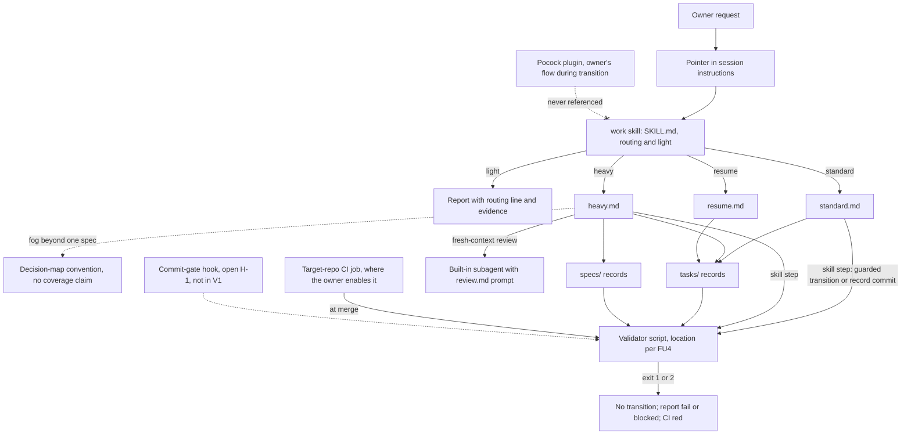

# 0005 — Native primitive mapping

- **Status:** accepted (2026-10-11)
- **Date:** 2026-10-10 (approved 2026-10-11)
- **Deciders:** project owner (approved 2026-10-11: FU1–FU4 pinned bundle distribution, H-1 no commit hook in V1 with CI merge enforcement condition, FU6 coexistence with Pocock plugin, and authorization to author the minimal V1 specification)
- **Depends on:** [ADR 0001](0001-product-boundary.md), [ADR 0002](0002-ceremony-tiers-and-routing.md) and [ADR 0003](0003-minimum-artifact-schemas.md), all `accepted`. D6 is `accepted` in [ADR 0004](0004-reuse-strategy-for-existing-skills.md). This record doesn't change it.
- **Evidence:** [D5 evidence](../research/d5-native-primitive-evidence.md) (codes `N`, `W`, `L`), [D2 evidence](../research/d2-routing-evidence.md) (codes `C`, `P`, `O`), and the [D6 evidence](../research/d6-reuse-evidence.md) (codes `S`, `M`, `P7`, and `C10`–`C21`; quoted in backticks here, such as `C15`, to keep them apart from the D2 codes `C1`–`C9`).
- **Numbering:** first drafted as 0004 and renumbered to 0005 before any commit, because 0004 went to D6.
- **Revision (2026-10-10, proposed):** realigned with accepted D6.
  - The cloud-session evidence now separates four channels, instead of treating personal skills and plugins as unavailable everywhere.
  - Where G-Ingá's files live, how target repositories get them, and how they're updated are no longer decided here. They're follow-ups FU1–FU5. FU1–FU4 block the minimal V1 spec.
  - The commit-gate hook is no longer proposed. Whether it's needed is open (H-1).
- **Revision (2026-10-10, consistency review, proposed):** one V1 validator path throughout. The skill step always runs it. CI runs it where the owner enables the job. No hook. The matrix, the diagram and the result table now say the same.
- **Revision (2026-10-10, reconciled onto `main` at `4604ff3`, proposed):**
  - D6 references are links.
  - FU1–FU4 compare concrete alternatives and carry recommendations. They stay unresolved until the owner decides.
  - H-1 and FU6 have proposals.
- **Revision (2026-10-11, accepted):** approved by project owner.
  - FU1–FU4 settled: G-Ingá repository is canonical; delivery via committed pinned bundle (Alternative A); update by atomic replacement with SHA-256 integrity manifest for accidental drift detection; validator co-located in bundle.
  - H-1 settled for V1: Alternative I (no commit hook in V1). CI validator execution provides merge enforcement only where required status checks / branch protection are configured. Without required checks, no deterministic gate exists and no equivalence may be claimed.
  - FU6 settled: Matt Pocock plugin remains installed and unreferenced during transition, with no runtime dependency.
  - Authoring of the minimal V1 specification document is authorized (does not authorize product implementation).
  - Unresolved questions U2–U8 documented as non-blocking implementation details or deferred follow-ups.
- **Revision (2026-10-13, accepted):** FU7 records the personal plugin channel shipped in [PR #34](https://github.com/EduardoShibukawa/G-Inga/pull/34) ([task](../../tasks/2026-10-13-plugin-marketplace-manifest.md)). The pinned bundle (Alternative A) stays the only distribution for target repositories and CI. Item 9 now points to FU7.

## Context

Base: `main` at `4604ff3`, which holds D6 as [ADR 0004](0004-reuse-strategy-for-existing-skills.md) with the [D6 evidence](../research/d6-reuse-evidence.md).

D6, as accepted (ADR 0004 §1 to §7), sets these bounds on D5:

- G-Ingá is the end state and the single entry point. It owns the workflow and the ADR 0003 contracts.
- No dependency on Matt Pocock's plugin, at runtime or by design. No G-Ingá instruction calls an upstream skill. Files those skills produce are never evidence for a G-Ingá gate.
- Native Claude Code mechanisms are allowed. Which one serves which need is D5's call.
- Upstream technique is adapted in G-Ingá's own words, and each adaptation names its upstream file and pinned commit.
- No upstream skill is vendored without a logged friction.
- The owner's marketplace plugin stays usable during the transition. It's the owner's existing flow, not a G-Ingá component. No role is covered by G-Ingá today, and a same-named skill doesn't count as coverage.

[ADR 0004](0004-reuse-strategy-for-existing-skills.md), "Implications for D5", lists nine inputs. The section "Response to D6's implications" below answers each one, or turns it into a follow-up.

What earlier decisions leave to D5:

- ADR 0002 §8: keep the fixed per-turn routing cost small. The consequences add "deterministic mechanisms only for floors that can be checked".
- ADR 0003, Consequences: where `tasks/` and `specs/` live in a target repository, how records relate to the session task list, and how the validator runs.

The [friction log](../friction-log.md) is still empty.

## Problem

Map each harness responsibility to the smallest native Claude Code mechanism. The result has to:

- keep the fixed per-turn cost small;
- leave the ADR 0003 contract as the single authority for states, approvals, versions and evidence;
- respect D6;
- add no mechanism just because it exists.

How G-Ingá's own files are distributed and kept in sync is a separate question, and this record doesn't settle it (FU1–FU5). FU1–FU4 block the minimal V1 spec.

## Responsibilities

| ID | Responsibility | Inputs | Outputs | Invariants | Failure behavior |
|---|---|---|---|---|---|
| R1 | Entry point and ceremony routing | request, repository state | `tier:` entry (routing line), chosen tier | ADR 0002 §2 rule, categorical. A routing line on every change in every tier. `heavy` needs owner confirmation. The tier never grants permissions | unknown signal → `standard` (ADR 0002 §2). Harness not loaded → plain Claude Code, and the report says the routing line is missing |
| R2 | Context discovery and continuity across sessions | session instructions, open task records, `## Checkpoint`, Git state | known open work, a revalidated state | task and spec records are the only cross-session state. Not transcripts, not the session task list, not auto memory. A checkpoint is revalidated before any edit ([contract](../artifact-contracts.md) §3.6) | record and Git disagree → reconcile first. No record → reroute from the request |
| R3 | Question-driven discovery and specification | `heavy` request, H1 gaps | spec draft, `decided:` entries, `approved:` entry | preference calls go to the owner, facts get investigated (X3). An approved spec is frozen by its hash ([contract](../artifact-contracts.md) §4.3). Under D6, no upstream skill is called | owner unavailable → parent `blocked` |
| R4 | Task decomposition and dependencies | approved spec | child records with `depends_on` | children only after the first approval, the spec gate, no dependency cycles, start guards ([contract](../artifact-contracts.md) §3.3) | validator `fail` → no child starts |
| R5 | Execution, checkpoints, resumption | task record | verifiable increments, checkpoint section | escalation triggers E1–E5 (ADR 0002 §5). Two attempts without new information, then escalate | stop → checkpoint, then `blocked` or `partial` |
| R6 | Verification, evidence, contract validation | verification table, commits | results at `verified_at`, validator report | `verified` only when the verification rule holds (det). `pass`, `fail`, `blocked`, `not run` only ([contract](../artifact-contracts.md) §3.4) | validator `fail` or `blocked` → the record stays `completed`, and the report says why |
| R7 | Human approval boundaries | the owner's explicit messages | `confirmed:`, `approved:`, `decided:`, `accepted:` entries | only the owner approves or accepts. Protected actions go through platform permissions | no approval → `blocked`. Authorship is a trust boundary ([contract](../artifact-contracts.md) §7) |
| R8 | Friction capture and later evaluation | misroutes, rework, fallbacks to an upstream skill | friction-log entries, per-task data for D7 | every harness change traces to a friction ([ADR 0001](0001-product-boundary.md) §4). D6's replacement criteria read these entries | a lost friction weakens the evidence. Nothing breaks at runtime |

## How the mechanisms compare

Evidence is in the [D5 evidence](../research/d5-native-primitive-evidence.md) §1. The availability column shows the channel a file arrives through. Each mechanism can arrive through more than one.

| Mechanism | Deterministic? | Fixed per-turn cost | Cost when used | Can enforce? | If unavailable or failing |
|---|---|---|---|---|---|
| `CLAUDE.md` text | no, guidance | full text, every request (N1) | none | no (N1) | nothing points to the harness |
| Model-invocable skill | no. Even the trigger is stochastic (O5) | name and description (N2) | body once, kept across turns. After compaction only its first 5,000 tokens are re-attached (N2) | no. `allowed-tools` only pre-approves (N4) | not invoked → no ceremony |
| User-only skill | no | none (N3) | as above | no | the owner has to remember to type it |
| Skill supporting file | no | none | read only when needed (N4) | no | that procedure is missing |
| Command hook | yes, always fires on its event | none (N10) | a process per matching event | yes: `PreToolUse` exit 2. Fails open on timeout or other exit codes unless `onFailure: "block"` (N7) | fails open by default |
| Script | yes | none | runtime, plus the output Claude reads | only when a hook or CI gates on its exit code | its runtime missing → `blocked` |
| Built-in subagent | no | none beyond what's already listed | separate context, same usage (N9) | no | no isolated review; the report says so |
| Custom subagent | no | its description (N9) | as above | its `tools` list (N9) | as above |
| Target-repo CI | yes | none | none in the session | at merge, with branch protection | not run |

Delivery channels for skill and instruction files. "Local" means a session on the owner's machine.

| Channel | Local | Cloud | Basis |
|---|---|---|---|
| Committed in the repository (`CLAUDE.md`, `.claude/skills/`, `.claude/agents/`, hooks in `.claude/settings.json`) | yes. Project hooks need workspace trust | yes. Hooks only in single-repository sessions | Fact (docs) N7, N12 |
| Personal (`~/.claude/skills/`, `~/.claude/CLAUDE.md`, user settings) | yes, every project on that machine | no: personal skills load "not [in] Cowork or cloud sessions" | Fact (docs) N6, N12 |
| Plugin enabled in user settings, or by a repository's `enabledPlugins` | yes, where installed | not installed in a cloud session | Fact (docs) N12, `C15` |
| Plugin files committed under `.claude/skills/` (skills-directory plugin) | after workspace trust | not verified | `C21` |
| Skills enabled on the owner's claude.ai account | synced into `~/.claude/skills/synced/` | loaded automatically | Fact (docs) N12, N16. Observed L3 |

No channel is unavailable everywhere. Repository-committed files are the only channel that is versioned with the target repository. That makes committing a reproducibility choice, not something the cloud forces (FU1).

## Decision (accepted 2026-10-11)

The items below choose mechanisms. The distribution architecture and project-local bundle placement are settled under FU1–FU4 below.

1. **One entry point: a skill, provisionally `work`.**
   - It's model-invocable, so its description is in context every turn, and it holds the ADR 0002 routing rule and the `light` floor.
   - `/work resume <task-id>` resumes. There's no separate `/resume` skill and no command per workflow type.
   - Its name avoids upstream names (`to-spec`, `to-tickets`, `grilling`, `grill-with-docs`, `wayfinder`), so a bare `/name` is never ambiguous while the plugin stays enabled (D6 implication 3, `C10`). It must also not collide with a personal skill, which would shadow a project one (N6).
2. **Progressive disclosure inside that skill.**
   - `SKILL.md` holds routing and `light`, under 5,000 tokens so compaction re-attaches it whole (N2).
   - Files read only when the tier needs them: `standard.md`, `heavy.md` (question rounds, spec, decomposition), `resume.md`, `review.md`.
   - Each file that adapts upstream technique names its upstream file and pinned commit in one line at its top (ADR 0004 §5, implication 8).
3. **One pointer in the instructions loaded every session, with no routing rules in it.** It says three things:
   - changes to a deliverable go through `/work`;
   - open work is in `tasks/`;
   - results use `pass`, `fail`, `blocked` and `not run`.

   The routing rule exists only in the skill. Whether the pointer goes in the target repository's `CLAUDE.md` or somewhere else follows FU1. If it's a block in someone else's `CLAUDE.md`, it's delimited, and content outside it is never rewritten (brief §7).
4. **Records live at the target repository's root: `tasks/` and `specs/`.**
   - That's the [contract](../artifact-contracts.md) §2.1 default and the validator's fixed paths ([development](../development.md), "Path assumptions"). Paths aren't configurable.
   - If either directory already exists for something else, setup stops and reports it.
   - ADRs go in `docs/decisions/` (contract). ADRs that upstream `domain-modeling` wrote under `docs/adr/` are left untouched, and they're not evidence for a G-Ingá gate (ADR 0004 §3, implication 7).
   - Records are always committed. They're the cross-session state.
5. **The validator is one deterministic script.**
   - Exit codes: `0` everything passed or was `not run`, `1` a check failed, `2` nothing failed but a check was `blocked` (as in [development](../development.md)).
   - Self-contained: no install step and no network.
   - Where it lives, and whether it shares a source with the instructions, is FU4.

   **V1 runs it in exactly two places:**

   1. **Skill step, always.** The `work` skill's procedures run it before every guarded transition (`verified`, `accepted`, spec approve, reopen or supersede, creating children) and before committing changes to `tasks/` or `specs/`. This is guidance, not enforcement: nothing stops a skipped step.
   2. **Target-repository CI, where the owner enables it.** The V1 spec ships one CI job definition. The owner adds it to each target repository. It's the only deterministic enforcement in V1, and it acts at merge, not at commit. A repository without the job has no deterministic enforcement, and reports must say so.

   The owner can also run the command by hand. **No hook runs it in V1** (item 6, H-1).

   | Validator result | Before a guarded transition (skill step) | Before committing records (skill step) | CI job |
   |---|---|---|---|
   | `0` | the transition may proceed | commit | green |
   | `1` (`fail`) | no transition. The record keeps its status, and the report lists the findings as `fail` | don't commit. Fix the record, or move the status back with a reason ([contract](../artifact-contracts.md) §8) | red |
   | `2` (`blocked`, for example a shallow clone) | no transition to `verified` or `accepted`. The report says `blocked` and why | commit allowed. The report says `blocked` | red. The job must fetch full history, as this repository's workflow does |
   | script or runtime missing, crash | treated as `blocked` | treated as `blocked` | red |

6. **No hook in this proposal.** The commit gate is an open follow-up (H-1, below), not part of V1. Until the owner settles H-1, nothing in V1 depends on it, and no V1 artifact defines it.
7. **No subagent by default.** The contract's default is zero ([contract](../artifact-contracts.md) §3.5).
   - The fresh-context review that ADR 0002 §4 requires uses the built-in general-purpose subagent with the prompt in `review.md`.
   - Fact-finding during question rounds runs inline (D6 implication 6, `M10`).
   - No custom agent definition.
8. **What counts as state.** Task and spec records are authoritative. The session task list may serve as scratch within a session; it's never mirrored and never read on resume. Auto memory holds no harness state.
9. **The Pocock plugin during the transition.**
   - No G-Ingá file refers to it (ADR 0004 §3 and §7).
   - While it's enabled, its descriptions count toward the fixed per-turn cost, outside G-Ingá's control (D6 implication 4, `P7`). This record doesn't decide whether a G-Ingá-managed repository disables it (FU6).
   - G-Ingá's own plugin packaging as a product distribution channel stays deferred ([ADR 0001](0001-product-boundary.md), Consequences). The owner's personal plugin channel is FU7.
10. **No mechanism for Wayfinder's capability, and no coverage claim.** When H1 and H5 both hold and the destination can't yet be one spec, `heavy.md` points to the decision-map convention this repository uses (L6). That doesn't make G-Ingá a replacement for `wayfinder`. D6's open question 5 and its replacement criteria decide coverage, and until they hold, `wayfinder` stays in the owner's flow ([D5 evidence](../research/d5-native-primitive-evidence.md) §5).
11. **Fixed per-turn cost = the pointer from item 3 + one skill description**, plus whatever the transitional plugin adds. No numeric limit is set here: D4 decides how cost is measured.
12. **Not used in V1:** MCP servers, output styles, `.claude/rules/`, `SessionStart`, `Stop` and `UserPromptSubmit` hooks, custom subagents, and `` !`command` `` injection in the skill. The reasons and the triggers for revisiting each are under Alternatives.

### Responsibility-to-mechanism matrix

| ID | Primary mechanism | Deterministic part | Enforces or guides | When it's unavailable | What stays in the contract, not in the prompt |
|---|---|---|---|---|---|
| R1 | `work` skill (`SKILL.md`) plus the pointer from item 3 | none | guides. The `tier:` line is checked only once a record exists | plain Claude Code without a routing line, and the report says so | log grammar ([contract](../artifact-contracts.md) §2.3) |
| R2 | the pointer, `/work resume`, `resume.md` | Git state comparison | guides | the owner names the task | checkpoint format (§3.6) |
| R3 | `heavy.md`, with technique adapted under ADR 0004 §5; the owner in the conversation | spec hash | guides the procedure. The spec freeze is checked by the skill step and enforced only by CI, where enabled | parent `blocked` | spec fields, approval, versions (§4) |
| R4 | `heavy.md`, child records | validator: spec gate, cycles, start guards | checked by the skill step. Enforced only by CI, where enabled | no child starts | §3.3, §4.4 |
| R5 | `standard.md`, task record | none | guides | checkpoint, then `blocked` | states (§3.3), budget labels (§3.5) |
| R6 | validator script | everything marked det in §7 | checked by the skill step. Enforced only by CI, where enabled | `blocked`, never `pass` | §3.4, §7, §8 |
| R7 | Claude Code permissions, log entries | presence of entries | permissions are hard. Authorship is a trust boundary | `blocked` | §2.3, §7 |
| R8 | a `friction:` line in the report, the [friction log](../friction-log.md) | none | guides | the evidence is lost | none yet (D7) |

### Proposed architecture

Solid lines are the V1 path. Dashed lines are open questions, not proposals.

### Response to D6's implications

| D6 implication | Response here |
|---|---|
| 1. Where G-Ingá's own files live | FU1, FU2 |
| 2. One mechanism per role | decision items 1–7 and the matrix |
| 3. Names during the transition | item 1 |
| 4. Fixed per-turn cost while the plugin is enabled | items 9 and 11. Disabling the plugin per repository is FU6 |
| 5. Plugins can't be trimmed | no partial plugin is assumed. FU6 |
| 6. Subagents for fact-finding | item 7: inline |
| 7. ADR location in a target repository | item 4 |
| 8. Provenance format | item 2 |
| 9. Keep the replacement criteria observable | items 4, 5 and 8: records, the validator and the friction log stay the signals. No new tracking system |

### What stays authoritative from D3

- The contract defines validity. The skill's prose says *when* to run a step, never *what* counts as valid. If they disagree, the contract wins.
- No mechanism here relaxes an ADR 0003 rule or writes an approval. CI and the validator only refuse.
- Whether the validator's rules and the instruction text come from one source is FU4. It's a drift risk, not an authority question: the contract is the authority either way.

## Follow-ups that depend on D6 (settled by owner approval on 2026-10-11)

D6 decides who owns the workflow, not how G-Ingá's own files reach a repository. On 2026-10-11, the project owner approved the distribution architecture (FU1–FU4), the V1 hook policy (H-1), and the transitional coexistence policy (FU6). These decisions unblock the minimal V1 specification document.

| ID | Question | Settled Decision (Alternative A) | Rationale & Constraints | Blocks |
|---|---|---|---|---|
| FU1 | Canonical instruction source & delivery channel | G-Ingá repository is canonical; committed per target repository | Verified to load in local and single-repo cloud sessions (N12). Target repositories receive generated, pinned bundle directories committed to Git. | settled (unblocks V1 spec) |
| FU2 | Project-local copies | Adopt Alternative A: dedicated committed bundle directory | Self-contained checkouts (`.claude/skills/work/`, `tools/validate/`, `manifest.json`). No external registry or unverified cloud sync. Light tier preserves zero-file task invariant. | settled (unblocks V1 spec) |
| FU3 | Updates without unmanaged forks or drift | Atomic replacement with SHA-256 integrity manifest | Updates replace the bundle atomically at a new release tag. Manifest hashes detect accidental drift; not cryptographic authentication against deliberate agent tampering. | settled (unblocks V1 spec) |
| FU4 | Validator distribution & source of truth | Co-located inside pinned bundle | Ships beside instructions at the identical version. Target-repo CI runs offline from checkout (runtime such as Node 22 or Bun required). Zero network risk. | settled (unblocks V1 spec) |
| FU5 | Local and cloud session parity | Structural delivery & discovery parity (`N12`); behavioral parity unverified | Committed files guarantee identical versioning and host loading. Effective agent behavior parity remains an empirical hypothesis for spikes/pilot. | settled for V1 (empirical check in D7) |
| FU6 | Pocock plugin during transition | Coexistence: keep installed and unreferenced | Owner's flow remains operational without disruption; no runtime dependency in G-Ingá; replacement verified per ADR 0004 §7 criteria. | settled for V1 |

## FU1–FU4: alternatives and settled decision (Alternative A)

### Alternatives

- **A. Pinned bundle (selected and approved).** G-Ingá's repository stays canonical. A release is a tagged, versioned directory: the `work` skill, its supporting files, the validator and a manifest. The owner copies that directory into each target repository and commits it there.
- **B. Plugin plus fetched validator.** G-Ingá ships as its own plugin, installed on the owner's machine. Each target's CI fetches the validator from G-Ingá's repository at a pinned tag.
- **C. Account skill plus fetched validator.** G-Ingá's skill is enabled on the owner's claude.ai account. CI fetches the validator as in B.
- **D. Git subtree or submodule.** G-Ingá's directory enters each target repository through Git itself.

### Comparison

| Criterion | A. Pinned bundle | B. Plugin + fetched validator | C. Account skill + fetched validator | D. Subtree or submodule |
|---|---|---|---|---|
| Source-of-truth clarity | G-Ingá's repository is canonical. Each copy states its version, and a manifest marks it as generated | canonical, one installed copy per machine | canonical, one copy per account | canonical. A subtree is a copy with merge history. A submodule is a pointer |
| Local and cloud reproducibility | committed project files load in both (N12). The version travels with the target's commit | user- and repo-enabled plugins aren't installed in the cloud (N12, `C15`). Install-time version, not the repo's (`C19`) | loads in the cloud (N12) and syncs locally (N16). Versioning and update timing weren't verified | subtree: same as A. Submodule: whether cloud clones initialize submodules wasn't verified |
| Maintenance | one update commit per target repository per release | one install per machine. ADR 0001 defers packaging | one upload per release | subtree: `git subtree pull` per target. Submodule: pointer bump plus init everywhere |
| Update safety | an explicit, reviewable commit. Local edits are detectable against the manifest | updates move under every repository at once, outside their history | same as B | subtree: reviewable merge, local edits possible. Submodule: reviewable pointer bump |
| CI reliability | the validator is in the checkout. No network, no second pin | needs network and a pin kept in step with the installed instructions | same as B | subtree: as A. Submodule: CI must check out submodules |
| Fixed context overhead | one description, only in repositories that adopt G-Ingá | the plugin's descriptions in every project on that machine | the description in every session on the account | as A |

### Approved decisions

| ID | Question | Settled Decision | Status |
|---|---|---|---|
| FU1 | Canonical source | G-Ingá's repository is the sole canonical authoring source. Target repositories hold generated, pinned bundle copies, committed to Git | approved by owner |
| FU2 | Project-local copies | **Alternative A**: each target commits one pinned bundle directory (`.claude/skills/work/`, `tools/validate/`, `manifest.json`) | approved by owner |
| FU3 | Updates without drift | Update = one explicit commit that replaces the whole bundle and manifest at a new version. SHA-256 manifest detects accidental drift | approved by owner |
| FU4 | Validator distribution | Validator ships co-located inside the bundle at identical version. CI runs offline from checkout (compatible runtime required) | approved by owner |

FU5 follows FU2: file delivery and host discovery are verified (`N12`), while behavioral parity is deferred to empirical validation in spikes and D7.

FU5 follows FU2. Under A, the local and cloud rows in the channel table are documented behavior, not assumptions. Spikes S2 and S5 still apply.

## FU6: settled policy (accepted 2026-10-11)

Two options:

- **Disable the Pocock plugin** in G-Ingá-managed repositories during the migration, through `enabledPlugins` set to `false` in the project's or the machine's local settings. Project settings take precedence over user settings (N17).
- **Keep it installed** until each role's replacement criteria hold.

| Criterion | Disable during migration | Keep until each role is covered |
|---|---|---|
| Fit with ADR 0004 §7 | contradicts it: §7 keeps the flow while no role is covered, and none is today | matches it |
| Per-role control | none: a plugin is on or off as a whole (`C11`) | not needed |
| Fixed context overhead | removes its descriptions (`P7`) | keeps them. They're counted and reported, and D4 measures them |
| Ambiguous entry point | removed | mitigated by distinct names (item 1). Misroutes go to the friction log |
| Evidence for the replacement criteria | lost: the owner can't fall back, so "no fallback" proves nothing | kept: each fallback is a logged data point |

**Proposed:** keep the plugin installed and unreferenced until all four roles meet ADR 0004's replacement criteria on real tasks. The owner may turn it off per repository with `false` in `.claude/settings.local.json` once every role that repository needs is covered.

The replacement criteria stay provisional, as ADR 0004 says. None has been shown on a real task.

## FU7: personal plugin channel (accepted 2026-10-13)

The G-Ingá repository is also a single-plugin marketplace. `.claude-plugin/marketplace.json` lists one plugin, `g-inga`, whose source is the repository root, and `.claude-plugin/plugin.json` adds `.claude/skills/` to the plugin's skill scan. The owner installs it with `claude plugin marketplace add EduardoShibukawa/G-Inga` and `claude plugin install g-inga@g-inga`, and gets the skills as `/g-inga:<skill>` in every project on that machine.

Scope of the channel:

- **Personal convenience, not distribution.** It serves the owner's machine. Target repositories and CI keep the committed pinned bundle (FU1–FU4). Alternative B's objections still hold for distribution: user-enabled plugins aren't installed in a cloud session (N12, `C15`), and the installed version follows the install, not the target repository's commit (`C19`).
- **One source, no copy.** The plugin reads the same `.claude/skills/` files the bundle is built from. There is no second copy to keep in sync, and `manifest.json` doesn't list the plugin manifests.
- **Version follows commits.** `plugin.json` sets no `version`, so each commit on `main` is a new plugin version and `claude plugin update g-inga@g-inga` picks it up. Pinning a version would require a manual bump per release.
- **Fixed per-turn cost.** About 154 tokens for the three skill descriptions in every session where the plugin is enabled (`claude plugin details g-inga`, 2026-10-13). In a repository that also carries the bundle, both copies load, namespaced apart. The owner may disable the plugin per repository with `"enabledPlugins": { "g-inga@g-inga": false }` in `.claude/settings.local.json`.
- **No change to the V1 spec.** Its non-goal "plugin packaging, marketplace distribution, or installer CLIs" covers G-Ingá as a distributed product, which stays deferred. Nothing in V1 depends on the plugin.

## H-1: is a commit-gate hook needed? (settled by [ADR 0009](0009-enforcement-primitives.md), 2026-10-14)

Earlier drafts proposed a `PreToolUse` hook on `git commit` that runs the validator. It's withdrawn. It's an open follow-up, not part of V1 and not implicitly accepted.

- **Invariant it would protect:** no commit that changes `tasks/` or `specs/` fails the [contract](../artifact-contracts.md) §7.1 history walk.
- **Why it might matter:** the walk judges every commit it can see, and validator finding [F8](../research/artifact-contract-validator-findings.md) has no waiver. An invalid commit that reaches `main` keeps failing.
- **Why it might not:**
  - F8 is still open. A waiver or "judge only end states" rule would remove the reason.
  - A squash merge leaves only end states in `main` (§7.1, Limits), so branch-local invalid commits would never reach it. This repository merges with merge commits, which keeps them.
  - CI on the pull request catches the failure before merge, and the branch can then be fixed. Fixing it without rewriting history is the hard part.
- **Coverage, if built:**
  - It sees only commits Claude makes through Bash in a matching form. A human commit, `git -C … commit`, or `git commit -a` with files not yet staged can slip past.
  - It needs workspace trust locally, and it only runs in single-repository cloud sessions (N7, N12).
- **Failure behavior, if built:** it fails open on timeout or an unexpected exit code, unless `onFailure: "block"` is set (N7). Failing closed blocks every record commit whenever the validator is broken.
- **What would justify revisiting it.** All three must hold:
  - F8 is settled as "no waiver";
  - and the merge strategy keeps branch commits;
  - and either a logged friction (an invalid record commit reached a pull request) or spike S3 shows it covers the commit forms the agent uses.

  Until then, alternative I (skill step plus CI, item 5) is the V1 path. A revisit needs a new revision of this record and the owner's approval.

**Proposed:** keep the hook outside V1. None of the three conditions holds today: F8 is open, and no friction or spike exists.

## Local and cloud sessions

| Element | Local | Cloud | Basis |
|---|---|---|---|
| The `work` skill and the pointer | depends on FU1 | depends on FU1 | channel table above |
| Validator runtime | not verified | Node 22 and Bun present in one container | Observed L4. Assumption elsewhere |
| Full Git history for the walk | depends on the clone | not shallow in one container | Observed L4. A shallow clone gives `blocked` ([contract](../artifact-contracts.md) §7.1) |
| Records survive the session | yes | only once pushed | Fact (docs) N14 |
| Pocock plugin (transition only) | where installed | not through user or repository settings. Account-enabled skills unverified | `C15`, `C20`, Observed L3 |

## How to test this without implementing it

1. **Table-top (now).** Walk ADR 0002's R01–R17 and the brief's scenarios through the matrix. For each one: which files load, which mechanism fires, which result propagates where.
2. **Assumption spikes (approved throwaway prototypes only, as brief §10 allows in M0):**
   - S1: how often the skill loads on its own for change requests compared with chat (O5). Pin the model and CLI version.
   - S2: a body under 5,000 tokens survives auto-compaction intact.
   - S3, only if H-1 is pursued: `if: "Bash(git commit*)"` matches the agent's commit forms, and `onFailure: "block"` fails closed.
   - S5: `/context` shows the fixed cost for the channel FU1 picks.
3. **M1 deterministic checks.** The description fits in 1,536 characters (N2). Referenced paths exist. The validator fixtures pass.
4. **Behavioral (D7).** Routing scenarios, plus D6's replacement criteria for each upstream role.

## Alternatives considered

| ID | Option | Why not now | Revisit when |
|---|---|---|---|
| A | Put the ADR 0002 routing rule in `CLAUDE.md` | full text every turn (N1) | never, unless skills stop loading reliably |
| B | User-only entry skill (`disable-model-invocation`) | zero fixed cost (N3), but a change typed without `/work` gets no routing line | D4 shows the description cost matters, or S1 shows auto-loading misfires |
| C | Separate `/work` and `/resume` skills | two entry points to keep consistent | resume needs a different trigger |
| D | One skill per tier or workflow type | several descriptions every turn, and routing duplicated in each | never as entry points |
| E | Call or wrap Pocock's skills for question rounds or decomposition | violates ADR 0004 §3 | — (D6) |
| G | Records in `.g-inga/`, `.scratch/` or `docs/tasks/`, or a configurable path | hidden, or different from the contract. `.scratch/` is upstream's convention, and its files aren't evidence (ADR 0004 §3) | a logged path collision |
| H | Validator in a `Stop` or `SessionStart` hook | `Stop` fires after every response and is capped at 8 continuations (N8). `SessionStart` gates nothing | never for gating |
| I | Validator as a skill step plus CI, no hook | weaker before merge (H-1) | **current V1 position** |
| J | Git pre-commit hook (`core.hooksPath`) | per-clone setup, and not a Claude Code primitive | a human commits an invalid record |
| K | Custom read-only reviewer subagent | its description every turn | a reviewer edits files |
| L | `SessionStart` hook listing open tasks | more machinery than the one-line pointer | a session misses open work |
| M | Mirror records into the session task list | two sources of state | never |
| N | Build a Wayfinder replacement now | coverage isn't demonstrated, and D6 keeps `wayfinder` in the transition flow | D6's replacement criteria for `wayfinder` call for it |
| O | Run the validator through `` !`…` `` when the skill loads | a failing command aborts the whole skill (N5) | never |

## Trade-offs

- **Guidance where judgment lives, enforcement where rules are checkable.** With no hook, nothing deterministic stops an invalid record before it's committed. The skill step can be skipped. CI catches the failure at merge, and only in repositories where it's enabled.
- **Small fixed cost against reliable triggering.** One description per turn buys automatic loading that is still stochastic (O5).
- **Distribution left open.** Deciding mechanisms without the channel keeps the record honest, but the minimal V1 spec can't be written until FU1–FU4 are answered.

## Owner approval recorded (2026-10-11)

1. **D5 accepted.** Approved as native primitive mapping and distribution architecture.
2. **FU1–FU4 approved.** Alternative A (Pinned Bundle): G-Ingá repository canonical, target repositories commit pinned bundle, update by atomic replacement with SHA-256 integrity manifest for accidental drift detection, validator co-located in bundle.
3. **H-1 confirmed for V1.** Alternative I (no commit hook in V1). Validator runs as skill step (guidance) and in target-repo CI at merge (deterministic enforcement contingent on required status checks / branch protection). Without required checks, no deterministic gate exists and no equivalence may be claimed. Pre-tool hook remains an open follow-up.
4. **FU6 confirmed.** Matt Pocock plugin remains installed and unreferenced during transition until ADR 0004 §7 replacement criteria are demonstrated on real tasks.
5. **Authorization to author minimal V1 specification.** Authorized drafting the V1 spec document. Does not authorize product implementation.

## Unresolved questions

| ID | Question | Blocks |
|---|---|---|
| U2 | Validator runtime: a bundled single file for Node, or Bun. Check the owner's machine | M1 |
| U4 | Whether the decision-map convention becomes part of the product, and whether `decision-records` ships with the validator | no. Follows D6's `wayfinder` criteria |
| U5 | Friction capture across repositories: a session in a target repository can't write G-Ingá's friction log | D7 |
| U6 | Setup and update procedure: detect, explain, preserve, be idempotent (brief §7) | the M1 spec, after FU1–FU3 |
| U7 | Numeric limit on the fixed per-turn cost | D4 |
| U8 | Validator findings F1–F14 report `blocked`. Resolving them decides what CI, and any later gate, can refuse | M1 |

## Implications for the minimal V1 specification

The V1 spec can't be written until FU1–FU4 are resolved. Then it has to define:

1. The `work` skill: its description, `SKILL.md`, the four supporting files and their load conditions, and the provenance lines.
2. The pointer text, and where it goes (after FU1).
3. The validator's command-line contract: one command, the exit codes and the result table in item 5, its output, its fixed paths, and where it lives (FU4).
4. The CI job definition the owner adds per target repository (item 5).
5. The review prompt.
6. The distribution and update procedure (FU1–FU3, U6).
7. Acceptance checks: the table-top walk, spikes S1, S2 and S5, and the M1 deterministic checks.

Out of the V1 spec: every hook, the commit gate included (H-1 open), plugins, MCP, custom subagents, configurable paths, a Wayfinder replacement, and numeric budgets.

## Consequences

- G-Ingá's runtime footprint is one skill, one pointer, one validator, the `tasks/` and `specs/` folders, and an optional CI job per target repository. Where those files come from is still open.
- Prompt instructions never decide validity. The contract and the validator do.
- `docs/development.md` keeps saying the record paths are D5's call until this ADR is accepted.
