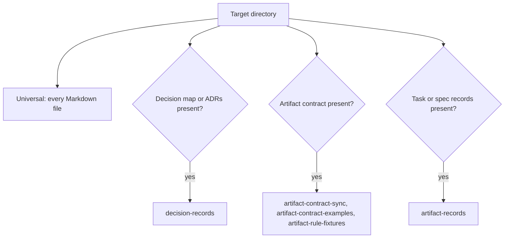

# Development

**Status:** repository tooling, not the G-Ingá product. It validates this repository's documents and the task/spec artifact contract. It doesn't decide how the product runs its own validator (D5).

## Setup

The toolchain is [mise](https://mise.jdx.dev/) plus [Bun](https://bun.sh/). Node.js, npm, pnpm and Yarn aren't used.

| File | Pins |
|---|---|
| `mise.toml` | Bun version and the `mise run` tasks. `locked = true`: mise installs only what `mise.lock` pins |
| `mise.lock` | Bun download URL and checksum per platform |
| `package.json`, `bun.lock` | development dependencies, installed with `bun install --frozen-lockfile` |

Mermaid diagrams are rendered in a headless Chromium or Chrome, which mise doesn't manage. The validator looks for `MERMAID_BROWSER` (or `PUPPETEER_EXECUTABLE_PATH`), then `PLAYWRIGHT_BROWSERS_PATH`, then the usual system paths. Without a browser the Mermaid check is `blocked`, never `pass`. Bun trusts Puppeteer's install script by default, which would download about 670 MB of Chrome; `.puppeteerrc.json` (`skipDownload: true`) turns that off for every `bun install`.

## Commands

```sh
mise install                 # Bun, as pinned in mise.lock
mise run validate            # every applicable deterministic check
mise run test                # type-check and test the validators
mise run validate:external   # external URL availability (network)
```

`mise run validate` runs `bun install --frozen-lockfile` first, then `bun run validate`. With dependencies already installed, `bun run validate` is the direct equivalent. `bun tools/validate/main.ts --root <dir>` validates another directory. CI runs `mise run test` and `mise run validate` in `.github/workflows/validate.yml`.

Exit codes: `0` every check passed or was `not run`; `1` a check failed; `2` nothing failed but a check was `blocked`.

No check edits a document. A failure is fixed in the document or, if the rule is wrong, in the validator, never by the validator.

## Layers

Checks are grouped by what they validate, not by the decision that introduced the rule. Each check states when it applies. When it doesn't apply, it's reported `not run` with the reason, which keeps the exit code at `0`.



### Universal (`tools/validate/universal/`)

Any directory of Markdown. No check assumes frontmatter or a document schema.

| Check | Applies when | What it proves |
|---|---|---|
| `markdown-lint` | any `.md` file | markdownlint with `.markdownlint.jsonc` (line length and table pipe style off). `docs/briefs/` isn't style-linted: briefs are kept as received |
| `local-links` | any `.md` file | Relative links and images resolve inside the directory, `#anchors` match a heading, `[doc](x.md) §N` and `ADR NNNN §N` match a numbered heading or ADR decision item, `ADR NNNN` exists. Links in code are ignored. No network |
| `mermaid` | a `mermaid` block exists | Every diagram renders to SVG with `@mermaid-js/mermaid-cli` |
| `external-links` | only with `validate:external` | 404 and 410 are `fail`; network errors, 401, 403, 429 and 5xx are `blocked` |

### Decision records (`tools/validate/decisions/`)

| Check | Applies when | What it proves |
|---|---|---|
| `decision-records` | `docs/decision-map.md` or a `docs/decisions/NNNN-*.md` exists | ADR H1, Status, Date and Deciders lines; statuses in the decision map's vocabulary; map rows agree with their ADRs and the map diagram; a document whose Status cites "decision Dn" agrees with the map. ADRs without a map are `blocked` |

### Task/spec artifacts (`tools/validate/artifacts/`)

The rules come from the [artifact contracts](artifact-contracts.md). `contract.json` is the contract's state machine for the script, not a second source of truth: it records the contract document (`source`) and the decision record that defined it (`defined_by`), and `artifact-contract-sync` fails when they drift.

| Check | Applies when | What it proves |
|---|---|---|
| `artifact-contract-sync` | `docs/artifact-contracts.md` exists | `contract.json` has its defining record's status and the same edges as the contract's state diagram |
| `artifact-contract-examples` | same | The contract's §9 example records satisfy its state rules |
| `artifact-rule-fixtures` | same | The §7.2 test table and review cases give the expected `pass`, `fail`, `blocked` or `frozen` |
| `artifact-records` | a record exists now, or Git history shows one was ever committed, or the clone is shallow (see below) | Every record there, with the Git history walk (§7.1) and the frozen-record check (§8). Deleted records fail (§6.1). A schema-less file next to real records is `blocked` (§8) |

A `tasks/` folder of ordinary notes, with no `schema:` key, isn't treated as task records. The diagram stays hand-written, because its labels carry the guards in prose.

`artifact-records` uses Git history so that deleting every record can't switch it off:

| Situation | Result |
|---|---|
| Records exist now | the walk runs |
| No records now, but HEAD's history committed one | the walk runs and fails each deletion (§6.1). An uncommitted deletion fails too |
| No records now or in HEAD's history | `not run` |
| Shallow clone, no records now | `blocked`: the missing history can't rule out deleted records (§7.1) |
| Not a Git repository, no records now | `not run`: nothing was ever tracked |
| Not a Git repository, records now | `blocked`: the walk needs Git |

### Path assumptions

Discovery uses fixed paths, relative to the validated directory. They follow this repository and the contract's §2.1. Where records live in a target repository is still D5's call, so these paths aren't configurable yet.

| What | Where it's looked for |
|---|---|
| Markdown files | every `*.md` below the root, except `.git/` and `node_modules/` |
| Files exempt from style lint | `docs/briefs/` |
| Decision map and records | `docs/decision-map.md`, `docs/decisions/NNNN-*.md` |
| Artifact contract | `docs/artifact-contracts.md` (`source` in `contract.json`) |
| Record that defined the contract | `docs/decisions/0003-minimum-artifact-schemas.md` (`defined_by` in `contract.json`) |
| Task and spec records | `tasks/*.md` and `specs/*.md`, top level only. A file is a record when its frontmatter `schema` is `task/N` or `spec/N` |
| Past records | HEAD's history only, not other branches: any commit that added or removed a line starting `schema: task/N` or `schema: spec/N` under `tasks/` or `specs/` (`git log -G`). Such a line in a note's body also counts, and then the whole directory is treated as records |

Where the contract is ambiguous, the validator reports `blocked` with the conflicting sections instead of picking a meaning. Known cases are in [artifact contract validator findings](research/artifact-contract-validator-findings.md).

These checks test the contract during development. They aren't the product's artifact validator, whose mechanism is D5's call.
