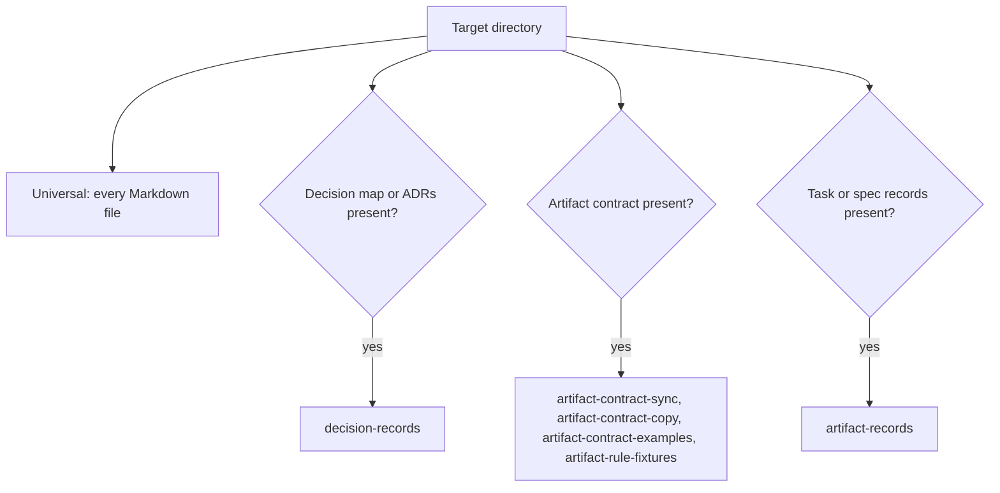

# Development

**Status:** repository tooling, not the G-Ingá product. It validates this repository's documents and the task/spec artifact contract. It doesn't decide how the product runs its own validator (D5).

## Setup

The toolchain is [mise](https://mise.jdx.dev/) plus [Bun](https://bun.sh/). Node.js, npm, pnpm and Yarn aren't used. Git is also needed: the artifact checks read history.

| File | Pins |
|---|---|
| `mise.toml` | Bun, hk and Pkl versions, the `postinstall` hook and the `mise run` tasks. `locked = true`: mise installs only what `mise.lock` pins |
| `mise.lock` | Bun, hk and Pkl download URLs and checksums per platform |
| `hk.pkl` | the Git hooks hk installs: `pre-commit` runs `mise run pre-commit` ([commit gate](#commit-gate)) |
| `package.json`, `bun.lock` | development dependencies, installed with `bun install --frozen-lockfile` |

Mermaid diagrams are rendered in a headless Chromium or Chrome, which mise doesn't manage. The validator looks for `MERMAID_BROWSER` (or `PUPPETEER_EXECUTABLE_PATH`), then `PLAYWRIGHT_BROWSERS_PATH`, then the usual system paths. Without a browser the Mermaid check is `blocked`, never `pass`. Bun trusts Puppeteer's install script by default, which would download about 670 MB of Chrome; `.puppeteerrc.json` (`skipDownload: true`) turns that off for every `bun install`.

### Platforms and shells

| Platform | Status |
|---|---|
| Linux x64 (glibc) | verified: CI on `ubuntu-24.04`, mise 2026.10.7 |
| macOS (x64, arm64), other Linux (arm64, musl) | not verified. `mise.lock` pins a Bun build for them and the browser lookup knows macOS's Chrome path |
| Windows | not verified. `mise.lock` pins a Windows Bun build, but the browser lookup has no Windows paths (set `MERMAID_BROWSER`), and these docs assume a POSIX shell |

Commands below are for a POSIX shell (bash, zsh); they also work in fish. `mise run` and `mise install` don't need shell activation.

### Install mise

Follow the [official installation guide](https://mise.jdx.dev/installing-mise.html) for your platform. CI uses mise 2026.10.7; check yours with `mise --version`.

Its recommended script installs the executable at `~/.local/bin/mise`, which isn't on `PATH` on every system. If `command -v mise` prints nothing afterwards, see [Troubleshooting](#troubleshooting). [Shell activation](https://mise.jdx.dev/shell-setup.html) is optional here: it only puts the pinned `bun` on your interactive `PATH`.

### Install the pinned tools

From the repository root:

```sh
mise install                 # Bun, hk and Pkl, as pinned in mise.lock; installs the Git pre-commit hook
```

The first `mise` command in the repository may ask you to trust `mise.toml`, because it has `[settings]`. Read the file (and its tasks), then accept, or run `mise trust`. `mise run` installs the npm dependencies itself through its `setup` task.

## Commands

```sh
mise run validate            # every applicable deterministic check (full gate of record)
bun run validate:authoring   # fast local current-tree check (skips history walk)
bun tools/validate/main.ts --explain [rule] # show rule rationale and repair guidance
mise run test                # type-check and test the validators
mise run validate:external   # external URL availability (network)
mise run setup               # only install dependencies (bun install --frozen-lockfile)
mise run pre-commit          # what the Git pre-commit hook and the CI pre-commit job run
```

`mise run validate` is the canonical entry point. It runs `bun install --frozen-lockfile` first, then `bun run validate`. `bun tools/validate/main.ts --root <dir>` validates another directory. CI runs `mise run test` and `mise run pre-commit` (which runs `validate`) in `.github/workflows/validate.yml`, after installing the pinned mise with `jdx/mise-action`; it doesn't rely on a Bun or mise already on the runner. It also sets up Node 22 and sets `G_INGA_REQUIRE_RUNTIMES=1`, so the product bundle tests in `tools/validate/bundle.test.ts` fail instead of skipping when Node 22 or later is missing.

For authoring workflows and agent procedures, see [validator-flow](../.claude/skills/validator-flow/SKILL.md).

The product's standalone validator, manifest and update procedure are separate from this tooling; see [bundle](bundle.md). After changing `tools/validate/standalone.ts`, run `bun run build:validator`, commit the bundle assets, then regenerate `manifest.json` (`bun run manifest`) and commit it alone.

Exit codes: `0` every check passed or was `not run`; `1` a check failed; `2` nothing failed but a check was `blocked`, or a prerequisite is missing (below).

Every `bun run` script starts with `tools/validate/preflight.ts`. If `node_modules` lacks a declared dependency, it prints `blocked:` with the setup command and exits `2` before any check runs. If the running Bun differs from the `mise.toml` pin, it prints a warning and goes on. It installs nothing.

### Without mise

`bun run validate`, `bun run test` and `bun run validate:external` run the same scripts, checks and exit codes as the `mise run` tasks, because those tasks call them. They aren't an equivalent toolchain, so use them only to troubleshoot:

- the Bun on your `PATH` is used, not the version and checksum `mise.lock` pins. The preflight warns when the version differs;
- dependencies aren't installed for you. Run `bun install --frozen-lockfile` first, or the preflight stops with exit `2`.

A result from this route is evidence only when it ran on the pinned Bun. CI is the reference.

### Commit gate

[ADR 0009](decisions/0009-enforcement-primitives.md) §2. `mise install` runs the `postinstall` hook, `hk install --mise`, which writes `pre-commit` into the clone's shared hooks directory, so every worktree of the clone is covered. The hook runs `mise x -- hk run pre-commit`, so it works without shell activation. hk stashes unstaged and untracked changes, runs the `pre-commit` mise task, and restores them, so the validator sees what the commit will contain. A non-zero task aborts the commit and the hook prints the findings. A shell chain such as `mise run validate | tail -1 && git commit` can't get past it.

- The steps live in the `pre-commit` mise task (today: `validate`), not in `hk.pkl`, so CI and hosts without hk run the same checks with `mise run pre-commit`.
- `[hooks]` is experimental before mise 2026.10, so `mise.toml` sets `experimental = true`. With an older mise and that setting off, `mise install` warns and installs no hook. A failed `postinstall` is only a warning too: `mise install` still exits `0`, so read its output, or check that `.git/hooks/pre-commit` exists.
- The agent's checked-in permissions (`.claude/settings.json`) deny `git commit --no-verify`, `-n` and `HK=0`. The owner keeps those bypasses. CI runs the `pre-commit` job on every pull request; branch protection on `main` requiring it is an owner setting.
- Remove the gate with `mise x -- hk uninstall`.

### Startup warnings and single skill listing

[ADR 0009](decisions/0009-enforcement-primitives.md) §1. The Claude Code plugin ships `hooks/hooks.json` with a `SessionStart` command (`hooks/session-start.mjs`, 3 s timeout, fail open):

- **Stale plugin warning:** reads the installed `g-inga@g-inga` commit from `~/.claude/plugins/installed_plugins.json` (or `CLAUDE_PLUGIN_ROOT`) and compares it with the marketplace's `main` commit (`git ls-remote`, cached for 24 hours in `${XDG_CACHE_HOME:-~/.cache}/g-inga/marketplace-main.json`). When they differ, it prints a one-line warning to update the plugin.
- **Missing Git hook warning:** when the working repository's `mise.toml` defines `[tasks.pre-commit]` (or a `pre-commit` file task) and `git rev-parse --git-path hooks/pre-commit` does not exist, it prints a one-line warning to run `mise install`.
- **Single listing in this repository:** `.claude-plugin/plugin.json` points at this repository's `.claude/skills/`, so enabling the user-installed `g-inga@g-inga` plugin while working inside G-Ingá itself would list each skill twice (`work` and `g-inga:work`). Checked-in `.claude/settings.json` sets `"enabledPlugins": { "g-inga@g-inga": false }` so the live `.claude/skills/` copy is the only one loaded here.

No check edits a document. A failure is fixed in the document or, if the rule is wrong, in the validator, never by the validator.

## Layers

Checks are grouped by what they validate, not by the decision that introduced the rule. Each check states when it applies. When it doesn't apply, it's reported `not run` with the reason, which keeps the exit code at `0`.



### Universal (`tools/validate/universal/`)

Any directory of Markdown. No check assumes frontmatter or a document schema.

| Check | Applies when | What it proves |
|---|---|---|
| `markdown-lint` | any `.md` file | markdownlint with `.markdownlint.jsonc` (line length and table pipe style off). `docs/briefs/` isn't style-linted: briefs are kept as received |
| `local-links` | any `.md` file | Relative links and images resolve inside the directory, `#anchors` match a heading, `[doc](x.md) §N` and `ADR NNNN §N` match a numbered heading or ADR decision item, `ADR NNNN` exists. Links in code are ignored. No network |
| `mermaid` | a `mermaid` block exists | Every diagram renders to SVG with `@mermaid-js/mermaid-cli` |
| `external-links` | only with `validate:external` | 404 and 410 are `fail`; network errors, 401, 403, 429 and 5xx are `blocked` |

### Decision records (`tools/validate/decisions/`)

| Check | Applies when | What it proves |
|---|---|---|
| `decision-records` | `docs/decision-map.md` or a `docs/decisions/NNNN-*.md` exists | ADR H1, Status, Date and Deciders lines; statuses in the decision map's vocabulary; map rows agree with their ADRs and the map diagram; a document whose Status cites "decision Dn" agrees with the map. ADRs without a map are `blocked` |

### Task/spec artifacts (`tools/validate/artifacts/`)

The rules come from the [artifact contracts](artifact-contracts.md). `contract.json` is the contract's state machine for the script, not a second source of truth: it records the contract document (`source`) and the decision record that defined it (`defined_by`), and `artifact-contract-sync` fails when they drift.

| Check | Applies when | What it proves |
|---|---|---|
| `artifact-contract-sync` | `docs/artifact-contracts.md` exists | `contract.json` has its defining record's status and the same edges as the contract's state diagram |
| `artifact-contract-copy` | `docs/artifact-contracts.md` and `.claude/skills/work/` exist | `.claude/skills/work/references/artifact-contracts.md`, the copy the bundle delivers, is byte for byte the transform `tools/validate/contract-copy.mjs` documents (a header comment plus a link prefix). After editing the contract, run `bun tools/validate/contract-copy.mjs` |
| `artifact-contract-examples` | `docs/artifact-contracts.md` exists | The contract's §9 example records satisfy its state rules |
| `artifact-rule-fixtures` | same | The §7.2 test table and review cases give the expected `pass`, `fail`, `blocked` or `frozen` |
| `artifact-records` | a record exists now, or Git history shows one was ever committed, or the clone is shallow (see below) | Every record there, with the Git history walk (§7.1) and the frozen-record check (§8). Deleted records fail (§6.1). A schema-less file next to real records is `blocked` (§8) |

A `tasks/` folder of ordinary notes, with no `schema:` key, isn't treated as task records. The diagram stays hand-written, because its labels carry the guards in prose.

`artifact-records` uses Git history so that deleting every record can't switch it off:

| Situation | Result |
|---|---|
| Records exist now | the walk runs |
| No records now, but HEAD's history committed one | the walk runs and fails each deletion (§6.1). An uncommitted deletion fails too |
| No records now or in HEAD's history | `not run` |
| Shallow clone, no records now | `blocked`: the missing history can't rule out deleted records (§7.1) |
| Not a Git repository, no records now | `not run`: nothing was ever tracked |
| Not a Git repository, records now | `blocked`: the walk needs Git |

### Path assumptions

Discovery uses fixed paths, relative to the validated directory. They follow this repository and the contract's §2.1. Where records live in a target repository is still D5's call, so these paths aren't configurable yet.

| What | Where it's looked for |
|---|---|
| Markdown files | every `*.md` below the root, except `.git/` and `node_modules/` |
| Files exempt from style lint | `docs/briefs/` |
| Decision map and records | `docs/decision-map.md`, `docs/decisions/NNNN-*.md` |
| Artifact contract | `docs/artifact-contracts.md` (`source` in `contract.json`) |
| Record that defined the contract | `docs/decisions/0003-minimum-artifact-schemas.md` (`defined_by` in `contract.json`) |
| Task and spec records | `tasks/*.md` and `specs/*.md`, top level only. A file is a record when its frontmatter `schema` is `task/N` or `spec/N` |
| Past records | HEAD's history only, not other branches: any commit that added or removed a line starting `schema: task/N` or `schema: spec/N` under `tasks/` or `specs/` (`git log -G`). Such a line in a note's body also counts, and then the whole directory is treated as records |

Where the contract is ambiguous, the validator reports `blocked` with the conflicting sections instead of picking a meaning. Known cases are in [artifact contract validator findings](research/artifact-contract-validator-findings.md).

These checks test the contract during development. They aren't the product's artifact validator, whose mechanism is D5's call.

## Troubleshooting

`mise doctor` reports how mise is installed, activated and configured. The mise [troubleshooting guide](https://mise.jdx.dev/troubleshooting.html) covers its own failures.

| Symptom | Cause and fix |
|---|---|
| `mise: command not found` | mise isn't installed, or isn't on `PATH`. Run `~/.local/bin/mise --version`: if that works, the installer's default location isn't on `PATH`. Add `~/.local/bin` to `PATH` in your shell's startup file, or call `~/.local/bin/mise` directly, then open a new terminal. If it doesn't work, [install mise](#install-mise) |
| `mise` works in one terminal but not in an editor, script or login shell | That program doesn't read the startup file where `PATH` or activation was set. See mise's [shell activation and PATH](https://mise.jdx.dev/troubleshooting.html#shell-activation-and-path) |
| `bun: command not found` after `mise install` | Tools are on `PATH` only in an [activated](https://mise.jdx.dev/shell-setup.html) shell. Use `mise run ...` or `mise exec -- bun ...`, or activate mise |
| mise asks to trust `mise.toml`, or says it isn't trusted | Read `mise.toml`, then accept or run `mise trust` |
| `blocked: dependencies not installed` (exit `2`) | Run `mise run setup`, or `bun install --frozen-lockfile` |
| `warning: Bun X is running, mise.toml pins Y` | You called `bun` directly with another version. Use `mise run ...` |
| `bun install --frozen-lockfile` fails | `bun.lock` doesn't match `package.json`. Update the lockfile in the change that edits `package.json` |
| `mermaid` is `blocked` | No browser found. Set `MERMAID_BROWSER` to a Chromium or Chrome executable |
| `artifact-records` is `blocked` in a shallow clone | Run `git fetch --unshallow` |
| A commit is rejected while every finding is `blocked` | The gate rejects exit `2` as well as `1`. Fix the prerequisite, for example `MERMAID_BROWSER` for `mermaid` |
| A commit fails with `"hk" couldn't exec process` | The hook is installed in the clone, but this worktree's branch predates the gate, so its `mise.toml` has no hk. Merge `main` into the branch and run `mise install` |
| `mise install` warns `hooks is experimental` | mise older than 2026.10 without `experimental = true`. Update mise (`mise self-update`) or keep the setting |
| `mise lock` in a worktree under `.claude/worktrees/` also rewrites the main clone's `mise.lock` | mise updates the lockfile of every config in the directory hierarchy. Run `mise lock` from a copy of `mise.toml` and `mise.lock` outside the clone, then copy the lockfile back |
