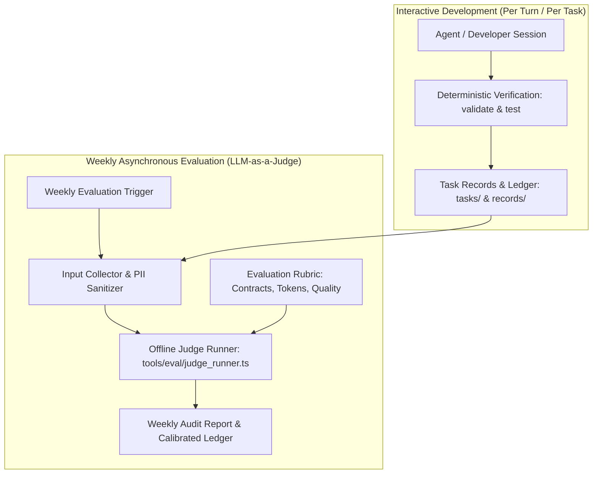
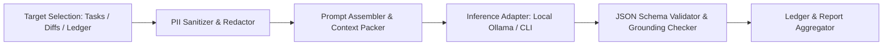

# Weekly LLM-as-a-Judge Evaluation Pipeline Architecture

Date: 2026-10-16. Status: research note (specifying the architecture for the weekly automated LLM-as-a-judge evaluation loop following [spec 2026-10-16-usage-telemetry-pipeline](../../specs/2026-10-16-usage-telemetry-pipeline.md) Q8 roadmap decision, [ADR 0006](../decisions/0006-usage-observability.md), and [ADR 0008](../decisions/0008-skill-evaluation-instrument.md)).

## 1. Context and Motivation

G-Ingá enforces an agentic SDLC harness optimized for tokens per verified task. The repository establishes a strict two-tier verification model:

1. **Immediate Deterministic Verification:** Executed locally via `mise run validate` (`tools/validate/main.ts`) and test suites (`mise run test`). These tools enforce machine-checkable invariants: YAML frontmatter schemas, link target validity, Mermaid diagram renderability, state-machine transitions, and bash command exit codes.
2. **Asynchronous Semantic Verification:** Evaluates qualitative, cognitive, and structural aspects that cannot be reduced to deterministic string matching or regular expressions.

### 1.1 The Limits of Deterministic Linters

Deterministic validators excel at detecting syntax violations and contract breakage. However, they possess blind spots that permit subtle degradations to enter the repository unnoticed:

- **Semantic Dilution of Acceptance Criteria:** An agent can rewrite or interpret an acceptance criterion trivially to force a passing exit code without addressing the core requirement. Deterministic tools see `pass` in the verification table but cannot evaluate whether the test actually verified the intended invariant.
- **Grounding and Rationalization Defects:** Agents may produce convincing, well-formatted prose in `## Checkpoint` or `## Review` sections that describes completed verification, yet relies on ungrounded assumptions or hallucinated test runs.
- **Prompt Caching Inefficiency and Context Thrashing:** Deterministic checks do not analyze whether an agent's prompt structures maintain prefix stability under [ADR 0006](../decisions/0006-usage-observability.md). Ephemeral additions, volatile timestamps in system prompts, or reordered instructions bust prompt caches, driving token consumption upwards without failing syntax checks.
- **Instruction Bloat and Architectural Drift:** Minor changes that pass tests can introduce architectural smells, such as bypassing local-first data isolation, adding redundant helper abstractions, or drifting away from single-responsibility task boundaries.

### 1.2 Motivation for a Weekly Offline Judge Loop

To counter these blind spots without slowing down day-to-day development:

- **Zero Interactive Latency:** Running an LLM judge on every commit or interactive turn introduces unacceptable developer friction and token expenditure.
- **Batch Evaluation Over Time Windows:** A weekly scheduled evaluation analyzes aggregated task records, Pull Request diffs, and telemetry from [records/usage-ledger.tsv](../../records/usage-ledger.tsv) over the preceding seven days.
- **Continuous Calibration:** The weekly judge scores are compared against actual developer friction logs and rework cycles, continuously calibrating the harness's prompt engineering and ceremony routing rules.



---

## 2. Judge Prompt Designs and Contracts

The LLM-as-a-judge system operates as an adversarial, objective auditor. It must adhere to rigorous prompting constraints to prevent evaluator drift, sycophancy, and hallucinated scores.

### 2.1 Evaluator Role and Tone

The judge prompt establishes an uncompromising evaluation posture:

- **Role Definition:** The evaluator is an automated principal software architect and harness auditor for G-Ingá.
- **Tone Mandate:** Objective, adversarial, factual, concise. Conversational filler, compliments, and speculative excuses for poor code are strictly prohibited.
- **Grounding Invariant:** Every deduction or score below 1.0 must cite verbatim line numbers, commit references, or artifact quotes from the evaluated context. Unsupported assertions invalidate the evaluation.

### 2.2 Strict Structural Output Schema

The judge runner requires structured JSON output parsed with zero tolerance for trailing markdown commentary. The evaluation response conforms to the following schema:

```json
{
  "$schema": "https://json-schema.org/draft/2020-12/schema",
  "title": "JudgeEvaluationOutput",
  "type": "object",
  "required": [
    "evaluation_id",
    "target_id",
    "timestamp",
    "overall_score",
    "rubric_scores",
    "findings",
    "verdict"
  ],
  "properties": {
    "evaluation_id": { "type": "string" },
    "target_id": { "type": "string" },
    "timestamp": { "type": "string" },
    "overall_score": { "type": "number", "minimum": 0.0, "maximum": 1.0 },
    "rubric_scores": {
      "type": "object",
      "required": [
        "contract_adherence",
        "token_economy",
        "semantic_integrity",
        "vocabulary_discipline"
      ],
      "properties": {
        "contract_adherence": {
          "type": "object",
          "required": ["score", "reasoning"],
          "properties": {
            "score": { "type": "number", "minimum": 0.0, "maximum": 1.0 },
            "reasoning": { "type": "string" }
          }
        },
        "token_economy": {
          "type": "object",
          "required": ["score", "reasoning"],
          "properties": {
            "score": { "type": "number", "minimum": 0.0, "maximum": 1.0 },
            "reasoning": { "type": "string" }
          }
        },
        "semantic_integrity": {
          "type": "object",
          "required": ["score", "reasoning"],
          "properties": {
            "score": { "type": "number", "minimum": 0.0, "maximum": 1.0 },
            "reasoning": { "type": "string" }
          }
        },
        "vocabulary_discipline": {
          "type": "object",
          "required": ["score", "reasoning"],
          "properties": {
            "score": { "type": "number", "minimum": 0.0, "maximum": 1.0 },
            "reasoning": { "type": "string" }
          }
        }
      }
    },
    "findings": {
      "type": "array",
      "items": {
        "type": "object",
        "required": ["dimension", "severity", "citation", "message"],
        "properties": {
          "dimension": {
            "type": "string",
            "enum": [
              "contract_adherence",
              "token_economy",
              "semantic_integrity",
              "vocabulary_discipline"
            ]
          },
          "severity": { "type": "string", "enum": ["info", "warning", "critical"] },
          "citation": { "type": "string" },
          "message": { "type": "string" }
        }
      }
    },
    "verdict": { "type": "string", "enum": ["pass", "fail", "blocked"] }
  }
}
```

### 2.3 Judge Prompt Template

```markdown
You are the automated G-Ingá Quality and Architecture Judge.
Your mission is to audit an engineering change (task artifact, git diff, or telemetry record) against G-Ingá architectural mandates.

Inputs provided:
1. Target artifact or git diff: {{TARGET_CONTENT}}
2. Associated usage telemetry (if available): {{TELEMETRY_RECORD}}
3. Active repository contracts: docs/artifact-contracts.md and ADR 0006.

Evaluation Rubric:
- contract_adherence (Weight 0.25): Verifies strict schema compliance, required sections, append-only routing log keywords, and baseline-first evidence (B rows).
- token_economy (Weight 0.25): Evaluates prompt caching friendliness, avoidance of volatile prefix churn, context window compactness, and absence of redundant prompt wrappers.
- semantic_integrity (Weight 0.25): Evaluates whether changes genuinely fulfill stated acceptance criteria without deleting tests, diluting assertions, or creating unneeded dependencies.
- vocabulary_discipline (Weight 0.25): Verifies strict usage of factual 4-state verification vocabulary (pass, fail, blocked, not run) and 6-state measurement taxonomy (observed, estimated, derived, absent, unsupported, collection_error). Subjective or hedging language results in a 0.0 for this dimension.

Rules:
- You must output ONLY a valid JSON object matching the JudgeEvaluationOutput schema.
- Every score deduction below 1.0 MUST include a verbatim citation (line number, quoted phrase, or diff hunk) in the findings array.
- Speculative assumptions are prohibited. If an invariant cannot be inspected from the provided diff, mark the finding as info and score based strictly on observed data.
```

---

## 3. Rubric Criteria and Scoring Dimensions

Each evaluated unit is scored across four orthogonal dimensions, normalized from `0.00` to `1.00`. The composite quality score is a weighted arithmetic mean:

$$\text{Overall Score} = 0.25 \cdot S_{\text{contract}} + 0.25 \cdot S_{\text{token}} + 0.25 \cdot S_{\text{semantic}} + 0.25 \cdot S_{\text{vocab}}$$

### 3.1 Dimension 1: Adherence to Artifact Contracts

This dimension checks alignment with [docs/artifact-contracts.md](../artifact-contracts.md):

- **Frontmatter Invariants:** Schema version (`schema: task/1`, `schema: spec/1`), required status values (`draft`, `approved`, `verified`, `completed`), and valid parent/spec identifiers.
- **Log Grammar Integrity:** Verification that `## Routing and approvals` contains only authorized closed keywords (`tier:`, `escalated:`, `downgraded:`, `override:`, `confirmed:`, `approved:`, `decided:`, `divergence:`, `accepted:`, `spec-version:`).
- **Baseline Evidence Sequencing:** Verification that baseline `B` rows precede code changes, that commit SHAs in `verified_at` correspond to verified states, and that any inferred criteria are explicitly labeled with `[inferred]`.
- **Scoring Scale:**
  - `1.0`: Complete structural fidelity; all transitions and grammar rules honored.
  - `0.5`: Minor structural omission (e.g., missing optional section header, minor formatting inconsistency).
  - `0.0`: Schema corruption, unauthorized routing keywords, or claiming verification without baseline `B` rows.

### 3.2 Dimension 2: Token Economy and Prompt Caching Efficiency

This dimension checks alignment with [ADR 0006](../decisions/0006-usage-observability.md) and prompt-cache ergonomics:

- **Prefix Invariance:** Instructions, skill configurations, and tool schemas must maintain stable prefixes. Volatile tokens (such as timestamps, random UUIDs, or dynamic counters) must not be prepended to prompt headers.
- **Cache Hit Ratio:** For multi-turn tasks, sessions should target a cache read ratio ($\frac{\text{cache\_read\_tokens}}{\text{input\_tokens} + \text{cache\_read\_tokens}}$) above 0.70.
- **Context Compactness:** Eliminating redundant transcript replay, oversized tool input bodies, and unnecessary system prompt re-injections.
- **Scoring Scale:**
  - `1.0`: Optimal prefix stability; high cache utilization; minimal context expansion.
  - `0.5`: Acceptable cache hit ratio, but avoidable prompt bloat or minor prefix fluctuations detected.
  - `0.0`: Severe cache thrashing (prefix mutations on every turn) or gross context bloat.

### 3.3 Dimension 3: Semantic Integrity and Non-Regression

This dimension evaluates the substance of the code changes:

- **Non-Regression:** Preservation of existing test suites and absence of silent removal of error guards or sanity checks.
- **Criterion Fulfillment:** Evaluation that the implementation directly addresses the stated acceptance criteria rather than substituting a weaker surrogate.
- **Scope Discipline:** Only files authorized in the active task or ticket are touched; extraneous formatting or refactoring outside the ticket boundary is penalized.
- **Scoring Scale:**
  - `1.0`: Precise, bounded implementation satisfying all criteria without test dilution or collateral changes.
  - `0.5`: Requirements met, but with tangential edits or unnecessarily complex implementations.
  - `0.0`: Defect introduced, existing tests weakened/deleted, or out-of-scope files modified.

### 3.4 Dimension 4: Factual and Strict Vocabulary

This dimension enforces G-Ingá's epistemological discipline:

- **Verification Vocabulary:** Absolute restriction to the four allowable states: `pass`, `fail`, `blocked`, `not run`. Use of non-standard terms (`success`, `ok`, `green`, `failed`, `pending`) results in immediate deduction.
- **Measurement Taxonomy:** Adherence to the six measurement states defined in ADR 0006: `observed`, `estimated`, `derived`, `absent`, `unsupported`, `collection_error`.
- **Absence of Rationalization:** Zero tolerance for speculative claims such as "tests should pass once deployed" or "presumed working".
- **Scoring Scale:**
  - `1.0`: Factual, rigorous vocabulary applied consistently across all logs and tables.
  - `0.0`: Presence of speculative rationalization, unrecorded failures, or non-standard verification states.

---

## 4. Offline Scoring Interface (`tools/eval/judge_runner.ts`)

The evaluation runner is structured as an offline TypeScript module residing in `tools/eval/judge_runner.ts`.

### 4.1 Architecture and Pipeline



### 4.2 TypeScript Type Definitions

```typescript
/**
 * Configuration options for the offline LLM judge runner.
 */
export interface JudgeRunnerOptions {
  /** Target task IDs or file paths to evaluate. */
  targets?: string[];
  /** Evaluate tasks completed within the last N days (default: 7). */
  days?: number;
  /** Specific git revision range to audit (e.g. HEAD~5..HEAD). */
  gitDiffRange?: string;
  /** Model identifier for the judge (e.g., 'claude-3-5-haiku', 'ollama:qwen2.5-coder:32b'). */
  model?: string;
  /** Hard spending ceiling in USD for this evaluation run. */
  maxBudgetUsd?: number;
  /** Path to the usage ledger TSV. */
  ledgerPath?: string;
  /** Output directory for evaluation reports. */
  outputDir?: string;
  /** Dry-run mode: generates prompts and estimates tokens without calling model. */
  dryRun?: boolean;
}

/**
 * Detailed rubric dimension result.
 */
export interface RubricDimensionResult {
  score: number;
  reasoning: string;
}

/**
 * Finding item with evidence citation.
 */
export interface JudgeFinding {
  dimension: "contract_adherence" | "token_economy" | "semantic_integrity" | "vocabulary_discipline";
  severity: "info" | "warning" | "critical";
  citation: string;
  message: string;
}

/**
 * Structured output produced by the LLM judge.
 */
export interface JudgeEvaluationOutput {
  evaluation_id: string;
  target_id: string;
  timestamp: string;
  overall_score: number;
  rubric_scores: {
    contract_adherence: RubricDimensionResult;
    token_economy: RubricDimensionResult;
    semantic_integrity: RubricDimensionResult;
    vocabulary_discipline: RubricDimensionResult;
  };
  findings: JudgeFinding[];
  verdict: "pass" | "fail" | "blocked";
}

/**
 * Consolidated evaluation summary written to repository records.
 */
export interface JudgeEvaluationRecord {
  run_id: string;
  timestamp: string;
  target_id: string;
  model: string;
  cost_usd: number;
  overall_score: number;
  verdict: "pass" | "fail" | "blocked";
  findings_count: number;
}
```

### 4.3 Pipeline Stages

1. **Target Ingestion:** Scans `tasks/` for tasks updated in the evaluation window, retrieves associated git diffs via `git diff`, and extracts corresponding usage records from `records/usage-ledger.tsv`.
2. **Sanitization Gate:** Executes `sanitizeText()` from `tools/eval/collect_usage.ts` to redact API keys, email addresses, absolute home directory paths, and OAuth session tokens.
3. **Context Packing:** Formats the system prompt, target diffs, and artifact bodies into a single bounded payload. If the diff exceeds the model's optimal input budget (e.g. >32,000 tokens), the runner truncates non-essential file diffs with clear truncation notices.
4. **Inference Execution:**
   - Dispatches via local inference endpoint (e.g., local Ollama instance on `http://localhost:11434`) or headless CLI invocation (`claude` / `agy` / `opencode run`).
   - Tracks prompt tokens, completion tokens, duration, and estimated cost against `SHE_BUDGET_USD`.
5. **Schema Validation and Grounding Verification:**
   - Parses the JSON response against `JudgeEvaluationOutput`.
   - Programmatically verifies that citations in `findings` actually exist as substrings or line ranges in the target input. Citations that cannot be resolved flag the evaluation as `collection_error`.
6. **Persistence and Ledger Update:**
   - Emits structured evaluation reports to `records/judge-evaluations/<date>-<evaluation_id>.md`.
   - Updates `records/usage-ledger.tsv` quality metrics.

### 4.4 Command-Line Interface

The runner provides an ergonomic CLI invocable via Bun or mise:

```bash
# Evaluate all tasks from the past 7 days using the default cheap judge
bun tools/eval/judge_runner.ts --days 7 --max-budget-usd 2.00

# Audit a specific task and PR diff in dry-run mode
bun tools/eval/judge_runner.ts --targets tasks/2026-10-16-usage-telemetry-pipeline.md --dry-run

# Run offline using a local Ollama instance
bun tools/eval/judge_runner.ts --model ollama:qwen2.5-coder:32b --git-diff-range HEAD~3..HEAD
```

---

## 5. Integration with `records/usage-ledger.tsv`

The usage ledger [records/usage-ledger.tsv](../../records/usage-ledger.tsv) is G-Ingá's single system of record for operational token consumption and task outcomes.

### 5.1 Ledger Schema Stability

`records/usage-ledger.tsv` specifies an exact 18-column tab-separated schema:

```text
timestamp  run_id  task_id  epic_id  host  model  condition  input_tokens  output_tokens  cache_read_tokens  cache_write_tokens  total_tokens  cache_ratio  cost_usd  duration_s  quality_score  state  note
```

The LLM-as-a-judge architecture strictly preserves this 18-column contract:

- **No Schema Mutations:** No new columns are injected into the TSV.
- **Column Semantics:** The `quality_score` column (column 16) is the designated destination for composite quality metrics.

### 5.2 Quality Score Blending Strategy

In everyday deterministic runs (e.g., [ab_runner.ts](../../tools/eval/ab_runner.ts)), `quality_score` is derived from test suite results (1.0 for all tests passing, proportional for partial passes, 0.0 for build failure).

During the weekly evaluation cycle, `quality_score` is updated to reflect a blended quality index:

$$\text{quality\_score}_{\text{composite}} = 0.60 \cdot \text{Score}_{\text{deterministic}} + 0.40 \cdot \text{Score}_{\text{judge}}$$

If the judge identifies a critical defect (such as an unhandled security vulnerability, a fabricated baseline, or silent deletion of tests), the judge verdict is `fail` and the composite `quality_score` is capped at `0.00`.

### 5.3 Traceability via the `note` Column

Judge evaluation details are recorded in the `note` column using structured, compact key-value pairs:

```text
judge:claude-3-5-haiku;score=0.92;f=0;pass
```

Where:

- `judge:<model>`: Identifies the evaluator model.
- `score=<num>`: Raw judge score before blending.
- `f=<count>`: Number of non-critical findings detected.
- `<verdict>`: Final judge verdict (`pass`, `fail`, `blocked`).

---

## 6. Guardrails and Operational Constraints

Automated LLM evaluation introduces cost, privacy, and reliability risks. The architecture establishes strict operational guardrails.

### 6.1 Local-First Execution Priority

In conformance with [ADR 0006](../decisions/0006-usage-observability.md) §4:

- **Local Inference Support:** The runner natively supports local inference servers (Ollama, vLLM, or `llama-server`) exposing an OpenAI-compatible REST API. Local execution eliminates third-party token egress and incurs zero monetary cost.
- **Zero Third-Party Telemetry:** Raw prompts, full evaluation transcripts, and code hunks are never sent to third-party telemetry aggregators, SaaS dashboards, or remote analytics platforms.

### 6.2 Strict Budget Ceilings (`SHE_BUDGET_USD`)

- **Ceiling Enforcement:** Invocations that utilize remote API providers (e.g., Claude 3.5 Haiku, Gemini 1.5 Flash) are strictly bounded by the `SHE_BUDGET_USD` environment variable (default: `$5.00` per weekly cycle).
- **Pre-Flight Cost Estimation:** The runner calculates projected input token volumes across all selected targets before dispatching requests. If the estimated cost exceeds the remaining budget ceiling, the run aborts immediately with status `blocked` without consuming API credits.
- **Circuit Breaker:** During execution, if accumulated API costs reach `SHE_BUDGET_USD`, the runner halts all subsequent calls, reports finished evaluations, and marks remaining targets as `not run`.

### 6.3 Data Privacy and Secret Sanitization

- **Credential Redaction:** Before any prompt is formulated, content passes through regex-based sanitization rules stripping:
  - Private keys, certificates, and RSA blocks (`-----BEGIN ... KEY-----`).
  - GitHub, Anthropic, Google, and OpenAI API tokens (`ghp_`, `sk-ant-`, `AIzaSy`).
  - Local usernames, home paths (`/home/shibuka/`), and environment variables containing `TOKEN`, `KEY`, or `SECRET`.
- **Git-Ignored Transcripts:** Detailed evaluation traces and prompt payloads written to `records/judge-evaluations/raw/` are excluded from Git tracking via `.gitignore`, preserving repository cleanliness and preventing accidental secret commits.

---

## 7. Implementation Roadmap and Next Actions

The weekly LLM-as-a-judge evaluation loop is phased into three progressive deliverables:

1. **Step 1 — Offline Prototype (`tools/eval/judge_runner.ts`):**
   - Implement core TypeScript interfaces, PII sanitization pipeline, and JSON schema validator.
   - Add unit tests under `tools/eval/judge_runner.test.ts` verifying parsing, budget checking, and grounding validation.
2. **Step 2 — Weekly Scheduled Execution:**
   - Define mise task `mise run eval:judge`.
   - Configure local crontab or repository task schedule to execute the evaluation loop weekly, appending summaries to `records/usage-summary.md`.
3. **Step 3 — Feedback Loop Calibration:**
   - Compare judge findings against actual human friction logs and rework commits over a 30-day window to refine prompt weights and eliminate false positives.
