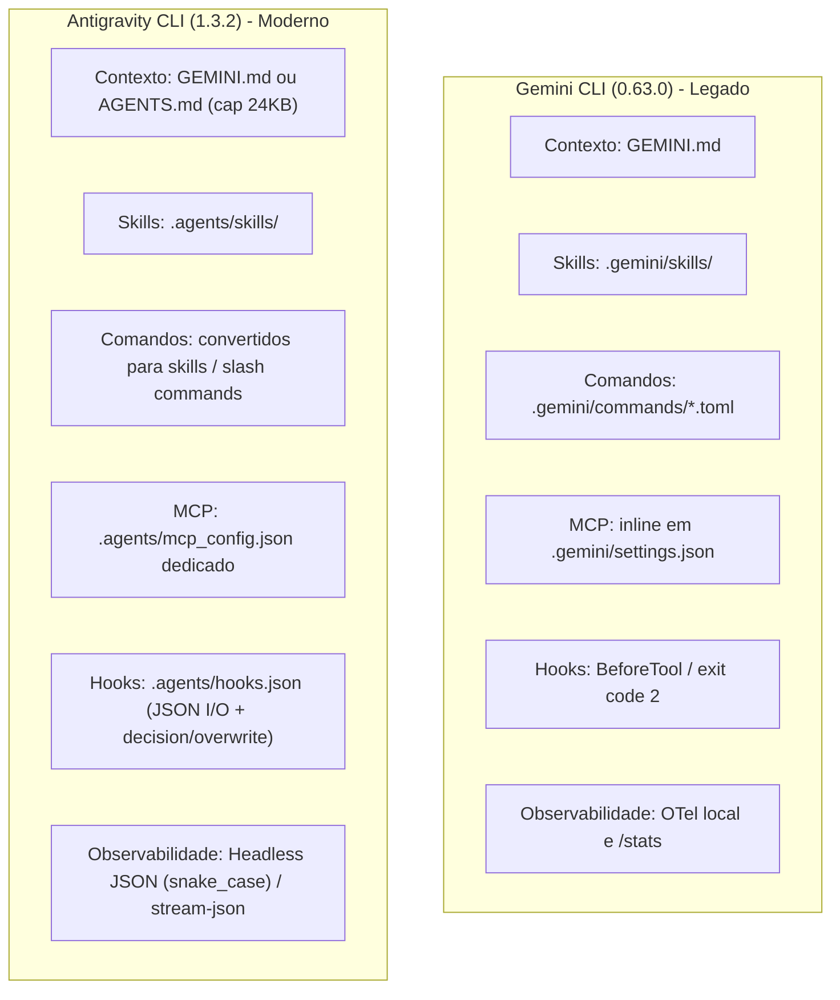

# Antigravity CLI (`agy`) Host Review and Google Runtime Reassessment

**Status:** research note and critical review (reassessment of Google runtime for G-Ingá). Not an ADR. Not a decision.  
**Date:** 2026-10-10.  
**Audited runtime:** Google Antigravity CLI `agy` v1.3.2.  
**Legacy runtime:** `@google/gemini-cli` v0.63.0.  
**Baseline host:** Claude Code v2.1.296.  
**Base commit:** `049b5d6` (clean `origin/main`).  
**Working branch:** `gemini/AGY-HOST-REASSESSMENT`.  
**Task claim:** `refs/heads/task-claims/AGY-HOST-REASSESSMENT`.  
**Audited historical artifacts:**

- `gemini-cli-host-evidence.md` (branch `gemini/GEMINI-ADAPTER-DISCOVERY-host-evidence`, commit `b98c169`)
- `gemini-cli-host-review.md` (branch `gemini/GEMINI-HOST-EVIDENCE-REVIEW`, commit `c318d41`)
- [d5-native-primitive-evidence.md](d5-native-primitive-evidence.md)
- [d4-observability-evidence.md](d4-observability-evidence.md)
- [docs/decision-map.md](../decision-map.md)
- [docs/decisions/0005-native-primitive-mapping.md](../decisions/0005-native-primitive-mapping.md)
- [docs/decisions/0006-usage-observability.md](../decisions/0006-usage-observability.md)
- [docs/artifact-contracts.md](../artifact-contracts.md)

---

## 1. Resumo executivo

Esta pesquisa atualiza a avaliação de compatibilidade do G-Ingá para o runtime de inteligência artificial do Google efetivamente disponível para o mantenedor sob a assinatura **Google AI Pro**: o **Google Antigravity CLI (`agy`)**.

O Gemini CLI tradicional (`@google/gemini-cli`), avaliado em notas de pesquisa anteriores (`gemini-cli-host-evidence.md` e `gemini-cli-host-review.md`), deve ser classificado formalmente como **host legado** para esta modalidade de autenticação. Em 18 de junho de 2026, o Google descontinuou o atendimento a contas individuais e de consumo no Gemini CLI (`IneligibleTierError` / `reasonCode: 'UNSUPPORTED_CLIENT'`), consolidando a experiência de terminal na plataforma Antigravity. A pesquisa histórica anterior permanece preservada como patrimônio de investigação, mas seus achados técnicos não constituem comprovação de compatibilidade com o Antigravity CLI.

### Principais conclusões da reavaliação

1. **Validade e limites do ponteiro de contexto (`GEMINI.md` / `AGENTS.md`):** O Antigravity CLI implementa descoberta hierárquica automática de regras subindo da pasta atual até a raiz do repositório, lendo arquivos `GEMINI.md` e `AGENTS.md` sem frontmatter. Cada arquivo possui limite de 24 KB (24.000 bytes) e concorre no orçamento compartilhado de 20.000 tokens de regras (`defaultRulesBudget`). O direcionamento instrucional do bloco delimitado do G-Ingá é plenamente funcional no `agy`.
2. **Deslocamento estrutural do caminho de skills:** O Antigravity CLI migrou as skills de workspace do caminho legado `.gemini/skills/` para `.agents/skills/` (admitindo também `.agent/`, `_agents/`, `_agent/`). Skills globais do usuário residem em `~/.gemini/antigravity-cli/skills/`.
3. **Incompatibilidade de descoberta nativa no Claude Code:** O Claude Code (v2.1.296) descobre skills exclusivamente em `.claude/skills/`, `~/.claude/skills/` e pacotes de plugins instalados. Ele **não** pesquisa `.agents/skills/` de forma nativa. Qualquer tentativa ingênua de consolidar todas as skills do projeto em `.agents/skills/` sem uma estratégia explícita de ligação ou empacotamento causará falha de carregamento no Claude Code.
4. **Transformação profunda no sistema de hooks:** O Antigravity CLI substitui a configuração de hooks no `settings.json` do Gemini CLI pelo arquivo `.agents/hooks.json`. O protocolo utiliza entrada e saída estritamente estruturadas em JSON via `stdin` e `stdout`, com suporte a decisões (`allow`, `deny`, `ask`, `force_ask`) e reescrita de argumentos (`overwrite`) no evento `PreToolUse`.
5. **Invalidação da premissa de OpenTelemetry em comum (ADR 0006 / D4):** A proposta D4 ([ADR 0006](../decisions/0006-usage-observability.md)) baseou-se na premissa de que tanto Claude Code quanto Gemini CLI exportavam métricas OTel nativas. O Antigravity CLI **não possui** exportador OTLP nativo integrado no binário. A observabilidade estruturada no `agy` é obtida nativamente por meio do modo headless (`--output-format json` e `--output-format stream-json`), dos hooks de ciclo de vida (`PostToolUse`, `PostInvocation`, `Stop`) ou dos logs de transcrição em disco (`transcript.jsonl`).
6. **Inadequação da métrica basal de $\le 100$ tokens:** O runtime do Antigravity CLI injeta seu ecossistema nativo de ferramentas e subagentes, resultando em contexto inicial superior a 130.000 tokens, token caching intenso (> 290.000 tokens de leitura de cache) e tokens de raciocínio estocásticos (`thinking_tokens` ~6.000 tokens). É inviável isolar matematicamente um delta fixo de $\le 100$ tokens em turnos isolados. A aferição de sobrecarga deve focar na proporção de contexto e na retenção do ponteiro após compactação.
7. **Recomendação prioritária:** Manter a demarcação estrita do V1 restrita ao Claude Code conforme [ADR 0001](../decisions/0001-product-boundary.md) (Opção C). Caso o mantenedor decida suportar o runtime Google para sua conta Google AI Pro, concentrar todos os esforços de integração exclusivamente no Antigravity CLI (`agy`) sob a Opção A, sem dispersão em camadas de compatibilidade com o Gemini CLI legado.
8. **Próximo passo experimental:** Especificação detalhada do **Spike AGY-S1**, focado em validar de ponta a ponta o carregamento de instruções, descoberta de skill mínima e execução de tarefa sintética não destrutiva no `agy`, isolado em Git worktree.

---

## 2. Estado e versões dos hosts avaliados

A tabela abaixo resume os runtimes identificados no ambiente do projeto:

| Runtime / Ferramenta | Versão Instalada | Status do Fornecedor | Autenticação Suportada para IA Pro | Canal de Instalação | Papel no G-Ingá |
|---|---|---|---|---|---|
| **Google Antigravity CLI (`agy`)** | `1.3.2` | Ativo e recomendado | Login com conta Google (Keyring nativo / OAuth / Secret Service) e API Key | `/usr/bin/agy` (instalador nativo do sistema) | **Host Google Alvo** para contas Google AI Pro |
| **Google Gemini CLI (`gemini`)** | `0.63.0` | Descontinuado para contas individuais (18/06/2026) | Apenas API Keys pagas do Google AI Studio ou licenças Gemini Enterprise | `/usr/bin/gemini` (pacote npm `@google/gemini-cli`) | **Host Legado / Referência Histórica** (bloqueado com `UNSUPPORTED_CLIENT`) |
| **Anthropic Claude Code (`claude`)** | `2.1.296` | Ativo e recomendado | Login OAuth Claude Pro / Team / Enterprise e API Key Anthropic | `/home/tg/.local/bin/claude` | **Host Canônico V1** ([ADR 0001](../decisions/0001-product-boundary.md)) |

---

## 3. Matriz de compatibilidade e evidências

Cada afirmação técnica relevante foi classificada segundo os critérios de rigor probatório do projeto:

- **Confirmada:** verificada diretamente por meio de comando reproduzível ou inspeção de código-fonte no ambiente atual.
- **Confirmada para versão específica:** validada documentalmente ou empiricamente para a versão exata indicada.
- **Parcial:** o comportamento existe, mas com restrições ou diferenças de contrato em relação ao esperado.
- **Não confirmada:** alegação documentada sem comprovação de teste local no ambiente.
- **Contradita:** evidência refuta formalmente uma premissa técnica assumida anteriormente.

| Afirmação Técnica | Fonte | Data de Consulta | Versão Aplicável | Classificação da Evidência | Detalhes e Notas de Campo |
|---|---|---|---|---|---|
| Descontinuação do Gemini CLI para indivíduos | Google Developers e código de onboarding | 2026-10-10 | `@google/gemini-cli@0.63.0` | **Confirmada** | Requisições encerram com `IneligibleTierError: This client is no longer supported for Gemini Code Assist for individuals` (`reasonCode: 'UNSUPPORTED_CLIENT'`). |
| Migração oficial para Antigravity CLI | `https://antigravity.google/docs/cli/gcli-migration/` | 2026-10-10 | `agy 1.3.2` | **Confirmada** | Guia oficial orienta migração de configurações, skills e extensões para o ecossistema Antigravity. |
| Descoberta hierárquica de `GEMINI.md` e `AGENTS.md` | `agy-customizations/docs/rules.md` | 2026-10-10 | `agy 1.3.2` | **Confirmada** | Caminha da pasta CWD até a raiz Git. Não aceita frontmatter. Capped em 24 KB por arquivo; orçamento agregado de 20.000 tokens (`defaultRulesBudget`). |
| Caminho de skills de workspace no `agy` | `agy-customizations/docs/skills.md` e guia de migração | 2026-10-10 | `agy 1.3.2` | **Confirmada** | Movido de `.gemini/skills/` para `.agents/skills/`. Suporta subdiretórios `scripts/`, `examples/`, `resources/`, `references/`. |
| Caminho de skills de workspace no Claude Code | `https://code.claude.com/docs/en/skills` | 2026-10-10 | Claude Code `2.1.296` | **Confirmada** | Claude Code pesquisa `.claude/skills/` no projeto e `~/.claude/skills/` no usuário. Não pesquisa `.agents/skills/`. |
| MCP em arquivo dedicado `mcp_config.json` | `agy-customizations/docs/mcp_servers.md` | 2026-10-10 | `agy 1.3.2` | **Confirmada** | Servidores MCP deixam de residir no `settings.json` e passam a `~/.gemini/config/mcp_config.json` ou `.agents/mcp_config.json`. Schema remoto usa `serverUrl`. |
| Protocolo de hooks via stdin/stdout JSON | `agy-customizations/docs/hooks.md` | 2026-10-10 | `agy 1.3.2` | **Confirmada** | Definido em `.agents/hooks.json`. `PreToolUse` recebe payload JSON com `toolCall`, `stepIdx`, `conversationId` e retorna JSON com `decision` (`allow`/`deny`/`ask`) e `overwrite`. |
| Execução headless com métricas de tokens | `https://antigravity.google/docs/cli/headless/` e `agy --help` | 2026-10-10 | `agy 1.3.2` | **Confirmada** | `agy -p "<prompt>" --output-format json` retorna `duration_seconds`, `num_turns`, `conversation_id` e objeto `usage` com `input_tokens`, `output_tokens`, `thinking_tokens`, `cache_read_tokens`, `total_tokens`. |
| Enforçamento de saída com `--json-schema` | `https://antigravity.google/docs/cli/headless/` | 2026-10-10 | `agy 1.3.2` | **Confirmada** | A flag `--json-schema` valida a resposta do modelo e popula o campo estruturado `structured_output` no envelope JSON final. |
| Inexistência de exportador nativo OTLP no `agy` | Documentação oficial e repositório de issues | 2026-10-10 | `agy 1.3.2` | **Contradita para D4** (Confirmada para o binário) | `agy` não possui suporte nativo a `OTEL_EXPORTER_OTLP_ENDPOINT` no binário. Telemetria em `settings.json` limita-se a relatórios de falha/estatísticas Google. |
| Compatibilidade de `mise` e `bun` com o validador | Testes executados no worktree local | 2026-10-10 | Bun 1.4.2 / Mise | **Confirmada** | `mise run validate` (Pass, 20.82s) e `mise run test` (Pass, 77 testes, 206 asserções, 36.98s) operam identicamente no ambiente do mantenedor. |

---

## 4. Diferenças entre Gemini CLI legado e Antigravity CLI

A tabela comparativa a seguir destaca as divergências técnicas fundamentais entre os dois runtimes do ecossistema Google:

| Dimensão Técnica | Gemini CLI Legado (`@google/gemini-cli@0.63.0`) | Google Antigravity CLI (`agy@1.3.2`) | Impacto Arquitetural no G-Ingá |
|---|---|---|---|
| **Disponibilidade para Google AI Pro** | Bloqueado (`IneligibleTierError` / `UNSUPPORTED_CLIENT`). | Plenamente funcional via login com conta Google ou API Key. | Torna o Antigravity o **único runtime viável** para o plano do mantenedor. |
| **Instruções de Workspace** | Lê `GEMINI.md` na raiz do projeto. | Lê `GEMINI.md` e `AGENTS.md` hierarquicamente. Capped em 24 KB. Orçamento compartilhado de 20.000 tokens. | O bloco ponteiro precisa permanecer conciso para nunca estourar o cap de 24 KB. |
| **Diretório de Skills do Projeto** | `.gemini/skills/<skill>/SKILL.md` | `.agents/skills/<skill>/SKILL.md` | Incompatível com o caminho de pesquisa nativo do Claude Code (`.claude/skills/`). |
| **Skills Globais do Usuário** | `~/.gemini/skills/` | `~/.gemini/antigravity-cli/skills/` | Configurações globais não devem ser misturadas nem migradas automaticamente. |
| **Custom Commands** | Arquivos `.toml` em `.gemini/commands/` com injeção `{{args}}`. | Não utiliza arquivos `.toml`. Comandos legados são convertidos em skills pelo comando `agy plugin import gemini`. | Simplifica o modelo mental: apenas skills no Antigravity, eliminando os `.toml`. |
| **Configuração de MCP** | Declarada inline no arquivo de preferências `~/.gemini/settings.json`. | Arquivo JSON dedicado: `~/.gemini/config/mcp_config.json` ou `.agents/mcp_config.json`. Schema usa `serverUrl`. | Isola ferramentas externas das preferências do usuário. |
| **Sistema de Hooks** | Definido em `settings.json`. Bloqueio por código de saída `2` ou JSON `{"decision":"deny"}`. | Definido em `.agents/hooks.json`. Protocolo JSON estrito em `stdin`/`stdout`. Suporta `decision: "deny"` e `overwrite`. | Permite gates determinísticos mais robustos com reescrita controlada de argumentos. |
| **Observabilidade de Tokens** | Estatísticas em camelCase no `--output-format json` (`stats.inputTokens`). Suporte a OTel local. | Estatísticas em snake_case no `--output-format json` (`usage.input_tokens`, `usage.thinking_tokens`, `usage.cache_read_tokens`). Sem OTel nativo. | Quebra parsers construídos para o schema do Gemini CLI legado. |
| **Subagentes** | Agentes embutidos específicos (`codebase_investigator`, etc.). | Subagentes nativos configuráveis e invocáveis via `agy agent` / `agy agents`. | Facilita delegação em tarefas `heavy`. |

---

## 5. Implicações para as propostas D5 e D4

### 5.1 Implicações para o D5 (Mapeamento de primitivas nativas - ADR 0005)

O [ADR 0005](../decisions/0005-native-primitive-mapping.md) encontra-se em status `proposed` (aguardando aprovação do mantenedor) e foi desenhado originalmente considerando apenas Claude Code. A avaliação anterior de adaptadores Gemini sugeria replicar primitivas em `.gemini/skills/` e `.gemini/commands/`.

Com a transição para o Antigravity CLI:

1. **Ponteiro contextual único (`GEMINI.md` / `AGENTS.md`):** O ponteiro de 3 linhas proposto para o Claude Code em `CLAUDE.md` pode ser espelhado em `GEMINI.md` sem alterações conceituais. Como o Antigravity limita regras de workspace a 24 KB e impõe um teto de 20.000 tokens agregados (`defaultRulesBudget`), o bloco minimalista do G-Ingá (< 200 bytes) é altamente compatível e não corre risco de ser rebaixado para ponteiro de caminho de arquivo.
2. **Eliminação dos arquivos `.toml` de comandos:** O Gemini CLI exigia `.gemini/commands/*.toml` para comandos personalizados. O Antigravity CLI padroniza slash commands diretamente como skills em `.agents/skills/<nome>/SKILL.md`. Isso unifica o modelo: no host Antigravity, tudo é skill.
3. **Ponto de entrada `/work`:** A invocação interativa `/work` e `/work resume <id>` operará como uma skill do Antigravity CLI, localizada em `.agents/skills/work/SKILL.md`.
4. **Hook de commit-gate (H-1):** O [ADR 0005](../decisions/0005-native-primitive-mapping.md) manteve o hook de commit-gate fora do V1 (decisão item 6 e pendência H-1), delegando a validação exclusivamente para o passo procedimental da skill e para o CI do repositório-alvo. O Antigravity CLI disponibiliza o evento `PreToolUse` com `matcher: "run_command"`, capaz de emitir `{"decision": "deny", "reason": "..."}` caso uma tentativa de commit ocorra sem execução prévia do validador determinístico. No entanto, recomendamos manter a postura prudente do ADR 0005: **não incluir hooks de bloqueio no V1**, mantendo o validador puramente como passo de skill e job de CI para evitar fricção desnecessária em sessões ágeis.

### 5.2 Implicações para o D4 (Observabilidade de tokens, contexto e custo - ADR 0006)

O [ADR 0006](../decisions/0006-usage-observability.md) encontra-se em status `proposed` e sua recomendação técnica (Opção A) adotou o OpenTelemetry (OTel) como canal estruturado comum entre Claude Code e Gemini CLI.

A constatação de que o **Antigravity CLI não possui exportador OTLP nativo no binário** produz impactos substanciais:

1. **Invalidação da Opção A do ADR 0006 para o ecossistema Google:** A suposição de que o mantenedor configuraria uma variável OTel local e receberia métricas padronizadas de ambos os CLIs não se sustenta no `agy 1.3.2`. Apenas o Claude Code possui essa capacidade ativa out-of-the-box.
2. **Reabilitação do modo Headless JSON para automações:** No ADR 0006, o modo headless JSON foi classificado como Opção E ("diferido para o runner de avaliação D7"). No Antigravity CLI, o modo `--output-format json` ou `--output-format stream-json` passa a ser o canal primário, estruturado e oficial de telemetria de tokens, fornecendo diretamente:
   - `usage.input_tokens`: tokens brutos de entrada.
   - `usage.output_tokens`: tokens gerados pelo modelo.
   - `usage.thinking_tokens`: tokens dedicados ao raciocínio interno.
   - `usage.cache_read_tokens`: tokens lidos a partir do cache de prompt.
   - `usage.total_tokens`: soma dos tokens transacionados.
   - `duration_seconds`: tempo total de execução.
   - `conversation_id`: chave correlacionável com a tarefa.
3. **Preservação dos princípios de observabilidade:**
   - A separação entre as quatro grandezas (uso observado, custo estimado, quota do plano e faturamento efetivo) permanece íntegra. No `agy`, o custo monetário é `unsupported` (não emitido), o uso é `observed` via envelope JSON, e a quota do plano Google AI Pro é acompanhada via TUI `/credits` ou limites de requisições por dia.
   - Os estados por campo (`observed`, `estimated`, `derived`, `absent`, `unsupported`, `collection_error`) mantêm-se totalmente aplicáveis ao schema de saída do `agy`.

---

## 6. Alternativas para o núcleo compartilhado e skills por host

O princípio fundamental de arquitetura do G-Ingá estabelece:

- **Núcleo compartilhado:** contratos de artefatos ([docs/artifact-contracts.md](../artifact-contracts.md)), tarefas (`tasks/`), especificações (`specs/`), convenções de status (`pass`, `fail`, `blocked`, `not run`), validação determinística (`tools/validate/`) e regras de Git.
- **Adaptações por host:** arquivos de entrada específicos exigidos pelos runtimes (Claude Code e Antigravity CLI), com zero código duplicado na lógica de negócio e mínima duplicação nas instruções procedimentais.

### Comparação das estratégias de organização de skills

Como o Claude Code pesquisa `.claude/skills/` e o Antigravity pesquisa `.agents/skills/`, avaliamos quatro alternativas arquiteturais:

| Estratégia | Descrição Técnica | Vantagens | Desvantagens e Riscos | Parecer |
|---|---|---|---|---|
| **Estratégia 1: Entradas Isoladas com Procedimento Compartilhado (Thin Adapters)** | Criar `.claude/skills/work/SKILL.md` e `.agents/skills/work/SKILL.md` como arquivos concisos de frontmatter contendo apenas o ponteiro/include para o documento procedimental canônico (ex: em `docs/procedures/work.md` ou embutido de forma idêntica). | (1) Respeita 100% os padrões nativos de cada host. (2) Não requer symlinks no Git (portável no Windows/Linux/macOS). (3) Zero risco de shadowing ou conflitos de descoberta. | Leve duplicação de metadados de frontmatter nos pontos de entrada. | **Recomendada** |
| **Estratégia 2: Symlinks entre Diretórios** | Criar as skills em `.agents/skills/` e criar um link simbólico de `.claude/skills` apontando para lá (ou vice-versa). | Edição em ponto único no repositório. | (1) Symlinks falham silenciosamente no Windows sem modo desenvolvedor. (2) Ambientes de container de nuvem do Claude Code podem ignorar symlinks para fora de sua raiz. (3) Fragilidade em ferramentas de empacotamento. | Rejeitada |
| **Estratégia 3: Sincronização Determinística via Script (`mise run sync-skills`)** | Manter uma fonte da verdade canônica e gerar os arquivos em `.claude/` e `.agents/` através de um script de validação/sincronização. | Garante que ambos os hosts tenham exatamente o mesmo texto; o validador falha em caso de divergência (RK1). | Adiciona uma etapa de build/sync desnecessária para arquivos que são puramente Markdown. | Considerar para V2 |
| **Estratégia 4: Plugin/Extensão Instalada por Máquina** | Empacotar o G-Ingá como um plugin de marketplace do Claude Code e como um plugin do Antigravity CLI (`agy plugin install`). | Mantém o repositório-alvo completamente limpo de pastas de configuração. | Viola a decisão aceita no [ADR 0001](../decisions/0001-product-boundary.md) (packaging diferido para pós-V1) e compromete a reprodutibilidade entre diferentes máquinas da equipe. | Rejeitada para V1 |

---

## 7. Riscos de concorrência, distribuição e observabilidade

| Identificador | Risco | Severidade | Impacto no Projeto | Mitigação Obrigatória |
|---|---|---|---|---|
| **RK-CONC** | **Concorrência entre workers e sessões:** Múltiplos agentes (Claude e Gemini/Antigravity) alterando o mesmo branch de trabalho ou colidindo na aquisição de tarefas. | Alta | Corrupção de estado Git, conflitos de merge e sobrescrita de evidências. | Protocolo de aquisição atômica via Git: verificação prévia de claims remotos, publicação de `refs/heads/task-claims/<TASK-ID>`, isolamento obrigatório em Git worktree independente e proibição de push forçado (`--force`). |
| **RK-DIST** | **Deriva Procedimental (Procedural Drift):** As instruções de `.claude/skills/` divergirem de `.agents/skills/`, resultando em comportamentos assimétricos de validação entre hosts. | Alta | O mesmo artefato ser aprovado por um host e reprovado por outro. | Centralizar todas as invariantes e regras de transição de estado no validador determinístico universal (`mise run validate`). Manter as skills como invólucros finos de orquestração. |
| **RK-OBS** | **Falsa Comparabilidade de Tokens:** Comparar diretamente `usage.input_tokens` do Antigravity com os tokens de entrada do Claude Code para estabelecer métricas de eficiência. | Média | Decisões arquiteturais enviesadas por diferenças inerentes de tokenizadores, prompt caching e injeção de ferramentas do sistema. | Respeitar a regra de ouro do ADR 0006: nunca somar ou comparar grandezas brutas de hosts distintos. Medir apenas tempo de ciclo, taxa de sucesso de primeira passagem e intervenções humanas. |
| **RK-PERM** | **Bloqueio de Permissões Headless no `agy`:** Execuções não interativas via terminal falharem por exigência de autorização interativa para execução de comandos (`run_command`). | Média | Falha em scripts de automação ou CI. | Utilizar a flag explícita `--dangerously-skip-permissions` em automações controladas ou configurar listas de permissão autorizadas em `~/.gemini/antigravity-cli/settings.json`. |

---

## 8. Decisões que dependem de aprovação humana

Nenhuma destas definições foi assumida de forma autônoma nesta pesquisa. Elas aguardam deliberação explícita do project owner:

1. **Aprovação da reorientação do host Google:** Formalizar que o suporte ao ecossistema Google no G-Ingá passa a ter como alvo exclusivo o **Google Antigravity CLI (`agy`)**, considerando o `@google/gemini-cli` legado e arquivado.
2. **Definição de escopo de V1 ([ADR 0001](../decisions/0001-product-boundary.md)):**
   - **Opção C (Recomendada):** Manter o V1 estritamente focado no Claude Code. O suporte ao Antigravity CLI permanece como pesquisa homologada para V2.
   - **Opção A:** Expandir o escopo do V1 para se tornar formalmente multi-host desde já, homologando o adaptador Antigravity CLI ao lado do Claude Code.
3. **Revisão da proposta D4 ([ADR 0006](../decisions/0006-usage-observability.md)):** Atualizar o texto do ADR 0006 para remover a premissa de OpenTelemetry no host Google, adotando o modo headless JSON (`--output-format json` e `stream-json`) e hooks como os canais estruturados de observabilidade para o `agy`.
4. **Homologação da estratégia de skills:** Aprovar a Estratégia 1 (pontos de entrada finos e independentes em `.claude/skills/` e `.agents/skills/` apontando para contratos idênticos).
5. **Autorização para execução do Spike AGY-S1:** Aprovar a condução do primeiro experimento controlado no runtime Antigravity CLI real.

---

## 9. Especificação e critérios de aceitação do próximo spike (Spike AGY-S1)

O próximo spike tem como objetivo validar em ambiente real, seguro e estritamente não destrutivo, a operação básica do Antigravity CLI com o G-Ingá.

### 9.1 Identificador e isolamento

- **Identificador:** `AGY-S1` (`spike-agy-s1-minimal-host`).
- **Branch de execução:** `gemini/spike-agy-s1-minimal-host` (criada a partir de `origin/main`).
- **Reserva atômica:** `refs/heads/task-claims/AGY-S1`.
- **Worktree local:** Diretório dedicado e isolado (ex: `/home/tg/Projetos/G-Inga-spike-agy-s1`).

### 9.2 Escopo dos 7 aspectos essenciais

1. **Carregamento de instruções de workspace:** Inserção de bloco delimitado `<!-- g-inga:host-pointer -->` em `GEMINI.md` na raiz do worktree.
2. **Descoberta de uma skill mínima:** Criação de `.agents/skills/work/SKILL.md` contendo descrição com gatilho claro e procedimento mínimo de consulta ao validador.
3. **Execução de tarefa sintética não destrutiva:** Execução de um comando headless no `agy` (`agy -p "/work test" --output-format json --dangerously-skip-permissions`) solicitando que o agente inspecione o repositório e relate o status do projeto segundo o vocabulário de 4 status.
4. **Validação do resultado por contratos e ferramentas existentes:** Execução de `mise run validate` e `bun tools/validate/main.ts` garantindo que nenhuma alteração inválida foi introduzida e que os contratos permanecem íntegros.
5. **Métricas disponíveis e custo de contexto:** Extração estruturada de `usage.input_tokens`, `usage.output_tokens`, `usage.thinking_tokens`, `usage.cache_read_tokens` e `duration_seconds` a partir da saída JSON do `agy`.
6. **Reprodutibilidade e comparação com o fluxo Claude:** Comparação qualitativa do comportamento do `agy` em relação às diretivas de `CLAUDE.md`.
7. **Isolamento por worktree e coordenação Git:** Confirmação de que o branch `main` e a árvore de trabalho principal permanecem 100% intocadas.

### 9.3 Critérios formais de avaliação

- **Critérios de aprovação (Pass):**
  - O agente no `agy` lê `GEMINI.md` e referencia expressamente o vocabulário de quatro status (`pass`, `fail`, `blocked`, `not run`) e o caminho `tasks/`.
  - A skill `.agents/skills/work/SKILL.md` é reconhecida e ativada pela instrução de teste.
  - O comando headless emite um envelope JSON válido contendo `status: "SUCCESS"` e o objeto `usage` populado com valores numéricos consistentes.
  - O validador determinístico do repositório (`mise run validate`) continua passando com código de saída `0`.
- **Critérios de reprovação (Fail):**
  - O `agy` falha com erro de autenticação ou incompatibilidade de runtime no plano Google AI Pro.
  - O arquivo `GEMINI.md` ou a pasta `.agents/skills/` são ignorados pelo CLI.
  - A execução produz modificações não autorizadas em arquivos rastreados ou quebra a suíte de testes.
- **Critérios de resultado inconclusivo (Inconclusive):**
  - O modelo atende parcialmente às diretivas, mas oscila entre respostas corretas e respostas que ignoram a skill `/work` devido a dispersão estocástica de atenção.
  - Falha de rede transitória que impeça a inferência no backend Google.

---

## 10. Recomendação final fundamentada

### Parecer: AVANÇAR COM CONDIÇÕES E PRIORIDADE ÚNICA

Recomendamos que o responsável humano aprove formalmente a **reorientação do host Google para o Antigravity CLI (`agy`)** e autorize o avanço para a execução controlada do **Spike AGY-S1**, sob as seguintes condições estritas:

1. **Condição de Escopo:** Não tentar reabilitar o Gemini CLI legado. Qualquer esforço em `@google/gemini-cli` deve ser evitado devido ao encerramento irreversível do serviço de backend para contas individuais.
2. **Condição de Governança:** O Spike AGY-S1 deve ser realizado exclusivamente no branch `gemini/spike-agy-s1-minimal-host` em worktree independente, sem modificar `CLAUDE.md`, sem alterar ADRs e sem submeter merge para o branch principal (`main`).
3. **Prioridade Única:** O Spike AGY-S1 é a única prioridade técnica sequencial para a homologação do segundo runtime do G-Ingá.
