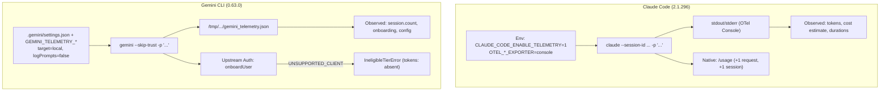
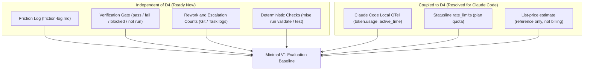

# D4 Spike Review: Decision Analysis on Usage Observability and ADR 0006

**Status:** research and decision review note (evaluating [ADR 0006](../decisions/0006-usage-observability.md) against [D4 spike results](d4-spike-results.md), [D4 evidence](d4-observability-evidence.md), and [host review](gemini-cli-host-decision-review.md)). Not an architectural decision.  
**Date:** 2026-10-11.  
**Audited Branch:** `claude/kind-pasteur-bd8bq3` at commit `7f830e4`.  
**Deciders:** project owner (pending).

---

## 1. Executive summary

This report delivers a critical decision audit of the Spike D4 observability results, evaluates the viability of [ADR 0006](../decisions/0006-usage-observability.md), examines the platform divergence between Claude Code and Google developer tools, and establishes the minimal dependencies for evaluation decision D7.

### 1.1 Core findings

1. **Claude Code OpenTelemetry pipeline is verified and production-ready (`pass`):** Under a personal Claude Pro OAuth subscription, Claude Code (`2.1.296`) emitted all required signals locally via the `console` exporter. Token counts (`input`, `output`, `cacheRead`, `cacheCreation`), active runtime durations, session counters, model identification, and list-price cost estimates were captured with zero content leakage. Assistant responses were explicitly redacted by default (`"<REDACTED>"`).
2. **Gemini CLI observability is blocked by upstream provider deprecation (`blocked`):** `@google/gemini-cli@0.63.0` initialized its local file telemetry exporter and recorded startup/lifecycle events, but failed before model inference with `IneligibleTierError` / `UNSUPPORTED_CLIENT`. This confirms Google's sunset of individual/free tiers on June 18, 2026. Token usage resulted in `absent` (supported by schema, but not emitted in scope because model inference was not reached), not zero tokens and not `collection_error` (the telemetry exporter functioned properly).
3. **No native per-task attribution exists in either CLI:** Both runtimes attribute telemetry strictly by `session.id`, `prompt.id`, or `request_id`. The contract gap for `session_id` remains open: current artifact schemas define no `session_id` field, and modifying contracts is out of scope for D4. Operational association can be noted manually in execution reports as exploratory evidence, but automated attribution per task remains an open gap pending future schema evolution.
4. **Strict separation of the four cost concepts is validated:** The experiment verified that (1) physical token consumption, (2) list-price cost estimates, (3) subscription rate limits / daily quotas, and (4) effective billing ($20/month fixed-price subscriptions) operate under distinct semantics and must never be conflated or mathematically derived from one another.

### 1.2 Decision recommendation for ADR 0006

- **Primary Recommendation: `revise`** (subject to owner confirmation of the [ADR 0001](../decisions/0001-product-boundary.md) boundary).  
  The core architecture of ADR 0006 (local-only OpenTelemetry, structured machine ingestion, human-only native views, proposed 6-state field taxonomy, and strict cost concept separation) is empirically sound and viable for Claude Code. However, ADR 0006 cannot be accepted as-is because it treats Gemini CLI as an active, co-equal signal source. It must be **revised** to:
  - Align scope with ADR 0001, focusing V1 observability exclusively on Claude Code;
  - Mark legacy Gemini CLI as deprecated/unsupported for personal accounts, and defer Antigravity CLI (`agy`) telemetry to a post-V1 milestone;
  - Update document status from "Spike (not run)" to incorporate the calibrated spike findings;
  - Record the task attribution contract gap as pending future schema evolution, without silently picking a mechanism in V1.
- **Alternative Recommendation: `remain proposed`**  
  If the owner requires unified dual-CLI observability across both Claude Pro and Google AI Pro prior to accepting D4, ADR 0006 must remain `proposed` until Antigravity CLI's unpublished OTel schema is investigated.

---

## 2. Experimental provenance and configuration

The experimental results evaluated herein were conducted on 2026-10-10 in isolated Linux x86_64 environments outside target repositories, as recorded in `docs/research/d4-spike-results.md`.



### 2.1 Claude Code configuration

- **Binary version:** `2.1.296 (Claude Code)`.
- **Authentication:** `claude.ai` OAuth, subscription tier `pro`.
- **Process environment:**

```bash
export CLAUDE_CODE_ENABLE_TELEMETRY=1
export OTEL_METRICS_EXPORTER=console
export OTEL_LOGS_EXPORTER=console
export OTEL_METRICS_INCLUDE_ACCOUNT_UUID=false
# Content gates explicitly disabled (=0).
# Official documentation notes OTEL_LOG_ASSISTANT_RESPONSES inherits OTEL_LOG_USER_PROMPTS if unset;
# explicitly setting all five to 0 guarantees content gates remain closed:
export OTEL_LOG_USER_PROMPTS=0
export OTEL_LOG_ASSISTANT_RESPONSES=0
export OTEL_LOG_TOOL_DETAILS=0
export OTEL_LOG_TOOL_CONTENT=0
export OTEL_LOG_RAW_API_BODIES=0
```

Claude Code ignores telemetry exporter settings in repository `.claude/settings.json`, ensuring launch-environment configuration takes precedence and cannot be subverted by untrusted cloned repositories.

- **Execution command:**

```bash
claude --session-id d4000000-0000-4000-8000-000000000001 -p "Responda exatamente SPIKE_OK. Não use ferramentas nem leia ou escreva arquivos."
```

### 2.2 Gemini CLI configuration

- **Binary version:** `@google/gemini-cli@0.63.0`.
- **Authentication:** `oauth-personal` (Google AI Pro account).
- **Workspace configuration (`/tmp/ginga_spike_gemini/.gemini/settings.json`):**

```json
{
  "telemetry": {
    "enabled": true,
    "target": "local",
    "outfile": "/tmp/ginga_spike_gemini/gemini_telemetry.json",
    "logPrompts": false,
    "traces": false
  },
  "privacy": {
    "usageStatisticsEnabled": false
  }
}
```

- **Execution command:**

```bash
gemini --skip-trust -p "Responda exatamente SPIKE_OK. Não use ferramentas nem leia ou escreva arquivos."
```

---

## 3. Evidence matrix by CLI, field, and evaluative criteria

### 3.1 Field-level signal audit

Field states are classified according to the taxonomy established in [ADR 0006](../decisions/0006-usage-observability.md) §5.

| Field / Signal | Source | Reported Value | Unit | State | Evaluative Assessment |
|---|---|---|---|---|---|
| **Claude Code** | | | | | |
| `claude_code.session.count` | OTel metric | `1` | session | `observed` | Emitted deterministically at session launch. |
| `claude_code.token.usage (input)` | OTel metric | `2` | tokens | `observed` | Measures non-cached prompt tokens. |
| `claude_code.token.usage (output)` | OTel metric | `10` | tokens | `observed` | Output response tokens generated. |
| `claude_code.token.usage (cacheRead)` | OTel metric | `8608` | tokens | `observed` | Tokens read from upstream prompt cache. |
| `claude_code.token.usage (cacheCreation)` | OTel metric | `11569` | tokens | `observed` | Tokens written to upstream prompt cache. |
| `claude_code.cost.usage` | OTel metric | `0.0944816` | USD | `estimated` | Computed locally at list price. Labeled `estimated`; not billing. |
| `claude_code.active_time.total` | OTel metric | `2.512` | seconds | `observed` | Total process execution wall time. |
| `claude_code.api_request (duration_ms)` | OTel event | `2419` | ms | `observed` | Network round-trip duration for inference. |
| `claude_code.assistant_response (response)` | OTel event | `"<REDACTED>"` | string | `observed` | Verifies privacy gate: response content redacted by default. |
| Native `/usage` 7d requests | CLI command | `3721 → 3722` | requests | `observed` | Incremented by exactly 1; validates OTel turn correlation. |
| Native `/usage` 7d sessions | CLI command | `57 → 58` | sessions | `observed` | Incremented by exactly 1. |
| Native `/usage` rate limits | Statusline JSON | `29%` (5h), `98%` (7d) | percentage | `observed` | Structured quota utilization available via statusline. |
| **Gemini CLI** | | | | | |
| `gemini_cli.session.count` | OTel metric | `1` | session | `observed` | Local lifecycle counter emitted. |
| `gemini_cli.onboarding.start/success` | OTel metric | `3` | attempts | `observed` | Pre-flight auth handshake attempted. |
| `gemini_cli.config` | OTel event | JSON | — | `observed` | Confirms `log_user_prompts_enabled: false`. |
| `gemini_cli.user_prompt (prompt_length)`| OTel event | `79` | chars | `observed` | Input string length captured. |
| `gemini_cli.user_prompt (prompt)` | OTel event | absent | string | `observed` | Excluded by `logPrompts: false`; privacy gate verified. |
| `gemini_cli.token.usage` | OTel metric | — | tokens | `absent` | Supported by schema; not emitted because model was not invoked due to onboarding rejection (`IneligibleTierError`). Collector functioned without error |
| `gemini_cli.cost.usage` | — | — | — | `unsupported` | No monetary cost metric exists in Gemini CLI schema. |
| Native `/stats` | CLI command | — | — | `unsupported` | Interactive REPL only; unscriptable in `-p` print mode. |

### 3.2 Evaluation of the 8 audit criteria

1. **Actual collection of telemetry:**  
   - *Claude Code:* Fully collected and observed across metric counters, duration gauges, and lifecycle events.  
   - *Gemini CLI:* Telemetry infrastructure initialized and wrote to disk, but core operational usage (tokens, tool executions, API latencies) failed to emit due to upstream rejection.
2. **Field taxonomy integrity:**  
   The 6-state taxonomy (`observed`, `estimated`, `derived`, `absent`, `unsupported`, `collection_error`) is a proposed framework that was partially exercised in this spike. Critically, Gemini CLI's token fields were correctly classified as `absent` (supported by the schema, but nothing emitted in scope because model inference was not invoked) rather than zero consumption or `collection_error` (the collector operated properly and did not fail). States such as `derived` and genuine `collection_error` were not exercised; the taxonomy is not fully validated across all fields.
3. **Comparability of native views vs. telemetry:**  
   - Claude Code's native `/usage` command serves as a coarse human verification mechanism, not a machine input. The spike proved that `/usage` request and session counters incremented by exactly 1, matching OTel. However, `/usage` token totals represent 7-day rolling aggregates, which cannot and must not be compared directly against single-turn OTel counts.
   - Gemini CLI's `/stats` command is purely interactive and cannot be invoked in non-interactive `-p` execution.
4. **Task attribution boundaries:**  
   Neither CLI supports native task tagging. Telemetry records attach `session.id`, `prompt.id`, or `request_id`. The contract gap for `session_id` remains open: current artifact schemas define no `session_id` field, and routing log grammar is closed. Automated per-task attribution is not available in V1. Manual operational recording in execution reports is exploratory evidence only, pending future schema evolution.
5. **Separation of cost, token usage, quota, and billing:**  
   All four concepts remain strictly decoupled:
   - *Token usage:* Physical count of processed units (`input`, `output`, `cacheRead`, `cacheCreation`).
   - *Estimated cost:* Claude Code's `claude_code.cost.usage` provides an informative synthetic dollar metric based on public API list prices. It carries no financial or billing liability.
   - *Plan quota / utilization:* Tracked independently via Claude's `rate_limits` statusline percentages and Google AI Pro's 1,500 daily request ceiling.
   - *Effective billing:* Monthly flat-rate subscription fees ($20/month) that do not vary with token volume.
6. **Privacy and isolation verification:**  
   - Local containment succeeded: telemetry was directed exclusively to stdout/stderr (Claude) and local JSON files (Gemini).
   - Content redaction held: all five content gates were explicitly disabled, ensuring prompt and completion texts were excluded or redacted (`"<REDACTED>"`).
   - Identity exposure confirmed: both CLIs embedded `user.email` and installation/account UUIDs in local records. Setting `OTEL_METRICS_INCLUDE_ACCOUNT_UUID=false` removes account UUID from metrics, but does NOT remove `user.email` from events or resources. This empirically proves the ADR 0006 rule that raw telemetry must never leave the workstation unscrubbed.
7. **Reproducibility:**  
   The experiment utilized deterministic command lines and temporary directory scaffolding. Claude Code's success and Gemini CLI's onboarding failure are 100% reproducible under the reported versions and subscription types.
8. **Handling of collection failures vs. uninvoked execution vs. zero consumption:**  
   The audit verified that model execution state, collector state, and field state are properly separated. In Gemini CLI, upstream onboarding rejection (`IneligibleTierError`) prevented model invocation, but the local telemetry exporter ran without failure. Empty token payloads were correctly classified as `absent`, avoiding false zeros and avoiding misclassification as `collection_error`.

---

## 4. Limitations and privacy risks

### 4.1 Methodological and experimental limitations

- **Sample size ($N=1$):** The spike executed a single turn per CLI with a minimal synthetic prompt (`"Responda exatamente SPIKE_OK"`). While sufficient to prove pipeline reachability, schema presence, and gate behaviors, an $N=1$ run cannot quantify:
  - Context compaction event behavior (`claude_code.compaction`);
  - Multi-turn token accumulation and cache churn across complex tasks;
  - Subagent attribution behavior under nested delegation.
- **Upstream deprecation of legacy Gemini CLI:** `@google/gemini-cli` is defunct for individual personal accounts. Antigravity CLI (`agy@1.3.2`) is the successor runtime for Google AI Pro, but its telemetry architecture and OpenTelemetry schema were not exercised in Spike D4.
- **Cross-model incommensurability:** Tokenizers and context architectures differ fundamentally between Claude Opus 5.5 and Gemini/Antigravity models. A token in Claude Code does not represent equivalent computational or semantic work to a token in Google models.

### 4.2 Privacy risks and governance

1. **Identity exfiltration:** Both runtimes embed personal identifiers (`user.email`, `organization.id`) in OTel resource attributes. Any automated export to remote collectors or Git tracking represents a PII leak.
2. **Insecure defaults in Gemini CLI:** If Gemini CLI or Antigravity CLI is ever used, `logPrompts` defaults to `true`. Furthermore, project-level `.gemini/settings.json` files outrank user settings. A malicious or careless repository configuration could enable prompt logging without the user's explicit consent.

---

## 5. Architectural recommendation for D4

| Criteria | Evidence Status | Finding | Consequence for ADR 0006 |
|---|---|---|---|
| **Claude Code OTel Schema** | Proven (`pass`) | Emits tokens, cache splits, durations, list-price estimate, session counters. | Validates decision item 1 & 5 for Claude Code. |
| **Privacy Minimal Gates** | Proven (`pass`) | Content gates explicitly set to `0` prevent prompt/response capture while keeping metrics. | Validates decision item 4. |
| **Field State Taxonomy** | Partially exercised / Proposed | Proposed 6 states isolate observed from estimated, absent, and unsupported; full empirical validation of all states (including `derived` and genuine `collection_error`) remains pending. | Proposed in decision item 5. |
| **Decoupling of Cost Concepts** | Proven (`pass`) | Tokens, estimates, quotas, and billing operate independently. | Validates decision item 6. |
| **Gemini CLI OTel Schema** | Blocked (`fail`) | Individual access sunset upstream; token metrics `absent` due to blocked model invocation. | Invalidates Gemini CLI as an active V1 signal source. |
| **Antigravity CLI Schema** | Unknown (`not run`) | Successor runtime not exercised in Spike D4. | Leaves Google AI Pro observability open. |
| **Task Attribution Mechanism** | Open contract gap | Keyed by session only; automated per-task attribution is limited and pending future schema evolution. | Leaves open question 2 in ADR 0006 pending resolution. |

### 5.1 Evaluated postures

1. **`accept` (Rejected):** Premature. Accepting ADR 0006 in its current text would formally adopt `@google/gemini-cli` as a supported signal source and enshrine unverified hypotheses (Q2, Q3) regarding an upstream client that is already deprecated for personal accounts.
2. **`blocked` (Rejected for V1):** Incorrect scope boundary. While the Gemini CLI channel is blocked, G-Ingá V1 is scoped exclusively to Claude Code ([ADR 0001](../decisions/0001-product-boundary.md)). Upstream issues in Google developer tools do not impede G-Ingá's V1 milestone.
3. **`revise` (Recommended Posture):**  
   The core architectural patterns proposed in ADR 0006 are proven and ready. The record should be **revised** to:
   - Scope V1 observability strictly to Claude Code (aligning with ADR 0001);
   - Reclassify Gemini CLI as legacy/unsupported for personal tiers;
   - Note Antigravity CLI as the future post-V1 candidate for Google AI Pro;
   - Record the task attribution contract gap as pending future schema evolution, without silently picking a mechanism in V1;
   - Update document status to record that the spike was successfully executed.
4. **`remain proposed` (Alternative Posture):**  
   If the project owner maintains that D4 must provide simultaneous, dual-platform observability across Claude Pro and Google AI Pro prior to accepting D4, ADR 0006 must remain `proposed` pending an empirical spike on Antigravity CLI (`agy`).

---

## 6. Dependencies on D7 and minimal V1 evaluation

### 6.1 Disentangling D7 from D4

Decision **D7** addresses evaluation: defining the smallest repeatable comparison to measure whether G-Ingá achieves its core objective—optimizing tokens (and time) per verified task ([principles](../principles.md) §6).

The review establishes that D7 does NOT require full cross-platform observability or automated telemetry ingestion:



1. **What D7 truly requires from D4:**
   - A verified mechanism to observe input tokens, output tokens, cache read/write tokens, and duration on Claude Code at the session level. This is fully satisfied by Claude Code's OTel `token.usage` and `active_time.total`.
   - Strict adherence to the principle that list-price dollar metrics are estimates and never billing figures.
2. **What D7 does NOT require from D4:**
   - Observability into Gemini CLI or Antigravity CLI.
   - Remote telemetry collectors, Prometheus servers, or automated log parsing daemons.
   - Synthetic benchmark suites (e.g., HumanEval, SWE-bench) or mandatory multi-repository fixtures (e.g., PetClinic).
   - Arbitrary token budgets or artificial execution thresholds.

### 6.2 Evaluation boundaries: ready vs. limited in D7

To prevent contradictions between the open task attribution contract and evaluation goals, D7's scope is strictly separated:

1. **D7 that can advance now:**
   - Deterministic verification results per task (`pass`, `fail`, `blocked`, `not run` at `verified_at`);
   - First-pass verification success rate (criteria verified at `verified_at` without regression);
   - Recorded ceremony escalations (`light` → `standard` → `heavy`);
   - Frictions identified and resolved in `friction-log.md`;
   - Matched before-and-after comparisons on real development tasks, with documented attribution limitations;
   - Per-session telemetry observations recorded manually as exploratory evidence (e.g., in execution reports), without presenting them as structured, automated per-task metrics.
2. **D7 that remains limited:**
   - Automated attribution of tokens and active execution duration per task;
   - Aggregations requiring a structured, machine-verifiable relationship between `session.id` and `task.id`.

### 6.3 Minimal evaluation framework for V1

The V1 evaluation framework should be lean, empirical, and grounded in real G-Ingá tasks:

1. **Deterministic Quality Gates (Ready):** First-pass verification rate (`pass` on `verified_at` without rework loops) and deterministic verification outcomes.
2. **Process Friction (Ready):** Count of escalations (`light` → `standard` → `heavy`) and friction entries recorded in `friction-log.md`.
3. **Usage Signals (Exploratory / Limited):** Session-level token totals and active execution time observed via Claude Code OTel console export, recorded manually as exploratory evidence alongside task execution reports. Automated aggregation per task is excluded pending schema evolution.
4. **Execution Protocol:** Matched before-and-after comparisons on real development tasks in the owner's personal repositories, comparing unassisted Claude Code against G-Ingá harness guidance, with documented attribution limitations.

---

## 7. Verified references and inspection levels

All primary references cited in this review are cataloged in [docs/research/reference-index.md](reference-index.md).

| Reference | Source / Identifier | Revision / Date | Inspection Level | Key Finding |
|---|---|---|---|---|
| Claude Code Costs | `code.claude.com/docs/en/costs` | Live page, 2026-10-10 | verified | `/usage` breakdown, list-price estimate disclaimers on Pro/Max subscriptions. |
| Claude Code Monitoring | `code.claude.com/docs/en/monitoring-usage` | Live page, 2026-10-10 | verified | OTel metrics (`token.usage`, `cost.usage`), events, content gates, redaction rules. |
| Claude Code Statusline | `code.claude.com/docs/en/statusline` | Live page, 2026-10-10 | verified | JSON schema on stdin, structured `rate_limits` percentages. |
| Gemini CLI Telemetry | `google-gemini/gemini-cli/docs/cli/telemetry.md` | Commit `9b6e026` | verified | Telemetry configuration, default `logPrompts: true`, lack of cost metrics. |
| Google Developers Blog | Blog post by D. Lyalin & T. Mullen | 2026-05-19 / live 2026-10-10 | verified | Sunset of Gemini CLI for personal/free tiers on June 18, 2026; transition to Antigravity CLI. |
| Antigravity CLI Reference | `antigravity.google/docs/cli/reference` | 2026-10-10 | verified | CLI flags (`-p`, `--output-format`), config paths, `--dangerously-skip-permissions`. |
| Spike D4 Results | `docs/research/d4-spike-results.md` | Commit `7f830e4` (local) | verified | Experimental runs on Claude Code (`pass`) and Gemini CLI (`blocked`). |
| Spike G-S1 Host Review | `docs/research/gemini-cli-host-decision-review.md` | Commit `7f830e4` (local) | verified | Architectural audit of Google developer tools host options (recommending Option C for V1). |

---

## 8. Validation commands and verified results

All repository validation suites were executed locally during this review:

1. `git status -u && git branch -v && git rev-parse HEAD`:
   - Working branch: `claude/kind-pasteur-bd8bq3`.
   - Current `HEAD`: `7f830e438553dd6a15b35d4ae9dc48eec57fdb90`.
   - Tracked modifications preserved: `docs/research/d4-observability-evidence.md`, `docs/research/reference-index.md`.
   - Untracked research artifacts preserved: `docs/research/d4-spike-results.md`, `docs/research/gemini-cli-host-decision-review.md`.
2. `mise run validate`: **`pass`**
   - `markdown-lint`: pass (23 files, 0 issues; 2 verbatim briefs excluded).
   - `local-links`: pass (383 local references in 25 files checked).
   - `mermaid`: pass (13 diagrams rendered cleanly).
   - `decision-records`: pass (6 ADRs, 8 map rows synchronized).
   - `artifact-contract-sync`: pass (17 diagram edges validated).
   - `artifact-contract-examples`: pass (3 contract examples validated).
   - `artifact-rule-fixtures`: pass (40 fixtures validated).
3. `mise run test`: **`pass`**
   - 77 unit tests passed across 2 files (0 failures, 206 assertions).

### 8.1 Methodological differentiation

1. **Repository validation (static/deterministic):** `mise run validate` and `mise run test` verify Markdown linting, schema validation, and link consistency. They do not validate external runtime behaviors, network reliability, or CLI telemetry stability.
2. **Runtime observation (empirical/experimental):** Spike execution captures empirical behavior under specific environment flags at $N=1$, confirming signal reachability or upstream access blocks.
3. **Architectural decision (governance):** Product boundaries, contract evolution, and adoption decisions are intentional choices reserved for the project owner, not an automatic consequence of passing static tests or running an isolated command.
