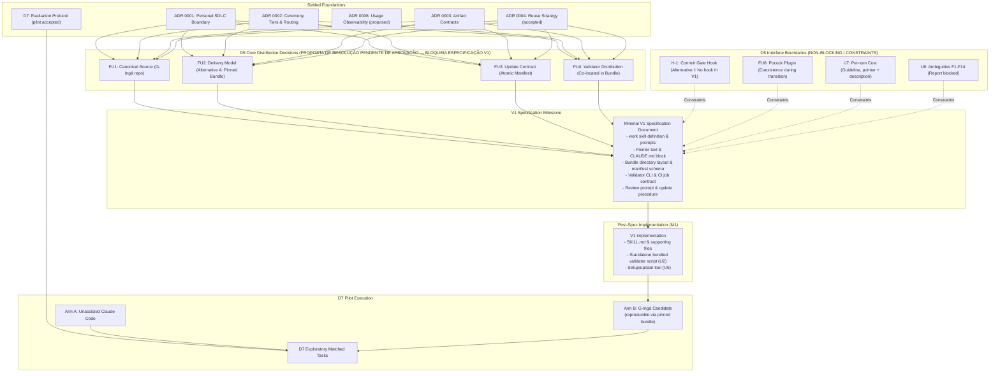

# D5 Decision Brief: Native Primitive Mapping and Distribution Architecture

**Status:** research brief / decision proposal (input to [ADR 0005](../decisions/0005-native-primitive-mapping.md)).  
**Date:** 2026-10-11.  
**Audited branch:** `claude/kind-pasteur-bd8bq3` at commit `7f830e4`.  
**Purpose:** Transform open human decisions in ADR 0005 (FU1–FU4, H-1, FU6, and unresolved questions U2–U8) into concrete, comparable proposals to unblock the minimal V1 specification, strictly respecting the product boundary ([ADR 0001](../decisions/0001-product-boundary.md)), ceremony tiers ([ADR 0002](../decisions/0002-ceremony-tiers-and-routing.md)), artifact contracts ([ADR 0003](../decisions/0003-minimum-artifact-schemas.md)), reuse strategy ([ADR 0004](../decisions/0004-reuse-strategy-for-existing-skills.md)), and evaluation protocol ([D7](../research/d7-evaluation-protocol.md)).  
**Deciders:** Project Owner (deliberation pending; this brief does not accept ADR 0005 nor implement V1).

---

## 1. Executive Summary

This brief provides the architectural rationale and decision proposals for the open questions in [ADR 0005](../decisions/0005-native-primitive-mapping.md). The minimal V1 specification is currently blocked because the project has not formally settled how G-Ingá's instructions and validator reach target repositories, how they are versioned, and how updates prevent forks.

### Summary of Recommendations

| Decision ID | Question | Preferred Recommendation | Impact on V1 Spec |
|---|---|---|---|
| **FU1** | Canonical source and session delivery channel | **Canonical repository in G-Ingá; committed per target repository.** G-Ingá's repository is the sole authoring source. Target repositories receive generated, pinned bundle directories committed to Git. | **Blocks V1 Spec.** Settles distribution channel. |
| **FU2** | Project-local copies | **Adopt Alternative A (Pinned Bundle).** Target repositories commit a dedicated bundle directory (`.claude/skills/work/`, `tools/validate/`, manifest). No account-only or plugin delivery. | **Blocks V1 Spec.** Settles repository layout. |
| **FU3** | Updates without forks or drift | **Atomic bundle replacement with integrity manifest.** Updates replace the bundle atomically at a new release tag. Local edits to bundle files are forbidden and detected by an integrity check. | **Blocks V1 Spec.** Settles update contract. |
| **FU4** | Validator distribution & source of truth | **Validator co-located in pinned bundle.** Validator ships inside the bundle alongside instructions at the identical release version. CI executes it directly from repository checkout without network. | **Blocks V1 Spec.** Settles validator delivery & CI job. |
| **FU5** | Local vs cloud parity | **Structural delivery & discovery parity via committed files; behavioral equivalence unverified.** Pinned bundle committed to repository ensures identical file versioning and verified host loading (`N12`). Effective agent behavioral parity across environments is an empirical hypothesis subject to runtime and tooling differences. | Proposta de resolução pendente de aprovação (decorre de FU1/FU2). |
| **FU6** | Pocock plugin during transition | **Keep installed and unreferenced.** The owner's marketplace plugin remains installed and unreferenced until all four roles meet ADR 0004 §7 replacement criteria on real tasks. | Interface constraint; does not block V1 spec. |
| **H-1** | Commit-gate hook | **Alternative I (No hook in V1).** Validator runs as a skill step before guarded transitions (guidance) and in target-repo CI at merge (deterministic enforcement). Pre-tool hook remains an open follow-up. | Interface constraint; does not block V1 spec. Proposta pendente de aprovação. |
| **U2** | Validator runtime packaging | **Self-contained zero-install bundle (Node 22 / Bun compatible).** Single-file script requiring no `node_modules` installation in target repos. | M1 implementation detail. |
| **U4** | Wayfinder / decision-map convention | **Defer from V1 core.** V1 governs `tasks/` and `specs/`. `docs/decisions/` ADRs follow repository conventions; no Wayfinder replacement is claimed. | Post-V1; follows D6 criteria. |
| **U5** | Cross-repo friction capture | **Terminal reporting + manual logging.** Target-repo sessions report friction in terminal summaries; owner logs them into G-Ingá's `docs/friction-log.md`. | Protocol rule for D7 pilot. |
| **U6** | Setup & update idempotence | **Deterministic update contract in V1 spec.** Detect, explain, preserve user work, and replace bundle idempotently. | Required in V1 spec text. |
| **U7** | Fixed per-turn cost limits | **Guideline budgets only.** Fixed per-turn overhead restricted to pointer text (~3 lines) + 1 skill description (< 1,536 chars). No hard numeric ceiling. | Guided by D4 / ADR 0006. |
| **U8** | Open validator findings F1–F14 | **Default to `blocked` on ambiguity.** Unresolved ambiguities report `blocked` (exit code 2) rather than fabricating passes. | M1 validator detail. |

---

## 2. Alternatives and Trade-offs for FU1–FU4, H-1, and FU6

The table below contrasts the viable architectural alternatives for each pending decision against the project's core principles: token economy, deterministic verification, zero ceremony for `light` tier, and independence from external plugins.

| ID | Alternatives | Trade-offs & Analysis | Preferred |
|---|---|---|---|
| **FU1 / FU2** | **A. Pinned Bundle**; B. Plugin + fetched validator; C. Account skill + fetched validator; D. Git Subtree / Submodule | A: Verified file loading parity across local and cloud (`N12`), explicit Git history, zero network in CI (effective behavioral parity requires validation). B: Deferred by ADR 0001, fails in cloud (Facts `N12`, `C15`), needs network. C: Unverified versioning (`N12`, `N16`), needs network. D: Clutters history or unverified submodule cloning. | **Alternative A** |
| **FU3** | 1. Silent auto-sync; 2. Uncontrolled copy-paste; **3. Manifest-checked atomic release (A)**; 4. Custom package manager CLI | 1: Breaks sessions mid-flight. 2: Silent forks and untracked drift. 3: Atomic reviewable Git commit with manifest hash for accidental drift detection (does not authenticate against deliberate modification). 4: Over-engineering, against principle §7. | **Option 3** |
| **FU4** | **1. Co-located inside bundle**; 2. Separate npm package; 3. Remote curl in CI | 1: Zero network dependency, guaranteed version match with instructions. 2: Registry publishing and npm overhead. 3: Network risk, secret management, drift risk. | **Option 1** |
| **H-1** | Hook: `PreToolUse` on `git commit`; **Alternative I: Skill step + CI merge gate** | Hook: Fails open unless block mode set; failing closed freezes commits on validator bug (`N7`). Bypassed by non-bash commits. F8 open. Alternative I: Skill guidance + deterministic merge enforcement in CI. | **Alternative I** |
| **FU6** | 1. Force-disable Pocock plugin in target repos; **2. Coexistence: keep installed, unreferenced** | 1: Contradicts ADR 0004 §7, removes fallback before coverage proven. 2: Distinct naming (`/work`) avoids collision; fallback friction can be logged. | **Option 2** |

---

## 3. Detailed Analysis and Recommendation per Decision

### 3.1 FU1: Canonical Instruction Source and Session Delivery Channel

- **Architectural question:** Where is G-Ingá authored and versioned, and which delivery channel reliably delivers instructions to Claude Code sessions across all execution contexts?
- **Viable alternatives:**
  1. *Committed project-level directory:* Canonical code in G-Ingá repo; target repos hold committed files under `.claude/skills/` and a pointer in `CLAUDE.md`.
  2. *Personal skill install:* Files placed in `~/.claude/skills/` on the owner's workstation.
  3. *Account-level skill:* Skills enabled on the owner's claude.ai web account and synced down.
  4. *Claude Code plugin:* Packaged as a plugin distributed via marketplace (deferred by [ADR 0001](../decisions/0001-product-boundary.md)).
- **Preferred recommendation:** G-Ingá repository remains the sole canonical source of truth. Delivery to target repositories occurs via generated, versioned files committed directly to the target repository (Alternative A).
- **Rationale:** Official Claude Code documentation establishes that committed repository files are the only channel verified to load in both local developer machines and single-repository cloud sessions (Fact `N12`). Personal skills in `~/.claude/skills/` do not load in cloud sessions (Fact `N6`, `N12`). Plugins are not installed in cloud environments even if declared in repository settings (Fact `N12`, `C15`). Committing files binds instruction and validator file versions directly to the target repository's commit history.
- **Consequences:** Distribution requires an explicit copy/update action per target repository. No global account configuration is required.
- **Contract & validation impact:** Aligns with [artifact contracts](../artifact-contracts.md) §2.1 and §7.1. Git history walk operates naturally within the repository checkout.
- **ADR 0001 compatibility:** Fully compatible. Respects the personal harness boundary, avoids public registry dependencies, and defers plugin packaging until justified by friction.
- **Dependencies:** Drives FU2, FU3, FU4, and FU5.
- **Evidence & uncertainties:** Doc facts `N6`, `N12`, and `N16` verify channel loading rules. Local container observation `L3` confirmed that cloud environments lack personal plugins.

### 3.2 FU2: Project-Local Copies in Target Repositories

- **Architectural question:** Do target repositories receive local file copies of G-Ingá instructions and tooling, or should they reference external/centralized assets?
- **Viable alternatives:**
  1. *Committed Pinned Bundle (Alternative A):* Target repo receives a clean, dedicated directory containing the `work` skill, supporting docs, validator, and manifest.
  2. *Zero-Copy External Reference:* Instructions injected via global user settings or account sync; validator fetched over network in CI.
  3. *Git Subtree / Submodule:* Managed via Git tree pointers.
- **Preferred recommendation:** Adopt Alternative A (Committed Pinned Bundle).
- **Rationale:** Committing G-Ingá files to the target repository guarantees self-containment. A checkout contains everything required to execute, inspect, and validate work. Committing G-Ingá's *own* generated files is explicitly distinct from "vendoring" third-party upstream skills under ADR 0004 §6. Git submodules introduce recursive clone friction in CI and cloud environments, while subtrees clutter repository history.
- **Consequences:** Repositories adopting G-Ingá carry a dedicated harness directory.
- **Contract & tier impact:** **Critical invariant preserved:** Distributing the bundle to a repository does **not** force artifact creation on tasks. The `light` tier remains strictly zero-file and zero-ceremony ([ADR 0002](../decisions/0002-ceremony-tiers-and-routing.md), [artifact contracts](../artifact-contracts.md) §1). `tasks/` and `specs/` records are only created when `standard` or `heavy` tasks are routed.
- **ADR 0001 compatibility:** Fits the owner's goal of a reliable personal workflow that works identically across worktrees and machines.
- **Blocks V1 Spec:** **Yes.** The specification cannot define bundle layout or installation steps without resolving FU2.

### 3.3 FU3: Updates Without Unmanaged Forks or Drift

- **Architectural question:** How are bundled files updated across target repositories without creating untracked local forks or silent drift?
- **Viable alternatives:**
  1. *Uncontrolled file copying:* Developer copies files ad-hoc without metadata.
  2. *Automated background sync:* Background process overwrites files from upstream.
  3. *Atomic versioned release with integrity manifest:* Bundle includes a `manifest.json` recording release version, canonical commit SHA, and SHA-256 hashes of all bundle files. Local edits are strictly forbidden; any needed modification must be committed upstream in G-Ingá first.
- **Preferred recommendation:** Atomic release with an integrity manifest (Alternative A).
- **Rationale:** Automatic updates can modify prompts mid-task, destroying prompt cache and altering behavior unexpectedly (`C16`). Manual ad-hoc copying leads to unversioned forks. An explicit manifest ensures that running `mise run validate` (or a harness check) detects accidental drift if harness files in a target repository are modified locally. Updates occur via a single, reviewable pull request replacing the bundle and updating the manifest.
- **Scope and security boundaries of the SHA-256 manifest:**
  - *Covered bundle assets:* Distributed harness files, namely instructions in `.claude/skills/work/`, skill supporting documents/scripts, and the bundled standalone validator script (`tools/validate/`).
  - *Excluded assets (no circularity or overreach):* The `manifest.json` itself is excluded from its own hash list to prevent circular self-reference. Target repository files are strictly excluded: project source code, `tasks/` and `specs/` records, and `CLAUDE.md` (except verifying the presence of the delimited pointer block).
  - *Integrity vs authentication:* The manifest detects accidental drift and uncoordinated local edits when expected hashes remain fixed. It does **not** provide cryptographic authentication or protect against intentional modification by a developer or an agent with write permissions, who could modify bundle files and recompute the manifest hashes in the same commit.
  - *Status:* Conceptual proposal for the V1 specification; not implemented in this task.
- **Consequences:** Upstream changes flow in one direction: `G-Ingá canonical -> Release Tag -> Target Repo Commit`.
- **Contract & validation impact:** The validator can verify bundle integrity against the manifest as a pre-flight check for accidental drift.
- **ADR 0001 compatibility:** Supports gradual, disciplined learning and prevents fragmentation.
- **Blocks V1 Spec:** **Yes.** The specification must define the manifest schema and update contract.

### 3.4 FU4: Source of Truth and Validator Distribution

- **Architectural question:** How do the instructions and the deterministic validator maintain a unified source of truth, and how is the validator delivered to target-repository CI?
- **Viable alternatives:**
  1. *Validator bundled co-located with instructions:* The validator script is distributed inside the pinned bundle at the exact same version.
  2. *Independent validator distribution:* Validator published as a standalone package (e.g. npm) or GitHub Action, fetched dynamically.
- **Preferred recommendation:** Bundle the validator directly inside the pinned bundle alongside instructions.
- **Rationale:** [ADR 0003](../decisions/0003-minimum-artifact-schemas.md) and [artifact contracts](../artifact-contracts.md) establish that the contract is the single source of truth for artifact validity. Instructions cite rules; the validator deterministically enforces them. If instructions and validator are distributed separately, a repository could run v1 instructions against a v2 validator, producing false rejections or undetected contract violations. Distributing both in the same bundle guarantees exact synchronization without network calls in CI.
- **Consequences:** Target-repo CI runs the validator directly from the repository checkout (`node .g-inga/tools/validate.js` or equivalent), with zero external download dependencies (network-free execution does not eliminate the requirement for a pre-installed compatible host runtime, such as Node or Bun, in the CI runner or developer environment).
- **Contract & validation impact:** Deterministic CI merge gates become completely offline and self-contained (given a compatible runtime).
- **ADR 0001 compatibility:** Maximizes reliability, avoids infrastructure overhead, and respects local execution.
- **Blocks V1 Spec:** **Yes.** The specification must specify the CI job definition and validator execution path.

### 3.5 FU5: Behavior in Local and Cloud Sessions

- **Architectural question:** Does the chosen mechanism guarantee behavioral equivalence between local development and cloud sessions?
- **Analysis and differentiation of parity dimensions:**
  1. *Version identity of instruction and validation files:* Guaranteed by Git commit. Local checkouts and remote cloud clones share the exact same commit SHA and file contents for instructions and the validator.
  2. *Host discovery and loading:* Documented and verified for Claude Code (`N12`). A cloud session starts from a fresh clone and automatically loads repository `CLAUDE.md`, `.claude/skills/`, `.claude/rules/`, and `.claude/settings.json` (hooks in single-repo sessions). Unlike personal skills (`~/.claude/skills/`, `N6`) and user/repository plugins (`C15`), committed repository files reliably load in cloud sessions.
  3. *Effective agent behavior:* **Not guaranteed to be identical.** Effective behavior depends on:
     - CLI version differences between local workstation and cloud container (`N14`, `L4`);
     - Tool and runtime availability (e.g. Node 22 and Bun observed in cloud container `L4`, but `mise` was absent; proxy compatibility limitations for package installation `N13`);
     - Workspace trust and permission modes (`N7`);
     - Unpushed local changes (`claude --cloud` clones the remote branch, not local unpushed commits, `N14`);
     - Stochastic nature of LLM responses (`O5`).
- **Uncertainties and empirical validation:** While structural delivery and host loading parity are supported by primary evidence (`N12`), effective behavioral equivalence remains an empirical hypothesis. Compaction survival under 5,000 tokens (Spike S2), fixed per-turn cost across channels (Spike S5), and behavioral parity on real tasks remain validation checks for M1 and the D7 evaluation pilot.
- **Status:** Proposta de resolução pendente de aprovação (decorre da deliberação de FU1 e FU2; paridade comportamental permanece como incerteza para validação empírica).

### 3.6 FU6: Coexistence with Matt Pocock Plugin During Transition

- **Architectural question:** Should a G-Ingá-managed repository disable the `mattpocock-skills` plugin during the transition?
- **Viable alternatives:**
  1. *Force-disable in target repo:* Set `"mattpocock-skills@mattpocock": false` in `.claude/settings.local.json` or `.claude/settings.json`.
  2. *Coexistence (keep installed and unreferenced):* Leave the plugin enabled on the workstation; G-Ingá instructions never invoke it, and distinct entry points prevent collisions.
- **Preferred recommendation:** Keep the plugin installed and unreferenced until all four roles (`grill-with-docs`, `to-spec`, `to-tickets`, `wayfinder`) meet the replacement criteria of ADR 0004 §7 on real tasks.
- **Rationale:** As established in ADR 0004 §7, no role is covered by G-Ingá today. Forcing the plugin off would break the owner's existing workflow before G-Ingá is verified. Distinct naming (`/work` vs `/to-spec`, `/to-tickets`) eliminates command ambiguity (Fact `C10`). Coexistence allows real fallback events to be logged in `docs/friction-log.md`, providing the empirical evidence required to prove replacement.
- **Consequences:** The plugin's descriptions (~2,152 characters across 11 skills, Fact `P7`) continue to contribute to the background per-turn context cost during the transition.
- **Blocks V1 Spec:** **No.** This is an operational coexistence policy.

### 3.7 H-1: Commit-Gate Hook Evaluation

- **Architectural question:** Is a `PreToolUse` hook intercepting `git commit` necessary in V1 to enforce contract invariants?
- **Analysis of text and trade-offs:**
  - *Invariant to protect:* Prevent invalid `tasks/` or `specs/` states from being committed, avoiding permanent failures during Git history walks ([artifact contracts](../artifact-contracts.md) §7.1, finding F8).
  - *Why it is problematic:* Hooks fire per matching Bash tool call. Official documentation (`N7`) confirms hooks fail open unless `onFailure: "block"` is set. If `onFailure: "block"` is configured, any validator script bug or unexpected environment failure completely freezes the developer's ability to commit. Furthermore, hooks can be bypassed by non-matching commit commands (`git -C`, aliases, GUI commits) and require workspace trust (`N7`).
  - *Prerequisites for revisiting:* ADR 0005 establishes that the hook should only be revisited if all three hold: (1) F8 is settled as "no waiver"; (2) merge strategy preserves un-squashed branch commits; and (3) a logged friction or Spike S3 shows the hook reliably intercepts agent commits.
- **Preferred recommendation:** **Alternative I (Current V1 Position).** Exclude the commit hook from V1. The validator runs as a skill step during execution (guidance) and in target-repo CI at merge (deterministic enforcement).
- **Enforcement conditions and limitations of CI gating:**
  - *Executing CI alone is not enforcement:* Running the validator job in target-repo CI does not, by itself, prevent an invalid merge. Deterministic enforcement exists *only* if the target repository configures branch protection or a merge gate that makes the validator check mandatory (required status check) before merge to protected branches.
  - *Specification mandate:* The V1 specification must define how target repositories make the CI check mandatory (e.g. GitHub branch protection rule / ruleset with required status check, GitLab merge request approval rules, or equivalent platform gate).
  - *Behavior in repositories without required checks:* Repositories lacking required status check enforcement (e.g. local-only branches, ad-hoc personal repositories, or repositories without branch protection) have **no deterministic enforcement** against invalid intermediate or final record merges. In such contexts:
    - Reports and tooling must **not** claim equivalent enforcement;
    - The limitation must be explicitly recorded in session summaries;
    - An explicit decision or fallback policy (e.g. voluntary manual execution or local verification discipline) must be documented without fabricating automated guarantees.
- **Consequences:** The agent could technically commit an intermediate invalid record during a task; CI catches it before merge to protected branches only if the job is configured as a required status check.
- **Blocks V1 Spec:** **No.** Proposed boundary pending owner confirmation (Alternative I: skill step guidance + CI merge gate; pre-tool hook remains an open follow-up).

### 3.8 Unresolved Questions U2, U4, U5, U6, U7, U8

| ID | Exact Text from ADR 0005 | Architectural Proposal & Rationale | Blocking Status |
|---|---|---|---|
| **U2** | *Validator runtime: a bundled single file for Node, or Bun. Check the owner's machine.* | **Single-file Node 22 compatible bundle.** Node is universally present in target development environments and CI runners. A standalone `.js` bundle bundled with esbuild/Bun requires zero dependencies and no `node_modules` in target repos. | Safe to defer to M1 implementation. |
| **U4** | *Whether the decision-map convention becomes part of the product, and whether `decision-records` ships with the validator.* | **Exclude from V1 core.** The decision map is an M0 discovery tool for G-Ingá itself. V1 runtime scope is strictly `tasks/` and `specs/`. ADRs in target repos follow existing repository conventions. | Post-V1; follows D6 criteria. |
| **U5** | *Friction capture across repositories: a session in a target repository can't write G-Ingá's friction log.* | **Terminal reporting + manual logging.** In target repositories, the `/work` skill outputs a structured `friction:` block in its final summary. The owner copies friction entries into G-Ingá's `docs/friction-log.md` when desired. Avoids cross-repo Git coupling. | Governed by D7 evaluation protocol. |
| **U6** | *Setup and update procedure: detect, explain, preserve, be idempotent (brief §7).* | **Declare requirements in V1 specification.** The V1 spec will mandate an idempotent update script contract that verifies manifest hashes, replaces bundle assets, and never touches user records in `tasks/` or `specs/`. | Addressed in V1 specification text. |
| **U7** | *Numeric limit on the fixed per-turn cost.* | **Guideline constraint, no hard limit.** Per ADR 0006, token budgets are guidelines. The fixed cost is constrained architecturally: pointer text < 5 lines, skill description < 1,536 chars (`N2`), supporting files loaded on-demand (`N4`). | Governed by ADR 0006 / D4. |
| **U8** | *Validator findings F1–F14 report `blocked`. Resolving them decides what CI, and any later gate, can refuse.* | **Report `blocked` (exit code 2) on open ambiguities.** CI and skill steps treat `blocked` as a non-passing gate for `verified`/`accepted`, adhering to contract honesty without fabricating assumptions. | M1 validator detail. |

---

## 4. Dependency Graph and Minimal Decisions Blocking V1 Spec

The diagram below maps the precise dependency relationships between D5 architectural choices, the minimal V1 specification, and the exploratory evaluation pilot (D7).

> [!IMPORTANT]
> **PROPOSTA DE RESOLUÇÃO PENDENTE DE APROVAÇÃO:** O bloqueio da especificação V1 por FU1–FU4 não está resolvido. As recomendações apresentadas abaixo (Alternative A, Bundle fixado, co-locação do validador) são propostas de resolução submetidas à deliberação humana do project owner. O bloqueio permanece formalmente ativo até essa aprovação.

### Categorization of Decisions

1. **Required BEFORE Writing the Minimal V1 Specification:**
   - **FU1 & FU2 (Delivery Model):** Defines the bundle directory structure, where the `work` skill lives, and how target repositories reference it.
   - **FU3 (Update Contract):** Defines how versions and manifests are structured.
   - **FU4 (Validator Co-location):** Defines the CI job specification and path contracts for validation.
2. **Recorded as Explicit Interface Constraints (in V1 Spec):**
   - **H-1:** Formally set as Alternative I (no hook in V1; skill step guidance + CI merge gate).
   - **FU6:** Formally set as non-interfering coexistence with distinct command names.
   - **U7:** Formally set as guideline budget enforced by progressive disclosure.
   - **U8:** Formally set as `blocked` reporting for ambiguous states.
3. **Implementation Details Deferred until AFTER Spec Approval (M1):**
   - **U2:** Code bundling format (single-file esbuild/bun artifact).
   - **U6:** Code implementation of the setup/update CLI script.
   - Exact hash parsing helpers and test runner configurations.

---

## 5. Risks: Distribution, Updates, Security, and Drift

### 5.1 Distribution Risks

- **Repository Clutter:** Target repositories carry a harness folder (e.g. `.g-inga/` or `.claude/skills/work/`).
  - *Mitigation:* Keep the bundle minimal: one skill folder, one bundled validator file, one manifest. Total bundle size under 100 KB.
- **Cloud Execution Incompatibilities:** Cloud environments clone clean branches without local machine configuration.
  - *Mitigation:* Alternative A relies exclusively on committed repository files, which official docs (`N12`) confirm load reliably in cloud sessions. Behavioral equivalence remains subject to environment runtimes, CLI versions, and proxy constraints (`N13`, `N14`, `L4`).

### 5.2 Update and Drift Risks

- **Accidental Drift vs. Intentional Tampering:** A developer or agent edits a prompt or validator rule directly in a target repository.
  - *Mitigation:* The manifest contains SHA-256 hashes of bundled assets. Local checks and CI detect accidental drift when bundle files diverge from the recorded manifest hashes.
  - *Security boundary:* SHA-256 manifest checking does not prevent intentional tampering by an agent or developer with repository write access who updates both the file and its hash in the manifest. It serves as an accidental drift detector and PR audit trail, not a cryptographic authentication gate.
- **Upstream Churn:** Fast-paced changes in upstream Claude Code primitives or techniques.
  - *Mitigation:* Pinned release tags. A target repository updates only when the owner chooses to bump the pinned bundle version.

### 5.3 Security and Governance Risks

- **Unauthorized Actions:** An agent modifies critical infrastructure or destructive code under low ceremony.
  - *Mitigation:* The tier never grants permissions ([ADR 0002](../decisions/0002-ceremony-tiers-and-routing.md) §3). Sensitive actions (auth, money, deletion) trigger `heavy` (H2, H4) or require platform permission approval.
- **False Verification Claims:** An agent declares `verified` without executing checks.
  - *Mitigation:* Validator checks `verified_at` commit consistency and requires all required check rows (`AC`, `SC`, `R`, `V`) to evaluate to `pass`. CI enforces this at merge.

---

## 6. Impact on Arm B of Evaluation D7

The [D7 evaluation protocol](../research/d7-evaluation-protocol.md) specifies an exploratory matched-pair evaluation on real tasks:

- **Arm A (Baseline):** Unassisted Claude Code without `/work`.
- **Arm B (Candidate):** G-Ingá harness (`/work`, ceremony routing, artifact contracts, verification gates).

### How D5 Settles Arm B Reproducibility Without Premature Implementation

1. **Defines an Identifiable, Pinned Arm B:**
   - Settling FU1–FU4 allows Arm B to be defined precisely: a target repository initialized with a specific G-Ingá release tag (e.g., `v1.0.0-alpha`).
   - The evaluator knows the exact prompt text, skill definitions, and validator logic used during the evaluation run, preventing cross-task drift.
2. **Preserves the Strict Zero-Ceremony Invariant for `light`:**
   - The protocol requires that `light` tasks produce **zero persisted repository files** ([artifact contracts](../artifact-contracts.md) §1).
   - Adopting Alternative A ensures that having the bundle tools installed in the repository does *not* force task records to be created. Arm B can execute trivial tasks with zero file overhead, matching Arm A's cleanliness while adding structured verification in terminal output.
3. **Enables Deterministic Evaluation Metrics (EQ1 and EQ2):**
   - Co-locating the validator (FU4) allows Arm B tasks to be verified deterministically via `mise run validate` without external network dependencies.
   - Provides honest, verifiable evidence for First-Pass Formal Verification and Defect Interception ([D7](../research/d7-evaluation-protocol.md) §1.1).
4. **Governed Piloting:**
   - Resolving these decisions allows the project owner to approve the minimal V1 specification, which in turn defines the exact candidate evaluated under D7, ensuring that D7 evaluates an authorized design rather than an ad-hoc prototype.

---

## 7. Relevant Accumulated References

The table below catalogs primary references informing these decisions, preserving exact titles, authors, canonical URLs, and verification states from [reference-index.md](reference-index.md) and research notes.

| Reference | Author / Organization | Canonical URL / Path | State | What Was Learned / Relevance |
|---|---|---|---|---|
| **Skills** | Anthropic (Claude Code Docs) | <https://code.claude.com/docs/en/skills> | verified (live page) | Context cost of descriptions; body lifecycle; 1,536-character description cap; compaction re-attachment (first 5,000 tokens within 25,000 budget); skill locations and precedence (`N2`–`N6`). |
| **Hooks** | Anthropic (Claude Code Docs) | <https://code.claude.com/docs/en/hooks> | inspected (first 200k chars) | Exit code 2 enforces blocking; other non-zero codes non-blocking; `onFailure: "block"` semantics; `Stop` continuation limits (`N7`, `N8`). Informs H-1. |
| **Cloud Environments** | Anthropic (Claude Code Docs) | <https://code.claude.com/docs/en/cloud-environments> | verified (live page) | What loads in cloud sessions: repo `CLAUDE.md`, `.claude/skills/`, hooks in repo settings. Personal skills and user/repo plugins do NOT load (`N12`, `C15`). Informs FU1, FU2, FU5. |
| **Subagents** | Anthropic (Claude Code Docs) | <https://code.claude.com/docs/en/sub-agents> | verified (live page) | Context isolation; same usage limits; `tools` list restrictions; description cost (`N9`). Informs decision item 7. |
| **Memory (`CLAUDE.md`)** | Anthropic (Claude Code Docs) | <https://code.claude.com/docs/en/memory> | verified (live page) | Loaded in full every request; guidance, not configuration; under 200 lines target (`N1`). Informs item 3 pointer text. |
| **Discover Plugins** | Anthropic (Claude Code Docs) | <https://code.claude.com/docs/en/discover-plugins> | verified (live page) | Install scopes; auto-update defaults per marketplace (`C13`, `C14`). Informs FU1, FU3. |
| **Plugin Loading** | Anthropic (Claude Code Docs) | <https://code.claude.com/docs/en/plugins/loading> | verified (live page) | Version computed from manifest; skills-directory plugins; synced plugins (`C19`–`C21`). Informs FU2, FU3. |
| **Settings Reference** | Anthropic (Claude Code Docs) | <https://code.claude.com/docs/en/settings-reference> | verified (live page) | `enabledPlugins` precedence; disabling plugins per repository (`N17`). Informs FU6. |
| **`skills`** | Matt Pocock | <https://github.com/mattpocock/skills> (`49dd158`, `v1.3.1`) | verified at pinned commits | 27 skills, 11 model-invoked (`P7`); upstream output incompatible with contracts (`M1`–`M9`); `wayfinder` behavior (`W1`–`W8`). Informs ADR 0004 and FU6. |
| **ADR 0001** | G-Ingá Project | [0001-product-boundary.md](../decisions/0001-product-boundary.md) | accepted | Personal SDLC harness first; public repo is by-product; context map deferred; plugin packaging deferred. |
| **ADR 0002** | G-Ingá Project | [0002-ceremony-tiers-and-routing.md](../decisions/0002-ceremony-tiers-and-routing.md) | accepted | Three tiers (`light`, `standard`, `heavy`); routing signals S1–S8; triggers H1–H6; zero persisted files for `light`. |
| **ADR 0003** | G-Ingá Project | [0003-minimum-artifact-schemas.md](../decisions/0003-minimum-artifact-schemas.md) | accepted | Artifact contracts; task states; spec hash freeze; verification table with `verified_at`. |
| **ADR 0004** | G-Ingá Project | [0004-reuse-strategy-for-existing-skills.md](../decisions/0004-reuse-strategy-for-existing-skills.md) | accepted | G-Ingá as end state; own contract path; no runtime dependency on plugin; transitional coexistence. |
| **ADR 0006** | G-Ingá Project | [0006-usage-observability.md](../decisions/0006-usage-observability.md) | proposed | Local OTel scoped to Claude Code; 4 cost concepts segregated; guidelines vs hard limits. |
| **D7 Protocol** | G-Ingá Project | [d7-evaluation-protocol.md](../research/d7-evaluation-protocol.md) | accepted (pilot) | Matched-pair evaluation protocol (Arm A vs Arm B) on real tasks in personal repos. |

---

## 8. Compact Summary for Project Owner Deliberation

The table below synthesizes the open decisions in ADR 0005 (FU1–FU6, H-1, and unresolved questions U2–U8) to support formal human deliberation by the project owner.

| ID | Preferred Recommendation | Main Alternative | Consequences of Choice | Blocks V1 Spec? | Human Decision Required |
|---|---|---|---|---|---|
| **FU1** | **Canonical G-Ingá repo; committed bundle per target repo.** G-Ingá is the sole authoring source; target repos receive generated, pinned bundle directories committed to Git. | Personal skill install (`~/.claude/skills/`) or account-synced skill (claude.ai). | Target repos commit harness files; no dependency on unverified cloud sync; updates require deliberate commit per repository. | **Yes** | Approve G-Ingá canonical source and committed repository files as delivery channel. |
| **FU2** | **Alternative A: Committed Pinned Bundle.** Target repo commits a dedicated harness directory (`.claude/skills/work/`, `tools/validate/`, `manifest.json`). | Zero-copy external references / account skills, or Git submodules / subtrees. | Self-contained checkouts with offline CI execution; target repos carry harness assets (~100 KB); `light` tier strictly preserves zero-file task record invariant. | **Yes** | Approve committing dedicated pinned bundle directory in target repositories. |
| **FU3** | **Atomic bundle replacement with integrity manifest.** Updates replace the bundle atomically at a new release tag. Local edits forbidden; SHA-256 manifest checks accidental drift. | Ad-hoc manual file copying, or automated background sync. | Updates are reviewable Git commits; accidental local edits detected; manifest is conceptual drift detector (not cryptographic authentication against deliberate agent tampering). | **Yes** | Approve update-by-replacement policy and manifest-based accidental drift detection. |
| **FU4** | **Co-locate validator inside pinned bundle.** Validator ships inside the bundle alongside instructions at the identical release version. | Standalone npm package or GitHub Action fetched dynamically in CI. | Zero network dependency in CI; instruction rules and validator checks never diverge; target repo CI runs offline from checkout. | **Yes** | Approve co-locating validator within bundle for local and CI offline gating. |
| **FU5** | **Structural delivery & host discovery parity (`N12`); behavioral parity unverified.** Pinned bundle ensures identical file versions and verified host loading in local and cloud sessions. | Rely on personal skills or plugins (which fail to load in cloud sessions, `N6`, `N12`, `C15`). | Assures file discovery parity across local and single-repo cloud sessions; separates file identity from agent behavior (which varies with runtime, CLI version, and LLM stochasticity). | **No** (derived from FU1/FU2) | Acknowledge structural vs behavioral parity boundary and approve deferring behavioral validation to spikes/pilot. |
| **FU6** | **Coexistence: keep Pocock plugin installed and unreferenced.** The marketplace plugin remains active on workstation until all 4 roles meet ADR 0004 §7 replacement criteria on real tasks. | Force-disable in target repositories via settings (`enabledPlugins: false`). | Preserves owner's existing workflow without disruption; fallback friction can be observed and logged; plugin adds background per-turn description context (~2,152 chars, `P7`). | **No** | Approve coexistence policy and non-interference boundary. |
| **H-1** | **Alternative I: No commit hook in V1.** Validator runs as skill step guidance during execution and in target-repo CI at merge (deterministic enforcement contingent on required status checks / branch protection). Pre-tool hook remains open follow-up. | `PreToolUse` hook on `git commit` with `onFailure: "block"`. | Avoids commit freezes from validator bugs/timeouts (`N7`); does not block invalid intermediate commits before merge; deterministic enforcement requires target repo branch protection (repos without required checks have no deterministic gate and must not claim equivalence). | **No** | Approve excluding commit-gate hook from V1 in favor of skill step + CI gate. |
| **U2** | **Single-file Node 22 / Bun compatible standalone bundle.** Zero dependencies, no `node_modules` installation in target repos. | Multi-file project requiring dependency installation in target repos. | Self-contained execution without setup overhead; relies on preinstalled runtime in target/CI. | **No** (M1 detail) | Confirm target runtime expectation (Node 22 / Bun). |
| **U4** | **Exclude decision-map convention from V1 core.** V1 runtime scope is strictly `tasks/` and `specs/`. ADRs follow target repository conventions. | Standardize decision-map schema and validator in V1. | Keeps V1 scope minimal; follows D6 criteria for `wayfinder`. | **No** (post-V1) | Confirm exclusion of decision map from V1 runtime core. |
| **U5** | **Terminal reporting block (`friction:`) in target repo; manual logging.** Session outputs friction summary; owner logs to G-Ingá `docs/friction-log.md`. | Automated cross-repo Git commits or shared database. | Avoids cross-repo Git coupling; relies on human logging discipline during pilot. | **No** (governed by D7) | Confirm manual friction logging procedure for target repo sessions. |
| **U6** | **Idempotent update contract in V1 spec.** Mandate contract that detects, explains, preserves user work in `tasks/`/`specs/`, and replaces bundle assets idempotently. | Unspecified ad-hoc file overwrite scripts. | Prevents destructive overwrites of user records during bundle updates. | **No** (V1 spec text requirement) | Confirm requirement of idempotent non-destructive update contract. |
| **U7** | **Guideline budget via progressive disclosure.** Pointer < 5 lines, skill description < 1,536 chars, supporting files loaded on-demand. | Hard numeric per-turn token ceiling. | Conforms to ADR 0006 guideline principles; avoids brittle token hard-stops. | **No** (governed by D4/ADR 0006) | Confirm guideline approach over hard per-turn token ceiling. |
| **U8** | **Report `blocked` (exit code 2) on open ambiguities (F1–F14).** CI and skill steps treat `blocked` as non-passing gate for `verified`/`accepted`. | Validator guesses resolution or passes silently. | Strict contract honesty; prevents false passes on ambiguous records. | **No** (M1 validator detail) | Approve fail-safe `blocked` reporting for ambiguous validator findings. |

---

## 9. Objective Checklist for Project Owner Deliberation

The project owner is invited to review and formally deliberate on the following decisions to unblock the minimal V1 specification:

- [ ] **Deliberation 1 (Distribution Architecture - FU1 to FU4):**
  - **Approve Alternative A (Pinned Bundle):** Canonical source in G-Ingá repo; target repositories commit a pinned bundle directory (`.claude/skills/work/`, `tools/validate/`, `manifest.json`); updates occur via atomic commit with manifest integrity verification; validator co-located in bundle for offline CI execution.
  - *Alternative choice:* Specify an alternative distribution model (e.g., account-level sync or standalone plugin).
- [ ] **Deliberation 2 (Enforcement Boundary - H-1):**
  - **Approve Alternative I (No Commit Hook in V1):** The validator runs as a skill step before guarded transitions (guidance) and in target-repo CI at merge (deterministic enforcement). Pre-tool commit hook remains an open follow-up.
  - *Alternative choice:* Require a `PreToolUse` commit-gate hook in V1 despite fail-open/fail-closed trade-offs.
- [ ] **Deliberation 3 (Transitional Coexistence - FU6):**
  - **Approve Coexistence Policy:** Keep the Matt Pocock marketplace plugin installed and unreferenced until all four roles meet ADR 0004 §7 replacement criteria on real tasks.
  - *Alternative choice:* Mandate disabling the plugin immediately in all G-Ingá-managed repositories.
- [ ] **Deliberation 4 (Authorization to Author V1 Specification):**
  - Authorize drafting the **Minimal V1 Specification document** incorporating the approved distribution and interface decisions.
  *(Note: Drafting the specification defines the product contract; it does not authorize functional implementation or bundle creation until the specification itself is reviewed and accepted).*
