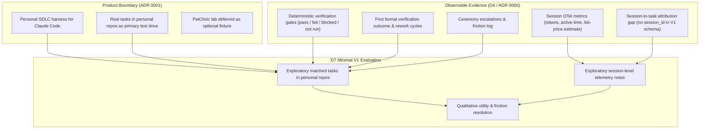
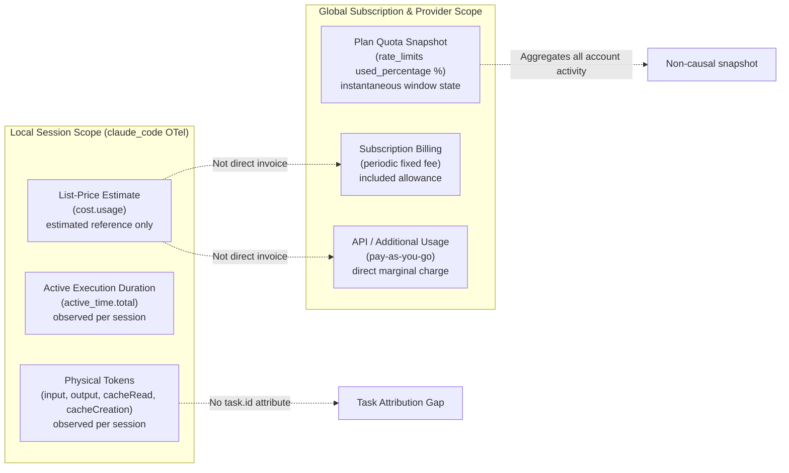
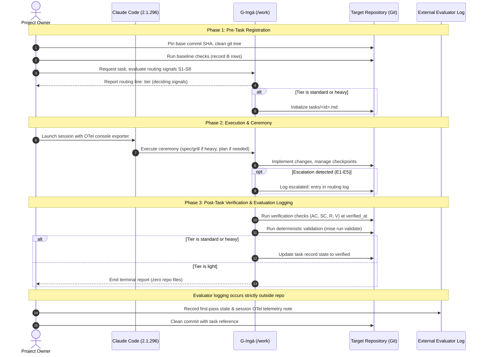
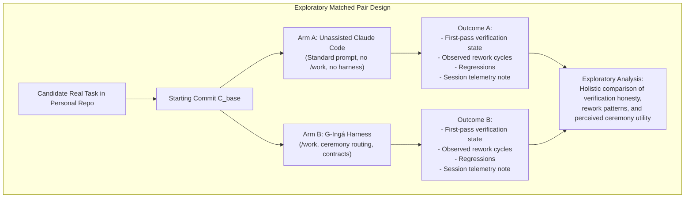

# D7 — Minimal V1 Evaluation Protocol for Real Tasks

**Status:** accepted (decision D7, approved by project owner on 2026-10-11 for exploratory evaluation pilot; does not authorize V1 implementation). Research note and evaluation protocol. Not an architectural decision.  
**Date:** 2026-10-11.  
**Audited branch:** `claude/kind-pasteur-bd8bq3` at commit `7f830e4`.  
**Depends on:** [ADR 0001](../decisions/0001-product-boundary.md) (`accepted`), [ADR 0002](../decisions/0002-ceremony-tiers-and-routing.md) (`accepted`), [ADR 0003](../decisions/0003-minimum-artifact-schemas.md) (`accepted`), [ADR 0005](../decisions/0005-native-primitive-mapping.md) (`proposed`), [ADR 0006](../decisions/0006-usage-observability.md) (`proposed`), [D4 spike results](d4-spike-results.md), [D4 spike review](d4-spike-review.md).  
**Deciders:** project owner (approved 2026-10-11 for exploratory evaluation pilot).  

---

## 1. Executive summary and evaluation objective

This proposal specifies the minimal evaluation protocol for G-Ingá V1. Its objective is to define a verifiable, empirical evaluation approach grounded in real software engineering tasks within the project owner's personal repositories, strictly respecting the product boundary defined in [ADR 0001](../decisions/0001-product-boundary.md) and the observability findings from Spike D4 ([ADR 0006](../decisions/0006-usage-observability.md), [D4 spike results](d4-spike-results.md), [D4 spike review](d4-spike-review.md)).

In accordance with project governance, decision **D7 is `accepted`** exclusively to conduct the exploratory evaluation pilot. This acceptance authorizes executing the evaluation protocol on real tasks to gather empirical evidence; it does not authorize the implementation of G-Ingá V1, does not alter artifact schemas, does not implement evaluation software, and introduces no mandatory numeric quotas or synthetic benchmarks.



### 1.1 Precise evaluation questions

To avoid conflating distinct aspects of the harness, the protocol separates five evaluation dimensions:

1. **EQ1 — Contract compliance:**
   - *Question:* Do generated artifacts (`schema: task/1`, `schema: spec/1`, terminal reports for `light`) conform strictly to the invariant syntax, frontmatter constraints, routing grammar, and state-machine transitions defined in [ADR 0002](../decisions/0002-ceremony-tiers-and-routing.md), [ADR 0003](../decisions/0003-minimum-artifact-schemas.md), and [artifact contracts](../artifact-contracts.md)?
   - *Supporting evidence:* Deterministic static validation via `mise run validate` (`bun tools/validate/main.ts`) and test suite assertions (`mise run test`). Validates frontmatter parsing, section completeness, transition reachability (§7.1), and link integrity.
2. **EQ2 — Defect interception vs. false completion:**
   - *Question:* Does the harness verification gate detect genuine defects or omissions before declaring work complete, preventing unverified build rationalizations ([principles](../principles.md) §3)?
   - *Supporting evidence:* **A final recorded status of `verified` with all checks passing does NOT, by itself, prove that the harness prevented a false completion claim.** A trivial or unexercised check would pass anyway. Evidence supporting defect interception requires:
     - Documented initial check failures on acceptance criteria (`AC`) during the first formal verification that were subsequently corrected;
     - Failing regression rows (`R`) that blocked premature verification;
     - Substantive defects surfaced by self-review (`V` rows) or adversarial review (`## Review` in `heavy`) requiring implementation fixes;
     - Matched comparisons showing a defect overlooked by unassisted Claude Code that was intercepted by the harness gate.
3. **EQ3 — Operational outcomes (rework and escalations):**
   - *Question:* How often do tasks require corrective iterations after formal verification, and under what conditions do ceremony tiers escalate?
   - *Supporting evidence:* State transitions from `completed` back to `active` in task records; explicit entries in `## Routing and approvals` matching the escalation grammar (`escalated: <from> → <to> because <E1–E5>`); and corresponding entries in `docs/friction-log.md`.
4. **EQ4 — Operational cost and ceremony proportionality:**
   - *Question:* Is the administrative overhead of ceremony (authoring task records, specs, and verification tables) proportional to task risk, keeping small work cheap while reducing overall rework friction?
   - *Supporting evidence:* Qualitative operator assessments logged in `docs/friction-log.md`; observation of whether simple tasks successfully complete in `light` tier with zero persisted files; and records of owner overrides or downgrades.
5. **EQ5 — Exploratory session telemetry:**
   - *Question:* What are the observed orders of magnitude for physical tokens (`input`, `output`, `cacheRead`, `cacheCreation`) and active CLI durations during evaluation sessions, within the strict boundaries of the session-to-task attribution gap?
   - *Supporting evidence:* Local OpenTelemetry console export payloads captured during dedicated 1:1 sessions, logged in exploratory execution notes without automated per-task aggregation.

---

## 2. Metrics, operational definitions, and evidence sources

The protocol strictly separates metrics backed by existing contracts from exploratory usage signals subject to platform limitations.

### 2.1 Contract-supported metrics (ready now)

These metrics rely entirely on accepted project contracts and deterministic repository tools:

| Metric | Operational definition | Allowed values | Primary source of evidence | Verification mechanism |
|---|---|---|---|---|
| **Verification Gate Outcome** | Deterministic check result for each acceptance, spec, regression, or self-review criterion at `verified_at` commit. | `pass`, `fail`, `blocked`, `not run` | Task record `## Verification` table (`schema: task/1`) or terminal report for `light` tier. | Deterministic script: `tools/validate/artifacts/rules.ts` checks valid result enum and `verified_at` consistency. |
| **First-Pass Formal Verification** | Categorical outcome of the first formal execution of acceptance criteria against the completed implementation candidate. | `first_pass_pass`, `first_pass_fail_reworked`, `verification_blocked`, `verification_not_run` | Task record state transitions, initial verification row states, and task execution reports. | Explicitly recorded verification attempt state. Subject to observational limits (see §2.2). |
| **Observed Rework Cycles** | Count of formal corrective fix-verify cycles following a failed verification before achieving `verified`. | Non-negative integer ($\ge 0$) | Task record state history (`schema: task/1`), recorded transitions `completed → active`. | Transition walk in validator (§7.1 of artifact contracts). |
| **Observed Regressions** | Count of regression checks (`R<n>`) evaluating to `fail` at `verified_at` that were not documented as pre-existing defects in baseline rows `B<n>`. | Non-negative integer ($\ge 0$) | Task verification table `R` rows. | Deterministic check: un-attributed `fail` in `R` row prevents `verified` state. |
| **Ceremony Escalations** | Count of explicit escalation events recorded in `## Routing and approvals` matching the grammar `escalated: <from> → <to> because <E1–E5>: <evidence>`. | Non-negative integer ($\ge 0$) | Task record routing log (`## Routing and approvals`). | Grammar check in validator (§2.3 of artifact contracts). |
| **Friction Entries** | Count and classification of operational friction events logged in `docs/friction-log.md` associated with the task. | Categories: identified, resolved, recurrent | `docs/friction-log.md` table entries (`F-NNN`). | Manual inspection and traceability links in harness changes. |

### 2.2 Operational definition of first-pass verification and contract limitations

First-pass verification success must NOT be inferred from Git commit counts. An engineer or agent may create multiple legitimate incremental commits during implementation before formally submitting the code to verification.

The four operational states of first-pass verification are:

1. **`first_pass_pass` (Primeira verificação aprovada):** The initial formal execution of the verification suite on the candidate implementation (at the transition to `completed`) yields `pass` across all required criteria (`AC`, `SC`, `V`, `R`), enabling direct progression to `verified` without intermediate fix cycles.
2. **`first_pass_fail_reworked` (Primeira verificação reprovada, seguida de correção):** The initial formal verification run fails on one or more criteria, requiring the task to transition back from `completed` to `active` to implement fixes and re-execute verification.
3. **`verification_blocked` (Verificação bloqueada):** The verification suite cannot complete due to external dependencies, environment failures, or pending human decisions, yielding a `blocked` check or task status.
4. **`verification_not_run` (Verificação não executada):** Formal verification was never executed (e.g., task was aborted, cancelled, or closed prematurely).

#### Contract and observational limitations

- `schema: task/1` does not maintain an append-only verification attempt history log. In standard operation, the `## Verification` table reflects the state at `verified_at`.
- If an agent runs verification locally, encounters a failure, and fixes the code before persisting the task artifact or committing the failure, the artifact on disk will display only the final passing state.
- **Protocol rule:** The evaluation protocol requires the agent to record any initial verification failure explicitly in the task report or in check notes (e.g., `fail on commit X; fixed in Y`). If the agent fails to record the intermediate failure, the evaluation protocol must classify the first-pass reconstruction as **limited by agent reporting honesty**, rather than fabricating certainty from Git commits. No schema change is permitted in V1 to solve this gap.

### 2.3 Strict separation of utilization metrics and cost concepts

Spike D4 and its review ([d4-spike-review.md](d4-spike-review.md) §1.1) established five strictly separated facets of usage and cost. They must never be conflated, combined, or derived from one another:



1. **Cobrança fixa periódica da assinatura (Fixed subscription fee):** Taxa periódica regular correspondente ao plano de assinatura ativo na conta (ex.: planos Pro ou Max no claude.ai). É faturada em ciclo fixo (mensal ou anual) independentemente da contagem exata de tokens de uma tarefa individual dentro dos limites da franquia. Os valores e termos regem-se pela política comercial vigente do provedor e não devem ser presumidos como universais ou imutáveis.
2. **Utilização dentro dos limites incluídos (Included usage allowances):** Consumo de requisições e tokens absorvido pela franquia regular coberta pelo plano de assinatura, sem geração de cobrança financeira adicional por chamada.
3. **Eventual uso pago de API ou utilização adicional (Additional paid usage / API pay-as-you-go):** Operações realizadas via chave direta de API (créditos pré ou pós-pagos), gateways com limites de gastos, ou funcionalidades de utilização adicional tarifada além da franquia base da assinatura. Nesses modelos, cada chamada e token geram cobrança financeira direta marginal faturada na conta.
4. **Estimativa teórica a preço de referência (Reference list-price estimate):** Valor monetário teórico emitido pelo sinal OTel `claude_code.cost.usage`, calculado sobre as tabelas públicas de preços por token da API. Constitui uma régua padronizada de intensidade computacional para comparar tarefas entre si, não espelhando automaticamente faturas ou despesas em contas sob assinatura.
5. **Ausência de faturamento por tarefa diretamente atribuível à telemetria:** A telemetria local de OTel não é um livro-razão contábil (billing ledger). O faturamento real do provedor opera exclusivamente no nível da assinatura periódica ou da fatura consolidada de API na nuvem, sem emissão de cobranças financeiras por tarefa individual do G-Ingá. Além disso, mesmo sob assinaturas fixas, tarefas de alta intensidade consom quota da janela móvel, reduzindo a capacidade restante e podendo antecipar bloqueios de taxa ou acionar tarifação adicional caso configurada; logo, não se deve presumir que o custo econômico marginal de uma tarefa seja necessariamente US$ 0,00.

### 2.4 Semântica verificada dos campos de quota do plano

Conforme documentado na especificação oficial do statusline de Claude Code (`code.claude.com/docs/en/statusline`, T18), os campos de rate limit utilizam a seguinte semântica estrita:

- **Utilização consumida (`used_percentage`):** Percentual acumulado da capacidade da janela móvel (5 horas ou 7 dias) que já foi consumido pela conta até o instante da observação (`rate_limits.five_hour.used_percentage`, `rate_limits.seven_day.used_percentage`, valores inteiros de 0 a 100).
- **Capacidade restante:** A fração não consumida da franquia da janela. **A CLI não emite a capacidade restante em contagem absoluta de tokens ou mensagens.** O protocolo proíbe converter o percentual em contagens brutas sem uma fórmula oficial verificada do provedor, visto que limites de taxa em serviços gerenciados podem variar dinamicamente conforme a carga do sistema e políticas de concorrência.
- **Instante da observação:** Timestamp (`resets_at` ou momento da requisição) em que a medição pontual foi capturada. Reflete o estado agregado de todas as sessões e atividades simultâneas na conta até aquele instante exato, não permitindo isolar causalmente quanto da utilização consumida foi gerado pela tarefa ou sessão sob observação.

---

## 3. Real-task execution protocol

The protocol is designed for non-synthetic, real engineering tasks executed in the project owner's personal repositories.



### 3.1 Pre-task phase (context and baseline pinning)

1. **Repository state pinning:** Record target repository path, current branch, and clean starting commit SHA ($C_{\text{base}}$). Ensure `git status --porcelain` is clean.
2. **Environment verification:** Confirm Claude Code version (`claude --version`, verified `2.1.296`), model (`claude-opus-5-5`), and effort level (`medium` by default).
3. **CLI session invocation verification:**
   - *Verified flag:* `claude --session-id <uuid>` is verified via `claude --help` in Claude Code `2.1.296` as valid for specifying a deterministic session UUID upon initialization.
   - *Resumption flag:* `claude --help` specifies `-r, --resume [value]` for resuming a session. Reusing `--session-id <uuid>` for resumption is unverified in official help and remains **pending verification**.
   - *Protocol instruction:* Use `claude --session-id <uuid>` strictly for new session launches; use `claude --resume <uuid>` for resuming an existing session.
4. **Baseline execution ($B$ rows):** Execute relevant test and lint suites on $C_{\text{base}}$ prior to any edits (ADR 0002 §4). Pre-existing failures are recorded in baseline rows (`B1 | test suite | fail | <sha_base> | pre-existing failure`) and are not attributed to the new task.
5. **Categorical routing:** Evaluate routing signals S1–S8 ([ADR 0002](../decisions/0002-ceremony-tiers-and-routing.md) §1) and propose tier (`light`, `standard`, `heavy`). For `heavy`, obtain owner confirmation before drafting specs.
6. **Artifact initialization:** For `standard` or `heavy`, initialize `tasks/<YYYY-MM-DD>-<slug>.md` per [artifact contracts](../artifact-contracts.md) §3. For `light`, do NOT create any file in the repository.
7. **Telemetry environment:** Set launch variables with all content gates explicitly set to 0:

   ```bash
   export CLAUDE_CODE_ENABLE_TELEMETRY=1
   export OTEL_METRICS_EXPORTER=console
   export OTEL_LOGS_EXPORTER=console
   export OTEL_METRICS_INCLUDE_ACCOUNT_UUID=false
   export OTEL_LOG_USER_PROMPTS=0
   export OTEL_LOG_ASSISTANT_RESPONSES=0
   export OTEL_LOG_TOOL_DETAILS=0
   export OTEL_LOG_TOOL_CONTENT=0
   export OTEL_LOG_RAW_API_BODIES=0
   ```

### 3.2 Execution phase (ceremonial guardrails)

1. **Tier ceremony adherence:**
   - `light`: Implement directly; no spec, no plan, no task file. Targeted verification in report.
   - `standard`: Implement against acceptance criteria (`AC1`, `AC2`, ...); create plan if non-trivial; manage checkpoints across sessions.
   - `heavy`: Grill ambiguous requirements; obtain owner approval on spec (`approved: spec v1`); decompose into child tasks (`tier: standard`); execute children; conduct adversarial self-review.
2. **Dynamic escalation:** If unexpected scope, contract breaks, or sensitive behavior emerge, trigger escalation (ADR 0002 §5) immediately:
   - Append `escalated: <from> → <to> because <E1–E5>: <evidence>` to `## Routing and approvals`.
   - Escalation to `heavy` pauses execution until owner confirms (`confirmed: heavy by owner (<date>, <ref>)`).
3. **Immediate friction capture:** Log operational anti-patterns or blocking friction immediately in `docs/friction-log.md`.

### 3.3 Post-task phase and evidence collection in tier `light`

1. **Verification suite execution:** Execute acceptance checks (`AC<n>`), spec criteria (`SC<n>`), regression checks (`R<n>`), and self-review (`V<n>`) on the candidate commit ($C_{\text{verified}}$).
2. **Deterministic contract validation:** Run repository validation:

   ```bash
   mise run validate
   mise run test
   ```

3. **Outcome state assignment:**
   - For `standard` and `heavy`: Update frontmatter status to `verified` once all contract rules hold.
   - For `light`: The agent outputs its final report to stdout/terminal with routing and check outcomes. No files are persisted in the repository.
4. **Preservação da ausência de arquivos e coleta de evidência no tier `light`:**
   - O tier `light` impõe como invariante contratual a **ausência total de arquivos de registro** no repositório (`tasks/` ou `specs/`) ([ADR 0002](../decisions/0002-ceremony-tiers-and-routing.md), [artifact contracts](../artifact-contracts.md) §1 & §6).
   - O avaliador **não deve introduzir arquivos ou formulários de avaliação dentro do repositório da tarefa** que violem a ausência de cerimônia do próprio tier `light`, sob pena de alterar retroativamente as propriedades do braço avaliado.
   - *Onde registrar:* Todos os dados da avaliação exploratória (resultado formal do primeiro passe, nota de telemetria OTel da sessão, duração e observações comparativas) devem ser registrados **estritamente fora do repositório da tarefa**, no registro geral do piloto de avaliação (ex.: em arquivo de diário de bordo mantido em `docs/research/` ou scratchpad do avaliador).
   - *Quando registrar:* O registro ocorre **estritamente após a conclusão do turno do agente e a emissão do seu relatório terminal**.
   - *Não retroatividade:* Esse registro externo não modifica o repositório da tarefa nem altera o histórico Git da entrega.
5. **Git commit and cleanliness:** Ensure target repository working tree is clean and committed.

---

## 4. Recording rework, escalations, and frictions

### 4.1 Rework recording

Rework represents corrective effort after formal verification fails.

- **Task record evidence:** In `## Verification`, initial failed checks and subsequent passing checks are preserved:

  ```markdown
  | AC1 | bun test test/unit/parser.test.ts | fail | 3a1b2c3 | off-by-one error on empty input |
  | AC1 | bun test test/unit/parser.test.ts | pass | 7d8e9f0 | fixed in parser.ts; verified_at |
  ```

- **State transition walk:** Validator checks valid transition reachability: `active → completed → active → completed → verified`.
- **Limitation:** In the absence of an explicit failure record or intermediate commit, rework cycles cannot be deterministically inferred; the protocol reports this as an observational gap.

### 4.2 Escalation recording

- **Routing log grammar:** Every escalation appears in `## Routing and approvals`:

  ```text
  escalated: light → standard because E1: approach required helper function across multiple files
  escalated: standard → heavy because E4: modified authentication token parsing in security middleware
  ```

- **Categories:** `E1` (approach unclear / 2 attempts fail), `E2` (contract or subsystem boundary crossed), `E3` (irreversible action), `E4` (sensitive behavior / security), `E5` (spec divergence).

### 4.3 Friction logging

- **Location:** `docs/friction-log.md`.
- **Required fields:** `ID`, `Date`, `Project / task`, `What happened`, `Cost (tokens, time, rework)`, `What I wanted instead`, `Linked change`.

---

## 5. Treatment of session metrics and task attribution boundary

### 5.1 Rules for handling telemetry

1. **No false task-level precision:** Never present session-level metrics as task-level metrics.
2. **Dedicated 1:1 session discipline (exploratory evaluation):** Launch Claude Code with a dedicated UUID for the task:

   ```bash
   claude --session-id $(uuidgen)
   ```

   Terminate the session upon task completion. This bounds session consumption to task execution, while preserving the distinction that the telemetry is emitted by the session.
3. **Dirty / multi-task sessions:** In sessions executing multiple tasks or extraneous queries, mark task telemetry as `unattributed` / `not run`.
4. **Standard exploratory note format:**

   ```text
   Observability note (exploratory, session-level only):
   - Session ID: d4000000-0000-4000-8000-000000000001
   - CLI version: 2.1.296 (Claude Code)
   - Input tokens: 12,450 (observed)
   - Output tokens: 890 (observed)
   - Cache creation tokens: 18,200 (observed)
   - Cache read tokens: 42,100 (observed)
   - Active duration: 38.4s (observed)
   - Estimated cost: $0.142 USD (estimated reference list-price; not per-task billing)
   - Quota snapshot: 5h: 32% consumed (resets at ...), 7d: 85% consumed (instantaneous window snapshot; not causal task consumption)
   ```

5. **Cost and billing segregation:** List-price dollar estimates (`claude_code.cost.usage`) must never be described as monetary expenditure. Telemetry signals do not constitute an accounting billing ledger.

---

## 6. Exploratory comparison method, threats to validity, and pilot design

### 6.1 Exploratory matched task comparison method

To compare unassisted Claude Code with G-Ingá, the protocol specifies an exploratory matched-pair design:

- **Arm A (Baseline - Unassisted Claude Code):** The operator executes a task using Claude Code in standard interactive mode without invoking `/work`, without ceremony routing, and without G-Ingá artifact templates.
- **Arm B (Candidate - G-Ingá Harness):** The operator executes a comparable task using `/work`, following ceremony routing, artifact contracts, and verification rules.
- **Pair matching requirements:**
  - Same target repository and identical starting Git commit ($C_{\text{base}}$).
  - Identical user prompt and pre-declared acceptance criteria.
  - Same CLI version (`2.1.296`), model (`claude-opus-5-5`), and effort level (`medium`).
  - Isolated Git worktrees to prevent workspace crosstalk.



### 6.2 Order of execution, counterbalancing, and limits of the matched design

1. **Registro da ordem real de execução:** Em cada par avaliado durante o piloto, deve-se registrar explicitamente a sequência temporal da execução: Braço A seguido do Braço B ($A \to B$) ou Braço B seguido do Braço A ($B \to A$).
2. **Contrabalanceamento da ordem:** Para mitigar vieses sistemáticos de ordem (como aquecimento de cache de prompt na API, resíduos locais de compilação ou aprendizado do desenvolvedor sobre a base de código), o protocolo orienta contrabalancear a ordem de execução entre pares subsequentes (ex.: Par 1 executa $A \to B$; Par 2 executa $B \to A$), sempre que operacionalmente viável.
3. **Limitação explícita quando a ordem for fixa:** Quando o contrabalanceamento não for praticável (por exemplo, se executar o Braço B primeiro fornecer ao operador um plano estruturado ou requisitos esclarecidos que contaminariam irremediavelmente a abordagem desassistida do Braço A, ou na impossibilidade de zerar o cache de prompt entre os testes), a ordem fixa deve ser documentada explicitamente como limitação metodológica do par.
4. **Limites do desenho pareado atual (avaliação do conjunto integrado):**
   - O desenho pareado atual foi estruturado para avaliar o impacto do conjunto integrado de intervenções do G-Ingá (roteamento de cerimônia, contratos de artefatos, portões de verificação determinísticos, auto-revisão e diretrizes anti-racionalização) operando conjuntamente frente ao uso desassistido.
   - Como esses componentes variam de forma agregada entre o Braço A e o Braço B, o desenho pareado atual não desacopla suas variáveis internas e, portanto, **não permite isolar o efeito causal específico de cada componente individual** (por exemplo, distinguir o efeito exclusivo da tabela de verificação frente ao efeito do roteamento por tiers).
   - *O que a comparação permite:* Avaliação holística da utilidade operacional, honestidade de verificação e padrões de retrabalho do harness integrado no ambiente real do proprietário.
   - *O que a comparação NÃO permite:* Isolamento de contribuições marginais de componentes individuais, generalização estatística para outros desenvolvedores ou repositórios, ou comprovação de causalidade algorítmica definitiva.
5. **Asymmetric operator assistance:** Operator prompts must remain strictly identical across both arms. Any debugging hint provided to one arm invalidates the comparison.
6. **Requirement drift:** Modifying scope or criteria midway through execution invalidates the pair.

### 6.3 Exploratory pilot design and task selection

In adherence to project principles, the protocol defines **no prescriptive sample size** (such as $N \approx 5\text{--}15$) and establishes no mandatory minimum task quotas.

Instead, the evaluation proceeds as an **exploratory pilot**:

- **Selection principle:** Tasks are selected opportunistically from the project owner's real personal repositories based on **task diversity** and **potential to surface operational friction**:
  - *Ceremony diversity:* Include tasks suitable for `light` (mechanical prose/docs), `standard` (well-scoped bug fixes with repro, self-contained features), and `heavy` (architectural changes, API contract evolution, high-uncertainty tasks).
  - *Technical diversity:* Include diverse engineering operations: reproducing and fixing a defect, refactoring existing code, authoring validation scripts, and updating technical specifications.
- **Qualitative review conditions (mid-pilot pause):**
  - The pilot must pause for review if ceremony overhead is perceived as counterproductive (e.g., authoring task records delays trivial fixes without preventing defects);
  - If routing signals (S1–S8) frequently produce ambiguous or contested classifications;
  - If deterministic verification tools disagree with human review.
- **Qualitative pilot closure conditions:**
  - The pilot concludes when at least one representative task has been executed across each ceremony tier (`light`, `standard`, `heavy`), and the logged friction entries in `docs/friction-log.md` provide sufficient empirical evidence to qualitatively answer evaluation questions EQ1 through EQ4, enabling a grounded decision on advancing to milestone M1.

---

## 7. Qualitative criteria for evaluation utility

In adherence to brief §9 (*"Avoid numerical weighted scoring models unless decisions cannot be made reliably through explicit constraints, categories and evidence. Do not pretend confidence scores are objective when inputs are subjective"*), the protocol defines qualitative criteria for evaluating utility:

1. **Defect interception utility:** Does the harness's verification gate detect real bugs, omissions, or regressions that unassisted Claude Code would have falsely declared "done"?
2. **Ceremony proportionality utility:** Is the overhead of maintaining task records (`standard`) or specs (`heavy`) perceived as low friction relative to the rework avoided? Does `light` successfully avoid ceremony overhead for trivial tasks?
3. **Friction actionability:** Does every logged entry in `docs/friction-log.md` lead directly to an identifiable, testable adjustment in harness rules or anti-rationalization tables?
4. **Attribution transparency:** Does the evaluation maintain complete honesty regarding session-level versus task-level data, avoiding fabricated per-task metrics?
5. **Contract determinism:** Do automated validation tools (`mise run validate`, `mise run test`) consistently agree with recorded artifact states without ambiguous human interpretation?

---

## 8. Decision record, adoption rationale, and remaining owner decisions

Decision D7 is **`accepted`** by the project owner on 2026-10-11 for the conduction of the exploratory evaluation pilot.

### 8.1 Formal decision record and adoption rationale

- **Scope of acceptance:**
  - Formally accepts the evaluation protocol specified in this document for the sole purpose of conducting an exploratory pilot with real software engineering tasks in the project owner's personal repositories.
  - Authorizes executing matched tasks (unassisted Claude Code vs. G-Ingá harness), capturing verification gate outcomes, recording rework cycles and ceremony escalations, logging friction entries in `docs/friction-log.md`, and taking exploratory session-level OpenTelemetry notes.
- **Evidence intended to be collected:**
  - *Contract compliance (EQ1):* Deterministic validation via `mise run validate` and `mise run test`, checking invariant syntax, frontmatter constraints, routing grammar, and state-machine transitions without human ambiguity.
  - *Defect interception vs. false completion (EQ2):* Documented initial check failures on acceptance criteria (`AC`), spec criteria (`SC`), regression rows (`R`), or self-review (`V`) during the first formal verification that were subsequently corrected before achieving `verified`.
  - *Operational outcomes (EQ3):* Count of corrective fix-verify cycles (`completed → active`) and explicit ceremony escalations (`light → standard → heavy`) matching the escalation grammar (`escalated: <from> → <to> because <E1–E5>: <evidence>`).
  - *Operational cost and ceremony proportionality (EQ4):* Qualitative friction events logged in `docs/friction-log.md` (`F-NNN`), confirming whether simple tasks complete in `light` tier with zero persisted files and whether ceremony overhead remains proportional to task risk.
  - *Exploratory session telemetry (EQ5):* Observed orders of magnitude for physical tokens (`input`, `output`, `cacheRead`, `cacheCreation`) and active CLI duration captured via local OpenTelemetry console exporter in dedicated 1:1 sessions, without automated per-task aggregation.
- **Recognized methodological limitations:**
  - *Session-to-task attribution boundary:* Neither Claude Code nor current artifact schemas (`schema: task/1`) provide native per-task tagging or a `session_id` field. Telemetry signals belong strictly to the session scope and are recorded manually in exploratory notes; automated per-task attribution remains unsupported in V1.
  - *Integrated matched-pair comparison:* The paired design evaluates the holistic harness (ceremony routing, artifact contracts, verification gates, and anti-rationalization guidelines together) against unassisted usage. It does not isolate the individual causal contribution of specific sub-components.
  - *Honesty of first-pass reconstruction:* Because `schema: task/1` does not maintain an append-only verification attempt log, first-pass failure reconstruction relies on agent reporting honesty in execution notes rather than Git commit counts.
  - *Threats to validity:* The protocol explicitly documents risks of execution order bias, prompt cache warming, operator learning, and asymmetric human assistance. When counterbalancing ($A \to B$ vs. $B \to A$) is not feasible, the fixed order must be recorded as a limitation.
  - *Absence of statistical generalization:* The exploratory pilot does not claim statistical significance, causal proof, or generalization across developers or repositories.
- **Conditions requiring protocol revision:**
  - Ceremony overhead is perceived as counterproductive (e.g., authoring task records delays trivial fixes without catching defects);
  - Routing signals S1–S8 frequently yield ambiguous or contested tier assignments;
  - Deterministic validation tools disagree with human review;
  - Operational findings reveal a need to alter artifact schemas, routing grammar, or observability taxonomies;
  - Any breach of tier `light` zero-file invariants in task repositories.
- **Absence of authorization for V1 implementation:**
  - Acceptance of D7 does NOT authorize implementing G-Ingá V1 features, packaging plugins, creating automated collectors/daemons, altering artifact schemas or contract grammar, changing the observability taxonomy, accepting ADR 0006, claiming proven efficacy, launching new telemetry spikes, or adopting synthetic benchmarks.

### 8.2 Remaining human decisions reserved for the project owner

The following decisions remain explicitly reserved for the project owner:

1. **Selection of exploratory pilot tasks:** Select the initial diverse tasks from personal repositories to initiate the exploratory pilot across ceremony tiers (`light`, `standard`, `heavy`).
2. **Direction for task attribution contract evolution:** When artifact contracts are next revised (in M1 or post-V1), decide where `session_id` should be recorded (`schema: task/2` frontmatter, `## Routing and approvals` log keyword, or ephemeral reports only).
3. **Role of PetClinic fixture in V1:** Confirm whether PetClinic remains an optional controlled fixture for cross-repository validation, or whether personal repositories remain the sole validation ground for V1.
4. **Quantitative thresholds policy:** Confirm that V1 operates without arbitrary numerical token quotas or success-rate targets until empirical data from real tasks establishes an objective baseline.

---

## 9. References and verification levels

All primary references cited in this proposal are cataloged in [docs/research/reference-index.md](reference-index.md).

| Reference | Source / Identifier | Revision / Date | Verification level | Applied finding / constraint |
|---|---|---|---|---|
| **ADR 0001** | `docs/decisions/0001-product-boundary.md` | Commit `ca42673` (2026-10-10) | verified (`accepted`) | Personal SDLC harness first; PetClinic optional; optimize tokens/time per verified task; grow from friction. |
| **ADR 0002** | `docs/decisions/0002-ceremony-tiers-and-routing.md` | Commit `ca42673` (2026-10-10) | verified (`accepted`) | Ceremony tiers (`light`, `standard`, `heavy`), signals S1–S8, triggers H1–H6, escalation E1–E5. |
| **ADR 0003** | `docs/decisions/0003-minimum-artifact-schemas.md` | Commit `ca42673` (2026-10-10) | verified (`accepted`) | Minimal schemas, states (`todo`, `active`, `completed`, `verified`, `accepted`, `blocked`, `partial`, `cancelled`). |
| **Artifact Contracts** | `docs/artifact-contracts.md` | Commit `ca42673` (2026-10-10) | verified (`accepted`) | Field-level contracts, verification table `ID \| Check \| Result \| Ref \| Note`, history checks (§7.1). |
| **ADR 0005** | `docs/decisions/0005-native-primitive-mapping.md` | Commit `7bbf68d` (2026-10-10) | verified (`proposed`) | Native Claude Code mechanisms: model-invocable `/work` skill, deterministic validator script, no unnecessary hooks. |
| **ADR 0006** | `docs/decisions/0006-usage-observability.md` | Working tree (2026-10-11) | verified (`proposed`) | Local-only OTel console export, 6-state taxonomy, four cost concepts separation, task attribution gap. |
| **Spike D4 Results** | `docs/research/d4-spike-results.md` | Working tree (2026-10-10) | verified (`research note`) | Claude Code OTel `pass` (`2.1.296`), Gemini CLI `blocked` (`IneligibleTierError`), content gates closed. |
| **Spike D4 Review** | `docs/research/d4-spike-review.md` | Working tree (2026-10-11) | verified (`research note`) | Audit of D4; separation of D7 dependencies; confirmation that D7 does not require dual-host OTel. |
| **SDLC Harness Brief** | `docs/briefs/sdlc-harness-brief.md` | Commit `ca42673` (verbatim) | verified (`input brief`) | Acceptance gates, baseline comparison, avoid numerical confidence scores when subjective (§9). |
| **Working Principles** | `docs/principles.md` | Commit `ca42673` (2026-10-10) | verified (`proposed`) | Ceremony matches stakes (§1), "Build passed" is not proof (§3), optimize tokens per verified task (§6). |
| **Claude Code Monitoring** | `code.claude.com/docs/en/monitoring-usage` | Live page (2026-10-10) | verified (`official docs`) | OTel metrics (`token.usage`, `cost.usage`), active durations, launch-environment configuration. |
| **Claude Code Costs** | `code.claude.com/docs/en/costs` | Live page (2026-10-10) | verified (`official docs`) | Separation of list-price estimates from subscription billing. |
| **Claude Code Statusline** | `code.claude.com/docs/en/statusline` | Live page (2026-10-10) | verified (`official docs`) | JSON statusline schema, `rate_limits.five_hour` and `seven_day` fields (`used_percentage`, `resets_at`). |
| **Claude Code CLI Help** | `claude --help`, `claude --version` | CLI `2.1.296` (2026-10-11) | verified (`observed`) | Verification of `--session-id <uuid>` for initialization; `-r, --resume` for resumption; resumption via `--session-id` unverified. |
| **Osmani Agent Skills** | `github.com/addyosmani/agent-skills` | Commit `1be8e34` (2026-10-10) | verified (`source repo`) | Skill evaluation levels (structural, trigger, behavioral), stochasticity of model triggers. |
