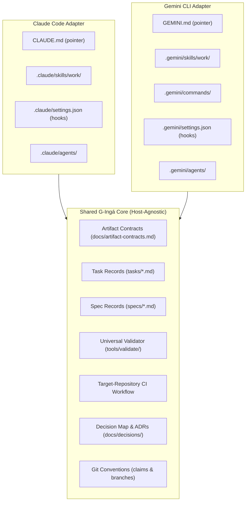
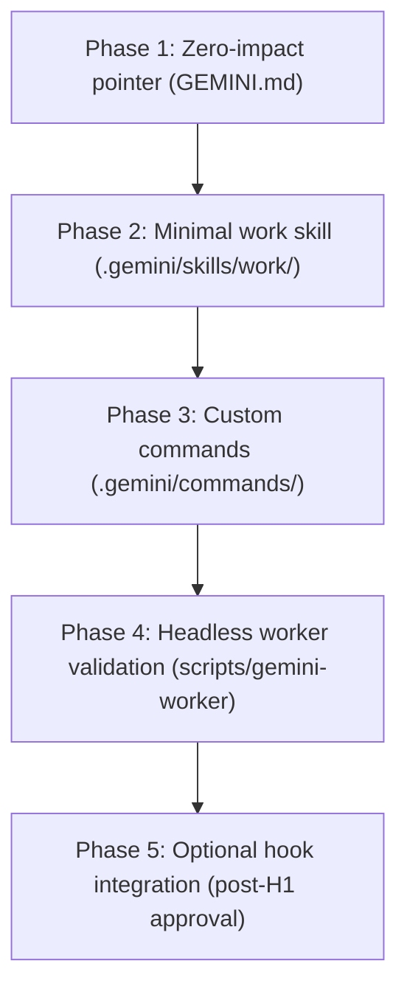

# Gemini CLI host evidence and primitive mapping

**Status:** research note (input to G-Ingá Gemini CLI adapter design).
**Date:** 2026-10-10.
**Gemini CLI in environment:** `0.63.0` (installed at `/usr/lib/node_modules/@google/gemini-cli/`).
**Deciders:** project owner (pending).

Codes: `G` for Gemini CLI official documentation and CLI capabilities, `C` for Claude Code comparison points, `L` for local observations.

Each claim carries one classification label:

- **Fact (docs):** read in the official documentation (bundled or online) on the date above.
- **Fact (source):** verified directly in installed package files or binaries.
- **Observed:** executed and confirmed in this local environment with the recorded command.
- **Inference (ours):** deduction based on evidence, submitted for owner review.
- **Assumption:** unverified, pending spike.

---

## Sources

| Source | Revision / Location | Date |
|---|---|---|
| Gemini CLI Documentation | bundled in `@google/gemini-cli@0.63.0` (`/usr/lib/node_modules/@google/gemini-cli/bundle/docs/`) and live docs at <https://geminicli.com/docs/> | 2026-10-10 |
| Gemini CLI Binary | `/usr/bin/gemini` (version `0.63.0`) | 2026-10-10 |
| G-Ingá Repository | `ca42673` (branch `gemini/GEMINI-ADAPTER-DISCOVERY-host-evidence`) | 2026-10-10 |
| Claude Code Documentation & ADR 0005 | [ADR 0005](../decisions/0005-native-primitive-mapping.md), [D5 evidence](d5-native-primitive-evidence.md) | 2026-10-10 |

---

## 1. Native Gemini CLI features relevant to G-Ingá

| # | Label | Feature | Detail | Source |
|---|---|---|---|---|
| G1 | Fact (docs) | Context hierarchy (`GEMINI.md`) | Loads hierarchically from user (`~/.gemini/GEMINI.md`), workspace (`.gemini/GEMINI.md` or workspace root `GEMINI.md`), and Just-In-Time (JIT) directory scans up to trusted root. Supports modular imports via `@path.md`. Multiple filenames can be declared via `context.fileName` in `settings.json`. Context is concatenated and sent on each turn | `docs/cli/gemini-md.md` |
| G2 | Fact (docs) | Agent Skills (`SKILL.md`) | Implements the open [Agent Skills](https://agentskills.io) standard. Skills are self-contained folders with a `SKILL.md` (YAML frontmatter: `name`, `description`). Only metadata is injected into prompt; full body and folder access are granted on explicit activation (`activate_skill` tool) | `docs/cli/skills.md` |
| G3 | Fact (docs) | Skill discovery tiers and aliases | Discovered across tiers (lowest to highest precedence): built-in, extension, user (`~/.gemini/skills/` or alias `~/.agents/skills/`), and workspace (`.gemini/skills/` or alias `.agents/skills/`). Within the same tier, the `.agents/skills/` alias takes precedence over `.gemini/skills/` | `docs/cli/skills.md`, `docs/cli/creating-skills.md` |
| G4 | Fact (docs) | Custom commands (`.toml`) | Project commands live in `.gemini/commands/` and user commands in `~/.gemini/commands/`. TOML files define prompts and metadata. Subdirectories create colon namespacing (e.g. `commands/git/commit.toml` becomes `/git:commit`). Supports `{{args}}` injection, `!{shell command}` execution and injection, and `@{path}` file/directory injection | `docs/cli/custom-commands.md` |
| G5 | Fact (docs) | Comprehensive hook system | JSON-based hook engine (`"type": "command"`) communicating via stdin (JSON), stdout (JSON), stderr (feedback). Exit code `0` is success, exit code `2` blocks the operation. Events cover tool lifecycle (`BeforeTool`, `AfterTool`), agent turns (`BeforeAgent`, `AfterAgent`), model interaction (`BeforeModel`, `BeforeToolSelection`, `AfterModel`), and session lifecycle (`SessionStart`, `SessionEnd`, `Notification`, `PreCompress`). Has built-in migration command: `gemini hooks migrate --from-claude` | `docs/hooks/reference.md`, `gemini hooks migrate --help` |
| G6 | Fact (docs) | Subagent ecosystem | Isolated context loops preventing context bloat. Built-in specialists: `codebase_investigator`, `cli_help`, `generalist`, `browser_agent`. Custom subagents are defined as Markdown files with YAML frontmatter in `.gemini/agents/*.md` (workspace) or `~/.gemini/agents/*.md` (user). Supports tool wildcards (`*`, `mcp_*`) and strict recursion protection (subagents cannot call subagents) | `docs/core/subagents.md` |
| G7 | Fact (docs) | Extension packaging | Extensions bundle commands, skills, hooks, subagents, MCP servers, and policies via a `gemini-extension.json` manifest. Managed via `gemini extensions [install\|link\|update\|disable]` | `docs/extensions/reference.md` |
| G8 | Fact (docs) | Headless mode & telemetry | Supports non-interactive execution with `-p/--prompt`. Flag `--output-format json` yields structured JSON with response, errors, and detailed `stats` (token counts, latency). `--output-format stream-json` yields JSONL events. Interactive `/stats` displays session token usage and caching savings | `docs/cli/headless.md`, `docs/cli/token-caching.md` |
| G9 | Fact (docs) | Plan Mode & shadow checkpointing | `--approval-mode plan` (or `/plan`) provides a read-only exploration mode with interactive question confirmation (`ask_user`) and external editor review (`Ctrl+X`). Checkpointing feature creates shadow Git commits under `~/.gemini/history/<hash>` with `/restore` command | `docs/cli/plan-mode.md`, `docs/cli/checkpointing.md` |

---

## 2. Mapping native features to harness responsibilities

G-Ingá defines eight core harness responsibilities in [ADR 0005](../decisions/0005-native-primitive-mapping.md) (§Responsibilities R1–R8). Here is how they map to native Gemini CLI primitives:

| ID | Responsibility | Gemini CLI native mechanism | Deterministic element | Guide vs enforce | Comparison with Claude Code proposal |
|---|---|---|---|---|---|
| R1 | Entry point and ceremony routing | Workspace skill `work` (`SKILL.md`) + pointer in `GEMINI.md` | None | Guides; routing line is checked once a record exists | Identical architecture to Claude Code (`work` skill + pointer in instructions) |
| R2 | Context discovery and continuity | Pointer in `GEMINI.md`, `/work resume <task-id>` via skill procedure or `.gemini/commands/work/resume.toml` | Git state inspection (`git status`, commit checks) | Guides; record and Git state reconciled | Both use `tasks/` and `specs/` committed in Git as authoritative state |
| R3 | Question-driven discovery and spec (`heavy`) | `heavy.md` loaded on demand inside `work` skill; owner dialogue via terminal UI; optionally Gemini `Plan Mode` (`/plan`) during exploration | Spec body hash (`sha256` via awk/node) | Guides exploration; spec freeze checked by validator and CI | Both keep fact-finding inline and require explicit human approval |
| R4 | Task decomposition and dependencies | `heavy.md` procedure creating `tasks/*.md` child records with `depends_on` | Validator script checks DAG, spec gate, start guards | Enforced by CI and validator step | Identical: DAG invariants live in shared contract, checked deterministically |
| R5 | Execution, checkpoints, resumption | `standard.md` procedure, task record transitions; G-Ingá `## Checkpoint` sections in task files | Escalation limits (E1–E5); contract state machine | Guides; record transitions checked by validator | G-Ingá checkpoint is distinct from Gemini's shadow Git `/restore` |
| R6 | Verification, evidence, validation | Deterministic validator script (`mise run validate` / Bun script) executed via shell | All rules marked `det` in [contract](../artifact-contracts.md) §7 | Checked in skill step, enforced in target-repo CI | Universal validator script is 100% shared across hosts |
| R7 | Human approval boundaries | Native approval prompts (`approval-mode: default`); explicit log entries (`approved:`, `accepted:`) | Presence of owner-attributed entries | Permissions and trust boundaries are hard | Both hosts require explicit human log entries for state progression |
| R8 | Friction capture and evaluation | `docs/friction-log.md` updates guided by skill procedure | None | Guides | Shared log format and evaluation approach |

---

## 3. Minimal file structure proposal for Gemini CLI

To support Gemini CLI without duplicating G-Ingá core logic or interfering with Claude Code, the following host-specific layout is recommended for target repositories adopting G-Ingá:

```text
target-repository/
├── GEMINI.md                          # Pointer block only (analogous to CLAUDE.md)
├── .gemini/
│   ├── skills/
│   │   └── work/
│   │       ├── SKILL.md               # Entry skill: routing rule + light tier procedure
│   │       ├── standard.md            # Standard tier procedure (read on demand)
│   │       ├── heavy.md               # Heavy tier procedure (read on demand)
│   │       ├── resume.md              # Resume procedure (read on demand)
│   │       └── review.md              # Adversarial review prompt (read on demand)
│   └── commands/                      # Optional developer shortcuts
│       └── work/
│           ├── index.toml             # Shortcut for /work
│           └── resume.toml            # Shortcut for /work:resume {{args}}
├── tasks/                             # SHARED: Authoritative task records
├── specs/                             # SHARED: Authoritative spec records
├── tools/validate/                    # SHARED: Universal deterministic validator
└── docs/                              # SHARED: Contracts, ADRs, decision map
```

### Alternative: Interoperable `.agents/skills/` directory

Because Gemini CLI natively discovers `.agents/skills/` with higher precedence than `.gemini/skills/` (Fact G3), G-Ingá could place the `work` skill in `.agents/skills/work/`. However:

- Claude Code currently expects skills in `.claude/skills/` or personal/plugin channels.
- Frontmatter schemas have slight differences (e.g. Claude Code's `disable-model-invocation`, `allowed-tools` vs Agent Skills standard).
- Recommendation: Keep host directories isolated (`.claude/skills/` for Claude, `.gemini/skills/` for Gemini) until a single multi-host standard is proven by tests.

---

## 4. Shared vs Host-specific boundaries



### What MUST remain shared

1. **Artifact contracts and schemas:** All state machines, frontmatter keys, revision histories, body hashes, and log grammar defined in [docs/artifact-contracts.md](../artifact-contracts.md).
2. **Authoritative records:** All files in `tasks/` and `specs/`. Neither host may introduce secondary task trackers.
3. **Universal validator:** The deterministic validation tool and its test suite (`tools/validate/`). Both hosts invoke the exact same validation binary/script with exit codes 0 (pass), 1 (fail), 2 (blocked).
4. **Vocabulary and reporting:** Status tokens (`pass`, `fail`, `blocked`, `not run`) and tier names (`light`, `standard`, `heavy`).
5. **Multi-agent coordination protocol:** Git remote claims (`task-claims/<task-id>`), execution branch conventions (`claude/...`, `gemini/...`), and atomic reservation protocol.

### What is host-specific

1. **Top-level instruction pointer:** `CLAUDE.md` for Claude Code; `GEMINI.md` for Gemini CLI.
2. **Skill directories and manifests:** `.claude/skills/work/` with Claude frontmatter; `.gemini/skills/work/` with standard YAML frontmatter.
3. **Interactive commands:** `.gemini/commands/work/*.toml` providing native slash-command syntax (`/work:resume`).
4. **Hook declarations:** Claude Code hook syntax in `.claude/settings.json` vs Gemini CLI hook syntax in `.gemini/settings.json` (or `gemini-extension.json`).
5. **Tool call syntax in procedural text:** Where Claude documentation references tool names such as `Bash` or `Edit`, Gemini procedures reference `run_shell_command` or generic terminal commands.

---

## 5. Relevant differences between Claude Code and Gemini CLI

| Area | Claude Code (v2.1.296) | Gemini CLI (v0.63.0) | Impact on G-Ingá |
|---|---|---|---|
| **Instruction loading** | Loads `CLAUDE.md` in full every request. Re-read after `/compact`. Block comments stripped. | Loads `GEMINI.md` hierarchically + JIT scans on file access. `@file.md` imports supported. | Both need concise pointer blocks to minimize fixed per-turn token overhead |
| **Skill invocation** | Stochastic description matching. Invocable via model or `/slash`. Truncated at 1,536 chars. Compaction preserves 5,000 tokens. | Explicit tool call (`activate_skill`) based on description. User confirmation dialog prompted. | Gemini CLI provides explicit activation consent; skill description must be precise |
| **Skill aliases** | `.claude/skills/`, `~/.claude/skills/`, plugins. | `.gemini/skills/`, `.agents/skills/`, extensions. | Opportunity to test `.agents/skills/` as a shared cross-host path in future milestones |
| **Custom commands** | Handled via skills or legacy `.claude/commands/`. | Native `.toml` files in `.gemini/commands/`. Supports `{{args}}`, `!{...}` shell, `@{...}` file. | Gemini CLI custom commands provide zero-token-overhead shortcuts for human operators |
| **Hooks** | `PreToolUse`, `PostToolUse`, `Stop`, etc. Exit code 2 blocks. | `BeforeTool`, `AfterTool`, `BeforeAgent`, `AfterAgent`, `BeforeModel`, etc. Exit 2 or `decision: "deny"`. Full JSON I/O. | Gemini hook system is more granular (can rewrite tool args, trigger tail calls, force retries) |
| **Hooks migration** | Manual configuration. | Built-in CLI command: `gemini hooks migrate --from-claude`. | Demonstrates direct upstream compatibility effort from Gemini CLI team |
| **Subagents** | Built-in general agent; custom in `.claude/agents/*.md`. | Built-in `codebase_investigator`, `cli_help`, `generalist`, `browser_agent`. Custom in `.gemini/agents/*.md`. | G-Ingá's adversarial review role in `heavy` tier can use `@generalist` or a dedicated review agent |
| **Observability (D4)** | `/cost`, session transcripts, OpenTelemetry. Local metrics vary. | Headless `--output-format json` yields structured `stats`. Interactive `/stats` shows cache savings. | Gemini CLI provides immediate structured token observability for automated pipelines |
| **Checkpointing** | No native shadow Git mechanism; relies on session rewind or Git. | Native shadow Git repository under `~/.gemini/history/<hash>` with `/restore`. | Crucial disambiguation: G-Ingá `## Checkpoint` is an in-repo task artifact; Gemini checkpoint is an undo snapshot |
| **Plan Mode** | Behavioral / subagent mode. | Dedicated `--approval-mode=plan` / `/plan` with read-only enforcement and external editor (`Ctrl+X`). | Native Plan Mode can safely host G-Ingá's question-rounds phase in `heavy` tier |

---

## 6. Risks of conflict, duplication, or incompatibility

| Risk ID | Description | Severity | Mitigation |
|---|---|---|---|
| **RK1** | **Procedural drift:** Divergent instructions in `.claude/skills/work/` and `.gemini/skills/work/` leading to incompatible task executions. | High | Keep skill markdown files thin. Move all validation rules and invariant checks into the shared validator script. The contract document is the sole authority. |
| **RK2** | **Tool invocation mismatches:** Skill text advising the agent to call host-specific tools (e.g. `Bash` vs `run_shell_command`). | Medium | Write procedural instructions using tool-agnostic phrasing ("run the command `mise run validate` using your shell tool") rather than referencing vendor-specific tool names. |
| **RK3** | **Semantic collision on "Checkpointing" and "Plans":** User or agent conflating Gemini CLI's native `/restore` or `.gemini/plans` with G-Ingá's `## Checkpoint` and `specs/*.md`. | Medium | Explicitly document terminology in `GEMINI.md`. G-Ingá's records in `tasks/` and `specs/` remain the sole authoritative cross-session state. |
| **RK4** | **Interactive activation friction:** Gemini CLI requiring interactive approval when activating skills or executing shell commands in headless environments. | Low | Document the use of `--consent` or appropriate policy engine rules when running automated Gemini CLI workers. |
| **RK5** | **Repository workspace clutter:** Gemini CLI creating `.gemini/worktrees/` or session caches that pollute Git status. | Low | Add standard `.gemini/` temporary paths (`.gemini/worktrees/`, `.gemini/history/`, `.gemini/tmp/`) to `.gitignore`. |

---

## 7. Minimum tests to validate integration

Before implementing a full Gemini CLI adapter, these isolated spikes must be run to verify documented behavior:

- **Spike G-S1 (Context Pointer Check):**
  - Create a test `GEMINI.md` with the 3-line G-Ingá pointer block.
  - Verify with `gemini -p "Summarize instructions" --output-format json` that the pointer is present in context and costs under 100 tokens.
- **Spike G-S2 (Skill Activation Check):**
  - Place a test skill in `.gemini/skills/test-skill/SKILL.md`.
  - Verify discovery with `gemini skills list`.
  - Trigger activation in a session and verify that bundled files in `scripts/` can be read and executed.
- **Spike G-S3 (Universal Validator Execution Check):**
  - Run the universal validator from within Gemini CLI (`run_shell_command` with `mise run validate`).
  - Verify that exit codes `0`, `1`, and `2` are handled cleanly without truncation or crashing.
- **Spike G-S4 (Custom Command Argument Passing):**
  - Create `.gemini/commands/work/resume.toml` with `{{args}}`.
  - Run `/work:resume TASK-123` and verify argument injection.
- **Spike G-S5 (Hook Enforcement Check):**
  - Configure a simple `BeforeTool` hook in `.gemini/settings.json` that exits with code `2` on a forbidden action.
  - Verify that Gemini CLI blocks the action and continues the session with the stderr explanation.

---

## 8. Shared decisions pending human approval

These architectural items require explicit human owner evaluation and cannot be decided autonomously by either worker:

1. **Packaging and distribution channel for G-Ingá files (ADR 0005 FU1–FU4):**
   - Candidate A (Pinned bundle committed per repo) vs Candidate B (Plugin/Extension installed per machine).
   - Gemini CLI supports native extensions (`gemini extensions install <git-url>`). Does the owner prefer a committed bundle in target repos or dual packaging (Claude plugin + Gemini extension)?
2. **Adoption of `.agents/skills/` as a common skill directory:**
   - Both hosts are converging on the `agentskills.io` standard. Should G-Ingá target `.agents/skills/` directly for shared skills, or maintain separate `.claude/skills/` and `.gemini/skills/` directories in V1?
3. **Deterministic commit-gate hook (H-1):**
   - Whether to introduce a Git pre-commit hook or native host tool hooks (`PreToolUse` in Claude, `BeforeTool` in Gemini) to enforce validation before record commits, or keep enforcement strictly in CI and skill procedures as proposed in ADR 0005.
4. **Observability schema standard (D4):**
   - Determining the common metrics format for tokens and cost across Claude Code transcripts and Gemini CLI headless JSON `stats`.

---

## 9. Incremental implementation sequence

Prioritized by lowest blast radius, zero Claude Code interference, and verifiable value:



1. **Phase 1: Context pointer (`GEMINI.md`)**
   - Deliverable: A clean, 3-point pointer file in target repositories directing turns to `/work`, pointing to `tasks/`, and establishing the 4-status vocabulary.
   - Risk: None. Completely isolated from Claude Code.
2. **Phase 2: Minimal `work` skill adapter (`.gemini/skills/work/`)**
   - Deliverable: `SKILL.md` (routing + `light` tier) and supporting tier files (`standard.md`, `heavy.md`, `resume.md`).
   - Risk: Low. Pure markdown procedural guidance. Reuses the exact same logic and references the universal validator.
3. **Phase 3: Ergonomic custom commands (`.gemini/commands/`)**
   - Deliverable: `.toml` shortcuts for `/work` and `/work:resume <id>`.
   - Risk: Low. Enhances developer ergonomics in Gemini CLI.
4. **Phase 4: Headless worker script and automated verification**
   - Deliverable: Validation that Gemini CLI can be invoked in headless mode (`gemini -p ... --output-format json`) as an autonomous worker on assigned task claims.
   - Risk: Low.
5. **Phase 5: Hook-based policy enforcement (Post-V1 / H-1)**
   - Deliverable: Optional `BeforeTool` hook in `.gemini/settings.json` running the validator before committing records.
   - Risk: Medium. Depends on human approval of decision H-1.
