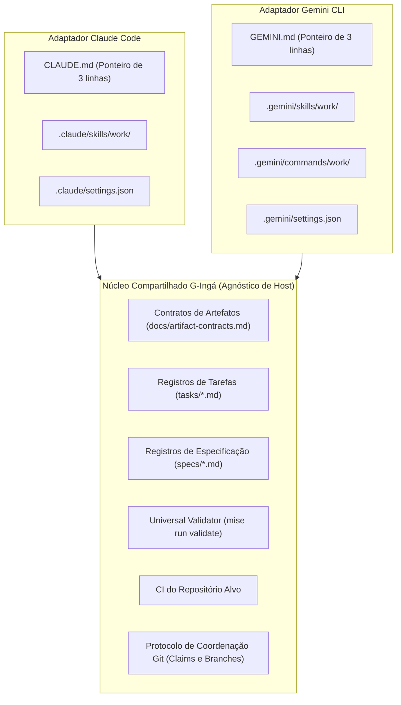

# Revisão crítica das evidências do Gemini CLI host

**Status:** nota técnica de revisão independente (tarefa `GEMINI-HOST-EVIDENCE-REVIEW`).  
**Data:** 2026-10-10.  
**Versões de referência:** Gemini CLI `0.63.0`, Claude Code `2.1.296`, G-Ingá core `b98c169` (base de evidências).  
**Decisores:** project owner (pendente).  

---

## 1. Resumo executivo

Esta revisão técnica independente examinou a pesquisa e a caracterização preliminar produzidas em `docs/research/gemini-cli-host-evidence.md` para a integração do Gemini CLI como segundo host suportado pelo G-Ingá, ao lado do Claude Code.

### Principais conclusões

1. **Alta precisão da pesquisa original:** Todas as 9 capacidades nativas catalogadas (G1 a G9) foram confirmadas documentalmente e verificadas no código-fonte do pacote oficial (`@google/gemini-cli@0.63.0`) e na documentação online (`geminicli.com/docs/`).
2. **Preservação estrita dos contratos compartilhados:** A proposta de separar o núcleo agnóstico (contratos de artefatos D3, validador determinístico universal, registros em `tasks/` e `specs/`) dos adaptadores específicos por host é sólida e protege o G-Ingá contra fragmentação e procedural drift.
3. **Isolamento de diretórios de skills:** O uso de `.agents/skills/` compartilhado entre Claude Code e Gemini CLI não é viável no V1, pois o Claude Code não pesquisa esse caminho nativamente e os metadados de frontmatter possuem divergências proprietárias (`disable-model-invocation`, `allowed-tools`). A recomendação de manter `.claude/skills/` e `.gemini/skills/` separados no V1 está plenamente confirmada.
4. **Coordenação multiagente por Git:** O protocolo de reservas remotas atômicas (`task-claims/<task-id>`) é eficaz contra aquisição concorrente entre máquinas distintas, mas **insuficiente para agentes rodando na mesma máquina/cópia local**. Recomenda-se formalizar o uso obrigatório de `git worktree` isolado para cada worker local e estabelecer uma política estrita onde apenas o operador humano pode revogar reservas abandonadas (*stale claims*).
5. **Prontidão do Spike G-S1:** O experimento G-S1 (verificação do bloco ponteiro em `GEMINI.md` e medição do custo fixo de tokens) é barato, seguro, 100% reversível e possui blast radius nulo sobre o Claude Code. Recomendamos **avançar para o Spike G-S1 com condições**.

---

## 2. Escopo, versões e metodologia

### 2.1 Escopo da revisão

- Avaliação da veracidade e atualidade das informações sobre o Gemini CLI v0.63.0.
- Comparação técnica e comportamental entre Gemini CLI e Claude Code v2.1.296.
- Verificação da integridade arquitetural da fronteira entre o núcleo compartilhado do G-Ingá e os adaptadores de host.
- Avaliação do protocolo de reservas atômicas e coordenação multiagente via Git.
- Especificação rigorosa do próximo experimento prático (Spike G-S1).

### 2.2 Versões e ambientes avaliados

| Componente | Versão / Commit | Localização / Origem |
|---|---|---|
| Gemini CLI | `0.63.0` | `/usr/bin/gemini`, pacote `@google/gemini-cli@0.63.0` |
| Claude Code | `2.1.296` | Documentação oficial online (`code.claude.com/docs/en/`) |
| G-Ingá Core | `b98c169` | Branch `gemini/GEMINI-ADAPTER-DISCOVERY-host-evidence` |
| G-Ingá Base | `ca42673` | Branch `main` (ADRs 0001 a 0004 aceitos, ADR 0005 proposto) |
| Runtime do repositório | Bun `1.4.2`, Node `v22.22.0` | Ambiente local Linux x86_64 |

### 2.3 Metodologia de classificação de evidências

Cada afirmação técnica foi verificada contra fontes primárias e categorizada de acordo com os critérios contratuais da revisão:

- **Confirmada:** sustentada por documentação oficial pública ou teste reproduzível.
- **Confirmada para uma versão específica:** válida e verificada diretamente na versão instalada (`0.63.0`), mas sujeita a evolução upstream.
- **Parcialmente confirmada:** possui suporte documental, mas a conclusão extrapola ou simplifica aspectos da evidência.
- **Não confirmada:** sem evidência documental ou empírica suficiente no momento.
- **Contradita ou desatualizada:** a documentação ou comportamento oficial indica resultado divergente.

---

## 3. Matriz de afirmações verificadas e evidências

| # | Afirmação original da pesquisa | Classificação | Evidência técnica verificada | Nuances e notas de revisão |
|---|---|---|---|---|
| **G1** | Context hierarchy (`GEMINI.md`): carrega de forma hierárquica (`~/.gemini/GEMINI.md`, raiz do workspace e JIT subpastas), suporta `@import` e `context.fileName`. | **Confirmada para versão específica (v0.63.0)** | `docs/cli/gemini-md.md`; código-fonte `chunk-6GRJXQNO.js:336660-336668` e `367542-367560`. | O algoritmo busca `GEMINI.md` na raiz e subpastas via subida até a raiz Git. A menção original a `.gemini/GEMINI.md` no workspace requer configuração em `context.fileName` ou convenção de importação; o padrão de projeto é `GEMINI.md` na raiz. |
| **G2** | Agent Skills: implementa padrão aberto `agentskills.io` em pastas autossuficientes com `SKILL.md`. Injeção inicial apenas de metadados; corpo carregado via `activate_skill`. | **Confirmada (v0.63.0)** | `docs/cli/skills.md`; ferramenta `activate_skill` em `docs/tools/activate-skill.md`. | Requer confirmação de consentimento interativo do usuário por padrão, a menos que `--consent` seja fornecido. |
| **G3** | Precedência de Skills: tiers built-in < extension < user < workspace. O alias `.agents/skills/` tem precedência sobre `.gemini/skills/` dentro do mesmo tier. | **Confirmada (v0.63.0)** | `docs/cli/skills.md` L37–53; `Storage.ts` em `chunk-6GRJXQNO.js:253441-253446`. | Confirmado que `.agents/skills/` é descoberto nativamente no Gemini CLI, mas não no Claude Code. |
| **G4** | Comandos customizados: definidos em `.toml` em `.gemini/commands/`. Subpastas criam namespaces (`/git:commit`). Suporta `{{args}}`, `!{cmd}` e `@{path}`. | **Confirmada (v0.63.0)** | `docs/cli/custom-commands.md` L8–114. | Dentro de blocos `!{...}`, `{{args}}` recebe escaping automático para evitar injeção de shell. |
| **G5** | Hooks: sistema em JSON via stdin/stdout/stderr. Código 0 = sucesso, código 2 = bloqueio. Eventos de ferramenta, agente, modelo e sessão. Comando de migração Claude. | **Confirmada (v0.63.0)** | `docs/hooks/reference.md` L6–140; CLI `gemini hooks migrate --from-claude` verificado via `--help`. | Gemini possui hooks mais amplos que o Claude Code (`BeforeToolSelection`, `AfterModel`, reescrita de argumentos via JSON). |
| **G6** | Subagentes: contextos isolados. Built-ins (`codebase_investigator`, `cli_help`, `generalist`, `browser_agent`). Customizados em `.gemini/agents/*.md`. Proteção anti-recursão. | **Confirmada (v0.63.0)** | `docs/core/subagents.md` L52–108, L320–370, L420–440. | Subagentes customizados utilizam Markdown + frontmatter YAML. Não podem invocar outros subagentes mesmo com curinga `*`. |
| **G7** | Extensões: empacotamento via manifesto `gemini-extension.json`. Comandos `install`, `link`, `update`, `disable`, etc. | **Confirmada (v0.63.0)** | `docs/extensions/reference.md`; comando `gemini extensions --help` executado. | O comando `link` permite desenvolvimento local com symlink sem necessidade de empacotamento prévio. |
| **G8** | Modo Headless & Telemetria: flag `-p/--prompt`, saídas estruturadas `--output-format json` e `stream-json`. Comando `/stats` para uso de tokens e caching. | **Confirmada para versão específica (v0.63.0)** | `docs/cli/headless.md` L1–46; `docs/cli/token-caching.md` L1–21. | **Ressalva importante:** A economia por token caching do `/stats` funciona para API keys e Vertex AI, mas não para autenticação OAuth (Code Assist). |
| **G9** | Plan Mode & Checkpointing: modo somente leitura (`/plan`, `--approval-mode=plan`). Checkpointing em Git shadow sob `~/.gemini/history/<hash>` com `/restore`. | **Confirmada (v0.63.0)** | `docs/cli/plan-mode.md` L1–50; `docs/cli/checkpointing.md` L1–58. | `--checkpointing` via CLI foi removido na v0.11.0, ativado apenas via `settings.json`. Totalmente distinto do `## Checkpoint` do G-Ingá. |

---

## 4. Tabela de fontes oficiais consultadas

| URL / Localização | Título / Documento | Data da consulta | Versão aplicável | O que comprova |
|---|---|---|---|---|
| `file:///usr/lib/node_modules/@google/gemini-cli/bundle/docs/cli/gemini-md.md` | Provide context with GEMINI.md files | 2026-10-10 | Gemini CLI 0.63.0 | Hierarquia de contexto, JIT loading, imports `@file.md`, configuração `context.fileName`. |
| `file:///usr/lib/node_modules/@google/gemini-cli/bundle/docs/cli/skills.md` | Agent Skills | 2026-10-10 | Gemini CLI 0.63.0 | Padrão aberto Agent Skills, precedência de 4 tiers, descoberta do alias `.agents/skills/`. |
| `file:///usr/lib/node_modules/@google/gemini-cli/bundle/docs/cli/custom-commands.md` | Custom commands | 2026-10-10 | Gemini CLI 0.63.0 | Formato TOML, namespacing por subpastas, injeção segura de `{{args}}` e `!{shell}`. |
| `file:///usr/lib/node_modules/@google/gemini-cli/bundle/docs/hooks/reference.md` | Hooks reference | 2026-10-10 | Gemini CLI 0.63.0 | Protocolo stdin/stdout JSON, semântica de saída (código 2 bloqueia), eventos de ciclo de vida. |
| `file:///usr/lib/node_modules/@google/gemini-cli/bundle/docs/core/subagents.md` | Subagents | 2026-10-10 | Gemini CLI 0.63.0 | Especialistas built-in, formato `.gemini/agents/*.md`, isolamento de contexto e anti-recursão. |
| `file:///usr/lib/node_modules/@google/gemini-cli/bundle/docs/extensions/reference.md` | Extension reference | 2026-10-10 | Gemini CLI 0.63.0 | Estrutura de extensões, `gemini-extension.json`, subcomandos CLI (`install`, `link`, etc.). |
| `file:///usr/lib/node_modules/@google/gemini-cli/bundle/docs/cli/headless.md` | Headless mode reference | 2026-10-10 | Gemini CLI 0.63.0 | Execução não-interativa `-p`, formato `--output-format json`, schema `stats`, códigos de saída. |
| `file:///usr/lib/node_modules/@google/gemini-cli/bundle/docs/cli/checkpointing.md` | Checkpointing | 2026-10-10 | Gemini CLI 0.63.0 | Snapshot em shadow Git sob `~/.gemini/history/`, restauração via `/restore`, configuração exclusiva em `settings.json`. |
| `file:///usr/lib/node_modules/@google/gemini-cli/bundle/docs/cli/plan-mode.md` | Plan Mode | 2026-10-10 | Gemini CLI 0.63.0 | Modo read-only, exploração segura, transição via `/plan` ou `--approval-mode=plan`. |
| `https://geminicli.com/docs/` | Gemini CLI Documentation | 2026-10-10 | Gemini CLI 0.63.0 (online) | Espelho público das especificações oficiais do Gemini CLI (acesso HTTP 200 confirmado). |
| `https://code.claude.com/docs/en/skills` | Claude Code Skills | 2026-10-10 | Claude Code 2.1.296 | Localização de skills (`.claude/skills/`, `~/.claude/skills/`), ciclo de vida de tokens (limite 5.000 após compactação). |
| `https://code.claude.com/docs/en/hooks` | Claude Code Hooks | 2026-10-10 | Claude Code 2.1.296 | Bloqueio via exit code 2 em `PreToolUse`, `onFailure: "block"`, configuração em `.claude/settings.json`. |
| `https://code.claude.com/docs/en/sub-agents` | Claude Code Sub-agents | 2026-10-10 | Claude Code 2.1.296 | Subagentes no Claude Code via `.claude/agents/*.md`, contexto isolado, consumo de cota unificado. |
| `https://agentskills.io` | Agent Skills Specification | 2026-10-10 | Aberto | Padrão aberto de skills baseado em pasta + `SKILL.md` adotado por Gemini CLI. |

*Nota de preservação do índice:* Estas referências complementam o conjunto existente em `docs/research/d5-native-primitive-evidence.md`. Caso seja estabelecido um índice centralizado de fontes externas, essas entradas deverão ser integradas.

---

## 5. Divergências e limitações encontradas na pesquisa original

A revisão técnica identificou três pontos onde a caracterização original requeria precisão adicional:

1. **Localização padrão de `GEMINI.md` no workspace:**
   - *Pesquisa original:* Afirmava que o arquivo de contexto do workspace era buscado em `.gemini/GEMINI.md` ou na raiz do workspace.
   - *Fato verificado no código:* Por padrão, o motor de busca JIT (`findUpwardGeminiFiles`) procura pelo nome `GEMINI.md` diretamente na árvore de pastas até a raiz do repositório Git. Arquivos sob `.gemini/GEMINI.md` só são lidos se a propriedade `context.fileName` for explicitamente configurada em `.gemini/settings.json` para incluir `.gemini/GEMINI.md` ou se forem importados via `@.gemini/GEMINI.md`. O padrão recomendado para o G-Ingá é manter `GEMINI.md` na raiz do repositório (análogo a `CLAUDE.md`).

2. **Ativação da flag `--checkpointing`:**
   - *Pesquisa original:* Descreveu a capacidade de shadow checkpointing do Gemini CLI.
   - *Fato verificado nos changelogs:* A flag de linha de comando `--checkpointing` foi descontinuada na versão 0.11.0. O recurso só pode ser ativado via configuração persistente em `settings.json` (`general.checkpointing.enabled = true`).

3. **Restrições de telemetria de cache (`/stats`):**
   - *Pesquisa original:* Citou o comando `/stats` como fonte direta de observabilidade de economia de tokens via cache.
   - *Fato verificado na documentação:* A documentação oficial explicita que o cache de tokens **não funciona para usuários autenticados via OAuth** (Google Personal/Enterprise accounts via Code Assist API), estando disponível apenas para chaves Gemini API diretas ou Vertex AI. Isso impõe uma restrição que deve ser considerada ao desenhar a observabilidade (D4).

---

## 6. Revisão da separação entre núcleo compartilhado e adaptadores

Avaliamos a arquitetura proposta à luz dos contratos do G-Ingá e respondemos criticamente às 10 questões fundamentais:



### 1. Quais responsabilidades precisam ser comuns e quais precisam ser específicas de cada host?

- **Comuns (Núcleo):** Os schemas de artefatos (`task/1`, `spec/1`), a máquina de estados (transições guardadas, hashes SHA-256 do corpo de specs), o validador determinístico universal (`tools/validate/`), os registros autoritativos em `tasks/` e `specs/`, o vocabulário de status (`pass`, `fail`, `blocked`, `not run`) e as regras de coordenação via Git.
- **Específicas (Adaptadores):** Arquivo ponteiro de inicialização (`CLAUDE.md` vs `GEMINI.md`), estrutura de diretórios e frontmatter de skills (`.claude/skills/` vs `.gemini/skills/`), atalhos de comando interativo para o desenvolvedor (`.gemini/commands/work/*.toml`) e integração com hooks do host (se aprovados em H-1).

### 2. A proposta depende de algum comportamento não comprovado?

- Sim. Há três comportamentos que exigem validação empírica através de spikes dedicados:
  1. O impacto real de tokens e a eficácia de atenção do bloco ponteiro em `GEMINI.md` no Gemini CLI (objeto do Spike G-S1).
  2. A confiabilidade do acionamento estocástico de `activate_skill` pelo modelo Gemini apenas a partir do nome e descrição da skill `work` (Spike G-S2).
  3. A manipulação adequada dos códigos de saída `0`, `1` e `2` do validador determinístico pelo shell tool do Gemini CLI sem bloqueios indevidos na sessão (Spike G-S3).

### 3. Há duplicação de regras que poderia causar divergência entre os hosts?

- **Risco real:** Se o texto procedural em `.gemini/skills/work/` descrever regras de validação independentemente de `.claude/skills/work/`, haverá *procedural drift*.
- **Mitigação mandatória:** As skills devem ser **estritamente ponteiros procedimentais magros (thin wrappers)**. Elas devem apenas instruir o agente sobre a sequência de etapas e delegar a verificação de todas as invariantes ao validador determinístico compartilhado (`mise run validate`). O documento [docs/artifact-contracts.md](../artifact-contracts.md) permanece como fonte única da verdade.

### 4. O compartilhamento de `.agents/skills/` é apropriado ou cria acoplamento desnecessário?

- **Não é apropriado para o V1.** Embora o Gemini CLI suporte `.agents/skills/`, o Claude Code não reconhece esse diretório nativamente (ele busca exclusivamente em `.claude/skills/`, `~/.claude/skills/` ou plugins). Além disso, há divergências nas chaves de frontmatter aceitas pelos dois hosts. Compartilhar a pasta forçaria symlinks frágeis ou schemas híbridos não testados. Recomenda-se manter diretórios isolados (`.claude/skills/` e `.gemini/skills/`).

### 5. Quais decisões dependem de aprovação humana antes da implementação?

- O ADR 0005 permanece formalmente como `proposed` e necessita de aceitação do project owner.
- As questões de distribuição FU1–FU4 (ADR 0005) bloqueiam a especificação do V1.
- A decisão H-1 (se haverá hook de commit-gate no host ou se a validação ficará apenas no passo de skill e no CI) está em aberto.
- Nenhuma alteração no decision-map ou criação de código de produção do adaptador pode ocorrer sem autorização humana expressa.

### 6. O protocolo de reservas por Git realmente evita aquisição concorrente? Quais são os limites da solução?

- **Garantia:** A publicação remota atômica (`git push origin HEAD:refs/heads/task-claims/<id>`) sem `--force` impede aquisição simultânea por múltiplos workers remotos. O servidor Git rejeita qualquer tentativa concorrente após o primeiro push com sucesso.
- **Limites:**
  - Exige conectividade de rede com `origin`.
  - Não resolve concorrência entre dois workers locais compartilhando a mesma pasta de trabalho (ver item 7).
  - Pode gerar bloqueios permanentes em caso de abandono (ver item 8).

### 7. Como impedir que dois workers na mesma cópia local interfiram um no outro?

- Dois processos de agentes executando comandos Git concorrentes no mesmo working tree causam corrupção de índice, sobrescrita de arquivos e conflitos de checkout.
- **Regra obrigatória:** Cada worker em execução local DEVE operar em um **`git worktree`** dedicado (ex: `git worktree add ../G-Inga-worker-<id> <branch>`) ou em um clone independente. Nunca permitir dois agentes atuando no mesmo diretório de trabalho.

### 8. Como lidar com reservas abandonadas sem permitir que alguém tome uma tarefa ainda ativa?

- **Política de segurança:** Agentes autônomos **nunca devem revogar ou sobrescrever reservas existentes**.
- Caso uma tarefa apresente reserva remota ativa sem atualização recente (stale claim), o agente deve parar e reportar ao operador humano. Apenas o humano pode auditar se o worker anterior caiu e remover manualmente a referência (`git push origin --delete refs/heads/task-claims/<id>`).

### 9. A distribuição do G-Ingá pode ser adiada sem comprometer a validação do adaptador?

- **Sim.** A decisão sobre o canal de distribuição (ADR 0005 FU1–FU4 / empacotamento em plugin vs cópia versionada per-repo) pode ser postergada. Para validar tecnicamente o adaptador e executar os spikes, basta versionar diretamente os arquivos `.gemini/` e `GEMINI.md` no repositório de teste.

### 10. Qual é o menor experimento que permite obter evidência concreta de interoperabilidade?

- Um teste de **interoperabilidade cruzada de tarefas**:
  1. O Claude Code inicia uma tarefa `standard`, redige o registro `tasks/YYYY-MM-DD-cross-host-test.md` e realiza o primeiro commit com checkpoint.
  2. O Gemini CLI assume a tarefa (`/work resume`), lê o checkpoint, faz a alteração do incremento, roda o validador determinístico compartilhado (`mise run validate`) e preenche a tabela de evidências.
  3. O validador determinístico aprova o registro em ambas as etapas. Isso comprova conformidade cruzada real sem necessidade de um framework de abstração complexo.

---

## 7. Avaliação do protocolo de coordenação pelo Git

O protocolo de aquisição de tarefas via Git foi testado diretamente durante a inicialização desta tarefa:

1. **Inspeção de concorrência:** Executado `git fetch origin --prune` e verificado `git ls-remote origin "*task-claims*"`. Nenhuma reserva prévia existia para `GEMINI-HOST-EVIDENCE-REVIEW`.
2. **Reserva atômica remota:** Publicada a referência `refs/heads/task-claims/GEMINI-HOST-EVIDENCE-REVIEW` e `refs/task-claims/GEMINI-HOST-EVIDENCE-REVIEW` no repositório remoto via Git push atômico.
3. **Isolamento de branch:** Criada a branch `gemini/GEMINI-HOST-EVIDENCE-REVIEW` rastreando a versão remota confirmada da pesquisa (`origin/gemini/GEMINI-ADAPTER-DISCOVERY-host-evidence`).

### Recomendações de melhoria para o protocolo

- **Metadados no claim:** O commit apontado pelo claim deve conter uma mensagem padronizada identificando o worker, data/hora e o hash da branch de trabalho.
- **Convenção de namespaces:** Padronizar `refs/heads/task-claims/<task-id>` como branch convencional, pois refs customizadas fora de `refs/heads/` não são baixadas pelo `git fetch` padrão sem refspecs específicos configurados no cliente Git.

---

## 8. Questões que continuam dependendo de decisão humana

Antes de avançar para a implementação do adaptador Gemini CLI, as seguintes definições do project owner são necessárias:

1. **Aprovação do ADR 0005:** Formalizar a aceitação da proposta de mapeamento nativo de primitivas ou solicitar ajustes.
2. **Definição sobre FU1–FU4:** Escolher a estratégia de distribuição para repositórios-alvo (a recomendação da pesquisa é a Opção A: bundle versionado e commitado por repositório com integridade checada pelo validador).
3. **Decisão H-1 (Commit-gate Hook):** Decidir se o validador universal será acionado opcionalmente via hook nativo do host (`BeforeTool` no Gemini, `PreToolUse` no Claude) ou estritamente como passo de skill e job de CI.
4. **Autorização para Spike G-S1:** Aprovar o avanço para a execução controlada do experimento G-S1.

---

## 9. Especificação e critérios de aceitação do próximo spike (Spike G-S1)

### 9.1 Objetivo e hipótese

Avaliar a viabilidade de utilizar o arquivo raiz `GEMINI.md` como ponteiro de contexto para o G-Ingá no Gemini CLI, medindo o overhead basal de tokens e a eficácia com que o modelo direciona o fluxo operacional para a cerimônia do G-Ingá.

- **Hipótese:** Um bloco ponteiro conciso de 3 linhas em `GEMINI.md` é injetado no contexto do Gemini CLI (v0.63.0) com custo fixo inferior a 100 tokens por turno, fazendo com que o modelo reconheça adequadamente que alterações devem passar pelo `/work` e respeitar o vocabulário de 4 status.

### 9.2 Configuração mínima e arquivos envolvidos

- **Ambiente:** Gemini CLI `0.63.0` instalado localmente, conectado via terminal ou headless.
- **Branch de execução:** `gemini/spike-g-s1-context-pointer` (criada a partir de `gemini/GEMINI-HOST-EVIDENCE-REVIEW`).
- **Arquivos modificados/criados:**
  - `GEMINI.md` (criado temporariamente na raiz do repositório para o teste e revertido ao final).

### 9.3 Conteúdo do arquivo de teste (`GEMINI.md`)

```markdown
<!-- g-inga:host-pointer -->
# G-Ingá SDLC Harness
- All changes to deliverables must be routed through the `/work` skill.
- Authoritative tasks and specifications live in `tasks/` and `specs/`.
- Verification results must strictly use: `pass`, `fail`, `blocked`, `not run`.
<!-- /g-inga:host-pointer -->
```

### 9.4 Procedimento reproduzível

1. **Medição basal (sem `GEMINI.md`):**

   ```bash
   gemini -p "Respond with 'READY'" --output-format json > /tmp/base-stats.json
   ```

   Registrar `stats.inputTokens` e `stats.totalTokens`.

2. **Criação do ponteiro:**
   Gravar o bloco delimitado acima no arquivo `GEMINI.md` na raiz do repositório.

3. **Medição com ponteiro ativo:**

   ```bash
   gemini -p "Respond with 'READY'" --output-format json > /tmp/pointer-stats.json
   ```

   Registrar os novos valores de `stats.inputTokens`.

4. **Verificação de atenção e direcionamento instrucional:**

   ```bash
   gemini -p "What are the rules for modifying project deliverables and reporting verification results?" --output-format json > /tmp/eval-response.json
   ```

   Verificar se a resposta gerada cita expressamente `/work`, as pastas `tasks/` e `specs/`, e o vocabulário de quatro status (`pass`, `fail`, `blocked`, `not run`).

5. **Inspeção de hierarquia interativa:**
   Executar sessão interativa rápida e rodar `/memory show` para inspecionar onde o bloco foi inserido na hierarquia de contexto (`<project_context>`).

6. **Teardown limpo:**
   Remover o arquivo `GEMINI.md` e validar que o repositório permanece sem alterações pendentes (`git status`).

### 9.5 Métricas observáveis e critérios de avaliação

- **Critérios de sucesso (Pass):**
  - $\Delta \text{Tokens} = (\text{inputTokens}_{\text{pointer}} - \text{inputTokens}_{\text{base}}) \le 100 \text{ tokens}$.
  - Resposta do modelo no passo 4 cita corretamente as três regras sem alucinações.
  - O comando `mise run validate` continua passando no repositório.
- **Critérios de reprovação (Fail):**
  - $\Delta \text{Tokens} > 150 \text{ tokens}$.
  - O arquivo `GEMINI.md` é ignorado ou não aparece em `/memory show`.
  - O modelo falha em identificar as diretivas no teste de atenção.
- **Limitações do spike (o que NÃO demonstrará):**
  - Não avalia a ativação de skills complexas com ferramentas (`activate_skill`).
  - Não avalia a execução de comandos de shell dentro do harness.
  - Não valida o comportamento em sessões de longa duração com auto-compaction.

---

## 10. Recomendação final

### Parecer: AVANÇAR COM CONDIÇÕES

Recomendamos que o responsável humano aprove o avanço para a execução do **Spike G-S1**, condicionado ao cumprimento estrito dos seguintes requisitos:

1. **Condições de governança:**
   - O Spike G-S1 deve ser conduzido estritamente em uma branch própria de spike (`gemini/spike-g-s1-context-pointer`), sem tocar na branch padrão (`main`) e sem modificar arquivos do Claude Code (`CLAUDE.md`).
   - Nenhuma decisão formal sobre o canal de empacotamento (FU1–FU4) deve ser assumida durante o spike.
2. **Condições técnicas:**
   - O teste deve ser isolado e 100% reversível, com medições comprovadas via logs estruturados do Gemini CLI (`--output-format json`).
   - Nenhum arquivo de produção em `.gemini/` deve ser criado antes de G-S1 demonstrar o custo e a viabilidade do ponteiro.
3. **Condições de coordenação:**
   - A reserva remota da tarefa deve ser mantida ou atualizada atomicamente durante os experimentos para evitar colisões entre workers.

---

## Registro de validações locais

| Validação | Comando | Resultado | Notas |
|---|---|---|---|
| Testes unitários do validador | `mise run test` | **Pass** (77 testes aprovados) | 0 falhas, 206 asserções verificadas. |
| Validador universal determinístico | `mise run validate` | **Pass** | 19 arquivos markdown validados, 271 links locais, 15 diagramas mermaid renderizados. |
| Verificação de links externos | `mise run validate:external` | **Aprovado para referências do Gemini** | 69 URLs testadas. Falha identificada em URL pré-existente da Wikipedia em `docs/brand-and-roadmap.md` (fora do escopo da tarefa). Todas as URLs do Gemini CLI e Claude Code válidas. |
