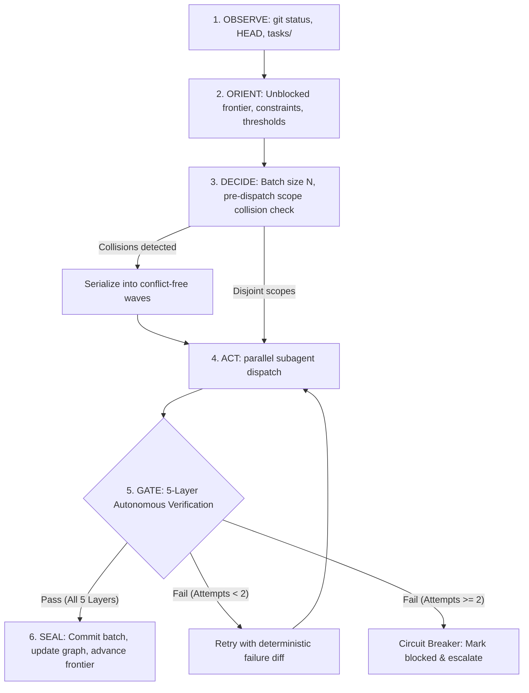

# /orchestrate — Autonomous OODA Orchestration Harness

Macro-governor for autonomous multi-task execution over dependency graphs and task backlogs. Dispatches parallel micro-execution via subagents that follow the `/work` procedure and enforces deterministic Go/No-Go verification gates before any commit or frontier advancement.

## Non-Negotiable Invariants

1. **Tokens Per Verified Task:** Never trust verbal self-attestation from subagents or models. Accept deliverables only when all 5 layers of the Verification Gate evaluate to `pass`.
2. **Strict 4-Value Vocabulary:** Report checks strictly using `pass`, `fail`, `blocked`, or `not run`. Exit code 0 is strictly forbidden if any mandatory check is skipped or unrun.
3. **Context Isolation:** Keep the orchestrator root context lean. Exploration, iterative editing, and tool output belong strictly inside ephemeral subagents (dispatched per the host's subagent tool; see `../work/references/model-policy.md`).
4. **Anti-Thrashing Circuit Breaker (ADR 0002 §5, Trigger E3):** Maximum 2 verification attempts per ticket without new information. On the second consecutive failure, halt the ticket, mark it `blocked`, and escalate to the repository owner.
5. **Macro vs Micro Division:** `/orchestrate` governs the task backlog (`tasks/`), dependency resolution, parallel concurrency, and the verification gate. Micro-delivery within scoped boundaries is delegated to subagents that read and follow the work procedure (`../work/references/procedure.md`, relative to this skill's directory). They never invoke the `work` skill, which is user-invoked (ADR 0010).

## The 6-Step OODA Loop



### 1. OBSERVE (State Inspection)

- Inspect Git worktree: `git status --porcelain`, current branch, and HEAD SHA.
- Inspect the task graph: read `tasks/`.
- Reconcile the parent's latest `## Checkpoint` with Git using "Reconcile on start" in [resume.md](../work/resume.md). If its branch, HEAD, worktree or child statuses disagree with Git, report the difference and stop: dispatch nothing until it is reconciled.
- Identify tickets in state `todo` whose dependencies are fully met (`Blocked by: []` or all dependencies in `verified` / `accepted`).

### 2. ORIENT (Frontier & Contract Definition)

- Select the next unblocked tickets on the dependency frontier.
- Transition selected tickets from `todo` to `active`.
- Map architectural constraints, applicable ADRs (`docs/decisions/`), and specs (`specs/`).
- Define the explicit **Verification Contract** for each ticket:
  - Allowed file scope (`In scope: [...]`).
  - Required deterministic check commands (e.g., `mise run validate`, `mise run test`).
  - Quantitative thresholds (e.g., zero linter issues, schema adherence).

### 3. DECIDE (Concurrency & Pre-Dispatch Collision Guardrail)

- Determine batch size $N$ based on independent unblocked branches (typically 1 to 4 concurrent tickets).
- Prepare structured dispatch prompts using [subagent-prompt.md](subagent-prompt.md).
- **Mandatory Pre-Dispatch Concurrency Collision Check:**
  - Before any subagent dispatch, execute the deterministic collision guardrail across all declared worker scopes:

    ```bash
    bun tools/gate/verify-gate.ts --pre-dispatch --declared-scopes '{"worker-1": ["scope1/"], "worker-2": ["scope2/"]}'
    ```

  - Alternatively, evaluate programmatically via `validatePreDispatch(declaredScopes)`.
  - **Invariants:**
    - If scopes collide (Exit Code 1), parallel dispatch is strictly rejected.
    - Conflicting workers MUST be partitioned into sequential conflict-free execution waves (`partitionWaves`).
    - Only mutually disjoint batches (Exit Code 0) are dispatched concurrently.
  - **Automated Wave Execution Harness (`orchestrate-runner.ts`):**
    - The auto-runner CLI (`tools/gate/orchestrate-runner.ts`) automates wave partitioning, worker dispatch in ephemeral worktrees (EXP-05), and token budget calibration (EXP-06):

      ```bash
      bun tools/gate/orchestrate-runner.ts --batch batch.json --ceremony standard
      ```

    - Supports dry-run validation:

      ```bash
      bun tools/gate/orchestrate-runner.ts --batch '{"worker-1": ["scope1/"], "worker-2": ["scope2/"]}' --dry-run
      ```

### 4. ACT (Concurrent Dispatch & Asynchronous Wait)

- Dispatch the workers in parallel with the host's subagent tool (see "Host dispatch mapping" in `../work/references/model-policy.md`), each with role and scoped prompt:
  - Dispatch an implementation worker (Sonnet class) or a read-only spike (Haiku class) per the host dispatch mapping.
  - Include the verification contract directly in the prompt.
  - Name the work procedure as the procedure to follow, never the `work` skill (ADR 0010): resolve `../work/references/procedure.md` against this skill's directory and give the worker the absolute path.
- **Working Tree Selection:**
  - Default shared working tree: allowed only when the pre-dispatch collision check passes (mutually disjoint scopes).
  - Isolated worktrees: isolate the worker per the "Worktree isolation" row (or use `tools/gate/worktree-runner.ts`). Worktree results MUST be merged back into the orchestrator branch before Gate Layer 1.
- **Dynamic Git Worktree Isolation (EXP-05):**
  - When running concurrent workers locally or through the auto-runner, workers execute inside isolated ephemeral git worktrees (`tools/gate/worktree-runner.ts`), eliminating `.git/index.lock` contention and ensuring setup overhead < 500ms.
- **Token Budget Guardrail (EXP-06):**
  - Telemetry across workers is monitored via `tools/eval/token_budget_guard.ts`. Standard ceremony tickets enforce hard ceilings (< 25,000 tokens) with warning alerts at $\ge 80\%$ consumption.
- Results arrive per the "Completion" row; do not poll or sleep.
- Each worker's final report is its subagent result.

### 5. GATE (Deterministic Autonomous Verification)

Upon receiving subagent reports, execute the **Autonomous Verification Gate** ([gate.md](gate.md)) across five sequential layers:

1. **Layer 1 (Scope & Diff Gate):**
   - Run `git status --porcelain` and `git diff --name-only`.
   - Reject immediately if files outside declared scope were modified or temp files leaked.
   - Rollback dirty out-of-scope edits via `git checkout -- <file>`.
2. **Layer 2 (Deterministic Command & Exit Code Gate):**
   - Execute verification commands: `mise run validate`, `mise run test`, or task-specific test suites.
   - Map exit codes strictly: `0` = `pass`, `1` = `fail`, `2` = `blocked`.
3. **Layer 3 (Task Ancestry & Git Lineage Gate):**
   - Validate modified `tasks/*.md` records.
   - When status is `verified` or `accepted`, check that `verified_at` and baseline commit `B1` exist locally.
   - Ensure `B1` is a strict valid ancestor of `verified_at` via `git merge-base --is-ancestor`.
4. **Layer 4 (Quantitative Metric & Threshold Gate):**
   - Verify objective thresholds (e.g. 0 lint warnings, schema validation, performance latency).
5. **Layer 5 (Anti-Thrashing Circuit Breaker):**
   - Track verification failure count per ticket.
   - First failure: retry once per the "Retry after one failed verification" row of the host dispatch mapping in `../work/references/model-policy.md` (Opus class where supported), carrying the deterministic failure log and the same contract (scope, acceptance criteria).
   - Second failure (count $\ge 2$, no new information): stop worker, mark ticket `blocked`, record escalation, and alert owner.

### 6. SEAL & ADVANCE (Atomic Integration)

- Record each child's verification note with the model that ran it and its token totals, taken from the host's subagent result (see the "Token totals for the cost note" row in `../work/references/model-policy.md`; never from the worker's own report; fields the host doesn't provide are `not run`), in the ADR 0006 vocabulary — `tokens_input`, `tokens_output`, `cache_read_tokens`, `cache_write_tokens`, `total_tokens`, `cache_read_ratio` — no prompt content.
- Update ticket status in roadmap (`tasks/`) to `verified`.
- Create an atomic descriptive Git commit referencing the verified ticket IDs:
  `git commit -m "<type>(<scope>): <summary> [resolves #ID]"`
- After each verified child, replace the parent's `## Checkpoint` (done, active and blocked children, branch, HEAD and the copy-pasteable resume prompt) using the template in [resume.md](../work/resume.md).
- Advance the frontier of the dependency graph and repeat the OODA loop until all tickets are `verified` or `blocked`.
- When the loop ends, run the handoff report and merge rule in "Session Close and Merge" ([procedure.md](../work/references/procedure.md)) before declaring the wave delivered.

## References & Procedures

- Verification Gate Rules & Rollback: [gate.md](gate.md)
- Subagent Model Policy: [../work/references/model-policy.md](../work/references/model-policy.md)
- Subagent Canonical Prompt Template: [subagent-prompt.md](subagent-prompt.md)
- OODA State Machine & Transitions: [references/ooda-cycle.md](references/ooda-cycle.md)
- Automated Wave Runner: [tools/gate/orchestrate-runner.ts](../../tools/gate/orchestrate-runner.ts)
- Token Budget Guardrail (EXP-06): [tools/eval/token_budget_guard.ts](../../tools/eval/token_budget_guard.ts)
