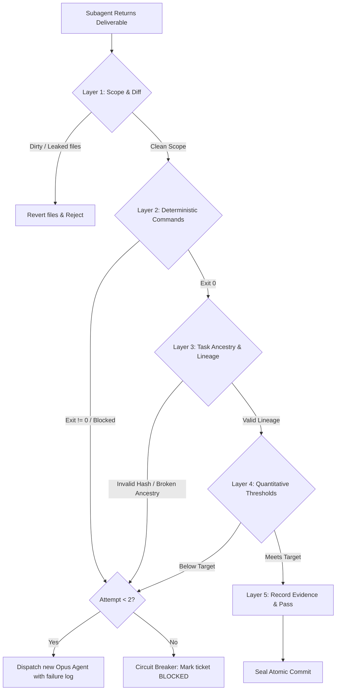

# Autonomous Verification Gate (Go/No-Go Specification)

The Autonomous Verification Gate is the deterministic barrier between subagent code generation and repository persistence. In G-Ingá, self-attestation is rejected: no commit or state advancement occurs without passing all applicable gate layers.

---

## 1. The 5 Verification Layers



---

## 2. Layer 1: Scope & Diff Gate (Structural Integrity)

Before running test suites or reading reports, the orchestrator inspects the physical Git changes.

### Commands

```bash
git status --porcelain
git diff --name-only HEAD

# Mandatory Pre-dispatch check across candidate concurrent subagents (CLI)
bun tools/gate/verify-gate.ts --pre-dispatch --declared-scopes '{"worker-1": ["src/a.ts"], "worker-2": ["src/b.ts"]}'

# Check concurrent declared scopes across subagents during post-run evaluation (CLI)
bun tools/gate/verify-gate.ts --declared-scopes '{"worker-1": ["tools/gate/"], "worker-2": ["tasks/"]}'
```

### Invariants & Evaluation

1. **Scope Boundary:** Every modified, added, or deleted path MUST match the declared `In scope:` patterns of the dispatched ticket.
2. **Untracked Leakage:** No untracked scratch files, dumps, `.DS_Store`, or node artifacts outside `.gitignore`.
3. **Secret Scan:** No staged or unstaged diff contains patterns matching API keys, `.env` files, or access tokens.
4. **Pre-Dispatch Concurrency Collision Guardrail:** Before invoking concurrent subagents in Step 3 DECIDE, the orchestrator MUST evaluate declared worker scopes using `validatePreDispatch` or `bun tools/gate/verify-gate.ts --pre-dispatch --declared-scopes <json>`.
   - Returns exit code 0 (`pass`) when all scopes are mutually disjoint.
   - Returns exit code 1 (`fail`) when collisions are detected, detailing conflicting workers and files.
   - When collisions occur, conflicting workers are partitioned into sequential conflict-free execution waves via `partitionWaves`.
5. **Concurrent Scope Isolation:** When evaluating concurrent batch runs post-execution, all declared file boundaries MUST be mutually disjoint. Overlapping files, directory prefixes, or wildcard patterns across workers are deterministically detected via `detectScopeCollisions`:
   - Exact file overlaps (e.g. `src/index.ts` vs `src/index.ts`).
   - Directory prefix containment (e.g. `tools/gate/` vs `tools/gate/verify-gate.ts`).
   - Wildcard glob matches (e.g. `tools/gate/*` vs `tools/gate/verify-gate.ts`).
   - Relative path normalization (`./path` vs `path`).

### Module API: `validatePreDispatch` & `detectScopeCollisions`

```typescript
import { detectScopeCollisions, validatePreDispatch, partitionWaves } from "tools/gate/verify-gate.ts";

// Pre-dispatch evaluation with wave partitioning:
const preResult = validatePreDispatch({
  "worker-1": ["tools/gate/verify-gate.ts"],
  "worker-2": ["tools/gate/verify-gate.ts"],
  "worker-3": ["docs/architecture.md"],
});

// preResult:
// {
//   pass: false,
//   hasCollisions: true,
//   collisions: { "tools/gate/verify-gate.ts": ["worker-1", "worker-2"], ... },
//   byWorker: { "worker-1": ["tools/gate/verify-gate.ts"], "worker-2": ["tools/gate/verify-gate.ts"] },
//   byFile: { "tools/gate/verify-gate.ts": ["worker-1", "worker-2"] },
//   waves: [["worker-1", "worker-3"], ["worker-2"]] // conflict-free sequential waves
// }

// Post-execution collision evaluation:
const result = detectScopeCollisions({
  "worker-1": ["tools/gate/verify-gate.ts"],
  "worker-2": ["tools/gate/verify-gate.test.ts"],
});
```

### Rollback & Collision Procedure

If concurrent scope collisions are detected prior to dispatch, the orchestrator serializes conflicting tasks into sequential execution waves (`partitionWaves`). If detected during gate evaluation:

```bash
git checkout HEAD -- <unauthorized-file>
git clean -fd <unauthorized-directory>
```

The ticket evaluation for Layer 1 is immediately marked `fail` (Exit Code 1) with:
`[OODA Gate L1 Scope Collision] FAIL: Scope collision detected between concurrent workers: <details>`.

---

## 3. Layer 2: Deterministic Command & Exit Code Gate

Layer 2 executes canonical repo verification suites. Subagents must never be asked *"did tests pass?"*; the orchestrator runs the checks directly.

### Strict 4-Value Vocabulary

Every check reports exactly one of four values:

- `pass`: Command exited with status `0` and verified the target behavior.
- `fail`: Command exited with status `1` (or non-zero test failure).
- `blocked`: Command exited with status `2` (environment, missing toolchain, network failure, shallow clone).
- `not run`: Check was not executed in this pass.

### Mandatory Checks Invariant

Exit code 0 is strictly forbidden if any mandatory check (e.g. `mise run validate`, baseline test suite, or required type check) was skipped, unrun, or blocked.

### Standard Commands

```bash
# Repository validation (linters, links, mermaid, schemas)
mise run validate

# Repository test suite
mise run test
```

### Exit Code Mapping Table

| Exit Code | Gate Status | Action |
|---|---|---|
| `0` | `pass` | Proceed to Layer 3. |
| `1` | `fail` | Increment failure counter. If counter < 2, dispatch a new `Agent` with `model: "opus"` carrying stderr/stdout and the same contract for retry. |
| `2` | `blocked` | Environment block. Halt ticket execution; escalate to human owner. |
| `127` | `blocked` | Missing binary / command toolchain. Escalate to human owner. |

---

## 4. Layer 3: Task Ancestry & Git Lineage Gate

Layer 3 enforces deterministic Git lineage integrity before any commit sealing or PR creation, preventing §3.4/§7.1 CI failures:

### Ancestry Invariants and Evaluation

1. **Task Record Discovery:** Detects modified or staged `tasks/*.md` records.
2. **Commit Existence:** When `status: verified` (or `accepted`), ensures that `verified_at` and baseline `Ref` commit hashes (e.g., `B1`) exist in the local Git repository (`git rev-parse --verify <sha>^{commit}`).
3. **Strict Ancestry Verification:** Deterministically asserts via `git merge-base --is-ancestor <baseline_sha> <verified_at>` that the baseline commit is a strict valid ancestor of `verified_at` and not identical to it (a baseline must run strictly before the change).
4. **Rejection:** Rejects with exit code 1 (`fail`) if any referenced commit does not exist or if ancestry is broken/reversed.

---

## 5. Layer 4: Quantitative Metric & Threshold Gate

For tickets specifying numerical acceptance thresholds (e.g., benchmark latency, test coverage delta, token budgets, or schema adherence):

| Metric Category | Target Threshold | Evaluation Command / Check |
|---|---|---|
| **Linter / Schema Issues** | `0` issues | `mise run validate` exits `0` with 0 warnings |
| **Test Regressions** | `0` regressions | `mise run test` reports 0 failed tests |
| **Subagent Execution Attempts** | $\le 2$ attempts | Circuit breaker counter |

If any threshold is not satisfied, the gate evaluates to `fail`.

---

## 6. Layer 5: Anti-Thrashing Circuit Breaker (ADR 0002 §5, Trigger E3)

To prevent infinite loops and runaway token expenditure:

- Maintain an attempt counter per ticket: `attempts: N`.
- **First Failure ($N = 1$):**
  - Extract the exact compiler, linter, or test failure output.
  - Dispatch a new `Agent` with `model: "opus"` (per `../work/references/model-policy.md`, relative to this skill's directory) carrying the factual failure report and the same contract. Continuing the existing Sonnet worker does not change its model, so it is not the retry.
- **Second Failure ($N = 2$):**
  - **Circuit Breaker Trips:** Immediately halt subagent execution.
  - Revert dirty changes: `git checkout HEAD -- <file>` for each ticket in-scope file, or discard the ticket's isolated worktree. Never revert the whole tree or run a pathless clean.
  - Mark ticket status as `blocked` in the roadmap (`tasks/`).
  - Escalate to the repository owner with:
    - Root cause failure log.
    - Attempt history ($N = 2$).
    - Recommended human action or architectural disambiguation.
  - Advance the orchestrator to other independent unblocked tickets on the frontier.
